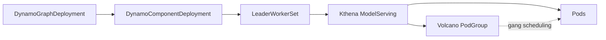

# NVIDIA Dynamo on Kthena

This guide describes how to run [NVIDIA Dynamo](https://github.com/ai-dynamo/dynamo) multinode workloads with Kthena. Dynamo creates standard `LeaderWorkerSet` (LWS) resources, and Kthena reconciles them into `ModelServing` workloads.

The integration follows this control-plane path:



Kthena preserves the LWS behavior observed by Dynamo's distributed runtimes:

| Contract | Behavior |
| -------- | -------- |
| Runtime  | Injects the standard `LWS_*` environment variables |
| DNS      | Provides LWS-compatible hostnames and shared-subdomain DNS |
| Status   | Projects replica counts and LWS conditions |
| Service  | Recreates the LWS headless Service after deletion |

## Prerequisites

- A Kubernetes cluster supported by Dynamo and Kthena.
- [Volcano](https://volcano.sh/en/docs/installation/) installed and available for gang scheduling.
- The [LeaderWorkerSet CRD](https://github.com/kubernetes-sigs/lws) installed before starting the Kthena Controller Manager (validated with LWS CRD `v0.10.0`).
- Kthena installed with the workload controller and webhook enabled. See the [Kthena installation guide](../getting-started/installation.md).
- Dynamo installed according to its [installation documentation](https://github.com/ai-dynamo/dynamo/blob/main/docs/fern/pages/kubernetes/installation/install-dynamo.md).

:::warning
Install only the LWS CRD. Do not run the native LWS controller or webhook in the same cluster because Kthena owns reconciliation of these LWS resources.
:::

## Configure Dynamo to use LWS

Use any multinode workload supported by your Dynamo release. Set `multinode.nodeCount` on the worker component and disable Grove so Dynamo selects its LWS pathway:

```yaml
apiVersion: nvidia.com/v1beta1
kind: DynamoGraphDeployment
metadata:
  name: multinode-model
  namespace: dynamo-demo
  annotations:
    nvidia.com/enable-grove: 'false'
spec:
  components:
    - name: <multinode-component>
      type: <component-type>
      multinode:
        nodeCount: 2
      # Use the podTemplate and runtime settings from a Dynamo example
      # supported by your selected release.
```

`multinode.nodeCount` marks the component as multinode. With the LWS and Volcano APIs available and Grove disabled, Dynamo renders the component as a `LeaderWorkerSet`. Refer to Dynamo's [multinode orchestration guide](https://github.com/ai-dynamo/dynamo/blob/main/docs/fern/pages/kubernetes/installation/multinode-orchestration.md) for the runtime-specific fields.

## Verify the integration

After applying the workload, inspect the complete resource chain:

```bash
kubectl get dynamographdeployments,dynamocomponentdeployments -n dynamo-demo
kubectl get leaderworkersets,modelservings,podgroups -n dynamo-demo
kubectl get pods -n dynamo-demo -o wide
```

A successful deployment has all of the following properties:

- The `DynamoGraphDeployment` reports `Ready=True`.
- Its `DynamoComponentDeployment` resources report `Available=True`.
- The multinode `LeaderWorkerSet` reports the expected `READY` and `UP-TO-DATE` replica counts and `Available=True`.
- The corresponding `ModelServing` reports the expected replica, available, and updated counts.
- Its Volcano `PodGroup` is `Running` and all leader and worker Pods are ready.

Inspect the actual runtime environment in a leader and worker Pod before
depending on native LWS address conventions:

```bash
kubectl exec -n dynamo-demo <leader-pod> -- env | grep -E '^(ENTRY_ADDRESS|LWS_)'
kubectl exec -n dynamo-demo <worker-pod> -- env | grep -E '^(ENTRY_ADDRESS|LWS_)'
```

Kthena's `headless-service` plugin supplies `ENTRY_ADDRESS` for the Entry Pod of
each Role instance and a separate discovery subdomain for member DNS. It does
not itself inject `LWS_LEADER_ADDRESS`, `LWS_GROUP_SIZE`, or `LWS_WORKER_INDEX`.
The `lws-standard-labels` plugin supplies identity labels, not these environment
variables. Native LWS environment and hostname compatibility must be verified
separately for the Dynamo backend being deployed.

Check the generated Services and actual Pod network identities:

```bash
kubectl get services -n dynamo-demo \
  -l modelserving.volcano.sh/name=<lws-name> -o yaml
kubectl get pods -n dynamo-demo \
  -l leaderworkerset.sigs.k8s.io/name=<lws-name> \
  -o jsonpath='{range .items[*]}{.metadata.name}{"\t"}{.spec.hostname}{"."}{.spec.subdomain}{"\n"}{end}'
```

The two plugin-managed Services have `clusterIP: None` and
`publishNotReadyAddresses: true`: the Entry Service selects only the Entry,
while the discovery Service selects Entry and Worker Pods. Use the observed
hostname and subdomain to query individual Pod DNS records.

Earlier versions of this guide described native LWS shared-subdomain names
such as `<lws-name>-0.<lws-name>.<namespace>`. The generic Kthena plugin does not
establish that layout. In particular, Dynamo TRT-LLM's derivation of Worker
hosts from a native LWS leader address must not be assumed to work from
`ENTRY_ADDRESS`. Validate the backend's address requirements before using this
integration; this headless-Service change does not implement a separate LWS
network protocol.

## Compatibility scope

- Conversion to ModelServing and Kthena Role DNS do not establish native LWS shared-subdomain parity. `networkConfig.subdomainPolicy: UniquePerReplica` is not supported.
- Do not run the native LWS controller or webhook alongside Kthena.
- The Kthena workload webhook must remain enabled for Dynamo-generated LWS resources.
- New generated ModelServings declare the headless plugin at creation, including LWS size 1. Existing children without it require migration because their plugin chain is immutable; see [plugin migration](../user-guide/modelserving-plugin-framework.md#upgrade-and-migration).
- This guide does not establish full Dynamo backend compatibility or provide a general replacement for every LWS feature. Verify the actual generated environment, DNS records, and application startup for the selected backend.

For an overview of Kthena's LeaderWorkerSet integration, see [LeaderWorkerSet integration](../user-guide/lws-integration.md).
