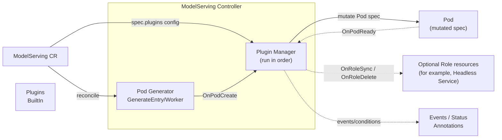

# ModelServing Plugin Framework

The ModelServing plugin framework lets you customize Pods and opt in to auxiliary Role resources managed by the ModelServing controller. The framework supports different inference engines (e.g., vLLM, TensorRT-LLM), accelerators (GPU, NPU, etc.), and optional integrations such as per-Role Headless Services.

## Overview

The plugin framework provides an extensible way to customize Pods before creation without modifying the core ModelServing API. Key features include:

- **Opt-in at creation**: Configure the plugin chain when creating the ModelServing; omitted or empty `plugins` means no plugin chain
- **Multi-plugin composition**: Support multiple plugins per ModelServing, executed in list order
- **Unified lifecycle hooks**: Pod and Role lifecycle hooks share one `Plugin` interface and `HookRequest`
- **Observability**: Track plugin execution status via Kubernetes Events and Status conditions

## Workflow



1. The controller generates the base Pod from the ModelServing `template`
2. If `spec.plugins` is configured, the Plugin Manager invokes each plugin's `OnPodCreate` hook in order
3. Plugins can modify Pod labels, annotations, env, volumes, nodeSelector, affinity, etc.
4. The mutated Pod is created in the cluster
5. When the Pod is ready, the `OnPodReady` hook is triggered (for logging, metrics, etc.)
6. The Plugin Manager invokes `OnRoleSync` and `OnRoleDelete` inside the controller's existing Role lifecycle paths. Plugins that do not need these events implement them as no-ops.

## When to Use Plugins

ModelServing already allows users to set `role.entryTemplate.spec` / `role.workerTemplate.spec` directly. In practice, organizations often need additional cross-cutting customization that depends on:

- **runtime/inference engine specifics**: extra sidecars, init containers, env var conventions, ports, probes
- **accelerator type/vendor**: GPU vs NPU, driver injection, device plugin resources, runtimeClass
- **networking**: RDMA, topology constraints, hugepages
- **integration with cluster infrastructure**: custom schedulers, gang scheduling annotations, metadata conventions

For simple configuration, use `role.entryTemplate.spec` / `role.workerTemplate.spec` directly; for reusable logic across multiple ModelServing instances, use plugins.

## API Configuration

An optional `plugins` field is added to `ModelServingSpec`:

| Field | Type | Description |
|-------|------|-------------|
| `name` | string | Plugin type identifier; must match a registered plugin name (e.g., `demo-pod-tweaks`) |
| `type` | string | Plugin type, e.g., `BuiltIn` (Webhook reserved for future extension) |
| `config` | object | Plugin-specific configuration, parsed by each plugin |
| `scope` | object (optional) | Restricts where the plugin runs: `roles` (role names), `target` (Entry/Worker/All) |

The substantive plugin chain is immutable after creation. Adding the first plugin, removing a plugin, changing its configuration or scope, or changing execution order requires a new ModelServing and a traffic migration. Scaling to zero or completing a rollout does not permit these changes, and parent controllers follow the same rule. Equivalent representations such as an omitted `type` and `BuiltIn` do not change the plugin's meaning.

### Developing a Custom Plugin

Built-in plugins live in `pkg/model-serving-controller/plugins/`. To add a custom plugin:

1. **Implement the Plugin interface** and its Pod and Role lifecycle hooks:

```go
type Plugin interface {
    Name() string
    OnPodCreate(ctx context.Context, req *HookRequest) error
    OnPodReady(ctx context.Context, req *HookRequest) error
    OnRoleSync(ctx context.Context, req *HookRequest) error
    OnRoleDelete(ctx context.Context, req *HookRequest) error
}
```

All hooks receive the same request type. Fields that do not apply to a hook may be nil or zero-valued; for example, `Pod` is nil for Role hooks. Runtime resources such as `KubeClient` and cache-backed listers are carried by `HookRequest`, following the same pattern as lifecycle context. `OnRoleSync` must be idempotent. `OnRoleDelete` must retain a retry path for failed cleanup requests, but a successfully requested auxiliary-resource deletion does not make core Role deletion wait for that resource's finalizers. Cleanup must check ownership and protect replacement UIDs. Implement unused hooks as no-ops.

2. **Define a config struct** for your plugin and decode it from `spec.Config` using `DecodeJSON()`:

```go
type MyConfig struct {
    RuntimeClassName string            `json:"runtimeClassName,omitempty"`
    Annotations      map[string]string `json:"annotations,omitempty"`
    Env              []corev1.EnvVar   `json:"env,omitempty"`
}
```

3. **Implement a factory function** that constructs the plugin from `PluginSpec`:

```go
func NewMyPlugin(spec workloadv1alpha1.PluginSpec) (Plugin, error) {
    cfg := MyConfig{}
    if err := DecodeJSON(spec.Config, &cfg); err != nil {
        return nil, err
    }
    return &MyPlugin{name: spec.Name, cfg: cfg}, nil
}
```

4. **Register the plugin** in `init()`:

```go
func init() {
    DefaultRegistry.Register("my-plugin-name", NewMyPlugin)
}
```

5. **Rebuild the controller** and deploy. The plugin will be available for use in ModelServing.

See `pkg/model-serving-controller/plugins/demo_plugin.go` for a reference implementation.

### Using Plugins

Kthena ships with a built-in demo plugin `demo-pod-tweaks` that can set `runtimeClassName`, add annotations, and inject environment variables. Use it to validate the plugin flow before developing your own.

Kthena also ships with `headless-service`. Configure it when creating a ModelServing whose Entry and Worker Pods need generated DNS settings:

```yaml
plugins:
  - name: headless-service
    type: BuiltIn
```

For each in-scope Role instance with a `workerTemplate`, the plugin maintains two Headless Services:

| Service | Selected Pods | Purpose |
| --- | --- | --- |
| Entry Service | Only the Entry Pod | Preserves the existing Service name and `ENTRY_ADDRESS=<entry-service>.<namespace>`; workers resolve the Entry address rather than the whole member set |
| Discovery Service | Entry and all Worker Pods in the same Role instance | Provides individual Pod records under a separate, stable Service name |

The plugin sets each newly created Pod's hostname to its generated Pod name and its subdomain to the discovery Service. A member's address is `<pod-hostname>.<discovery-service>.<namespace>`. Services publish addresses before readiness so members can initialize together. Inspect the Pod's `spec.subdomain` for the generated discovery name rather than deriving it from `ENTRY_ADDRESS`.

The plugin accepts `scope.roles`; `scope.target` must be omitted or `All`. A Role without `workerTemplate` gets neither these Services nor the generated DNS settings. A non-nil `workerTemplate` still qualifies when `workerReplicas` is zero. Desired Services are recovered after accidental deletion. They are auxiliary resources: their presence, absence, or terminating state does not establish whether a Role or ServingGroup exists.

### Upgrade and migration

Older controller versions created Entry Services and injected `ENTRY_ADDRESS` without an explicit plugin. With the opt-in model, an existing ModelServing without `headless-service` does not receive these settings when Pods are later recreated. Adding the plugin to that existing object is an immutable-field change: create a new object with the required chain and migrate traffic after verifying readiness.

An existing managed entry-only Service can retain its name and UID. A different migration is required for workloads that already used an all-member Service as their Pod subdomain. Changing that Service to entry-only would remove the old Worker DNS records, while a new discovery Service cannot change running Pods' immutable subdomains or environment. The controller reports `MigrationRequired` and preserves the existing layout instead of silently changing its selector or creating Pods that depend on the new layout. Use a new ModelServing and controlled traffic migration; this plugin does not automatically rebuild those Pods to migrate DNS.

ModelBooster and LWS converters declare `headless-service` when creating new ModelServings and keep the declaration stable as worker counts change. ModelBooster omits `workerTemplate` when there are no workers, so those Roles receive no plugin DNS resources. LWS keeps its worker template at size 1, so its single-Pod Role still receives the two Services and generated DNS settings. Existing converted ModelServings without this plugin also require migration; the converter cannot bypass plugin immutability. This behavior supplies Kthena Role DNS and does not by itself implement native LWS hostname, shared-subdomain, or `LWS_LEADER_ADDRESS` conventions.

**Example: Using the demo plugin**

```yaml
apiVersion: workload.serving.volcano.sh/v1alpha1
kind: ModelServing
metadata:
  name: llama-8b
spec:
  schedulerName: volcano
  replicas: 2
  plugins:
    - name: demo-pod-tweaks
      type: BuiltIn
      config:
        runtimeClassName: nvidia
        annotations:
          example.com/custom: "value"
        env:
          - name: CUSTOM_VAR
            value: "custom-value"
  template:
    roles: []
```

The `demo-pod-tweaks` plugin accepts:

| Config field | Type | Description |
|--------------|------|-------------|
| `runtimeClassName` | string | Sets `spec.runtimeClassName` on the Pod |
| `annotations` | map[string]string | Merges annotations into the Pod |
| `env` | []EnvVar | Appends environment variables to all containers |

**Example: Scoping a plugin to specific roles or targets**

```yaml
plugins:
  - name: demo-pod-tweaks
    type: BuiltIn
    scope:
      roles: ["worker"]
      target: Worker
    config:
      runtimeClassName: nvidia
```

### Plugin Execution Order

- Plugins execute in the order defined in the `plugins` list
- A plugin name may appear only once
- Each plugin sees the Pod after previous plugins have applied their mutations
- If any plugin returns an error, Pod creation fails and the controller retries via workqueue

For more design details, see the [ModelServing Plugin Framework proposal](https://github.com/volcano-sh/kthena/blob/main/docs/proposal/modelserving-plugin-framework.md).
