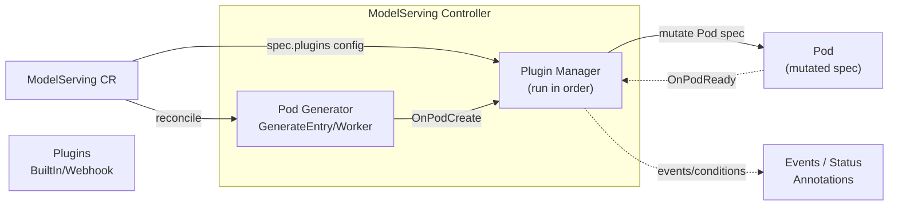

## ModelServing Plugin Framework

### Summary

This proposal introduces a plugin framework for `ModelServing` that lets users customize generated Pods and opt in to auxiliary Role resources for different inference engines, accelerators, and integrations.

At a high level:

- A new `spec.plugins` field enables one or more plugins.
- The controller will invoke plugins at defined hook points (e.g. `OnPodCreate`, `OnPodReady`).
- Plugins can mutate the Pod spec (labels/annotations, env, volumes, node affinity, scheduler hints, etc.) in a controlled and observable way.

### Motivation

Today, ModelServing already allows users to set `role.entryTemplate.spec` / `role.workerTemplate.spec` directly. In practice, organizations often need additional cross-cutting customization that depends on:

- runtime/inference engine specifics (extra sidecars, init containers, env var conventions, ports, probes)
- accelerator type/vendor (GPU vs NPU), driver injection, device plugin resources, runtimeClass
- networking (RDMA), topology constraints, hugepages
- integration with cluster infrastructure (custom schedulers, gang scheduling annotations, metadata conventions)

Embedding every possible case in the controller or CRD directly is not feasible and lacks extensibility.

A plugin system enables:

- reuse across many ModelServing objects
- optional, composable behavior (multiple plugins)
- faster iteration without changing the core ModelServing API for each new accelerator/engine

#### Goals

- Provide a first-class, opt-in extension mechanism for customizing Pods created by ModelServing.
- Support multiple plugins per ModelServing instance with deterministic ordering.
- Define stable hook points for the lifecycle:
  - Pod creation/mutation before the controller creates the Pod
  - Pod readiness notification (and future lifecycle hooks)
- Make plugin application observable (events / status conditions / annotations).
- Keep the plugin chain opt-in at object creation and make migration from former core-provided behavior explicit.

#### Non-Goals

- Allowing plugins to mutate resources other than those owned by the ModelServing reconciliation (initially).
- Implementing a remote plugin execution mechanism in the first iteration (e.g., webhook, WASM runtime) unless explicitly chosen as the MVP.

### Proposal

#### Diagram



#### API changes

Add a `plugins` field to `ModelServingSpec`:

- `plugins[]` is optional.
- The substantive chain is immutable after creation, including its presence, plugin configuration and scope, and execution order. Adding the first plugin, removing a plugin, or changing its behavior requires a new ModelServing and traffic migration. Parent-controller updates follow the same rule; scaling to zero is not an exception.
- Each plugin entry specifies:
  - `name` (string) – plugin identifier
  - `type` (string) – plugin kind (e.g., `BuiltIn`, `Webhook`), to allow future extension
  - `config` (raw JSON) – plugin-specific configuration (opaque to the API server)
  - `scope` (optional) – apply to entry/worker, roles, or all

Example (illustrative):

```yaml
apiVersion: workload.kthena.io/v1alpha1
kind: ModelServing
metadata:
  name: llama-8b
spec:
  schedulerName: volcano
  replicas: 2
  plugins:
    - name: nvidia-gpu-defaults
      type: BuiltIn
      config:
        runtimeClassName: nvidia
        gpuResourceName: nvidia.com/gpu
        gpuCount: 1
    - name: huawei-ascend-defaults
      type: BuiltIn
      config:
        npuResourceName: huawei.com/Ascend910
        npuCount: 1
  template:
    roles: []
```

Notes:

- `config` should be defined as `apiextensionsv1.JSON` (or an equivalent raw JSON type already used in the repo) to avoid forcing a schema per plugin.

#### Hook points

Initial hook points:

- `OnPodCreate(ctx, req) -> error`
  - Called after the controller generates the base Pod object (currently via `utils.GenerateEntryPod` / `utils.GenerateWorkerPod`) and after core controller annotations are applied (e.g., gang scheduling annotations), but before the Pod is created.
  - Allows mutation of:
    - `ObjectMeta.Labels/Annotations`
    - `Spec` (containers, resources, env, volumes, nodeSelector, affinity, tolerations, runtimeClassName, schedulerName override?)

- `OnPodReady(ctx, req) -> error`
  - Called when the controller observes `utils.IsPodRunningAndReady(pod)` in the informer update callback.
  - Intended for side-effect-free bookkeeping or emitting signals (events/metrics) and for future extension.

Optional Role lifecycle hooks:

- `OnRoleSync`
  - Called from the existing active-Role management loop.
  - Idempotently ensures auxiliary resources owned by one Role replica.
- `OnRoleDelete`
  - Called from the existing Role and ServingGroup deletion paths.
  - Issues cleanup for auxiliary Role resources without adding those resources to core deletion-completion checks.
  - Failed cleanup requests remain retryable after Pod/store removal and controller restart. Verify owner and Role identity and fence deletion by the validated resource UID; never delete a same-name replacement. A successful deletion request need not wait for the auxiliary resource's finalizers.

Other future hook points:

- `OnPodDelete`
- `OnServiceCreate` (an optional future hook for plugin-owned Services)
- `OnServingGroupCreate`

#### Plugin ordering and determinism

- Plugins execute in list order.
- Each plugin sees the Pod object after previous plugins have applied their mutations.
- If any plugin returns an error, reconciliation fails for that Pod creation step.
  - The controller retries via its workqueue retry logic.

#### Observability

- Emit Kubernetes Events on:
  - plugin applied
  - plugin error
- Add/extend ModelServing Status conditions to reflect plugin failures.
- (Optional) Annotate created Pods with applied plugin names + a hash of plugin config for debugging.

#### Notes/Constraints/Caveats

- Plugins must be deterministic and idempotent with respect to Pod mutation to avoid endless reconcile loops.
- Plugins must not mutate cluster-scoped resources or unrelated workloads in the first iteration.

#### Risks and Mitigations

- **Security:** Running arbitrary plugin code inside the controller process can be risky.
  - Mitigation: first iteration can restrict to a curated set of built-in plugins compiled into the controller image.
  - Future: support webhook- or WASM-based plugins with explicit allowlists.

- **Stability / upgrades:** Plugin API versioning.
  - Mitigation: version the plugin interface package and keep it compatible; add feature gates.

- **Debuggability:** Hard to see what mutations were applied.
  - Mitigation: add events + optional Pod annotations capturing applied plugins.

### Design Details

#### Controller integration points

Based on the current controller implementation:

- Pod objects are created in:
  - `(*ModelServingController).CreatePodsByRole()`
  - which calls `utils.GenerateEntryPod()` / `utils.GenerateWorkerPod()`
  - and then calls the Kubernetes API `Pods().Create()`.

This is the primary `OnPodCreate` insertion point.

- Pod readiness is handled in:
  - `ModelServingController.updatePod()`
  - which checks `utils.IsPodRunningAndReady(newPod)`
  - and then calls `handleReadyPod()`.

This is the primary `OnPodReady` insertion point.

#### Proposed Go interfaces (draft)

```go
// Package location (suggestion): pkg/model-serving-controller/plugins

// HookRequest contains all context needed for a hook.
type HookRequest struct {
  ModelServing   *workloadv1alpha1.ModelServing
  ServingGroup   string
  RoleName       string
  RoleID         string
  RoleIndex      int
  Role           *workloadv1alpha1.Role
  IsEntry        bool
  Pod            *corev1.Pod
  KubeClient     kubernetes.Interface
  ServiceLister  corelisters.ServiceLister
}

type Plugin interface {
  Name() string

  // Called before controller creates the Pod.
  // Implementation may mutate req.Pod in-place.
  OnPodCreate(ctx context.Context, req *HookRequest) error

  // Called when controller observes Pod ready.
  OnPodReady(ctx context.Context, req *HookRequest) error

  // Called while reconciling an active Role replica.
  OnRoleSync(ctx context.Context, req *HookRequest) error

  // Called when deleting a Role replica.
  OnRoleDelete(ctx context.Context, req *HookRequest) error
}
```

A small plugin manager composes plugins and runs them in order. Every lifecycle hook shares the same request and interface so additional hook points do not require parallel capability types. Fields that do not apply to a hook are nil or zero-valued. Following the `pod-ranktable-plugin` pattern, Kubernetes clients and cache-backed listers needed by built-in plugins are supplied through `HookRequest`; plugin factories receive only `PluginSpec`.

The built-in `headless-service` plugin maintains two Headless Services for each in-scope Role instance with a non-nil `workerTemplate`:

- An entry-only Service keeps the historical name and `ENTRY_ADDRESS=<entry-service>.<namespace>` semantics. Its selector includes the Entry label so the address cannot resolve to Worker members.
- A separate discovery Service selects all members of the same Role instance. Newly created Entry and Worker Pods use their generated Pod names as hostnames and this Service as subdomain, producing individual member DNS records. The generated Service name is stable and respects Kubernetes name limits. Both Services publish NotReady addresses for distributed initialization.

`OnPodCreate` injects the DNS settings and ensures initial resources; `OnRoleSync` recovers missing desired Services; `OnRoleDelete` requests cleanup. `scope.roles` may restrict Roles, but `scope.target` must be `All` or omitted. A nil worker template disables the plugin's effects for that Role, while zero worker replicas with a non-nil worker template still qualifies. Services remain optional auxiliary state and never decide whether a Role or ServingGroup exists. Missing Services are restored without rolling healthy Pods.

This layout separates entry rendezvous from member discovery while preserving the historical entry address. A single all-member Service with an explicit Entry Pod FQDN is a valid alternative for new workloads, but changing only newly generated environment variables would not preserve running Pods that still use the original Service name as their entry address.

#### Headless DNS migration boundaries

Ordinary ModelServings without the plugin no longer receive core-generated Services, `ENTRY_ADDRESS`, or hostname/subdomain on future Pod creation. Plugin immutability prevents adding `headless-service` to those existing objects. Migration uses a new ModelServing and verified traffic cutover, rather than an implicit plugin insertion or forced child replacement.

Existing managed entry-only Services can be reconciled while retaining their names and UIDs. An old all-member Service with live Pods using its name as subdomain needs a different path: narrowing its selector would remove Worker DNS records, and creating another Service cannot change those Pods' immutable subdomains or environments. Report `MigrationRequired`, preserve the current Pods and Service layout, and block creation/selector changes that depend on the new layout until migration is arranged. Do not claim transparent in-place DNS migration or automatically rebuild healthy Pods to achieve it.

New ModelBooster and LWS conversions declare the plugin from creation and keep it stable as worker counts change. ModelBooster uses a nil worker template at zero workers, so entry-only Roles get no plugin DNS resources. LWS retains a worker template at size 1 and therefore still receives both Services and DNS settings. Existing generated objects lacking the plugin cannot bypass immutability. These changes cover Kthena Role DNS only; full native LWS/Dynamo hostname and shared-subdomain compatibility requires separate integration work and verification.

The plugin declaration and rollout history serve different purposes. Cleanup or Service drift repair cannot select a new Pod template, alter partition decisions, or force replacement of healthy Pods; local recovery must continue using the applicable historical template and worker layout.

#### Test Plan

- Unit tests for the plugin manager:
  - ordering
  - error propagation
  - idempotent mutation examples
- Controller unit tests (existing `pkg/model-serving-controller/controller/model_serving_controller_test.go`) extended to validate:
  - Pod mutations were applied before create
  - ready hook invoked on readiness transitions
  - entry-only and all-member discovery selectors, missing-Service recovery and owner/UID protection
  - failed cleanup retry after datastore removal and restart without treating Services as live Roles
  - immutable converter plugin declarations across zero/nonzero worker counts
- Real cluster verification:
  - query entry and individual Worker DNS, including NotReady initialization
  - preserve upstream entry-only Service names and Pod UIDs during reconciliation
  - detect the old all-member/subdomain layout before destructive selector changes
  - verify cleanup retries and same-name replacement protection with recorded UIDs

### Alternatives

1. **Admission webhook only**
   - Pros: Kubernetes-native, decoupled from controller.
   - Cons: harder to scope to ModelServing-specific logic; additional deployment complexity.

2. **Template-only approach** (expand `PodTemplateSpec`)
   - Pros: no plugin code.
   - Cons: does not scale for cross-cutting, conditional logic; becomes an unwieldy API surface.

3. **WASM plugin runtime inside controller**
   - Pros: safer sandbox; dynamic loading.
   - Cons: larger engineering lift; still needs a config distribution story.
