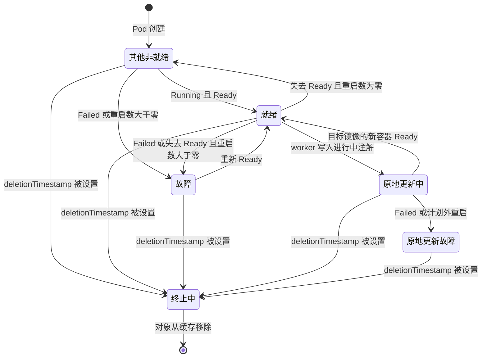

# 以 Pod 状态变化为入口的检视

## 0. 文档信息

| 项 | 内容 |
| --- | --- |
| 状态 | 检视结论，待评审。没有修改 controller 代码 |
| 检视对象 | `volcano-sh/kthena` `main` @ `b4e536bb` 的 ModelServing controller |
| 角度 | 原来的[检视意见](../modelserving-rollout-implementation-review.md)按滚动规则组织。本文换一个入口：列出 Pod 的每一种状态变化，逐个追到 controller 的反应 |
| 方法 | 白盒走读，加单元级探针。三组探针共 51 个函数：Pod 状态矩阵和恢复时序 16 个，`None` 策略的前后对照 23 个，复评核实 12 个 |
| 证据的位置 | 任务目录 `issues/features/005-modelserving-rollout-spec-state-review-IP/` 下的 `subagents/r2-whitebox-pod-lifecycle.md`、`subagents/r2-behavior-regression-none-failed.md`、`subagents/r2-rereview-verification.md`，以及 `probes/r2-pod-lifecycle/`、`probes/r2-behavior-none/`、`probes/r2-rereview/` |
| 配套 | 目标设计对同一张表的反应见[状态机改进方案](04-state-machine.md) 2.4；修复的安排见[重构方案](05-refactoring-plan.md) |

探针名分三组。不带前缀的（`M1`、`R3d`、`X2` 等）在 `probes/r2-pod-lifecycle/`；`BN-` 开头的在 `probes/r2-behavior-none/`；`RV-` 开头的在 `probes/r2-rereview/`。各目录的 `README.md` 列出了每个探针的设定和重跑方式。

证据类型和严重度沿用检视意见的 0.1、0.2 节。探针用 fake clientset，直接调用 controller 的回调和 `syncModelServing`，Pod 的状态是手写的，事件顺序由探针指定。它证明「给定这份状态和这个顺序，代码会这样做」，不是 Kind 证据。本任务没有在 Kind 上运行任何东西。

代码位置的缩写：`msc.go` 是 `controller/model_serving_controller.go`，`rh.go` 是 `controller/revision_history.go`，`pdt.go` 是 `controller/pod_deletion_targets.go`，`ipu.go` 是 `controller/inplace_update.go`，`state.go` 是 `inplace/state.go`，都在 `pkg/model-serving-controller/` 下；`ctl.go` 是 `pkg/controller/controller.go`。

## 1. 结论

1. **替换一个坏 Pod 只有一条路，每一环都是边沿触发。**路径是：故障事件，grace 的 goroutine 发 DELETE，删除事件，回调删除同范围的其余成员，worker 重建。reconcile 一侧只问两件事：这个名字上有没有对象，它是不是 Ready。`Failed`、`Succeeded`、终止中的 Pod 都算「在位」，不补建。链上任何一环丢了，没有别的路径补上。
2. **因故障而发的删除，没有一个出自 worker。**全部出自 informer 回调和 grace 的 goroutine，不看滚动预算，不看 leader 的 context。
3. **`Succeeded` 的 Pod 在任何策略下都没有处理**（PL-1，新）。它不入队、不恢复、不补建，所在单元永久不可用。
4. **`None` 或 grace 为 `-1` 时，`Failed` 的 Pod 永久留在原位**（PL-4）。这符合现在的契约，但后果比字面上大：它占着滚动预算和驱逐预算，autoscaler 的指标采集被跳过，原地更新永久卡住，而且没有任何事件指出是哪个 Pod。PodGC 只在集群里终态 Pod 超过阈值（默认 12500）时才清理，所以「别人删了才补」在健康的集群里等于永远不补。
5. **一个身份不符的同名 Pod 会让整个 ModelServing 停摆，`status` 也不再更新**（PL-3）。它是检视意见 REC-4、REC-5 背后的共同机制，另有两种新的触发方式。
6. **启用 leader election 时，失主的进程不退出，也不再参选**（PL-2，新）。存活探针发现不了。默认配置不启用 leader election，不受影响。
7. **恢复没有任何退避**（PL-8）。`RoleRecreate`、grace 为 0、替代 Pod 一出现就失败时，探针在 50 毫秒里完成了 8 轮删除重建。
8. **原来标为「未验证」或只有走读的七条意见有了探针结论，都成立**：REC-3、REC-4、REC-5、REC-6、REC-8、EV-5、IP-6 第三条。REC-7 的触发路径在默认配置下复现。ORD-4 的触发条件比原来写的常见，建议从 P2 改为 P1。
9. 带严重度的意见从 49 条变成 57 条，见 [6.3](#63-更新后的意见统计)。

## 2. 当前实现怎样看一个 Pod

### 2.1 事件处理器的分类

`updatePod`（`msc.go:347-419`）对每个新增或更新事件做一次分类，先命中的生效。

| 顺序 | 类别 | 判定 | 处理 |
| --- | --- | --- | --- |
| 0 | 终止中 | `deletionTimestamp` 非空 | 直接返回（`msc.go:355-359`） |
| 0 | 过期事件 | 缓存里已没有这个 Pod、UID 不同、或缓存里的它正在删除 | 直接返回（`msc.go:365-368`） |
| 0 | 不归我管 | owner 不存在；owner UID 不符；组名或 Role 实例名不是 controller 生成的形式 | 直接返回（`msc.go:370-382`） |
| 1 | 原地更新故障 | 原地更新进行中，并且 `Failed` 或有计划外重启 | `handleErrorPod` |
| 2 | 原地更新中 | 原地更新进行中，还没完成 | `handleInPlaceUpdatingPod` |
| 3 | 就绪 | `phase` 是 `Running` 且 Ready 条件为 True | `handleReadyPod` |
| 4 | 故障 | `phase` 是 `Failed`，或有计划外重启 | `handleErrorPod` |
| 5 | 其他 | 以上都不成立：Pending、没有重启的未就绪、`Succeeded` | 只在配置了 roleCoordination 时入队 |

「计划外重启」对没有原地更新记录的 Pod 等价于：`phase` 是 `Running` 或 `Pending`，并且任一普通容器或 init 容器的 `RestartCount` 大于 0（`state.go:215-240`）。`phase` 是 `Succeeded` 时恒为假。

worker 不用这个分类。它对每个 Role 实例只做两个判断（`rh.go:274-291`）。

| 判断 | 条件 | 用途 |
| --- | --- | --- |
| 在位 | 每个期望的名字上都有一个 Pod，owner、组、Role、实例标签相符，revision 标签等于单元记录的 revision。不看 `phase`，不看 `deletionTimestamp` | 决定补不补建 |
| Ready | 在位，并且每个 Pod 没在删除、Running 且 Ready、不在原地更新中 | 决定单元是 `Running` 还是 `Creating` |

所以两边的归类不一致：回调眼里的「故障」「其他」「终止中」，在 worker 眼里都只是「在位、不 Ready」。

### 2.2 回调眼里的状态

`Succeeded` 没有自己的状态，落在「其他非就绪」里。目标设计的归类见[状态机改进方案](04-state-machine.md) 2.1。

## 3. Pod 状态变化与当前的反应

行号与[状态机改进方案](04-state-machine.md) 2.4 的表相同，可以逐行对照。「下一轮」指事件之后的第一次 reconcile，不管它由什么触发；两个 informer factory 的 resync 都是 0，不入队的行意味着这一轮可能很久不来。

| # | Pod 状态变化 | 当前实现的反应 | 问题 | 意见 |
| --- | --- | --- | --- | --- |
| 1 | 创建后还没 Ready | 「其他」分支。不改 datastore；只在协调模式下入队。下一轮：在位，不 Ready | 新建单元时每个 Pod 的 CREATE 发两遍，靠 AlreadyExists 放过 | PL-7 |
| 2 | 第一次 Ready | 「就绪」分支。回调里 GET ControllerRevision、调 plugin 的 `OnPodReady`；更新 datastore；全组 Ready 或实例刚变 `Running` 时入队 | 回调里调用 API | EV-2 |
| 3 | 不再 Ready，没有重启 | 「其他」分支。不改 datastore，不入队（协调模式除外）。datastore 和 `status` 仍把它算作可用，直到别的事件带来一轮 reconcile | `status` 滞后；缩容按旧状态选对象 | EV-1、ORD-5 |
| 4 | 容器计划外重启且不 Ready | 「故障」分支。标记不可用，入队。恢复开启时写 `graceMap`、启动 goroutine；grace 为 0 时 goroutine 立即 DELETE，不再读 Pod。`None` 或 `-1` 时只标记 | 删除不经 worker；到期不读最新配置；重启过一次并恢复的 Pod，此后一不 Ready 就算故障 | EV-2、REC-2、待决项 O6 |
| 5 | 重启之后恢复 Ready | 「就绪」分支。不清除 `graceMap` 里的记录 | 同一个 Pod 再次故障时命中旧记录：不标记、不入队，按旧计时剩下的时间被删。探针里第二次故障只等了 0.9 秒（grace 2 秒） | REC-3 |
| 6 | `phase` 变成 `Failed` | 同第 4 行。`None` 或 `-1` 时永久保留：worker 认为它在位，不补建；只有人工删除才会补 | 见结论第 4 条 | PL-4 |
| 7 | `phase` 变成 `Succeeded` | 「其他」分支。不改 datastore，不入队，不恢复。下一轮单元变成未就绪，之后永久如此 | 任何策略下都没有处理 | PL-1 |
| 8 | 长期 Pending，没有重启 | 同第 1 行。没有恢复，也没有专门的报告 | 只能从 Pod 列表里发现 | EV-3 |
| 9 | 被本进程以外的操作者请求删除 | 在分类之前就返回。不改 datastore，不入队，协调模式也不入队。`status` 在整个终止期间仍把它算作可用 | 终止宽限期长、节点失联时，`status` 长时间与事实不符 | PL-6 |
| 10 | 被本进程请求删除 | 滚动和缩容在发 DELETE 之前已把单元标成 `Deleting`。事件同第 9 行 | — | — |
| 11 | 长期停在终止中 | 单元停在 `Deleting` 或 `Creating`，占着序号，不重建。SG 模式下 `Deleting` 的旧版本组每轮被「再选一次」并占掉额度，滚动停住 | 等同名 Pod 消失与 StatefulSet 相同；问题是没有报告 | EV-3 |
| 12 | 对象消失，controller 看到了 | `deletePod`。单元是 `Deleting` 就入队。否则按策略：`ServingGroupRecreate` 和 `RoleRecreate` 在回调里直接删除范围内的其余 Pod；`None` 标记不可用并入队，worker 只补缺的那个 | 回调和 worker 竞争，见[第 4 节](#4-三个时序问题) | EV-2、REC-7、REC-8 |
| 13 | 对象消失，controller 没有看到 | 下一轮按缺口补建。范围内还有终止中的 Pod 时，它消失的事件会被新进程当成一次新的删除 | 重启后删掉健康的幸存成员（探针 `R4f`） | REC-5 |
| 14 | 原地更新的正常过程 | 「原地更新中」分支标记不可用并入队；成员完成后走「就绪」分支；worker 在全部成员完成后翻转标签 | 翻转不是原子的，翻到一半重启可能卡住 | IP-3 |
| 15 | 原地更新期间计划外重启 | 「原地更新故障」分支，即使当前 Ready。恢复开启：grace 后删除。恢复关闭：只标记，Pod 之后在目标镜像上 Ready 就算完成 | 升级前就有重启记录的容器被误判 | IP-1 |
| 16 | 原地更新超过进度期限 | worker 每轮发一条 `InPlaceUpdateTimeout`。恢复开启：把未完成的 Pod 交给 `handleErrorPod`。恢复关闭：只发事件，单元永久占着额度 | `-1` 下事件的文案是「applying recovery policy」，实际什么都没做 | IP-6、PL-7 |
| 17 | 标签或注解变化 | 按当时的健康状况走普通的更新事件，没有专门处理 | 清标成功而缓存滞后时再缩容，会回收刚转正的单元 | ORD-3 |
| 18 | 外来的同名 Pod；ownerReference 被摘掉；revision 标签被改 | 外来 Pod 的事件被跳过，但每轮 CREATE 得到 AlreadyExists、身份不符、reconcile 返回错误。摘掉 owner 被 client-go 转成一次删除事件，回调按策略删除同实例的健康 Pod | 整个 ModelServing 停摆；实例永久 `Deleting` | PL-3、PL-5 |
| 19 | controller 启动后第一次看到 | `syncAll` 对每个 Pod 调一次 `addPod`。故障的 Pod 不登记单元，只启动 grace 计时；grace 为 0 时 DELETE 在 `syncAll` 期间就发出，早于第一轮 reconcile。终止中的 Pod 不登记 | 整个单元都是故障或终止中的 Pod 时，单元不在 datastore 里 | REC-4、REC-5 |

## 4. 三个时序问题

恢复的删除在回调里，补建在 worker 里，两者读的是不同时刻的状态。下面三种交错都用探针按指定的顺序复现了；真实集群里窗口多宽没有测量。

| 交错 | 结果 | 探针 | 意见 |
| --- | --- | --- | --- |
| 故障 Pod 从缓存消失后、它的删除回调运行前，有一轮 reconcile 补建了缺的成员 | 回调的快照取自 API，把刚补的 Pod 一起删掉。多一次创建和删除 | `R3a`、`RV-S1` | REC-8 |
| 单 Pod 的实例被重建，新 Pod 还没进缓存，旧 Pod 的删除回调才运行 | 回调把刚建的 Pod 当成一次新的丢失再删一遍。`ServingGroupRecreate` 下整组被多建一次 | `R3c`、`R7b` | REC-8 |
| 删除回调落在 worker「读 Role 列表」和「发 CREATE」之间 | 回调取快照时新 Pod 还不存在，只删了 entry；worker 随后建出 worker Pod。之后每轮删除都发现快照之外的 Pod，发 `DeletionIdentityChanged` 后返回。实例永久 `Deleting`，entry 缺失，直到进程重启 | `R3d` | REC-7 |

第三种只需要默认配置（`RoleRecreate`、grace 为 0）和一个 `Failed` 的 Pod。`handleErrorPod` 在同一时刻既入队又启动删除，所以被入队触发的那轮 reconcile 和删除事件天然靠得很近。

## 5. 请求从哪里发出，重启后剩下什么

| goroutine | 发出的 Pod 请求 | 受什么约束 |
| --- | --- | --- |
| informer 回调，`updatePod` | 不写 Pod。读 ControllerRevision，调 plugin | — |
| informer 回调，`deletePod` | LIST、GET、DELETE Pod，删 PodGroup，调 plugin | UID 快照。不看预算；用的是 `context.TODO()` |
| grace 的 goroutine，每个故障 Pod 一个 | DELETE 一个 Pod | UID 前置条件。不看预算，不读最新策略，不绑定任何 context |
| worker | 全部 CREATE；滚动、缩容、回收 surge 的 DELETE；原地更新的 PATCH | 预算、partition、leader 的 context |
| 启动线程，`syncAll` | 与 `updatePod` 相同，并会启动 grace 的 goroutine | — |

| 反应 | 丢了事件 | 进程重启 |
| --- | --- | --- |
| Ready 的计数 | 每轮按缓存重算。但没有事件就没有下一轮 | `syncAll` 重建 |
| 缺失 Pod 的补建 | 同上 | 能补。按缺口补，不再按恢复范围重建 |
| 故障 Pod 的删除 | 只由这个 Pod 的事件启动。DELETE 失败只打日志，不重试；终态的 Pod 通常不再有事件（探针 `R6`） | `syncAll` 重新观察，重新计满 grace |
| 恢复范围的展开 | 只在删除事件的回调里做 | 丢失。除非范围内还有终止中的 Pod，它消失时会重新触发 |
| `Deleting` 标记和删除批次 | — | 丢失 |
| 原地更新的进度、surge 身份 | 在 Pod 注解上 | 保留。surge 单元里重建的成员不带标记 |
| `status` | 只在 reconcile 走到最后一步时写 | 同左 |

恢复被重启打断时，结果取决于重启的时刻（探针 `BN-B5`）。

| 重启的时刻 | `RoleRecreate` 下的结果 |
| --- | --- |
| 故障 Pod 已被删除，还在终止 | 新进程把它的删除事件当作一次真实的删除，重建整个实例 |
| 故障 Pod 已经消失 | 只补这一个 Pod，同实例的健康成员保留 |
| 范围内其余成员都在终止 | 最终整个实例重建，中途多建又多删一个 Pod |

契约 2.7 要求的是第二种。维护者 2026-11-14 的决定（D11）要求恢复能跨重启做完，目标设计把三种统一成「已经开始就做完」：范围内已经有 Pod 被删除的恢复，重启后按 Pod 上的标记做完（[状态机](04-state-machine.md) 6.3）。

## 6. 发现

### 6.1 新发现

#### PL-1 `Succeeded` 的 Pod 没有任何处理（P1，缺口）

- **现象**：`phase` 变成 `Succeeded` 时，回调走「其他」分支，不改 datastore、不入队。它不满足任何故障判定，所以不进恢复。worker 认为它在位，不补建。这段代码不看策略和 grace。
- **证据**：走读 `msc.go:384-418`、`state.go:216-218`、`rh.go:274-291`；非测试代码里没有引用 `PodSucceeded`。探针 `M1` 的 T07 在七种配置下三个 UID 都原样保留；`R1b` 里默认策略、N=3、U=1，滚动出来的新版本 Pod 变成 `Succeeded` 后，滚动停在 1/3，三轮 reconcile 没有任何写请求，也没有 Warning 事件。
- **怎样到达这个状态**：`restartPolicy` 是 `OnFailure` 或 `Never` 的模板里，容器以 0 退出就是 `Succeeded`；webhook 不限制 `restartPolicy`（探针 `BN-W1`）。`restartPolicy: Always` 的 Pod 也可能到达：StatefulSet 的代码注释写明，被驱逐或被强制停止的 Pod（例如节点重启时被终止）最终的 `phase` 由容器的退出码决定，这正是它把 `Succeeded` 和 `Failed` 一起处理的原因（见 [03](03-fault-pod-handling-comparison.md)）。后一条路径本任务没有在集群上验证。
- **影响**：容量永久少一个；占住滚动预算；需要人工删除。
- **规范**：契约 2.7 的触发条件里没有 `Succeeded`。D10 已决定把它和 `Failed` 一样当作终态。

#### PL-2 失主后进程不退出，也不再参选（P1；只在启用 leader election 时）

- **现象**：`leaderElector.Run(ctx)` 只调用一次，返回后主协程停在进程级的 `<-ctx.Done()`（`ctl.go:157-171`）。`OnStoppedLeading` 只打一行日志（`ctl.go:187-189`）。informer 和 worker 用的是 leader 的 context，随之停止。进程继续存活；`/healthz` 由 webhook 的 HTTP server 提供，存活探针照常通过。
- **前提**：`--leader-elect` 默认是 false，chart 默认不传，副本数默认 1。默认部署不受影响。
- **影响**：单副本加 leader election 时，一次超过续约期限（10 秒）的 apiserver 抖动之后，controller 永久停止工作。多副本时每个副本只能当一次 leader。停下来的进程里，已经在睡的 grace goroutine 仍会醒来：它读的缓存不再更新，失主之后才恢复的 Pod 在它眼里永远是故障的，UID 前置条件通过，Pod 被删除。新 leader 把这次删除当作外部删除，按策略重建整个范围。
- **证据**：进程不退出、不再参选是走读。缓存停止更新后 grace 到期删掉已恢复的 Pod 有探针（`L1`、`RV-S9`）。
- **与已有意见的关系**：检视意见 EV-5 的第一条是它的一个后果，并入本条。
- **建议**：失主时退出进程。kube-controller-manager 是这样做的。

#### PL-3 一个身份不符的同名 Pod 让整个 ModelServing 停摆（P1）

- **现象**：创建遇到 AlreadyExists 且身份不符时返回错误（`msc.go:3299-3309`）。这个错误一路返回到 `syncModelServing`，在滚动和写 `status` 之前。只要那个 Pod 还在，每一轮都这样。
- **触发方式**：重启时整个单元处于故障态而目标版本已经变了（`R4c`，检视意见 REC-4）；重启时旧版本的 Pod 仍在终止（`R4d`，REC-5）；有人改了 Pod 的 revision 标签（`X1`，新）；同名旧 ModelServing 留下的 Pod 占着名字（`X3`，新）。
- **影响**：滚动不推进，`status` 停在旧值，可能与事实相反。`R4c` 里一个组的唯一 Pod 是 `Failed`，`status` 报的是 `available=2`、`AllGroupsReady`。`None` 或 `-1` 下永久不解。
- **建议**：身份不符只阻塞这一个单元，记成 condition；其余单元和 `status` 照常处理。

#### PL-4 恢复关闭时，`Failed` 的 Pod 永久占着预算，没有报告（P2，缺口）

- **现象**：`None` 或 `-1` 下 `Failed` 的 Pod 不被删除。所在单元是目标版本时计入不可用，U=1 时其余旧组永远不被选中。
- **证据**：探针 `R1a`、`BN-A1`：之后的 reconcile 创建数和删除数都是 0，没有 Warning 事件；人工删除后只补这一个 Pod，滚动继续。
- **连带的后果**（走读）：驱逐 webhook 把带 `Failed` Pod 的组算作未就绪，对其他健康组的驱逐可能被拒绝（`webhook/eviction_handler.go:490-514`）；autoscaler 采集指标时遇到 `Failed` 的 Pod 就跳过这一组（`pkg/autoscaler/autoscaler/metric_collector.go:136-139`）；原地更新中的 Pod 变成 `Failed` 后更新永久卡住，每轮发一条超时事件（探针 `I1`）。
- **规范**：符合契约 2.7。D10 已决定 `None` 下重建终态 Pod，这一条在 `None` 下随之消失；`-1` 下是否保留见待决项 O1，保留的话需要一个 condition 说明原因。

#### PL-5 摘掉 ownerReference 会触发恢复，并让实例永久 `Deleting`（P2）

- **现象**：client-go 把「更新后不再匹配过滤器」转成一次删除事件，回调按 `RoleRecreate` 删掉同实例的健康 entry。被摘 owner 的 Pod 不在删除快照里但标签还在，之后每轮都是 `DeletionIdentityChanged`，实例停在 `Deleting`。
- **原因**：过滤器、删除快照、「删完了没有」的判断、替代者的判断，四处对「这个 Pod 算不算成员」的口径不一致（`msc.go:2552-2559`、`pdt.go:103-126`、`msc.go:2598-2612`）。
- **证据**：探针 `X2`。由用户操作失误引起，所以定 P2。

#### PL-6 终止中和 `Succeeded` 的 Pod 不入队，协调模式也不例外（P2）

- **现象**：带 `deletionTimestamp` 的事件在分类之前就返回，协调模式的「其他分支入队」对它不起作用（探针 `M1` 的 T08）。
- **影响**：别人删除一个 Pod 之后，在它真正消失之前，`status.availableReplicas` 一直把它算作可用。节点失联时更长：Pod 先变成未就绪（不入队），几分钟后被驱逐（不入队），kubelet 不在所以一直终止。
- **与已有意见的关系**：检视意见 EV-1 写的是「协调模式下这类事件会入队」，对未就绪成立，对终止中不成立。

#### PL-7 小项（P3）

| 项 | 现象 |
| --- | --- |
| CREATE 发两遍 | SG 模式下新建一个组之后，同一轮的 Role 同步用还没更新的缓存判断「不在位」，再发一遍。`None` 下补一个 Pod 时，同实例的其余成员也各收到一次 CREATE，plugin 的 `OnPodCreate` 随之重复执行 |
| 只写不读的状态 | datastore 的 Running 集合有四处写入，唯一的读取函数在非测试代码里没有调用者 |
| 没有调用者的函数 | `utils.ContainerRestarted` |
| 事件文案 | grace 为 `-1` 时 `InPlaceUpdateTimeout` 写着「applying recovery policy RoleRecreate」，随后因恢复关闭直接返回 |

#### PL-8 恢复没有退避（P2）

- **现象**：`RoleRecreate` 或 `ServingGroupRecreate`、grace 为 0，替代 Pod 一出现就失败。每一轮都是删除整个范围再重建，controller 一侧没有任何延迟。
- **证据**：探针 `BN-L1`：50 毫秒里完成 8 轮（探针每 5 毫秒轮询一次，只跑 8 轮）。上游 PR #2006 在 Kind 上记录过 `None` 旧行为下约 22 秒一轮，其中 20 秒是容器自己的存活时间。
- **先例**：DaemonSet 为同样的问题加了 `failedPodsBackoff`；LeaderWorkerSet 和 RoleBasedGroup 给整组重建加了退避。见 [03](03-fault-pod-handling-comparison.md)。
- **建议**：见[状态机改进方案](04-state-machine.md) 6.4 和待决项 O3。

### 6.2 已有意见的新证据

| 意见 | 原来的证据 | 现在 | 变化 |
| --- | --- | --- | --- |
| REC-1 故障起点不跨重启 | 走读 | D9 已决定不要求跨重启 | 关闭，不改代码。当前实现本来就是重启后重新计满 |
| REC-2 grace 到期不读最新配置 | 走读 | 探针 `RV-S9`、`BN-B8`：计时期间把策略改成 `None`、把 grace 改成 `-1`，到期仍然删除 | 证据升级 |
| REC-3 恢复后再次故障沿用旧计时 | 走读 | 探针 `R2` | 证据升级 |
| REC-4 重启时全故障的单元不进 datastore | 未验证 | 探针 `R4b`、`R4c`、`BN-B3`。版本相同时能被收养；版本不同时每轮报错 | 成立。机制见 PL-3 |
| REC-5 重启时仍在删除的 Pod | 未验证 | 探针 `R4d`、`R4e`、`R4f`、`BN-B5` | 成立。`R4f` 证实会删掉健康的幸存成员 |
| REC-6 恢复没有兜底 | 走读 | 探针 `R6`：DELETE 出错后三轮 reconcile 都不重试 | 证据升级 |
| REC-7 单元永久 `Deleting` | 终态有探针，触发没有复现 | 探针 `R3d` 在默认配置下复现；`X2` 是另一种触发 | 触发路径成立 |
| REC-8 旧的删除事件重建新单元 | 走读 | 探针 `R3a`、`R3c`、`R7b`、`RV-S1` | 证据升级。回调还会在 Pod 仍在终止时把组从 datastore 删掉 |
| EV-1 未就绪不入队 | 探针 | 范围扩大到终止中和 `Succeeded` | 见 PL-6 |
| EV-3 `status` 的表达 | 最后一项未验证 | 探针 `RV-S10`：重启时 N 为 0，非协调路径的 `status` 保留旧计数、旧 `observedGeneration` 和 `Available` | 去掉「未验证」 |
| EV-5 失主后的延迟删除 | 走读，P3 | 探针 `L1`、`RV-S9` | 第一条并入 PL-2（P1）；第二条仍是 P3 |
| ORD-3 转正后清除标记 | 不定级 | 探针 `RV-S3`：清标已成功、缓存滞后时缩容，回收的是健康的已转正单元，留下故障的单元。只在 U ≥ 1 且缩容本该选别的组时出现 | 时序缺口定为 P2 |
| ORD-4 surge 单元的 Pod 重建后不带标记 | 别的 commit 上的 Kind 观察，P2 | 探针 `S1b`、`BN-R3`：默认策略下 surge 组的 Pod 故障一次，滚动结束后的序号集合就不对 | 建议改为 P1。它也是 D10 的前置 |
| BG-1 受保护的未就绪组不占预算 | 探针 | 探针 `S2`、已有单测 `TestServingGroupRollingUpdateIgnoresUnavailableProtectedGroups`（N=3、U=0、S=1、P=2，Running 从 3 降到 2，底线是 3） | 不变 |
| IP-6 第三条 | 走读 | 探针 `I1` | 证据升级 |

### 6.3 更新后的意见统计

| 级别 | 原审 | 现在 | 变化 |
| --- | --- | --- | --- |
| P0 | 2 | 2 | — |
| P1 | 18 | 21 | 去掉 REC-1；加上 PL-1、PL-2、PL-3；ORD-4 从 P2 升上来 |
| P2 | 16 | 20 | ORD-4 升走；加上 ORD-3 的时序缺口、PL-4、PL-5、PL-6、PL-8 |
| P3 | 13 | 14 | 加上 PL-7 |
| 合计 | 49 | 57 | |

不定级的有两条：CO-5（规范没有覆盖），REC-1（按 D9 关闭）。四条测试意见不变。

### 6.4 符合契约、建议在规范层面复核的行为

这三条不是实现与契约的出入：契约 2.7 把故障定义为「当前不 Ready 且普通或 init 容器 `RestartCount` 大于 0，或终态 `Failed`」，实现照做了。它们合起来是[状态机改进方案](04-state-machine.md)的待决项 O6。

| 行为 | 证据 |
| --- | --- |
| 一个 Pod 只要重启过一次并恢复，此后任何一次未就绪（探针抖动、节点 NotReady）都算故障。默认配置下立即被删，并带着整个 Role 实例重建 | 探针 `M1` 的 T05h |
| Pending 的 Pod，init 容器失败重试过一次，默认配置下立即被删并重建整个实例 | 探针 `M2` |
| grace 为 0 时，重启后 `syncAll` 对当时所有故障的 Pod 发 DELETE，早于第一轮 reconcile，不受任何预算约束 | 探针 `R4a` |

## 7. 没有验证的内容

- **没有 Kind 证据。**Pod 的状态是手写的，没有经过 kubelet。DELETE 之后 Pod 一律先停在终止中，由探针决定何时消失。
- **竞态的发生频率。**第 4 节的交错是探针指定的，真实 informer 下窗口多大没有测量。组一级的 REC-7 是推演。
- **PL-2 的「不再参选」**来自读 `ctl.go` 和 client-go 的源码，没有运行真实的 leader election。
- **节点失联的完整过程**（未就绪，然后被驱逐，然后长期终止）是按代码推演的，各步分别有探针，连起来没有。
- **没有覆盖的组合**：Role 级 surge 实例里的故障 Pod；协调模式滚动途中的故障 Pod；多个 Pod 同时故障；plugin、PodGroup、Service 事件与 Pod 事件的交错。
- **PL-4 的连带后果**（驱逐预算、autoscaler）是走读。
