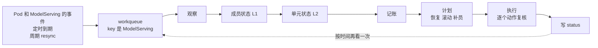
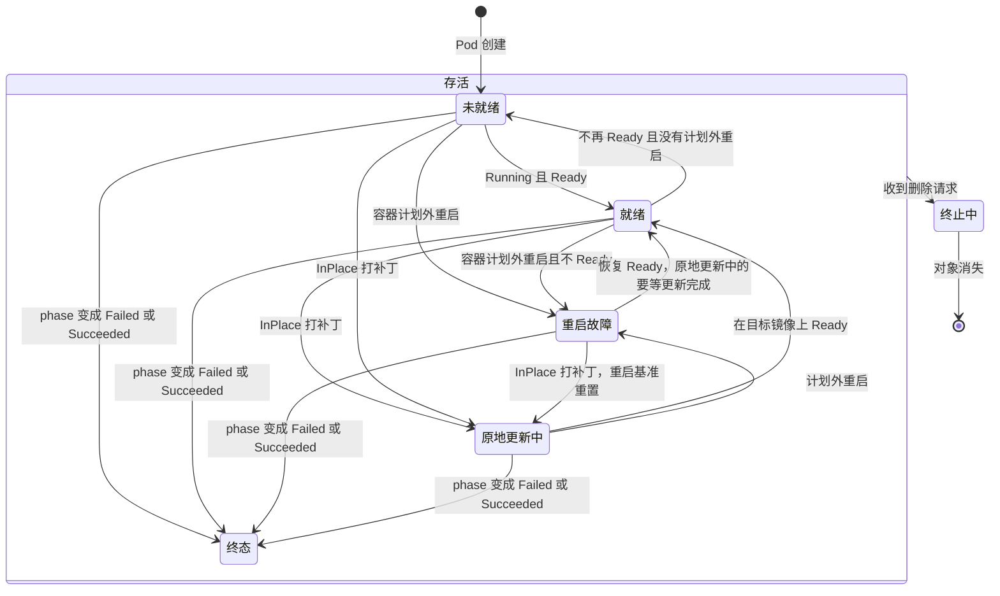
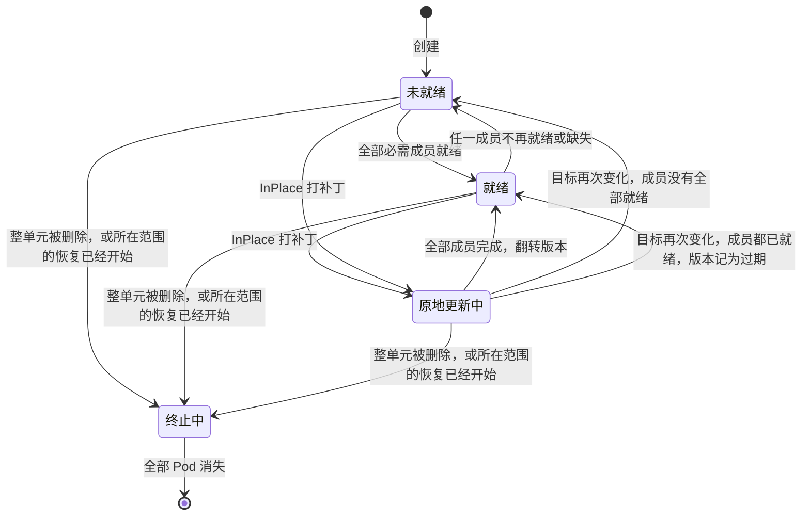
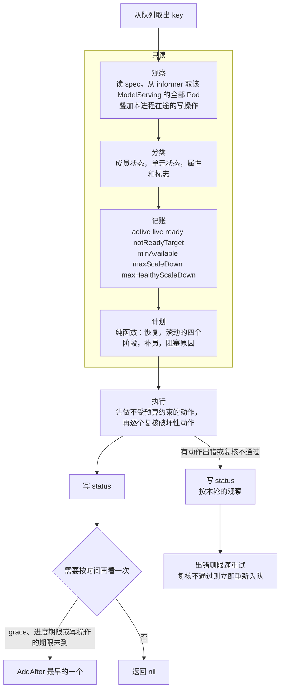
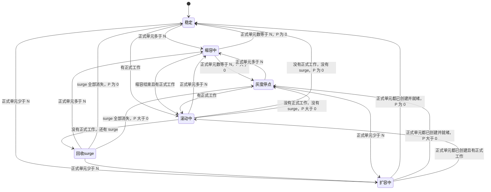
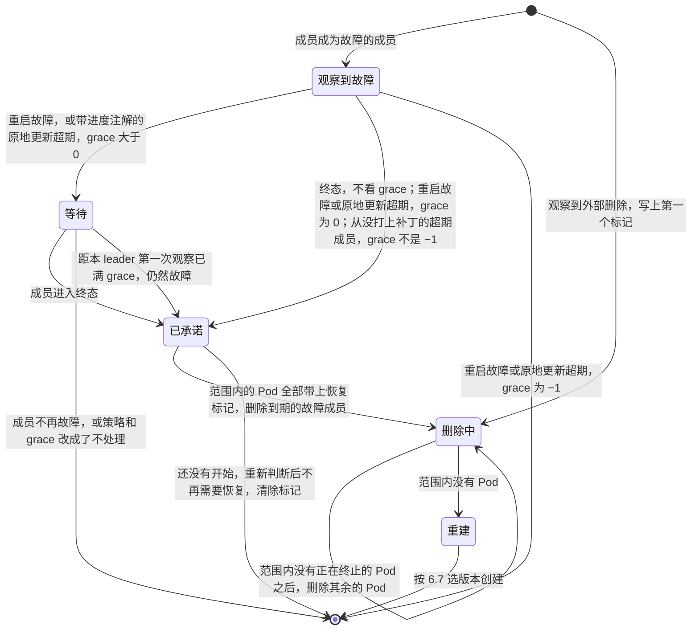
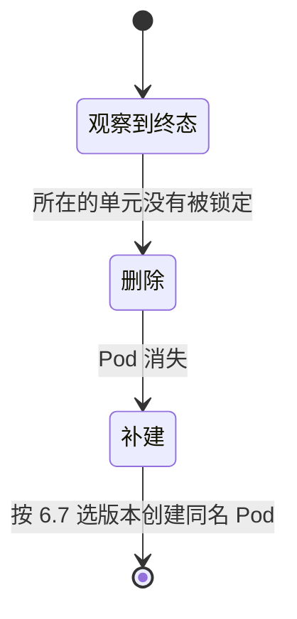
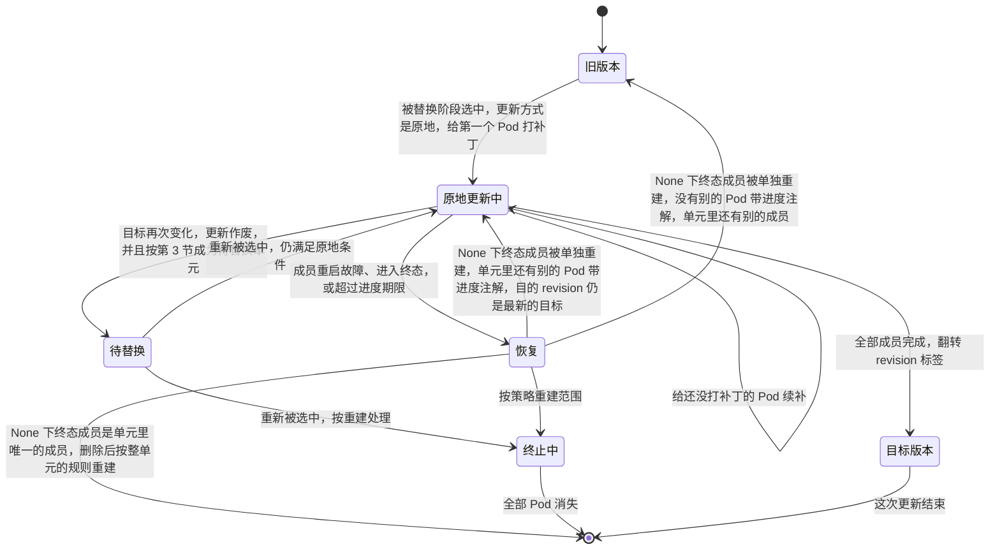

# ModelServing 状态机改进方案

## 0. 文档信息

| 项 | 内容 |
| --- | --- |
| 状态 | 设计终稿，待评审。没有实现，没有修改 controller 代码 |
| 当前实现的基线 | `volcano-sh/kthena` `main` @ `b4e536bb` |
| 规则依据 | [行为规范](../modelserving-rollout-behavior-spec.md)的 R1～R31、R35～R38。R32～R34（恢复与重启）由本文[第 6 节](#6-故障恢复l4)和[第 10 节](#10-重启与主备切换)改写，R37 有一处收窄，都列在[第 14 节](#14-对规范和契约的影响)，2026-11-15 已按四组批准，SG 规范 A.4 第 3 条除外 |
| 与原状态设计的关系 | 取代[状态设计](../modelserving-rollout-state-design.md)的第 4、5 节。它的第 3 节「当前状态机」仍然有效；从 Pod 状态变化看到的现状见 [02](02-pod-state-entry-review.md) |
| 配套 | [复评结论](01-rereview-disposition.md)、[Pod 状态入口的检视](02-pod-state-entry-review.md)、[故障 Pod 处理的对照](03-fault-pod-handling-comparison.md)、[重构方案](05-refactoring-plan.md)、[理想状态机与改造对照](06-state-table.md)、[核心状态机（不含原地更新）](07-core-state-machine.md) |
| 范围 | 事件处理、工作队列、一轮 reconcile、成员（Pod）状态、单元状态、滚动阶段、故障恢复、InPlace、重启。plugin 的实现不在范围内 |

本文按下面这些决定写。D1～D3 是 2026-11-12 定的，D9～D11 是 2026-11-14 定的，D12～D15 是 2026-11-15 逐项定的。

| 决定 | 内容 |
| --- | --- |
| D1 | surge 被 N 覆盖时转正，并清除标记 |
| D2 | 受 partition 保护的单元发生故障时，占用滚动预算 |
| D3 | SG 模式下修改 `roles[].replicas` 立即应用 |
| D9 | 故障计时不跨重启。新 leader 从自己第一次观察到故障起，重新计满 grace |
| D10 | `recoveryPolicy: None`：未就绪的 Pod 不处理；`Failed` 和 `Succeeded` 的 Pod 立即删除并按原名字重建，只动这一个 Pod。`Succeeded` 在所有策略下都和 `Failed` 一样算终态。当时一并定的「带失败退避」已由 D14 撤回 |
| D11 | 已经开始的恢复要能跨重启做完。机制从简，不要求沿用历史上的 `deletion-scope` 注解 |
| D12 | R37 收窄：单元里还有带未完成进度注解的 Pod 时，补建的成员用注解里的目的 revision；整单元消失后按 R15 重建（[6.7](#67-与滚动的关系)） |
| D13 | `Failed`、`Succeeded` 的 Pod 在所有策略、所有 grace（包括 `-1`）下等同于被删除的 Pod。`None`：立即删除，只重建这一个。`RoleRecreate`、`ServingGroupRecreate`：立即重建所配置的范围，不等 grace。grace 和 `-1` 只约束重启故障和原地更新超期 |
| D14 | 不做退避：单 Pod 重建和范围重建都不加。理由是 StatefulSet 没有，退避要多一份状态，还牵涉 controller 重启。按不做来设计，标为待讨论（[6.4](#64-计时以及不做退避)） |
| D15 | 范围恢复保持两步删除，不改成标记写全之后一起删除 |

还没有定的和待讨论的事项列在[第 15 节](#15-待决项和没有验证的内容)。

## 1. 总览

### 1.1 设计约束

| 编号 | 约束 | 来源 |
| --- | --- | --- |
| C1 | 单一决策点。创建、删除、打补丁、写 `status` 只在处理该 ModelServing 的 worker 里发生。事件处理器和定时器只入队 | 原设计；复评的「统一动作入口」 |
| C2 | 水平触发。一轮的决定只取决于最新 spec 和本轮观察到的对象，外加 [1.3](#13-状态载体) 列出的四项内存信息 | 原设计 |
| C3 | 丢了会改变结果的状态都放在对象上 | 原设计 |
| C4 | 恢复跨重启：已经开始的恢复，换了 leader 也按原范围做完 | D11 |
| C5 | 计时不跨重启：grace 的起点只在内存里 | D9 |
| C6 | 从 Pod 状态出发。Pod 的每一种状态都归到一个成员状态，每个成员状态在每种恢复策略下都有确定的反应，没有落不进任何分支的状态 | 2026-11-14 新增的审视点 |
| C7 | 阶段显式，计划是纯函数 | 原设计 |
| C8 | 计划给出候选，执行前逐个动作复核 | 复评 |
| C9 | 机制从简。允许创建后又删除的浪费，不为省一次重建增加持久状态 | 行为规范的设计原则；D11 |
| C10 | 错误不扩散。一个单元上的冲突或 API 错误只阻塞这个单元，不中止其他单元的处理，也不妨碍写 `status` | [02](02-pod-state-entry-review.md) 的 PL-3 |

### 1.2 四层状态和一条管线

状态分四层，每一层都由下一层推导出来，不单独存储。

| 层 | 对象 | 取值 | 从哪里来 |
| --- | --- | --- | --- |
| L1 成员 | 一个 Pod | 未就绪、就绪、重启故障、终态、原地更新中、终止中；另有缺失和外来。恢复标记和 surge 标记是成员的属性，不是状态 | Pod 对象本身（[第 2 节](#2-成员状态l1从-pod-状态变化出发)） |
| L2 单元 | 一个 ServingGroup，或一个 Role 实例 | 就绪、未就绪、原地更新中、终止中、不存在 | 它的成员（[第 3 节](#3-单元状态l2)） |
| L3 滚动阶段 | 一个预算范围 | 稳定、缩容中、扩容中、滚动中、回收 surge、灰度停点；可叠加阻塞原因 | 计划函数的输出（[第 5 节](#5-滚动阶段与计划函数l3)） |
| L4 恢复 | 一次故障，或一次外部删除 | 观察到故障、等待、已承诺、删除中、重建 | 成员状态、恢复策略、Pod 上的恢复标记（[第 6 节](#6-故障恢复l4)） |

四层合起来是一台以单元为主体的状态机：成员状态是它的输入，滚动和恢复是它边上的条件，阶段是它输出给 `status` 的名字。合在一起的图和每条边的条件在[理想状态机与改造对照](06-state-table.md#2-单元状态机)的第 2 节，本文各节的图是每一层的细节。想先不看原地更新时，读[核心状态机](07-core-state-machine.md)的 A 部分：那里是同一台状态机在没有用原地更新时的样子，原地更新在它的 B 部分单列。07 不增加规则，也不改变 05 的顺序。

一轮 reconcile 是一条单向管线。



### 1.3 状态载体

| 载体 | 内容 | 跨重启 | 丢失的后果 |
| --- | --- | --- | --- |
| ModelServing `spec` | N、U、S、P、模板、恢复策略、grace | 是 | — |
| ModelServing `status` | `currentRevision`（基线）；其余字段只是输出 | 是 | — |
| ControllerRevision | 每个 revision 的模板快照 | 是 | — |
| Pod 标签 | 所属 ServingGroup、Role、Role 实例、revision、Role 模板 hash | 是 | — |
| Pod 注解：surge 标记 | 这个 Pod 属于临时单元，以及属于哪一层 | 是 | — |
| Pod 注解：InPlace 进度 | 打补丁的目的 revision、各容器的重启基准、期限 | 是 | — |
| Pod 注解：恢复标记 | 这个 Pod 所在的范围已被承诺重建；范围的种类（Role 实例或 ServingGroup）；这个 Pod 自己的 UID；承诺时范围内的 Pod 数 n（[6.3](#63-恢复标记先标记后删除)） | 是 | — |
| 内存：在途的写操作 | 本进程已发出、缓存里还没看到的写操作，每条带期限（[4.1](#41-观察)）。确定失败的 DELETE 和原地补丁多记一轮，用于 [4.2](#42-计划) 的让路 | 否 | 无。缓存重新同步后不需要；失败的记录丢了，只是多让路一轮 |
| 内存：故障起点 | 每个重启故障或原地更新超期的 Pod（按 UID）被本 leader 第一次观察到的时间。终态的 Pod 不计时 | 否 | 重新计满一个 grace（D9） |
| 内存：外部删除记录 | 还没处理完的外部删除（Pod 的 UID、owner、所属范围、删除请求的时间）。保留到所在范围的 Pod 全部带上恢复标记为止 | 否 | 范围内一个标记都还没有写上的，退化成只补缺失的成员；已经写上标记的靠标记续做 |
| 内存：不算外部删除的删除 | 三类 Pod 的 UID：本进程请求删除的；本进程删除一个单元时，其中已经被别人请求删除的成员；本进程开始担任 leader 时已经在终止的。都保留到它的删除事件处理完为止（[6.5](#65-外部删除)） | 否 | 无。新 leader 开始工作时重新建立：届时还在终止的 Pod 都记进来 |

和当前实现相比，去掉了 datastore 里的单元状态、`graceMap`、`podDeletions`、`roleCleanups` 四处内存状态，新增一个 Pod 注解（恢复标记）。

## 2. 成员状态（L1）：从 Pod 状态变化出发

### 2.1 判定

成员状态只看 Pod 自己的生命周期信息。下表自上而下判定，取第一个成立的。

| 顺序 | 成员状态 | 条件 |
| --- | --- | --- |
| 1 | 终止中 | `deletionTimestamp` 非空 |
| 2 | 终态 | `status.phase` 是 `Failed` 或 `Succeeded` |
| 3 | 重启故障 | 有计划外的容器重启（普通容器或 init 容器），并且 Pod 不 Ready 或正处于原地更新中 |
| 4 | 原地更新中 | InPlace 注解记录的更新还没有完成 |
| 5 | 就绪 | `phase` 是 `Running`，Ready 条件为 True |
| 6 | 未就绪 | 其余全部：Pending，或 Running 但不 Ready 且没有计划外重启 |

另有两种不对应「一个属于自己的 Pod」的情形。

| 情形 | 条件 |
| --- | --- |
| 缺失 | 单元已应用的版本要求有这个成员，但没有对应的 Pod |
| 外来 | 名字和某个成员相同，但 owner 的 UID 不是这个 ModelServing，或者没有 owner，或者身份标签不是 controller 生成的形式 |

成员另有两个属性。属性和状态互相独立，不参与上面的判定。

| 属性 | 条件 | 作用 |
| --- | --- | --- |
| 恢复标记 | Pod 带有效的恢复标记（[6.3](#63-恢复标记先标记后删除)） | 所在范围内不创建 Pod；这个范围的恢复开始之前，范围内不发任何删除 |
| surge 标记 | Pod 带 surge 注解 | 所在单元是临时单元还是待转正的单元（[第 3 节](#3-单元状态l2)） |

原地更新中的 Pod 有过计划外重启时一直是重启故障，直到更新完成或者被重建。恢复生效时它按重启故障处理：计时，到期重建。恢复不生效时（策略是 `None`，或 grace 是 `-1`）没有人会重建它，所以更新是否完成不看计划外重启：它之后在目标镜像上 Ready 就算完成（[5.2](#52-计划函数)）。两种情况都与当前实现相同（`ipu.go:638-645`，`ipu.go` 指 `pkg/model-serving-controller/controller/inplace_update.go`）。

**恢复标记不是成员状态。**带标记的 Pod 是什么状态就算什么状态：带着残留标记的就绪 Pod 仍然是就绪的，计入 `ready`；带着标记的终态 Pod 仍然是终态，仍然是恢复的触发条件。如果把「已标记」做成一个排在终态之前的状态，它会盖住 Pod 的真实情况，带来两个问题：标记写上之后触发条件就看不到了，下一轮分不清这是该接着做的恢复还是该清除的残留；带着残留标记的健康单元会被当成未就绪的候选，不经健康额度就被滚动删除。

「计划外的重启」指 `RestartCount` 超过基准。没有做过原地更新的 Pod 基准是 0；做过的 Pod，基准是开始打补丁时记下的各容器重启次数，加上打补丁预期引起的那一次（检视意见 IP-1 要求基准覆盖全部容器）。Ready 的 Pod 不看历史上的重启次数。这与当前实现和契约的定义相同；它带来的两个行为（重启过一次的 Pod 此后一不 Ready 就算故障，init 容器重试一次就算故障）是否要改，是待决项 O6。

顺序里有三处是有意安排的。

- 终止中排在最前。Pod 一旦被请求删除，它之前是什么状态都不再产生新的动作。Kubernetes 1.27 起，被删除的 Pod 会先被 kubelet 置为终态再消失；它带着 `deletionTimestamp`，所以归到终止中，不会被当成终态再处理一遍。
- 终态排在重启故障和原地更新中之前。原地更新期间 Pod 变成 `Failed`，按终态处理。
- 重启故障排在就绪之前只对原地更新中的 Pod 有影响：kubelet 发现补丁之前，旧的 Ready 条件还在，这时的计划外重启仍然算故障。

### 2.2 状态图



终态没有出边回到其他存活状态：`Failed` 和 `Succeeded` 的 Pod 不会被 kubelet 重新启动。这是 D10 把它和「未就绪」「重启故障」区别对待的依据。写上或清除恢复标记不改变成员状态，所以图里没有对应的边。

### 2.3 各成员状态的含义

| 成员状态 | 占着名字 | 所在单元能否就绪 | 会不会自己变好 | 恢复是否处理 |
| --- | --- | --- | --- | --- |
| 就绪 | 是 | 能 | — | — |
| 未就绪 | 是 | 不能 | 可能 | 不处理 |
| 重启故障 | 是 | 不能 | 可能，kubelet 会继续重启 | 取决于策略和 grace |
| 终态 | 是 | 不能 | 不会 | 处理，范围取决于策略 |
| 原地更新中 | 是 | 不能 | 正常情况下会 | 超过进度期限后取决于策略 |
| 终止中 | 是 | 不能 | — | 等它消失 |
| 缺失 | 否 | 不能 | — | 补建，或按策略扩大到范围 |
| 外来 | 是 | 不能 | — | 不动它，报告冲突 |

「占着名字」的成员存在期间，不能创建同名的 Pod。外来的 Pod 和版本读不出来的成员只阻塞所在的单元（C10）。当前实现遇到它们会让整个 ModelServing 的 reconcile 每轮中止，见 [02](02-pod-state-entry-review.md) 的 PL-3。

### 2.4 Pod 状态变化与反应

下表是本设计对每一种 Pod 状态变化的反应。任何变化都会让 owner 入队，表里不再重复。当前实现对同一行的反应，以及两者的差别，见 [02](02-pod-state-entry-review.md) 第 3 节。

| # | Pod 状态变化 | 成员状态 | `None` | `RoleRecreate` | `ServingGroupRecreate` |
| --- | --- | --- | --- | --- | --- |
| 1 | 创建后还没 Ready：未调度、拉镜像、init 容器运行、容器启动中 | 未就绪 | 等待 | 等待 | 等待 |
| 2 | 第一次 Ready | 就绪 | 重算单元和预算 | 同左 | 同左 |
| 3 | 不再 Ready，没有重启（探针失败、节点失联） | 未就绪 | 不处理。单元计为未就绪，`status` 随即反映 | 同左 | 同左 |
| 4 | 容器计划外重启且不 Ready，包括 init 容器和 CrashLoopBackOff | 重启故障 | 不处理，由 kubelet 继续重启 | 计时。到期仍故障，删除这个 Pod；它消失后删除其余成员，整个 Role 实例重建 | 计时。到期仍故障，删除这个 Pod；它消失后删除其余成员，整个 ServingGroup 重建 |
| 5 | 重启之后恢复 Ready | 就绪 | — | 结束这次计时 | 结束这次计时 |
| 6 | `phase` 变成 `Failed` | 终态 | 立即删除这个 Pod，消失后按原名字重建 | 不等 grace，承诺所在 Role 实例并删除这个 Pod；它消失后删除其余成员，整个实例重建 | 不等 grace，承诺所在 ServingGroup 并删除这个 Pod；它消失后删除其余成员，整个组重建 |
| 7 | `phase` 变成 `Succeeded` | 终态 | 同第 6 行 | 同第 6 行 | 同第 6 行 |
| 8 | 长期 Pending，没有重启（调度不了、镜像拉不下来） | 未就绪 | 不处理，在 `status` 里报告 | 同左 | 同左 |
| 9 | 被本进程以外的操作者请求删除 | 终止中 | 等它消失，补这一个 Pod | 不等 grace，承诺所在 Role 实例；它消失后删除其余成员，整个实例重建 | 不等 grace，承诺所在 ServingGroup；它消失后删除其余成员，整个组重建 |
| 10 | 被本进程请求删除（滚动、缩容、回收 surge、恢复） | 终止中 | 等它消失 | 等它消失 | 等它消失 |
| 11 | 长期停在终止中（节点失联、finalizer） | 终止中 | 继续占着名字和容量。不强制删除，在 `status` 里报告 | 同左 | 同左 |
| 12 | 对象消失，controller 看到了这次删除 | 缺失 | 按第 9、10 行的归类继续 | 同左 | 同左 |
| 13 | 对象消失，发生在 controller 不在的时候 | 缺失 | 只补这一个 Pod | 只补这一个 Pod | 只补这一个 Pod |
| 14 | 原地更新：打补丁、预期内的重启、在目标镜像上 Ready | 原地更新中，然后就绪 | 单元全部成员完成后翻转版本 | 同左 | 同左 |
| 15 | 原地更新期间计划外重启 | 重启故障 | 不处理。Pod 之后在目标镜像上 Ready 就算完成；一直不 Ready 时单元占着 `notReadyTarget`，滚动因此阻塞并报告 | 同第 4 行 | 同第 4 行 |
| 16 | 原地更新超过进度期限，Pod 没有重启也没有进入终态 | 原地更新中；单元里从没打上补丁的成员状态不变 | 不处理，报告超期；从没打上补丁的成员继续续补（已经作废的更新不续补） | 带进度注解而没有完成的成员同第 4 行，从超期的时刻起计时。从没打上补丁的成员（没有未完成的进度注解，revision 标签不是目的 revision）不等 grace。按目的 revision 补建的成员不在此列（[6.1](#61-触发范围和时机)） | 同左 |
| 17 | 标签或注解变化：surge 标记被清除、revision 被翻转、恢复标记被写入或清除 | 状态不变，属性重新读取 | 确认对应的写操作 | 同左 | 同左 |
| 18 | 出现外来的同名 Pod；ownerReference 被摘掉；身份标签或 revision 标签被改成读不出的值 | 外来，或所在单元版本未知 | 不动它，不在这个名字上创建，只阻塞这个单元，报告冲突。不算删除，不触发恢复 | 同左 | 同左 |
| 19 | controller 启动后第一次看到的任何状态 | 按上面归类 | 与持续运行时相同 | 相同；计时从这一刻开始。开始担任 leader 时已经在终止的 Pod 不按第 9 行处理：等它消失，只补缺失的成员；所在范围的恢复已经开始时按标记做完 | 同左 |

- `restartGracePeriodSeconds` 为 `-1` 时，第 4、15、16 行在 `RoleRecreate` 和 `ServingGroupRecreate` 下都不发起重建，与当前实现相同。第 6、7 行不看 grace：终态的 Pod 在所有策略、所有 grace 下都等同于被删除的 Pod（D13），`-1` 下照样处理，与第 9 行一致。当前实现对 `Failed` 的 Pod 在 `-1` 下不处理，正数 grace 下要等满 grace；`Succeeded` 的 Pod 在任何 grace 下都不处理。
- 第 15、16 行重建出来的单元用哪个版本，见 [6.7](#67-与滚动的关系)。
- 第 4、6、9 行里「先删除故障的或被外部删除的 Pod，它消失后删除其余成员」沿用当前实现的顺序。每个故障的 Pod 各自计时、到期各自被删；范围内正在终止的 Pod 都消失之后，其余成员才被删除（[6.3](#63-恢复标记先标记后删除) 的 M2）。标记写全之后一起删除的做法没有采用（D15）。
- 第 12、13 行的区别在于有没有删除的记录。informer 断连之后重新 LIST 才发现的删除，client-go 会补发删除事件，属于第 12 行。
- 成员所在的范围带恢复标记时，上表让位于 [6.3](#63-恢复标记先标记后删除)：已经开始的范围做完；没有开始的先清除标记或重新承诺，在那之前范围内不删除、不创建。

## 3. 单元状态（L2）

单元没有存储的状态字段。每轮由它的成员推导出下面五个状态之一。



图里原地更新的「完成」按 [5.2](#52-计划函数) 的定义。

| 单元状态 | 从成员推导的条件 | 在预算中 |
| --- | --- | --- |
| 不存在 | 没有任何 Pod | 不计 |
| 终止中 | 现存成员全部是「终止中」；或者单元所在范围的恢复已经开始（[6.3](#63-恢复标记先标记后删除) 的 M3）；或者本轮已经决定删除整个单元 | 只计入 `active` |
| 原地更新中 | 有 Pod 带着未完成的原地更新进度注解（不论这个 Pod 现在是哪个成员状态），并且注解里的目的 revision 等于最新的目标版本。翻转 revision 标签时注解不删除，只标记为完成，里面的重启基准保留（`inplace/state.go:50`、`417-425`）；本文说「带进度注解」都指还没有标记完成的 | 计入 `live` 和 `notReadyTarget`（R36） |
| 就绪 | 已应用版本要求的成员全部存在、全部是「就绪」 | 计入 `live` 和 `ready` |
| 未就绪 | 其余全部：有成员缺失、未就绪、重启故障、终态、外来；一部分成员是终止中 | 计入 `live` |

表里自上而下判定。进度注解里的目的 revision 已经不是最新目标时，这次原地更新作废：单元不再算原地更新中，状态按成员判定，版本记为过期（见下面的属性表）。`active`、`live`、`ready`、`notReadyTarget` 的定义见行为规范第 3 节和 R8。未就绪的单元带上原因（缺失、终态、重启故障、未就绪、原地更新超期、外来、版本未知），原因写进 `status`。

单元还有五个属性。

| 属性 | 来源 |
| --- | --- |
| 序号 | 名字 |
| 版本 | 按生效的滚动单位读已应用的 revision。Role 模式按各实例的 Role 模板与目标做语义比较，再汇总到整组：只改了 `prefill` 的模板时，`decode` 的实例保留旧 revision 也算达到目标。成员的版本不一致，或者读不到所需的历史时，记为未知。原地更新已经作废的单元记为过期，不论 revision 标签是什么：它不等于目标版本（检视意见 BG-6 的情形：把目标改回原版本时，标签上的 revision 恰好等于目标）。版本未知的单元和有外来成员的单元既不是替换的候选，也不算已就位 |
| surge 标记 | 注解 `modelserving.volcano.sh/surge`，值注明属于哪一层（`serving-group` 或 `role`）。两层各看各的。「单元带标记」指它至少有一个没在删除的 Pod 带本层的标记。临时单元里后来创建的 Pod 带标记，正式单元里的不带 |
| 更新方式 | 「原地」要同时满足：`updateMethod` 是 `InPlace`；从当前版本到目标版本只改了容器镜像；U 大于 0；plugin 链支持原地更新；Pod 和容器的重启策略是 `Always`（R35）；单元里没有终态的成员。否则是「重建」 |
| 锁定 | 两种情况之一：单元和一个带着残留恢复标记的范围有交集（M6；范围可以比单元小，例如 SG 模式下某个 Role 实例带着 `role` 的残留标记）；单元的 surge 清标请求结果不明（[4.1](#41-观察)）。锁定的单元状态照常推导、照常计入预算、照常参与选取，但对它的删除和原地补丁推迟到解锁之后（[5.2](#52-计划函数)） |

更新方式和成员状态的关系有三条。

- 有终态的成员时按重建处理。补丁救不活终态的 Pod，这样的单元整个删除后重新创建。当前实现不看这一点，照样给终态的 Pod 打补丁。
- 有成员正在终止时等待，不打补丁也不重建，与当前实现相同（`ipu.go:221-223`）。组内缩容删掉一个 Role 实例就是这种情况：它消失之后单元又是齐全的，可以原地更新。等待只推迟原地补丁：单元在替换里占着名额，本轮不打补丁；缩容和回收 surge 照常可以删除它，新的恢复触发也照常处理。
- 有成员缺失不妨碍原地更新，与当前实现相同。现存的成员照常打补丁；缺的成员由补员按单元已应用的版本创建，下一轮由 `continueInPlace` 补上补丁（[5.2](#52-计划函数)）。

原地更新作废的单元有四种去向。结果都与当前实现相同（`ipu.go:490-499`、`520-525`），只有前两种多了预算。

- 目标改回了 Pod 标签上的 revision：不论序号都是待替换单元。标签说它已经是目标版本，实际跑的是另一个版本的镜像，partition 在这里没有什么可保护的。当前实现在这种情况下不看 partition、也不经预算，直接删除整个单元（BG-6）；这里改成按预算排队。被选中之后按重建处理：删除整个单元，再按 R15 创建，与现在相同，不尝试把镜像原地打回去。
- 目标换成了别的版本，序号 ≥ P：是待替换单元。
- 目标换成了别的版本，序号 < P，成员都已经在原来的目的镜像上就绪：保持原样。它在提供服务，计入 `ready`；版本是过期，所以不推进基线。partition 放开之后成为待替换单元。
- 目标换成了别的版本，序号 < P，成员还没有完成：留在原处，等进度期限。

前两种里，成员都就绪时它是就绪的单元，按健康额度排队；否则按未就绪的候选处理。

作废不停止进度期限。四种去向里只要还有成员没有完成，期限都照常计算，不看序号，也不看单元是不是在排队。后三种与当前实现相同（`ipu.go:496-499`、`520-525`）；第一种在当前实现里立即重建，没有排队的时候，排队期间期限照常是本设计的选择。超期之后按 [6.1](#61-触发范围和时机) 处理，重建时按 [6.7](#67-与滚动的关系) 选版本。作废的单元不再续补。

锁定通常只持续一轮：清除残留标记的请求在本轮最先发出，下一轮单元就恢复正常。

每轮给每个 `live` 单元定两个互相独立的标志。

| 标志 | 条件 | 规则 |
| --- | --- | --- |
| 待替换单元 | 版本不等于目标版本，且序号 ≥ P；或者原地更新已经作废、而目标等于 Pod 标签上的 revision，这时不看序号 | R11、R37 |
| 临时单元 | 带本层的 surge 标记，且序号 ≥ N | R2 |

带本层标记、序号 < N 的单元是待转正的单元（R3）：分类时按正式单元对待，执行阶段清除它的标记。

有一种单元从 Pod 观察不到：N 大于 0，但所有 Role 的期望实例数都是 0。这样的 ServingGroup 没有任何 Pod。它按 spec 计为存在并且就绪，不为它创建 Pod，也不因为它推进基线。只要有一个 Role 的期望实例数大于 0，没有 Pod 的 ServingGroup 就是「不存在」，需要创建。这是「从 Pod 推导单元」带来的约束；当前实现在 datastore 里保留组的记录，没有这个问题（[01](01-rereview-disposition.md) 的 S6）。

## 4. 一轮 reconcile



图里「计划」一格的内部，按要回答的问题分在几处。看到什么状态会扩缩容、建或回收 surge、替换：[5.1](#51-阶段) 的表。一个单元在滚动中依次经过什么、每一步的条件：[5.3](#53-滚动中的一个单元)。看到什么 Pod 状态会触发恢复：[2.4](#24-pod-状态变化与反应) 和 [6.1](#61-触发范围和时机)。把这几处合成一台单元状态机、每条边带上条件的画法，以及当前代码在每条边上差在哪里、要怎样改，在[理想状态机与改造对照](06-state-table.md)。

### 4.1 观察

观察以 informer 缓存为准。本进程刚发出的写操作可能还没有出现在缓存里，所以 worker 为每个 ModelServing 记录在途的写操作，观察时把它们叠加到缓存内容上，再做分类。叠加总是取保守的一侧：新建的 Pod 算存在但未就绪，被删的 Pod 算终止中。

| 写操作 | 叠加到观察上的效果 | 确认（从记录里去掉） |
| --- | --- | --- |
| 创建 Pod | 这个名字上有一个未就绪的成员 | 缓存里出现这个名字的 Pod |
| 删除 Pod | 这个 UID 是终止中 | 缓存里这个 UID 已带 `deletionTimestamp`，或已不存在 |
| InPlace 打补丁 | 这个 UID 是原地更新中，目的 revision 是补丁写入的值 | 缓存里这个 Pod 的注解已是打过补丁的状态，或已不存在 |
| 清除 surge 标记 | 请求成功：这个 UID 没有标记。结果不明：所在单元锁定 | 缓存里这个 UID 已没有标记，或已不存在 |
| 写恢复标记 | 请求成功：这个 UID 带写入的标记。结果不明：范围内照样不创建（M4），但这个标记不算写成功，不能据此删除（M2） | 缓存里这个 UID 的标记与写入的一致，或已不存在 |
| 清除恢复标记 | 请求成功：这个 UID 没有标记。结果不明：仍算带标记 | 缓存里这个 UID 已没有标记，或已不存在 |

- 记录在请求发出之前登记。请求返回确定的失败时立即撤销；NotFound 的删除视为已确认。DELETE 和原地补丁确定失败时，另外把「这个成员上一轮的动作失败了」记一轮，给 [4.2](#42-计划) 的让路用。
- 确认是每轮对照缓存当前内容做的，不依赖是否收到了对应的事件。
- 每条记录带期限，建议 30 秒。到期仍未确认时，对这个对象做一次直读（GET），按读到的结果更新或撤销记录：例如创建被接受、但 Pod 在缓存看到之前就被删掉了，直读得到 NotFound，记录撤销，这个成员按缺失处理。有记录没到期时，本轮结束时 `AddAfter` 到最早的期限，不靠周期 resync 来唤醒。
- 直读的结果和缓存不一致时以直读为准，记录保留到缓存追上为止。例如删除已经在 apiserver 完成，缓存却一直没有收到删除通知：这个 Pod 按已经不存在处理，它的名字可以补建，不重复发 DELETE，也不需要重启 controller。
- 结果不明的创建还没有 UID，写不了恢复标记。范围内有这样的记录时，本轮不承诺这个范围，等它确认或到期（[6.3](#63-恢复标记先标记后删除)）。
- 记录只影响它涉及的对象。一个迟迟不被确认的写操作不会停掉其他单元的恢复、滚动和定时，`status` 也照常按叠加后的观察写。
- 清除 surge 标记也要记录。复评里的反例是：清标已经成功、缓存还没更新时 N 又缩小，计划会按旧缓存把刚转正的单元当成临时单元回收（[01](01-rereview-disposition.md) 的 S3）。叠加之后，这个单元在本进程看来已经是正式单元。
- 记录只在内存里。重启后缓存是新同步的，不需要它。

这里没有采用「在途的写操作全部确认之前，本轮不做计划」的做法（ReplicaSet 的 expectations 是这种形式）。ReplicaSet 一轮只决定创建或删除的数量，等一轮没有代价；这里一轮要处理一个 ModelServing 的全部单元，整轮等待会让一个单元上不被确认的写操作挡住其他单元的故障恢复。

### 4.2 计划

计划不调用任何 API，也不会中途返回错误：读不出版本、名字被外来 Pod 占用这类情况都是某个单元的阻塞原因，不影响其他单元（C10）。它按下面的顺序在同一份工作副本上进行；每决定一个动作就更新工作副本，后面的步骤按更新后的计数判断。两层的计划都做完之后，才按 [4.3](#43-执行) 的顺序统一执行。

1. **带恢复标记的范围**（[6.3](#63-恢复标记先标记后删除)，[6.6](#66-恢复计划) 的 A 段）。已经开始的范围接着做，在工作副本里标为终止中。还没有开始的范围，和它有交集的单元本轮锁定。
2. **ServingGroup 层**的滚动四个阶段和在途的原地更新（[第 5 节](#5-滚动阶段与计划函数l3)）。
3. **Role 层**：对每个没在删除、恢复没有开始的 ServingGroup 的每种 Role，做同样的计划（[第 8 节](#8-servinggroup-层role-层与协调)）。本轮由第 2 步新建的组整组创建，Role 层从下一轮起管它。
4. **新的恢复触发**（[6.6](#66-恢复计划) 的 B、C 段）。两种情况下让路。第 2、3 步本轮会删除的单元整个跳过：删除覆盖了其中的每个 Pod。这样的单元里的外部删除记录不是留到下一轮，而是丢弃（[6.5](#65-外部删除) 的核对）：记录是一次事件，留着的话下一轮照样触发。本轮会被打上原地补丁的成员只跳过它自己：补丁会重置它的重启基准，下一轮按新的基准重新判断；同单元的其他成员照常判断。终态的成员不会被打补丁，所以只有会删除它的动作才能代替对它的恢复。被选中而动作推迟的单元（锁定，或者原地更新在等终止中的成员）不跳过。让路的前提是那个动作发得出去：上一轮对这个成员的 DELETE 或原地补丁确定失败时，本轮不为它让路，恢复照常判断。否则单元每一轮都被选中、动作每一轮都失败，恢复就一直被挡着。这个前提只对故障的成员适用；外部删除的记录不看它：Pod 已经在删除，单元的删除不再需要对它发 DELETE。承诺一个范围时，撤掉本轮计划里落在这个范围内的创建和原地补丁。
5. **补员**：给没有被选中删除的单元补上缺失的成员。缺失的成员落在带恢复标记的范围里时不补。

滚动排在新的恢复触发之前，是因为一个既过期又故障的单元可以直接由滚动替换成目标版本，不必先按旧版本恢复一次。新选中做原地更新的单元不会有终态成员（[第 3 节](#3-单元状态l2)的更新方式）；它如果有重启故障的成员，本轮只打补丁，下一轮按新的重启基准重新判断。已经在原地更新中的单元可以有终态成员：打过补丁的 Pod 之后进入了终态，而另一个成员的补丁一直打不上。这个终态成员照常由恢复处理，不等续补成功；让路的规则按成员而不是按单元，就是为了这种情形。

### 4.3 执行

执行按下面的顺序发出动作。

| 顺序 | 动作 | 是否受滚动预算约束 |
| --- | --- | --- |
| 1 | 清除转正单元的 surge 标记；清除残留的和无效的恢复标记；给完成原地更新的单元翻转 revision 标签 | 否 |
| 2 | 写恢复标记 | 否 |
| 3 | 恢复删除：标记已经写全的范围（按 M2 的两步）、`None` 下的终态 Pod | 否。被删的 Pod 所在的单元已经不是就绪的，或者所在范围的恢复已经开始 |
| 4 | 创建：正式单元、surge、缺失的成员 | 受容量上限约束 |
| 5 | 给在途的原地更新补上还没打的补丁 | 否。这些单元已经计入 `notReadyTarget` |
| 6 | 缩容、回收 surge、替换（删除或 InPlace 打补丁） | 是 |

恢复排在创建和替换之前。恢复移进 worker 之后，它和滚动共用一轮；排在前面，后面的步骤出错时恢复已经发出。本轮清除过 surge 标记或恢复标记时，结束后立即重新入队，让解除锁定的单元尽快参与计划。

**错误隔离。**一个动作的 API 请求出错时，放弃同一个单元在本轮剩下的动作，其他单元的动作继续，最后汇总返回错误，按限速重试。删除一个单元是一个动作，由各个 Pod 的 DELETE 组成：其中一个失败不放弃其余的，终态的和故障的成员排在前面。这样一个 Pod 的 DELETE 一直被拒绝时，同单元里终态的 Pod 仍然删得掉。这样做在预算上是安全的：计划里新建的单元都按未就绪计，后面的删除并不依赖创建成功；前面的删除失败只会让实际删除的数量变少。

**复核。**下面这些动作发出之前，用 informer 缓存的当前内容（叠加在途的写操作）再看一次，不调用 apiserver。

| 动作 | 复核的内容 |
| --- | --- |
| 所有 DELETE 和 PATCH | 目标成员的 UID 与计划时相同。DELETE、原地补丁和 surge 清标还要求它没有被请求删除；写和清除恢复标记不要求，M1 要给已经在删除的 Pod 也写标记。第 6 步删除一个单元时（缩容、回收 surge、按删除执行的替换），因为已经被请求删除而没有发 DELETE 的成员，UID 记进「不算外部删除的删除」（[6.5](#65-外部删除)） |
| 第 1 步，清除残留的恢复标记 | 范围仍然没有开始：范围内没在删除的 Pod 数不少于 n |
| 第 3 步，范围删除 | 范围内现存的、属于自己的 Pod 都带确定写成功的标记（M2；外来的 Pod 写不了标记，不算在内）。删故障的成员：它仍然是故障的成员（[6.1](#61-触发范围和时机)）。删其余的 Pod：范围已经开始，并且范围内没有正在终止的 Pod |
| 第 3 步，`None` 下的单 Pod 删除 | 这个 Pod 仍然是终态，所在的单元没有被锁定 |
| 第 4 步，创建 | 目标范围内没有带恢复标记的 Pod（M4） |
| 第 6 步，缩容、回收 surge、替换 | 候选单元的就绪情况按现在的重新看：按「未就绪」选中的单元如果已经就绪，它需要的是健康额度，放弃；按就绪选中的单元变成了未就绪，不放弃，删除它不再需要健康额度。删除就绪的单元：按现在的计数，删除之后 `ready` 仍不低于 `minAvailable`。目标单元没有被锁定。配置了 roleCoordination 时，依赖和进度差按当前观察重算后仍然允许 |

复核不通过时放弃这个动作，立即重新入队。第 6 步的动作不通过时，本轮其后受预算约束的动作也一起放弃。已经发出的动作不回滚。DELETE 和 PATCH 都带 UID 前置条件。

复核缩小了「观察之后事实又变了」的窗口，不能消除它：复核和请求之间仍然有间隔，缓存本身也可能滞后。当前实现只在协调模式下做这种复核，读的是 apiserver（`controller/coordinated_round.go`）；本设计把它推广到所有模式，读缓存。协调模式是否继续直读 apiserver，随检视意见 CO-8 一起决定；它现有的断言（`coordinated_round_test.go` 的 `TestCoordinatedActionRechecksDependencyBudgetAndReplacementAfterPlanning`）在重构时要保留。

### 4.4 写状态

写状态放在最后，两条路径都要经过它：正常执行完，执行中有动作出错或复核不通过。只要观察成功就写，`observedGeneration` 不会因为出错而落后。状态按叠加了在途写操作的观察计算：刚创建、缓存里还没有的 Pod 计为未就绪的副本。状态没有变化时不发写请求。

观察阶段就失败的轮次是例外：读不到 spec，或者解析不出目标版本，这一轮没有计划可言。这时只写副本计数和一个说明原因的 condition，不推进 `observedGeneration`。当前实现在这种情况下不写 `status`。

## 5. 滚动阶段与计划函数（L3）

### 5.1 阶段

阶段由计划函数算出，写进 `status` 的 condition，不作为下一轮的输入。扩缩容和滚动的判断因此不依赖上一轮的阶段，也不要求收到「N 改了」「模板改了」这样的事件：每一轮都按本轮的观察（[4.1](#41-观察)）重新判断。重启涉及的内存差异按 [1.3](#13-状态载体) 和[第 10 节](#10-重启与主备切换)处理。

5.1 到 5.3 的图和表是 [5.2](#52-计划函数) 伪代码的索引和例子，不是另一套规则；有出入时是文档的错误，以伪代码和它引用的规则为准。表和图里的条件成立，表示计划里有这个动作；动作发出之前还要经过锁定的推迟和执行前的复核（[4.3](#43-执行)）。

**条件里用到的量。**都按单元数，不按 Pod 数；单元和它的属性按[第 3 节](#3-单元状态l2)从本轮的观察推导。定义在行为规范第 3 节和 R8，这里列在一起，反引号里是伪代码用的名字。

| 量 | 怎么数 |
| --- | --- |
| 正式单元 | 不带本层 surge 标记的单元，加上带标记而序号小于 N 的单元（待转正，R3）。包含正在删除的是 `regularAll`，只数没在删除的是 `regularLive`。下文说「正式单元数」指前者 |
| 临时单元 | 带本层 surge 标记、序号不小于 N 的单元 |
| `active`、`live`、`ready` | 全部单元数；其中没在删除的；`live` 里就绪的。三个数都包含临时单元 |
| `notReadyTarget` | `live` 里版本是目标版本而未就绪的单元数（R8）。新建的目标版本正式单元、没就绪的临时单元、发生故障的目标版本单元都算，序号小于 P 的也算；原地更新中的单元按目标版本算（R36）。不是目标版本的未就绪单元不算：受保护的旧版本单元故障时不占这个数，但 `ready` 少 1（D2） |
| 待替换单元 | `live` 的单元里版本不等于目标版本、序号不小于 P 的（R11）。就绪的和未就绪的都算，版本过期的临时单元也算；原地更新中的单元不算（R36）。另有一种不看序号的情形，以及不能当候选的单元，见[第 3 节](#3-单元状态l2) |
| 正式工作 | 待替换单元里除去临时单元的那些，`work`（R25）。其中更新方式是重建的是 `workRecreate`（R38） |
| `minAvailable` | `max(0, N − U)` |

正在删除的临时单元算在哪一边，字面上有一处没有对上。[第 3 节](#3-单元状态l2)把「单元带标记」定义成至少有一个没在删除的 Pod 带标记，按这个定义，Pod 全部在终止的临时单元不再带标记，会算进正式单元和 `regularAll`；参考模型里正在删除的临时单元仍然算临时单元。本文没有改这个定义，也没有在两者之间选择（待决项 O11）。

**两层各看什么。**同一套条件用在两层上，输入不同。完整的对照在[第 8 节](#8-servinggroup-层role-层与协调)。

| | ServingGroup 层 | Role 层 |
| --- | --- | --- |
| 单元 | 一个 ServingGroup | 一个 ServingGroup 里某种 Role 的一个实例 |
| N | `spec.replicas` | 该 Role 的 `replicas` |
| 版本不等于目标版本 | 组的 revision 不是目标 revision | 实例的 Role 模板与目标的 Role 模板不一致，按语义比较（[第 3 节](#3-单元状态l2)） |
| 扩缩容（阶段 1、2） | 两种滚动单位下都做 | 两种滚动单位下都做 |
| 建和回收 surge、替换（阶段 3、4） | 只在 `ServingGroupRollingUpdate` 下 | 只在 `RoleRollingUpdate` 下 |

`ServingGroupRollingUpdate` 下修改 `roles[].replicas` 属于 Role 层的扩缩容：每个 ServingGroup 里该 Role 的正式单元都多于或少于新的 N，各组同时处理，不等 ServingGroup 层的额度。新增的实例用所在组已应用的版本，就绪之前所在的 ServingGroup 计为未就绪（R22、D3）。

**阶段和条件。**每个阶段对应这一轮观察到的一个条件。「可能的来源」只是例子：判断看的是第二列的状态，不看它是怎么来的。

| 阶段 | 这一轮观察到 | 可能的来源 | 这一轮计划的动作 |
| --- | --- | --- | --- |
| 缩容中 | 正式单元多于 N（`regularAll > N`） | 调小了 N | `regularLive > N` 时删除多出的 `regularLive − N` 个：未就绪优先，deletion cost 低优先，序号高优先（R20）；受 partition 保护的单元也可以被选中（R16）。被删的单元消失之前不建 surge、不替换（R24） |
| 扩容中 | 正式单元少于 N（`regularAll < N`） | 调大了 N；一个正式单元整个消失了，例如被滚动替换或恢复删除 | 在 `[0, N)` 的空闲序号上从低到高创建，补到正式单元数等于 N 或 `active` 达到 N + S 为止（R1、R7）。序号小于 P 用基线版本，否则用目标版本（R15） |
| 滚动中 | 有正式工作，并且正式单元不多于 N | 模板改了，目标版本随之变化；调低了 P，露出旧版本的单元 | `live` 多于 N + S 时先回收超出的 surge（R26）；否则 `workRecreate` 不空时把 surge 补到 `active` 等于 N + S（R25、R38）。然后在额度内替换（R8、R9、R12）。过程见 [5.3](#53-滚动中的一个单元) |
| 回收 surge | 没有正式工作，还有临时单元 | 滚动做完了；调高了 P，剩下的旧版本单元都受保护 | 删除临时单元：未就绪的直接删除，就绪的要求删除之后 `ready` 不低于 `minAvailable`（R26、R27） |
| 稳定 | 正式单元数等于 N，没有正式工作，没有临时单元，P 为 0。是否还要求全部就绪、没有正在删除的单元，没有规定，见图后的说明 | — | 没有扩缩容和替换。R17 的条件成立时推进基线 |
| 灰度停点 | 同上，P 大于 0 | — | 没有扩缩容和替换。基线不推进 |

阶段是名字，不是互斥的分支：一轮里 [5.2](#52-计划函数) 的每一步都按自己的条件判断。「滚动中」内部每轮按固定顺序做两件事：surge 不足就补，然后在预算内替换。「扩容中」和「滚动中」可以重叠。「滚动中」遇到正式单元多于 N 就进入「缩容中」，替换暂停，直到缩容结束（R24）。

同样的条件画成阶段之间的转移。边上只写从一个阶段到另一个阶段时变化的那个条件，进入一个阶段的条件以上表为准，其中稳定和灰度停点两行不是完整的条件，见图后的说明；起点只是画法，新建的 ModelServing 第一轮看到的是正式单元少于 N。



图只画了常见的转移，不是完备的转移关系；[5.3](#53-滚动中的一个单元) 的例子里就有图上没有的转移。某一轮处在哪个阶段只看上表。

稳定和灰度停点的条件有一处没有规定。上表这两行，以及图里进入这两个阶段的边，除了从「扩容中」出来的两条，都只看数量、正式工作和临时单元，不看单元是否就绪；R28 的滚动完成要求全部就绪、没有正在删除的单元，行为规范把灰度停点定义成 P 大于 0 时的滚动完成。数量已经够、没有正式工作、没有临时单元，但还有单元未就绪或正在删除时，R28 的规模完成和滚动完成都不成立，这一轮报告哪个阶段，本文没有规定。滚动收尾时可能经过这个状态：最后一个替代者已经创建、还没有就绪，而 surge 已经回收或者本来就没有。稳定之后单元发生故障也是这个状态，两者在单元这一层的观察相同。它不影响动作：这一轮不因此发起扩缩容和替换，补员、在途的原地更新和恢复各按自己的规则进行，适用的阻塞原因照常报告，基线只在 R17 的条件成立时推进。两个阶段同时成立时 condition 怎样表达，本文也没有规定。这几处合在一起是待决项 O10。另有一问只列在 O10 里：阶段按这一轮开始时的观察算，还是按本轮的决定记进工作副本之后算。

任何阶段都可以叠加阻塞原因。

| 阻塞原因 | 条件 |
| --- | --- |
| `ScaleDownInProgress` | 正式单元数（含正在删除的）大于 N（R24） |
| `BudgetExhausted` | 有待替换单元，但 `maxScaleDown` 为 0，或只剩就绪的候选而 `maxHealthyScaleDown` 为 0。后一种如果是受保护单元未就绪造成的，message 里写明（D2） |
| `TargetNotReady` | `notReadyTarget > 0` 且因此额度为 0 |
| `CapacityFull` | 需要创建但 `active ≥ N + S` |
| `HistoryUnavailable` | 创建受保护单元或做局部修复时读不到所需的 revision |
| `RecoveryInProgress` | 有范围的恢复已经开始，还没有做完 |
| `UnitLocked` | 有单元被锁定（[第 3 节](#3-单元状态l2)），或者原地更新在等终止中的成员消失，对它的动作推迟。message 写明是哪一种：残留的恢复标记还没有清除，surge 清标的结果不明，等终止中的成员消失 |
| `PodNotRecovered` | 有成员处于 controller 不处理的不可用状态：长期未就绪、`None` 或 `-1` 下的重启故障、原地更新超期 |
| `PodStuckTerminating` | 有成员长期停在终止中 |
| `IdentityConflict` | 名字被外来 Pod 占着，或单元的版本读不出来 |
| `Coordination…` | 协调过滤器给出的原因，沿用现有的 `CoordinatedRoleRolloutBlocked` |

### 5.2 计划函数

输入是 spec 解析后的 N、U、S、P、目标版本、基线版本，加上单元列表。输出是八个动作列表、是否推进基线、阶段和阻塞原因。下面是 SG 层和独立 Role 的普通滚动；协调 Role 的候选顺序见[第 8 节](#8-servinggroup-层role-层与协调)。

```text
plan(spec, units):
    # units 是本轮观察的工作副本。每决定一个动作就更新它：
    # 被删的单元标为正在删除，新建的单元加入并记为未就绪。
    # 已经开始恢复的单元在进入本函数之前已经标为正在删除。
    # 下面的 active、live、ready 都按当时的工作副本计数。
    #
    # 锁定的单元（第 3 节）照常参与选取，占着它在 scaleDown、retireSurge、replace 里的名额；
    # 对它的动作推迟到解锁之后，本轮其余被选中的单元照常执行。

    # 转正（R3）
    promote = 带本层标记且序号 < N 的单元
    临时单元 = 带本层标记且序号 ≥ N 的单元；其余都是正式单元

    regularLive = 没在删除的正式单元
    regularAll  = 全部正式单元（含正在删除的）

    # 阶段 1：缩容（R20）
    若 |regularLive| > N：
        scaleDown = 按（未就绪优先，deletion cost 低优先，序号高优先）取前 |regularLive| − N 个
    scalingDown = |regularAll| > N                                  # R24

    # 阶段 2：补正式单元（R1、R15、R7）
    missing = N − |regularAll|
    对 [0, N) 中没有任何单元占用的序号，从低到高：
        若 missing ≤ 0 或 active ≥ N + S：停止
        createRegular += (序号, 序号 < P ? 基线版本 : 目标版本)
        missing −= 1

    # 在途的原地更新（R36）。不占新的额度：这些单元已经计入 notReadyTarget
    对每个原地更新中的单元 u：
        若 u 的成员全部完成：completeInPlace += u                     # 翻转 revision 标签
        否则若 u 已超过进度期限 且 恢复生效：不再续补，交给恢复（6.1）
        否则：continueInPlace += u 里还没打补丁的成员，终止中和终态的除外
    # 成员「完成」：在目标镜像上 Ready。恢复生效时还要求没有计划外重启；
    # 恢复不生效时（None，或 grace 为 −1）不看计划外重启。
    # 「还没打补丁的成员」：没有未完成的进度注解，revision 标签也不是目的 revision。
    # 按目的 revision 补建的成员（没有注解，标签已经是目的 revision）不算，它不需要补丁。

    work = 待替换单元 − 临时单元
    workRecreate = work 中更新方式为「重建」的单元               # R38

    # 阶段 3：临时容量（R25、R26）
    若 work 为空，或 live > N + S：
        对临时单元，按（未就绪优先，序号高优先）：
            work 非空且 live ≤ N + S 时停止
            未就绪的直接加入 retireSurge
            就绪的仅当 ready − 1 ≥ minAvailable 时加入
    否则若不在缩容中且 workRecreate 非空：
        从序号 N 起取空闲序号，createSurge 直到 active = N + S

    # 阶段 4：替换（R8、R9、R12）
    若不在缩容中且 work 非空：
        maxScaleDown        = max(0, live − minAvailable − notReadyTarget)
        maxHealthyScaleDown = max(0, ready − minAvailable)
        broken  = 待替换且未就绪的单元，序号从高到低
        healthy = 待替换且就绪的单元，序号从高到低
        k1 = min(|broken|, maxScaleDown)
        k2 = min(|healthy|, maxScaleDown − k1, maxHealthyScaleDown)
        replace = broken[:k1] ++ healthy[:k2]

    # 基线（R17）
    若 P = 0 且 N > 0 且 单元数 = N 且 全部单元是正式单元、没在删除、就绪、是目标版本：
        advanceBaseline = true

    返回 promote、scaleDown、createRegular、createSurge、retireSurge、replace、
         continueInPlace、completeInPlace、advanceBaseline、阶段、阻塞原因
```

每个单元向计划函数提供：序号、版本、是否就绪、是否正在删除、是否锁定、是否带本层的 surge 标记、deletion cost、更新方式、原地更新的目的 revision 和各成员的补丁进度。原地更新中的单元按 R36 当作目标版本的未就绪单元，不进入待替换集合；目的 revision 已经不是最新目标的（例如 v1→v2 的补丁还没完成就提交了 v3），这次更新作废，不算作目标版本的容量；它是不是待替换单元，按[第 3 节](#3-单元状态l2)的四种去向判断。

`replace` 里的单元按更新方式执行：「原地」的打补丁，「重建」的删除。被删的单元消失之后，由后面某一轮的阶段 2 或阶段 3 重新创建，计划函数不需要记住它删过什么。

`continueInPlace` 处理打补丁做到一半的单元。一个单元有多个 Pod 时，补丁是逐个 Pod 发出的；一部分成功之后请求出错或 controller 重启，下一轮这个单元已经是原地更新中，不再是替换的候选。没有这个输出的话，剩下的 Pod 永远等不到补丁。它从 Pod 上的进度注解推导，不需要记住上一轮做到哪里，也不占新的额度。当前实现里对应的是 `resumeInPlaceUnit`（`controller/inplace_update.go:758`），每轮在完成检查里调用，不经预算和 partition；本设计保留这个行为，把它写成计划的一个输出。

**锁定不改变选取的结果，只推迟动作。**缩容要删的是排在最前面的那几个单元；其中一个被锁定时，不能改删排在后面的单元来凑数，那样删掉的就不是规则选中的单元了。所以锁定的单元照样被选中、照样占名额，只是这一轮不对它动手；同一轮里其余被选中的单元照常处理。占着的名额有两个后果，都要等它解锁：它是缩容对象时，正式单元数仍然大于 N，R24 的门控不放开，这个预算范围里不建 surge、不替换，和缩容对象卡在终止中时一样；额度只有 1 而它排在待替换候选最前面时，其余待替换单元这一轮轮不到。锁定通常只有一轮；清除标记的 PATCH 持续失败时会一直等下去，这时 `status` 里有 `UnitLocked`，并且连续失败会发事件（[第 11 节](#11-status-和事件)）。协调模式的候选是按序号取的前缀，前缀在锁定的单元处截断（[第 8 节](#8-servinggroup-层role-层与协调)）。

相对原状态设计 4.5 的伪代码，这里多了三处：已经开始恢复的单元算作正在删除；锁定的单元占着名额但推迟动作；在途的原地更新有自己的两个输出。参考模型 `rollout_model.py` 覆盖的仍是单个预算范围、全部按重建处理的部分，不含这三处。

### 5.3 滚动中的一个单元

这一节从单元的角度把滚动连起来：一个旧版本的单元什么时候被选中，它占的那份容量之后经过什么，每一步由哪个阶段、在什么条件下推进。适用于 ServingGroup 层和独立 Role；协调 Role 的候选取法不同（[第 8 节](#8-servinggroup-层role-层与协调)）。

**这一轮替换哪几个。**阶段 4 的门控是有正式工作，并且不在缩容门控中。门控通过之后，候选是全部待替换单元：版本过期的临时单元也在里面，和正式单元排在同一个序列里。额度用阶段 1 到 3 更新过的计数算。

```text
minAvailable        = max(0, N − U)
maxScaleDown        = max(0, live − minAvailable − notReadyTarget)
maxHealthyScaleDown = max(0, ready − minAvailable)
k1 = min(未就绪的候选数, maxScaleDown)                               # 先选未就绪的，序号从高到低
k2 = min(就绪的候选数, maxScaleDown − k1, maxHealthyScaleDown)       # 再选就绪的，序号从高到低
```

- 未就绪的候选只消耗 `maxScaleDown`，就绪的候选两种额度都消耗（R9）。`ready` 已经低于 `minAvailable` 时，未就绪的旧单元仍然可以替换，就绪的不能。
- 有正式工作不等于这一轮一定替换。k1 和 k2 都是 0 时等待，阻塞原因是 [5.1](#51-阶段) 的 `BudgetExhausted` 或 `TargetNotReady`。正常的滚动里，等替代者就绪的每一轮都是这样，不表示卡住了。
- 替换不等 surge 就绪。surge 和第一批替换可以在同一轮决定，用的是已有的额度（下面例子的第 1 轮）。
- 选中之后按单元的更新方式执行：「原地」的打补丁，「重建」的删除整个单元。「原地」的条件见[第 3 节](#3-单元状态l2)的属性表，逐个单元确定。
- 选中不等于已经动手。锁定的单元、原地更新要等终止中的成员的单元，占着名额而动作推迟，不改选别的单元（[5.2](#52-计划函数)）。动作发出之前逐个复核，不通过就放弃并立即重新入队，本轮其后受预算约束的动作也一起放弃（[4.3](#43-执行)）。

**被替换的容量经过什么。**表里每一行是这份容量的一个状态，后四列是它在这个状态下怎样计数。

| 处在 | 进入的条件 | `active` | `live` | `ready` | `notReadyTarget` |
| --- | --- | --- | --- | --- | --- |
| 待替换 | `live` 的单元，版本不等于目标版本，序号不小于 P。就绪的和未就绪的都算 | 1 | 1 | 1 或 0 | 0 |
| 终止中 | 被阶段 4 选中，更新方式是重建，删除已经发出 | 1 | 0 | 0 | 0 |
| 空位 | 全部 Pod 消失 | 0 | 0 | 0 | 0 |
| 补建未就绪 | 阶段 2 创建：`regularAll` 少于 N，并且 `active` 小于 N + S | 1 | 1 | 0 | 补建的版本是目标版本时 1，不是时 0 |
| 原地更新中 | 被阶段 4 选中，更新方式是原地，补丁已经发出。不经过终止中、空位和补建 | 1 | 1 | 0 | 1 |
| 就绪 | 重建：补建的单元全部成员就绪。原地：全部成员完成，翻转 revision 标签 | 1 | 1 | 1 | 0 |

- 「待替换」是单元的属性，不是[第 3 节](#3-单元状态l2)的单元状态。其余几行依次对应第 3 节的终止中、不存在、未就绪、原地更新中、就绪。
- 每一轮重新选一次。没有选中的单元留在「待替换」：额度不够，或者缩容还没有结束。
- 表里是一份正式容量的去向，不是同一个对象。补建按阶段 2 的规则落在 `[0, N)` 里最低的空闲序号上，版本按这个序号选（R1、R15）。被替换的单元在 `[0, N)` 里、更低处没有空位时，补建就在原来的序号上；按序号成为待替换单元的，序号不小于 P，补建的是目标版本。被替换的是范围外的正式单元（序号不小于 N），或者更低处本来有空位时，补建落在那个空位上；空位的序号小于 P 时用的是基线版本（行为规范的 SG-S02、SG-P11）。
- 被替换的是版本过期的临时单元时没有「补建」这一步。它消失之后要不要再建一个 surge，由阶段 3 重新判断。
- 单元不再是待替换单元的其他情形：目标版本改回了它的版本；P 调高到它的序号之上；它被缩容删除，不再补建；它因故障被恢复重建，版本按 [6.7](#67-与滚动的关系) 选。前两种不适用于原地更新已经作废的单元，它的去向见[第 3 节](#3-单元状态l2)。
- 原地更新之后的续补、作废和超期见[第 7 节](#7-inplace-单元)。「完成」的定义在 [5.2](#52-计划函数)。

把这些数代进 `maxScaleDown` 的式子：终止中和空位让 `live` 少 1，目标版本的补建和原地更新让 `notReadyTarget` 多 1。所以从被选中到替代者就绪，这份容量一直占着 1 个 `maxScaleDown`，不因为旧单元消失或新单元创建而提前释放（R8）。替代者一就绪额度就回来，下一轮可以再选，不等同一批的其他单元（R10）。目标版本起不来时，补建的单元一直占着 1 个额度；额度因此用完时滚动停在这里，阻塞原因是 `TargetNotReady`。

补建的版本不是目标版本时是例外：补建落在序号小于 P 的空位上，而基线版本又不同于目标版本。这样的单元不计入 `notReadyTarget`，只通过 `ready` 占着健康额度。所以同时在替换中的单元数没有统一的上限，未就绪的范围外旧单元被替换进保护区的空位时可以超过 U（行为规范第 5 节）。就绪的单元始终受 `maxHealthyScaleDown` 保护。

**临时单元。**

| 变化 | 条件 | 规则 |
| --- | --- | --- |
| 创建 | 有正式工作，`live` 不多于 N + S，不在缩容门控中，`workRecreate` 不空。建在从 N 起最低的空闲序号上，目标版本，带标记，建到 `active` 等于 N + S 为止 | R2、R25、R38。InPlace 启用时回退为重建的单元能否用 surge 仍待定（O4） |
| 回收 | 没有正式工作时全部回收；有正式工作而 `live` 多于 N + S 时只回收超出的。未就绪的直接删除；就绪的要求删除之后 `ready` 不低于 `minAvailable`，不满足就留到以后的轮次。先未就绪的，同类先序号高的。不受缩容门控限制 | R26、R27 |
| 转正 | 序号小于 N，也就是 N 调大到盖住了它。从这一轮起算正式单元，执行时最先清除标记。Pod 不动，版本不变，不要求就绪 | R3 |
| 版本过期 | 它的版本不再是目标版本、序号不小于 P 时，是待替换单元。有正式工作时它是替换的候选，和正式单元一起排队、一起占额度；没有正式工作时按回收处理。删除之后不保证立刻再建一个：要重新满足创建的条件，正在删除的单元仍然计入 `active` | R11、R14 |

有临时单元不妨碍补正式单元，挡住补建的是 `active` 达到 N + S。

**例子。**N=4，U=1，S=1，P=1，四个单元都是 v1 并且就绪，基线 v1，提交 v2。`minAvailable` 是 3。每一行是一轮 reconcile，单元一栏是这一轮开始时看到的状态，计数一栏依次是 `active`/`live`/`ready`/`notReadyTarget`。

| 轮 | sg-0 | sg-1 | sg-2 | sg-3 | sg-4 | 计数 | 这一轮的判断 | 动作 | 下一轮之前 |
| --- | --- | --- | --- | --- | --- | --- | --- | --- | --- |
| 1 | v1 就绪 | v1 就绪 | v1 就绪 | v1 就绪 | 无 | 4/4/4/0 | 正式单元 4 个，等于 N，不扩缩容。正式工作是 sg-1、sg-2、sg-3，sg-0 的序号小于 P。都按重建处理，`active` 小于 N + S：建 surge。记进 surge 之后 `live` 5、`ready` 4、`notReadyTarget` 1，额度 1 和 1：选序号最高的 sg-3 | 创建 sg-4（v2，surge），删除 sg-3 | sg-3 消失 |
| 2 | v1 就绪 | v1 就绪 | v1 就绪 | 无 | v2 未就绪，surge | 4/4/3/1 | 正式单元 3 个，少于 N：补 sg-3，序号不小于 P，用 v2。之后 `live` 5、`ready` 3、`notReadyTarget` 2，额度 0 和 0：不替换 | 创建 sg-3（v2） | sg-3、sg-4 就绪 |
| 3 | v1 就绪 | v1 就绪 | v1 就绪 | v2 就绪 | v2 就绪，surge | 5/5/5/0 | 正式工作是 sg-1、sg-2。额度 2 和 2：两个都选 | 删除 sg-2、sg-1 | sg-1、sg-2 消失 |
| 4 | v1 就绪 | 无 | 无 | v2 就绪 | v2 就绪，surge | 3/3/3/0 | 正式单元 2 个，少于 N：补 sg-1、sg-2。没有正式工作了，该回收 surge；sg-4 是就绪的，删掉它 `ready` 会从 3 降到 2，低于 `minAvailable`：这一轮不回收 | 创建 sg-1、sg-2（v2） | sg-1、sg-2 就绪 |
| 5 | v1 就绪 | v2 就绪 | v2 就绪 | v2 就绪 | v2 就绪，surge | 5/5/5/0 | 没有正式工作，回收 surge：删掉 sg-4 之后 `ready` 是 4，不低于 3 | 删除 sg-4 | sg-4 消失 |
| 6 | v1 就绪 | v2 就绪 | v2 就绪 | v2 就绪 | 无 | 4/4/4/0 | 没有动作。P 大于 0，是灰度停点，基线仍是 v1 | 无 | — |

同一个例子把 P 改成 0，前三轮相同，之后 sg-0 也被替换，全部就绪之后基线推进到 v2。N 从 5 调到 3 的同时提交 v2 时，第 1 轮只做缩容：没在删除的正式单元 5 个，多于 N，删除序号最高的 sg-4、sg-3；正式单元连同正在删除的仍是 5 个，缩容门控挡住建 surge 和替换。两个单元消失之后的那一轮门控放开，建 surge sg-3，删除 sg-2，之后与上表的节奏相同。

这些过程出自参考模型，逐轮的输出在任务目录的 `model/walkthrough.txt`，其中还有没有 surge 的滚动和容量挡住补建的例子；转正、版本过期的 surge、范围外的正式单元见 `model/traces.md` 的 SG-P08、SG-C14、SG-S02。模型只有一个预算范围，全部按重建处理，不含锁定、原地更新、两层嵌套和协调；环境的简化是被删的单元在下一轮之前全部消失，没有单元在删除时未就绪的单元一起就绪。

## 6. 故障恢复（L4）

### 6.1 触发、范围和时机

| 成员的情形 | `None` | `RoleRecreate` | `ServingGroupRecreate` |
| --- | --- | --- | --- |
| 未就绪 | 不处理 | 不处理 | 不处理 |
| 重启故障 | 不处理 | grace 到期后重建所在 Role 实例 | grace 到期后重建所在 ServingGroup |
| 终态（`Failed`、`Succeeded`） | 立即删除这个 Pod，按原名字重建 | 不等 grace，重建所在 Role 实例 | 不等 grace，重建所在 ServingGroup |
| 原地更新超过进度期限 | 不处理，报告超期 | 同「重启故障」，从超期的时刻起计 grace；从没打上补丁的成员不等 grace | 同左 |
| 被外部删除，controller 看到了 | 只补这一个 Pod | 不等 grace，重建所在 Role 实例 | 不等 grace，重建所在 ServingGroup |
| 缺失，controller 没有看到删除 | 只补这一个 Pod | 只补这一个 Pod | 只补这一个 Pod |

- 下文把重启故障、终态、原地更新超过进度期限这三种成员统称**故障的成员**。它们是范围重建的触发条件。第三种指单元的原地更新（包括已经作废的）超过进度期限之后的两类成员：带进度注解而没有完成的；没有未完成的进度注解、revision 标签也不是目的 revision 的，也就是从没打上补丁的。后一类不等 grace，与当前实现相同（`ipu.go:736-746`）：它们本身是健康的，单元缺了它们又完成不了。按目的 revision 补建的成员没有未完成的进度注解，标签已经是目的 revision，不属于第三种：单元超期之后它还在启动时按普通的未就绪成员看待，等它 Ready 单元就完成更新。当前实现的超期处理同样跳过这种 Pod（`ipu.go:738-746`）。不这样限定的话，重建出来的成员会立刻又被判为故障，范围反复重建。
- grace 是 `restartGracePeriodSeconds`，只约束重启故障和原地更新超期：0 表示立即，正数表示从本 leader 第一次观察到故障起等这么久，`-1` 表示不因这两种成员发起重建。终态的 Pod 不看 grace，在任何取值下都与被外部删除的 Pod 同样处理（D13）：它不会在原地恢复，等待没有意义。
- 下文说「恢复生效」「恢复不生效」，指的是对重启故障和原地更新超期的处理：策略不是 `None` 并且 grace 不是 `-1` 时生效。终态的 Pod 不受它影响。四种触发在范围策略下的时机：

  | 成员的情形 | grace 为 0 | grace 为正数 | grace 为 `-1` |
  | --- | --- | --- | --- |
  | 终态 | 立即 | 立即 | 立即 |
  | 重启故障 | 立即 | 等满 grace | 不发起恢复 |
  | 原地更新超期，带未完成的进度注解 | 立即 | 等满 grace | 不发起恢复 |
  | 原地更新超期，从没打上补丁 | 立即 | 立即 | 不发起恢复 |

  `None` 下只有第一行有动作，范围是这一个 Pod。从没打上补丁的成员「不等 grace」，不等于它能绕过 `None` 或 `-1`。
- 重建一个范围分两步：先删除到期的故障成员，每个成员各自计时；范围内正在终止的 Pod 都消失之后，再删除其余的 Pod（[6.3](#63-恢复标记先标记后删除) 的 M2）。第一步与当前实现相同；第二步当前实现是在被删的 Pod 里最先消失的那一个消失时做。
- `ServingGroupRecreate` 只能和 `ServingGroupRollingUpdate` 一起用。
- 恢复只负责故障。`None` 不关闭模板滚动，未就绪和重启故障的 Pod 仍然可以被滚动替换。

相对当前实现，这张表有四处变化。

| 变化 | 当前实现 | 本设计 | 依据 |
| --- | --- | --- | --- |
| `None` 下的 `Failed` Pod | 永远不删除。kubelet 不会重启它，这个成员永久不可用，占着滚动预算、驱逐预算，autoscaler 的指标采集也因此被跳过 | 立即删除并重建这一个 Pod | D10 |
| `Succeeded` 的 Pod | 任何策略下都不在故障判定里，不入队（协调模式除外）、不恢复、不补建 | 与 `Failed` 相同：`None` 下单独重建，其余策略下按范围重建 | D10、D13 |
| 范围策略下的 `Failed` Pod，grace 是正数 | 与重启故障一样等满 grace，期间 Pod 留在原地 | 立即重建范围 | D13 |
| grace 是 `-1` 时的 `Failed` Pod | 任何策略下都不处理，Pod 永久保留 | `None` 下单独重建，其余策略下立即重建范围 | D13 |

`None` 下的重启故障不变：不删除。重启故障在范围策略下的处理也不变。

当前实现在这几处的证据见 [02](02-pod-state-entry-review.md)；StatefulSet 等 controller 的做法见 [03](03-fault-pod-handling-comparison.md)。`None` 的含义在已发布的版本里变过两次，v1.1.0 的发布说明写的是「`None` 不再删除 Pod」；`-1` 的 API 注释写的是「the controller never deletes it」。D10 和 D13 都改变已发布的行为，升级说明见 [05](05-refactoring-plan.md) 第 6 节。D13 之后没有用来保留终态 Pod 的配置开关。终态的 Pod 仍然可能留着，有三种情况：所在的范围里有外来的 Pod 时不做范围恢复；所在的单元被残留标记锁定时暂时不删；要承诺的范围遇到另一种范围的恢复已经开始并且卡住时，按 M7 一直等（[6.3](#63-恢复标记先标记后删除)）。

`None` 下，终态的成员落在一个已经开始的范围里时只删除、不单独补建：带标记的范围内不创建（M4），要等整个范围清空之后一起重建。

终态和外部删除相同的是范围和时机，不是依据。两者有意保留的差别：

- 终态的 Pod 在被删除之前随时可以重新观察到，controller 重启不影响。外部删除只留在内存的记录里，第一个标记写上之前 controller 崩溃就丢了（待讨论项 O9）。
- 终态的 Pod 承诺时还没有被删除，已经数在范围的 Pod 数里，不再作为外部删除另外计入 n。否则范围会凭空成为「已经开始」。
- 外部删除触发的范围，第一个标记一写上就是已经开始。终态触发的范围，在第一个 DELETE 发出之前只是残留：这时把策略改成 `None`，标记被清除，然后只重建这一个 Pod。
- 范围内有外来的 Pod 时，外部删除的记录被丢弃；终态的 Pod 还在，冲突解除之后会再次触发。
- 所在的单元本轮被缩容、回收 surge 或按删除执行的替换删除时，两者都让路（[4.2](#42-计划) 第 4 步）。终态的 Pod 还在，单元的删除没有做成的话，下一轮照常触发；外部删除的记录在让路时已经丢弃，之后只补这一个 Pod。
- 带 `deletionTimestamp` 的 `Failed` 或 `Succeeded` 的 Pod 归为终止中（[2.1](#21-判定)），不再作为终态触发。

### 6.2 一次恢复经过的状态

范围重建（`RoleRecreate`、`ServingGroupRecreate`）：



「观察到故障」和「等待」只在内存里，重启后从头观察、重新计时。终态的成员不经过「等待」，新 leader 第一轮就再次承诺。「已承诺」是可以撤销的：标记已经写上，但范围内还没有任何 Pod 被删除。「删除中」不可撤销：范围内已经有 Pod 被删除，换了 leader、改了策略都要做完。外部删除触发的恢复没有「已承诺」这一段：被删的那个 Pod 就是已经少掉的成员，标记一写上就是「删除中」。

单 Pod 重建（`None` 下的终态 Pod）：



单 Pod 重建不需要恢复标记。终态的 Pod 在被删除之前一直可以被重新观察到；删除之后它就是一个缺失的成员，补建是任何情况下都会做的事。

### 6.3 恢复标记：先标记，后删除

恢复标记是 Pod 上的一个注解，下文写作 `modelserving.volcano.sh/recovery-scope`。

- **值**包含三样：范围的种类（`role` 或 `serving-group`）；这个 Pod 自己的 UID；一个数 n。它不带操作编号、阶段和 UID 集合。
- **n** 是承诺时这个范围里的 Pod 数：承诺时没在删除的 Pod 数，加上触发这次承诺的外部删除的 Pod 数（这些 Pod 正在删除，或者已经消失；见 [6.5](#65-外部删除)）。同一次承诺写到各个 Pod 上的 n 相同。
- **有效性。**值里的 UID 与 Pod 的 UID 相同，标记才有效。无效的标记被忽略并清除。这挡住了从模板、备份或粘贴的清单里带过来的标记。controller 创建 Pod 时也不从模板复制这个 key。
- **名字。**用一个新的 key。fork 的几个分支写过 `workload.kthena.io/deletion-scope`，值只有范围。新的 key 加上值里的 UID，那些 Pod 不会被误认成已标记。

**范围内的 Pod 怎样数。**n 和下面的「没在删除的 Pod 数」用同一个口径。

- 只数确认存在的 Pod 对象：缓存里有的，加上创建请求已经成功返回、缓存里还没看到的（它的 UID 已知，可以写标记）。结果不明的在途创建、本轮刚计划的创建都不算：它们没有 UID，写不了标记。范围内有结果不明的在途创建时，本轮不承诺这个范围，等它确认或到期；本轮计划里落在这个范围内的创建，在承诺时撤掉。
- 按身份标签认，不看 ownerReference。被摘掉 owner 的 Pod 仍然算在范围内，所以摘 owner 不会让个数减少。
- 终态的 Pod 在被删除之前仍然是现存的 Pod，数在个数里。「终态等同于被删除」说的是范围和时机，不是计数。把它当作已经少掉的话，一个带残留标记的范围会因为一个终态的 Pod 被判成已经开始，`None` 下也整个被删。
- 范围内有外来的 Pod 时不承诺这个范围。controller 不给不属于自己的 Pod 写标记，也不删它；这个单元按身份冲突阻塞并报告，等人处理。已经开始的范围里才出现外来的 Pod 时，其余的 Pod 照常删除：M2 的「全部带上标记」不含外来的 Pod。外来的 Pod 占着名字，范围在它被处理之前不重建。

**已经开始。**一个带标记的范围，当它里面没在删除的 Pod 数小于 n 时，这次恢复已经开始。n 取范围内同种有效标记里最大的。

这个判断只用到 Pod 的个数，不看范围「应该」有哪些成员。承诺之后范围内不会再创建 Pod（M4），所以个数只会减少。正常的来源有三种：controller 按 M2 发出的范围删除；承诺之后发生的外部删除；触发承诺的那次外部删除（它在 n 里已经算过）。三种都是「这个范围确实少了 Pod」。身份标签被改掉的 Pod 也会离开范围，见下面「残留期间范围又少了 Pod」。创建到一半的单元、扩容新增而还没创建的 Role 实例，这些缺员在承诺之前就存在，不在 n 里，不会被当成已经开始。

| 规则 | 内容 |
| --- | --- |
| M1 承诺 | 决定重建一个范围时，给范围内现存的每个 Pod 写上标记：先写没在删除的，再写已经在删除的。PATCH 带 UID 前置条件。补标记和重写标记时，n 取范围内有效标记里最大的 |
| M2 删除 | 范围内现存的、属于自己的 Pod 全部带上标记之后才删除，分两步。第一步删除范围内已经到期的故障成员（重启故障满 grace；终态的成员和从没打上补丁的成员不等，见 [6.1](#61-触发范围和时机)）：每个成员各自计时，范围已经开始之后新到期的也照样删除；被外部删除的那个 Pod 已经在删除，不用再删，范围内其他终态的或到期的成员照样按这一步处理。第二步在范围已经开始、并且范围内没有正在终止的 Pod 之后，删除其余的 Pod。这里只认确定写成功的标记：请求返回成功，或者缓存里已经看到。同一轮里 PATCH 全部成功就接着做第一步；有失败则停下，下一轮续做 |
| M3 续做 | 已经开始的范围必须做完：按 M1 的顺序给没有标记的 Pod 补上标记，然后按 M2 删除。范围取自标记，不看最新的 `recoveryPolicy`，也不看成员现在是否健康。新 leader 的第一轮同样如此 |
| M4 封闭 | 范围内还有带标记的 Pod 时（不论它是否已在删除），不在这个范围内创建任何 Pod；本轮承诺的范围也一样，不论标记是否已经写成。每个创建发出之前复核这一条 |
| M5 重建 | 范围内没有任何 Pod 之后，如果这个单元仍然需要（序号还在期望之内；临时单元按阶段 3 重新判断），重新创建，版本按 [6.7](#67-与滚动的关系) 的优先级选取 |
| M6 残留 | 带标记而没有开始的范围，标记是残留。本轮如果同一个范围又被承诺（触发条件仍然成立），沿用这些标记接着做；否则清除，清除之前复核范围仍然没有开始。清除之前不在这个范围内发任何删除，包括 `None` 下的单 Pod 删除、缩容、回收 surge 和滚动替换 |
| M7 互斥 | 一个 ServingGroup 里，两种范围的标记不同时存在。要承诺的范围和现有的另一种标记冲突时，等那些标记做完或被清除，再承诺 |

这七条规则保证三件事。

1. **开始了就做完。**范围已经开始之后，剩下的 Pod 都会被删除，它们消失之前范围内不会创建新的 Pod。换了 leader 也一样。
2. **没开始就可以撤销。**只写了标记、范围内的 Pod 一个没少时，不会因为标记本身去删除这个范围。
3. **不会被自己的其他删除触发。**controller 的单 Pod 删除、缩容、回收 surge 和滚动替换不会让一个带残留标记的范围变成「已经开始」。

理由如下。

- 全部标记完才删除（M2）。所以 controller 自己的删除不会让标记在补全之前消失。
- 先标记没在删除的 Pod（M1）。已经在删除的 Pod 随时会消失，标记写在它上面留不住。
- 先删故障的 Pod，等它消失再删其余的（M2）。这沿用当前实现的顺序：故障的 Pod 卡在终止中时（finalizer、节点失联），范围内其余的 Pod 继续运行；被外部删除的 Pod 走完它的终止期之后，其余的 Pod 才被删除。D11 只要求开始了的恢复做完，没有要求改变这个顺序，所以保留。和当前实现有一处差别：范围内同时有几个 Pod 在终止时，当前实现在第一个消失时就删除其余的 Pod，这里等它们全部消失。第一个消失的是哪一个，重启之后无从知道；「没有正在终止的 Pod」可以从当前状态直接判断。标记写全之后一起删除不符合 M2 的字面，但同样能给出上面三条保证，恢复能快一个终止期，代价是故障的 Pod 卡住时把本来还在运行的成员也删掉。这个做法没有采用（D15）。
- 有标记期间不创建（M4）。所以续做时在范围内看到的没有标记的 Pod，一定是承诺之前就有的，可以补标记（M3）；Pod 的个数也因此只减不增。
- 「已经开始」看的是个数相对 n 减少，不是范围是否齐全（M3、M6）。范围内的 Pod 一个没少时没有需要保护的中间状态，按最新的事实重新判断总是安全的：故障的成员已经就绪、策略改成了 `None`、标记是回退再升级之后留下来的，这些情况下都不应当删除一个完好的范围。
- 残留清除之前不删除（M6）。否则 `None` 下删掉范围里的一个终态 Pod，或者缩容删掉组里的一个 Role 实例，个数就少于 n 了，下一轮会把残留当成已经开始，删除整个范围。
- 两种范围不并存（M7）。Role 实例的范围包含在 ServingGroup 的范围里。两种标记并存时，「范围内的 Pod 是否都带标记」「该封闭哪些名字」都没有唯一的答案。互斥之后，任何时刻一个 ServingGroup 里只有一种范围在恢复。恢复途中策略改了，在途的恢复按原来的范围种类做完，新策略下的承诺要等旧标记做完或清除。
- 开始之后范围取自标记。恢复整个范围的目的是让范围内的 Pod 一起重新启动，留下一部分旧成员不符合这个目的。

**承诺会丢失的窗口。**标记只存在 Pod 上，触发它的外部删除只记在内存里。下面三个窗口里承诺会丢失，丢失之后退化成只补缺失的成员，与外部删除发生在 controller 离线期间的结果相同。三个窗口都需要 controller 崩溃和外部删除叠在一起。

| 窗口 | 条件 | 结果 |
| --- | --- | --- |
| 第一个标记写上之前 | 触发是外部删除；controller 在写上第一个标记之前崩溃，或者删除发生时 controller 不在 | 新 leader 只看到一个缺失的或正在终止的成员，只补这一个。怎样关掉这个窗口是待讨论项 O9 |
| 标记写到一半 | 标记没有写全时 controller 崩溃；新 leader 的第一轮生效之前，已经带标记的 Pod 又全部被外部删除并且消失 | 范围内剩下的 Pod 没有标记，不再删除 |
| 残留清到一半 | 清除残留标记做到一半时 controller 崩溃；新 leader 的第一轮生效之前，仍然带标记的 Pod 全部被外部删除并且消失 | 同上。这次外部删除只补缺失的成员 |

触发是故障的成员时没有第一个窗口：故障的 Pod 还在，新 leader 会重新观察到它，终态的立即再次承诺，重启故障的重新计时后再承诺。这是终态和外部删除在丢失窗口上的差别：终态随时可以重新观察，外部删除只留在内存的记录里。其余的差别见 [6.1](#61-触发范围和时机)。controller 没有崩溃时后两个窗口也不存在：带标记的 Pod 被外部删除时，本进程有这次删除的记录，记录要到范围内的 Pod 全部带上标记才丢弃，会据此重新承诺。策略在这期间改成了 `None` 时记录按 `None` 的规则丢弃，只补缺失的成员，这是 `None` 对外部删除本来的处理。推演模型把崩溃概率设为每次 API 调用 8%、API 错误 3%，策略不固定为 `None` 的五次运行里，每次 18 万到 27 万次承诺，丢失 3 到 5 次，一共 23 次，都属于后两个窗口。其中 22 次之前 controller 崩溃过；剩下 1 次是策略在标记写到一半之后改成了 `None`，按上一句的规则只补缺失的成员（[05](05-refactoring-plan.md) 第 8 节）。第一个窗口在模型里和「controller 离线期间的删除」没有区别，不单独计数。

**残留期间范围又少了 Pod。**范围带着残留标记、还没清除时，范围内的 Pod 被外部删除，或者身份标签被改掉而离开了范围，这个范围就成了已经开始，会按标记做完，即使策略已经改成了 `None`。这是「个数少于 n」这个判断的直接结果。残留通常在一轮之内清除，窗口很短；回退到旧版本期间残留会一直留着，见下面「回退」一段。

**没有采用的做法。**

| 做法 | 为什么没有采用 |
| --- | --- |
| 不用标记，重启后看到「范围内有成员缺失、又有成员存在」就重建整个范围 | 分不清「被删掉的成员」和「还没来得及创建的成员」：扩容新增的 Role 实例、创建到一半的单元、controller 离线期间缺的成员，都会被当成一次范围恢复 |
| 不用标记，看到范围内有成员在终止就删除其余成员 | 终止中的 Pod 消失之后就没有依据了；也分不清组内缩容、单 Pod 重建这些只删一部分成员的操作 |
| 用标记，但把「范围不齐全」当作已经开始（本文的第一版） | 缺员不能证明删除过。一个创建到一半的单元里，现存的故障成员被标记之后 controller 重启，故障又自己恢复了：范围不齐全，健康的成员会被删除。扩容也会让一个带残留标记的范围变得「不齐全」 |
| 两种范围的标记可以并存，`role` 可以升级成 `serving-group`（本文的第一版） | 升级到一半时两种标记并存，补标记和封闭的规则对不上：按小范围封闭会放行大范围里的创建，按大范围要求全部带同种标记又可能永远补不齐 |
| 标记写全之后一起删除范围内的 Pod | 不是当前实现的顺序，D11 也没有要求。它不影响「第一个标记写上之前」的窗口：两种顺序在标记写全之前的动作完全相同。已定为不采用（D15） |
| 标记里带操作编号或 UID 集合 | 一个数 n 已经够区分「少了 Pod」和「本来就没有」。UID 集合随范围大小增长，还要保证各个 Pod 上的集合一致 |
| 给滚动、缩容、回收 surge 的删除也写标记（为了续做这些删除） | 它们的触发条件（版本不是目标、数量多于 N、没有正式工作）在重启后可以重新观察到，新 leader 会重新选中同一个单元。多 Pod 单元删到一半时重启，剩下的成员所在的单元是未就绪的，滚动和缩容都优先选未就绪的单元。写标记要给每次删除多加一轮 PATCH |
| 把恢复意图记在 ModelServing 的 `status` 里 | 需要逐单元的字段，`status` 目前没有；它能关掉上面三个窗口，但超出了「机制从简」的要求（D11） |

这个做法和 Volcano Job 的重启是同一种：`killPods` 在删除每个 Pod 之前先给它写 `volcano.sh/controller-out-of-sync` 注解，写不上就不删，controller 重启后看到带注解的 Pod 继续删除。其他项目的做法见 [03](03-fault-pod-handling-comparison.md) 第 5 节。

**回退。**回退到不认识标记的旧版本后，旧 controller 会忽略标记，按自己的规则处理这些 Pod。再升级回来时分两种情况。范围内没在删除的 Pod 数不少于 n：这些标记是残留，按 M6 清除。少于 n：范围被当作已经开始，整个重建一次，不看策略和成员是否健康。会少于 n 的情形包括：回退期间这个范围缩过容（例如 `serving-group` 的标记留在组里，之后调小了 `roles[].replicas`）；再升级的那一刻范围内有 Pod 正在终止。回退的步骤里因此要包含清除这个注解（[05](05-refactoring-plan.md) 6.4）。没有验证。

### 6.4 计时，以及不做退避

故障的起点只在内存里（C5）。

**故障起点。**按 Pod UID 记录本 leader 第一次观察到它是重启故障的时间。原地更新超期的成员，起点是本 leader 第一次观察到它超期的时间。终态的成员不计时。

- 到期判断每轮现算，用最新的 grace：`现在 ≥ 起点 + grace`。没到期就 `AddAfter(剩余时间)`。
- 下面任何一种情况都删除记录，结束这次计时：成员不再是故障的成员（恢复就绪；打了原地补丁、重启基准重置；原地更新完成）；成员进入了终态，从这一刻起它不等 grace；Pod 不存在了；策略改成 `None`，或 grace 改成 `-1`。同一个 UID 再次故障时重新记录、重新计时（检视意见 REC-3）。所在范围的恢复已经开始时计时照常：到期的故障成员按 M2 的第一步删除。
- 新 leader 没有这份记录，从自己第一次观察起重新计满（D9）。这与当前实现相同。已知的后果：controller 重启或主备切换的间隔短于 grace 时，持续的重启故障一直等不到恢复。终态的 Pod 不计时，不受影响。

**不做退避（D14，待讨论）。**本设计不给重建加退避。`None` 下终态 Pod 的单独重建和范围策略下的范围重建，都在观察到触发的那一轮发出。理由有三条：StatefulSet 删除并重建 `Failed` 的 Pod 时没有退避（[03](03-fault-pod-handling-comparison.md)）；退避要多一份按身份的计数和定时；这份状态放在内存里，重启后就归零，放在对象上又与机制从简（C9）相反。

后果是「删除、重建、又进入终态」的循环没有上限。这是 D14 接受的风险。

- 什么时候会循环：kubelet 拒绝准入（`OutOfcpu`、`NodeAffinity` 等），Pod 一创建就是 `Failed`；Pod 模板的 `restartPolicy` 是 `Never`，容器退出之后 Pod 是 `Failed` 或 `Succeeded`；`restartPolicy` 是 `OnFailure`，容器以 0 退出之后 Pod 是 `Succeeded`（非零退出由 kubelet 在原地重启，属于重启故障，不在这里）；Pod 模板带 `activeDeadlineSeconds`，Pod 到期之后是 `Failed`，同范围的 Pod 一起创建、一起到期；节点压力驱逐反复发生。`restartPolicy` 和 `activeDeadlineSeconds` 的问题是待决项 O7。
- 一圈有哪些步骤：`None` 下是删除、等 Pod 消失、创建、等它再次进入终态。范围策略下是写全标记、删除终态的成员、等它消失、删除其余成员、等范围清空、创建、再次进入终态；每一圈比当前实现多一批写标记的 PATCH。
- 没有节流：两步删除、M4 和等 Pod 消失只保证顺序和不混代，不保证最小间隔。apiserver 对终态的 Pod 把删除的宽限期置 0，没有 finalizer 时对象立即消失，所以第一步是即时的；第二步删的是范围内还在运行的 Pod，要等它们各自的终止期。reconcile 成功之后队列的 `Forget`、API 出错时的重试、客户端的 QPS 限流，都不是按故障位置的退避。
- API 负载：当前实现在范围策略、grace 为 0 时已经有这个循环，探针量到每一圈经 core/v1 客户端的请求数：单 Pod 的 Role 实例 9 个，4 个 Pod 的 Role 实例 21 个，5 个 Pod 的 ServingGroup 36 个（任务目录的 `probes/r3-behavior-decisions/`；fake client，量的是请求数，不是集群上的耗时）。这些数不含事件。客户端默认每秒 5 个请求、突发 10 个，同一个进程里的四个 controller 共用。按这些数估算：kubelet 持续拒绝准入时集群一侧每一圈只要几秒，范围大或者几个循环同时发生时会把额度占满，其他 ModelServing 的滚动和恢复都排在它后面。这是估算，没有在集群上测过。本设计每一圈的请求数会不同（多一批标记的 PATCH，每删一个终态的 Pod 多一条事件，少一些直读），也没有测量。
- 牵连多大：`None` 下只有这一个 Pod 在循环。`RoleRecreate` 下是所在的 Role 实例，`ServingGroupRecreate` 下是整个 ServingGroup，其中健康的成员每一圈都被删除重建。恢复不受滚动的删除预算限制，partition 也不保护。
- 哪些是当前实现已经有的，哪些是新增的：

  | 情形 | 当前实现 | 本设计 |
  | --- | --- | --- |
  | 范围策略，grace 为 0（默认），`Failed` | 已经循环，没有任何保护（[02](02-pod-state-entry-review.md) 的 PL-8） | 同样循环 |
  | 范围策略，grace 为正数，`Failed` | 每个 grace 最多重建一次 | 不再等 grace，循环变快 |
  | 范围策略，grace 为 `-1`，`Failed` | 不处理，没有循环 | 新增循环 |
  | 范围策略，`Succeeded` | 不处理，没有循环 | 新增循环 |
  | `None`，`Failed` 或 `Succeeded` | 不处理，没有循环 | 新增循环，只涉及这一个 Pod |

- 推演模型里一个每次创建后立刻进入终态的 Pod，64 个模拟步里：`None` 下它被重建 32 次。范围策略下不论 grace 是 0、2 还是 `-1`，范围都被承诺 22 次、完成重建 21 次，`RoleRecreate` 删除 43 个 Pod，`ServingGroupRecreate` 删除 85 个 Pod。把终态改回「像重启故障一样等 grace」（D13 之前的做法，也是当前实现的做法）作对比：grace 为 0 时相同；grace 为 2 时承诺 13 次、完成 12 次；`-1` 时为 0。模拟步不是时间，这些数只说明相对关系。

待讨论的是：要不要加退避或次数上限，形状是什么，状态放在哪里。可以参考的事实（[03](03-fault-pod-handling-comparison.md) 第 6 节；任务目录的 `subagents/r3-community-terminal-and-deletion-origin.md`）：

- StatefulSet 和 ReplicaSet 没有退避。对 ReplicaSet，上游把它当作没有解决的缺陷：kubernetes/kubernetes#72593 从 2019 年开到现在，标签是 `priority/important-soon` 和 `lifecycle/frozen`。对 StatefulSet 没有找到专门的 issue，只有那个 issue 里一句「有同类代码」的评论。
- 「StatefulSet 没有」只覆盖节点一侧造成的终态（准入拒绝、驱逐、节点关机）。StatefulSet、DaemonSet、ReplicaSet 的 Pod 模板只允许 `restartPolicy: Always`，也不接受 `activeDeadlineSeconds`：容器退出由 kubelet 在原地重启并退避，Pod 不会因此进入终态。ModelServing 这两个字段都不检查，容器退出和到期造成的循环只有这边有。所以 O3 要和 O7 一起讨论。
- DaemonSet 的 `failedPodsBackoff` 只在内存里，按时间过期。
- 做整组重建的项目里，LeaderWorkerSet 默认不限制，可以选择开启次数上限和退避，计数持久化在对象的注解上；RoleBasedGroup 默认有退避，计数持久化在 `status` 里；JobSet 和 Volcano Job 用持久化的次数上限。
- 同一个 Pod 在 `None` 下加上按 1、2、4、8 增长的内存退避，模型里 64 个模拟步重建 10 次。
- 行为回归分析给出三个可以讨论的选项（任务目录的 `subagents/r3-behavior-regression-decisions.md` 3.7）：webhook 要求 `restartPolicy` 是 `Always`，与 StatefulSet 相同；终态的 Pod 至少保留到它的 `creationTimestamp` 加一个固定时长再删，时钟取自 Pod 自己，不需要计数，controller 重启后照样成立；只加可见性，不节流，例如按 ModelServing 计的恢复删除次数指标。controller-manager 现在没有指标端点，加这个指标意味着新增端口、参数和 chart 里的抓取配置，按 ModelServing 展开的标签还有基数的问题。

循环发生时能看到什么：每次删除的事件记在被删的 Pod 上，不受按对象的限流影响；但它和其他请求共用客户端的额度，循环很快时会排队，队列满了会丢。ModelServing 上的汇总事件不够用：client-go 对同一个来源、同一个对象的事件限流，容量 25 条，之后每 5 分钟放行一条，循环几圈之后它显示的次数就远小于实际（当前实现的探针里循环 40 圈，recorder 被调用 161 次，写出去 21 条）。所以热循环的规模现在只能从记在 Pod 上的事件和 controller 的日志里看。本文建议采纳上面第三个选项里的计数指标，但它不在 2026-11-15 的决定里，随 O3 一起请维护者确认。

### 6.5 外部删除

Pod 被 controller 以外的操作者删除时，`RoleRecreate` 和 `ServingGroupRecreate` 要求重建整个范围。「这个成员是被别人删掉的」不能从集群的当前状态看出来，所以这里保留一处事件语义。

- **生成记录。**事件处理器在两个时刻生成记录：看到一个 Pod 新带上 `deletionTimestamp`；收到 Pod 的删除事件（包括 tombstone）。记录包含 Pod 的 UID、owner 的 UID、所属 ServingGroup 和 Role 实例、删除请求的时间。按 Pod UID 去重。处理器不做决定，只存记录并入队。
- **删除请求的时间。**取 `deletionTimestamp` 减去 `deletionGracePeriodSeconds`。apiserver 写的 `deletionTimestamp` 是请求时间加宽限期，直接用它会把宽限期内补建的成员算成「删除之前就有的」。没有时间戳的 tombstone 取回调收到它的时间。
- **只有真实的删除才生成记录。**当前实现用 `cache.FilteringResourceEventHandler` 接 Pod 事件，过滤条件是 ownerReference。ownerReference 被摘掉时，这次更新会被它转成一次删除回调（`msc.go:226`；`msc.go` 指 `pkg/model-serving-controller/controller/model_serving_controller.go`），进而触发范围恢复（[02](02-pod-state-entry-review.md) 的 PL-5）。身份标签被改掉不会变成删除回调，它让 reconcile 每轮因为身份不符而中止（PL-3）。本设计里这两种情况都只让原 owner 入队，不生成记录；这个 Pod 之后按「外来」处理。
- **不算外部删除的删除。**worker 每发出一个 DELETE，在请求发出之前把 Pod 的 UID 记进这个集合，请求确定失败时撤销；NotFound 不算失败，不撤销，这个 Pod 的删除事件可能还没有处理。worker 因为缩容、回收 surge 或按删除执行的替换删除一个单元时，其中已经被别人请求删除的成员不再发 DELETE，它的 UID 也记进来：单元的删除盖住了它，它的删除不再展开到范围。登记有两处：核对时按下一条的最后一种情况丢弃记录的，当时就记；执行单元的删除时，[4.3](#43-执行) 的复核看到已经在终止的成员，不论它是什么时候被删的，都记。这个集合独立于 [4.1](#41-观察) 的在途写操作：在途的删除在缓存看到 `deletionTimestamp` 时就确认了，而这个 Pod 最终消失时还会有一次删除事件，那时仍然要认得它是自己删的。所以集合里的 UID 保留到它的删除事件处理完为止。记录只在本进程担任 leader 之后生成；当前实现的 informer 在当选之后才启动，没有更早的事件，实现如果让备用副本提前同步缓存，担任 leader 时要清空已有的记录。本进程开始担任 leader、第一轮之前，把缓存里已经带 `deletionTimestamp` 的 Pod 的 UID 也记进来：它们是上一任 leader 或别的操作者在本进程开始工作之前删的，本进程分辨不了，一律不算外部删除。这里不比较 controller 的时钟和 apiserver 的时间戳。代价是：controller 不在期间发生的外部删除，即使被删的 Pod 在新 leader 开始工作时还在终止，也只补这一个；当前实现在这个时刻会重建整个范围。补建的 Pod 如果加入不了原来的一组，只有在它崩溃重启或者进入终态时才会成为故障的成员、再按策略重建范围；它一直不 Ready 而不重启，或者 Ready 了却没有真正加入时，没有自动的补救，要人工删除一个成员来触发范围重建。
- **核对。**worker 在计划里核对每条记录。下面任何一条成立就丢弃：owner 的 UID 不是当前这个 ModelServing；这个 UID 在「不算外部删除的删除」里；范围内已经没有早于这次删除请求创建的成员，也就是范围内的 Pod 都已经换过一遍；范围内有外来的 Pod，这样的范围不做范围恢复（[6.3](#63-恢复标记先标记后删除)），缺失的成员按补员处理；被删的 Pod 所在的 ServingGroup 或 Role 实例，本轮第 2、3 步会删除（缩容、回收 surge、按删除执行的替换），这个 Pod 本来就要被删。「早于」按 `creationTimestamp` 比较，精度是秒，同一秒创建的算之后创建的，与当前实现的 `recreatedSinceDeletion` 相同（`msc.go:498-517`）：宁可只补一个 Pod，也不把刚重建的范围再删一遍。

  最后一条的细节：

  - 判据只用本轮计划的输出，不用从 Pod 推导出来的单元状态。Pod 的状态看不出是谁删的：只有一个 Pod 的 Role 实例被外部删除，或者一个实例的 Pod 同时被外部删除时，这个实例的成员也「全部在终止」，这些情况要照常承诺。
  - 被选中而动作推迟的单元不算，与 [4.2](#42-计划) 第 4 步一致：记录留着，照常承诺。
  - 按这一条丢弃时，把这个 Pod 的 UID 记进「不算外部删除的删除」。它消失时还会生成一条记录，那一条也要认得；否则同单元的其他 Pod 先消失之后，范围仍然会被重建，只是推迟了。
  - 它只在范围比单元大的时候有区别，只有一种情形：`ServingGroupRecreate` 下组内缩容删掉一个 Role 实例，同时这个实例的一个 Pod 被外部删除，不应当因此重建整个组。范围不大于单元时，丢弃和承诺删掉的 Pod 相同。
  - 当前实现的做法不同。单元的删除先开始时，它靠 datastore 里的 `Deleting` 只入队、不重建（`msc.go:2563-2572`）；外部删除先被处理时，它重建整个组。
  - 两处代价。记录丢弃之后单元的删除没有做成，随后计划又变了（缩容被改回去，目标版本改回去，协调的门控关上），这次外部删除只补一个 Pod。本进程对这个 Pod 的 DELETE 确定失败、登记被撤销，随后它又被外部删除，这时单元的其他成员都在终止、单元不再被选中，记录照常承诺，范围比单元大的话整个组多重建一次。两处都要两件少见的事接连发生。
  - 这条规则是推演，模型不含滚动和缩容，没有模型证据。
- **承诺。**核对通过的是外部删除。策略是 `None` 时丢弃记录，缺失的成员由补员处理。否则承诺该范围（M1），同一个范围的全部有效记录一起计入 n；被删的 Pod 消失之后，按 M2 删除其余的成员。范围内因故障的成员而承诺时，也把这个范围当时有效的记录计入 n。
- **保留到承诺落到每个 Pod 上。**记录保留到范围内现存的 Pod 全部带上写成功的同种标记为止。PATCH 失败时记录还在，下一轮重试；不能因为一次瞬时的 API 错误把范围恢复变成只补一个 Pod。只有一部分 Pod 带标记时记录也要留着：这时唯一带标记的可能正是被删的那个 Pod，它一消失标记就没有了。范围内有另一种标记时，承诺按 M7 等待，记录也留着；等待期间范围内的 Pod 如果都已经换过一遍，记录按核对的规则丢弃。范围内的 Pod 全部带上标记之后，续做靠标记（M3），不再需要记录。
- **被删的 Pod 带不带恢复标记，不影响核对。**它所在的范围还带着标记时，这次删除让个数少于 n，范围按 M3 续做，标记写全之后记录丢弃。标记已经被清除时，它就是一次普通的外部删除，按上面的规则重新承诺。
- **只在内存里。**重启后为空：controller 不在期间发生的删除没有记录，退化成只补缺失的成员。informer 断连之后重新 LIST 才发现的删除，client-go 会以 tombstone 补发删除事件，照样生成记录，与当前实现相同。

删除请求的时间和两条丢弃规则（上一任留下的删除不算外部删除；范围内的 Pod 都已经换过一遍）在复评补充里被删掉了，这里恢复。前一条原来是比较删除的时间和本进程开始工作的时间，现在改成「开始担任 leader 时已经在终止」，不依赖 controller 的时钟。两条规则分别对应两个已经用探针复现的问题：上一任 leader 留下的终止中的 Pod 消失时，新进程把它当成一次新的删除，删掉了健康的幸存成员（检视意见 REC-5）；worker 抢在删除回调之前补建了成员，回调又把整个范围删一遍（[01](01-rereview-disposition.md) 的 S1）。

### 6.6 恢复计划

```text
recover(spec, units, mem, now):
    policy = spec.recoveryPolicy
    grace  = spec.template.restartGracePeriodSeconds
    scopeOf(m) = policy 为 ServingGroupRecreate ? m 所在的 ServingGroup : m 所在的 Role 实例
    restartRecovery = policy 不是 None 且 grace 不是 −1      # 「恢复生效」。只约束重启故障和原地更新超期
    stalled(m) = m 所在单元的原地更新（包括已经作废的）已超过进度期限，并且
                 m 带进度注解而没有完成，或 m 没有未完成的进度注解、revision 标签也不是目的 revision
                 # 按目的 revision 补建的成员不算
    faulty(m)  = m 是重启故障或终态，或 stalled(m)                    # 4.3 的复核用
    waits(m)   = restartRecovery 且（m 是重启故障，或 stalled(m)）     # 受 grace 和 −1 约束的触发
    due(m)     = stalled(m) 且 m 没有未完成的进度注解，或 now ≥ mem.faultStart[m.UID] + grace
                 # 前者不等 grace。终态的成员不走 waits 和 due：它不计时，不看 grace（D13）
    count(s)   = s 内没在删除的 Pod 数               # 口径见 6.3
    started(s) = count(s) < s 内有效标记里最大的 n

    # 0. 无效的标记（值里的 UID 不是这个 Pod 的）：unmark

    # A. 带标记的范围。在两层的滚动计划之前执行
    对每个含带标记 Pod 的范围 s（范围种类取自标记的值）：
        若 started(s)：                                          # M3
            mark += s 内没有标记或 n 较小的 Pod，写范围内最大的 n，没在删除的排在前面
            若 s 内没有正在终止的 Pod：delete += s 内的 Pod       # M2 第二步。执行时复核（4.3）：
                                                              # 本轮第一步刚发出删除的话，留到下一轮
            s 在工作副本里标为终止中；s 算作本轮已经承诺
        否则：
            s 记为「残留」，和 s 有交集的单元本轮锁定；留到 B、C 之后决定  # M6

    # B. 新的触发。在两层的滚动计划之后执行。
    #    跳过本轮会被滚动或缩容删除的单元；跳过本轮会被打上原地补丁的成员，只跳过它自己。
    #    上一轮对这个成员的 DELETE 或原地补丁确定失败时不跳过（4.2）。
    #    终态的成员不会被打补丁：只有会删除它的动作才能代替对它的恢复（4.2）。
    #    成员状态不看标记：带标记的故障成员照样是触发条件
    对每个没在删除的成员 m：
        若 m 所在的范围已经开始：                    # 范围按标记做完，不看策略
            若 m 是终态：
                删除 mem.faultStart[m.UID]
                delete += m                                  # M2 第一步。不看策略和 grace
            否则若 waits(m)：
                mem.faultStart[m.UID] 没有则记为 now
                若 due(m)：delete += m                       # M2 第一步
                否则：requeueAfter(mem.faultStart[m.UID] + grace − now)
            否则：
                删除 mem.faultStart[m.UID]
            处理下一个成员
        若 m 是终态：                                # D13：与被删除的 Pod 同样处理，不计时
            删除 mem.faultStart[m.UID]
            若 policy 为 None：
                若 m 所在的单元被锁定：本轮不处理                  # M6
                否则：deletePod += m                              # 没有退避（D14）
            否则：commit(scopeOf(m), m)                           # 不看 grace，−1 也一样
        否则若 waits(m)：
            mem.faultStart[m.UID] 没有则记为 now
            若 due(m)：commit(scopeOf(m), m)
            否则：requeueAfter(mem.faultStart[m.UID] + grace − now)
        否则：
            删除 mem.faultStart[m.UID]

    # C. 外部删除。r 的 Pod 所在的单元本轮会被第 2、3 步删除时丢弃 r，并把这个 Pod 的 UID 记进
    #    「不算外部删除的删除」：这个 Pod 本来就要被删，它的删除不再展开到范围（6.5 的核对）
    对 mem.externalDeletes 里每条核对通过的记录 r：
        若 policy 为 None：丢弃 r
        否则若 scopeOf(r) 内现存的 Pod 全部带同种标记：丢弃 r    # 承诺已经落到每个 Pod 上
        否则：commit(scopeOf(r), 无)；r 保留到下一轮

    # M6：残留的范围如果没有在 B、C 里被重新承诺，清除它的标记
    对每个残留的范围 s：若 s 没有被 commit：unmark += s 内带标记的 Pod

    # D. 补员
    对每个没在删除的单元，给不在任何带标记范围里的缺失成员生成创建动作：
        版本按 6.7 的优先级选取
        临时单元里补建的 Pod 带 surge 标记

    commit(s, 触发的 Pod)：
        若 s 已经在本轮承诺过：
            若有触发的 Pod：delete += 触发的 Pod                     # 同一范围里每个到期的故障成员都删
            返回
        若 s 所在的 ServingGroup 里有另一种范围的有效标记：返回       # M7，等它做完或清除
        若 s 内有外来的 Pod，或有结果不明的在途创建：返回             # 等冲突解决，或等写操作确认
        撤掉本轮计划里落在 s 内的创建和原地补丁
        n = count(s) + s 内核对通过的外部删除记录数
        mark += s 内现存的、标记不是（s 的种类，n）的 Pod，没在删除的排在前面
        若有触发的 Pod：delete += 触发的 Pod                         # M2 第一步
        若 count(s) < n 且 s 内没有正在终止的 Pod：delete += s 内的 Pod   # 被外部删除的 Pod 已经消失
        s 在工作副本里标为终止中

    # delete 里的动作在执行时都排在 mark 全部成功之后（M2）
```

`recover` 和 `plan` 一样是纯函数：`mem` 和 `now` 作为输入传入，对 `mem` 的修改作为输出返回。这七条规则有一个推演模型，模型里的规则与上面的伪代码逐条对应，结果和两者之间的差别见 [05](05-refactoring-plan.md) 第 8 节。

### 6.7 与滚动的关系

- **预算。**恢复删除的 Pod 所在的单元在删除之前已经不是就绪的，或者所在范围的恢复已经开始，所以恢复不消耗 `maxScaleDown` 和 `maxHealthyScaleDown`。已经开始恢复的单元只计入 `active`，在消失之前不计入 `live`（R33）。重建出来的单元是未就绪的，目标版本的计入 `notReadyTarget`。
- **版本。**创建 Pod 时按下面的优先级选版本。「单元」指预算单元：SG 模式下是 ServingGroup，Role 模式下是 Role 实例。
  1. 单元里一个 Pod 都没有了，按整单元创建，由序号和 partition 决定（R15）。不论它消失之前是什么版本、是否在原地更新中。
  2. 补建时单元里还有别的 Pod 带着未完成的进度注解，补建的成员用注解里的目的 revision（R37）。注解以本轮观察到的为准，不看本轮刚计划的补丁。
  3. 其余情况，补建的成员用单元已应用的版本，不借恢复提前应用新模板（R18）。

  范围比单元小的时候（SG 模式下重建一个 Role 实例），组里还有别的 Pod，适用第 2、3 条：组在原地更新中就用目的 revision，否则用组已应用的版本。

  第 1 条压过第 2 条，是对 R37 的收窄。R37 要求恢复原地更新中的单元时用目标版本；更新的意图只记在 Pod 上，最后一个 Pod 消失之后就没有了。例子：单 Pod 的单元开始了 v1→v2 的原地更新，随后 partition 被提高到盖住它，Pod 又进入终态被删除；重建时按 R15 得到基线 v1，不是 v2。意图也可能在单元还没空的时候就丢了：多 Pod 的单元里只有一个 Pod 打上了补丁，更新随后作废、不再续补，这个 Pod 又进入终态被删除；剩下的 Pod 都没有注解，补建按第 3 条用单元已应用的版本。为了这些情形另设一份不随 Pod 消失的状态，不符合 C9。这个收窄列在[第 14 节](#14-对规范和契约的影响)，已经批准（D12）。
- **只有一个成员的单元。**单元里没有其他成员时，删除终态 Pod 之后单元就空了，按整单元规则创建：滚动途中不受保护的旧单元会直接变成目标版本；因为提高 partition 而受保护的新版本单元会回到基线版本。当前实现在 Pod 被人删除时已经是这样（`msc.go:1072-1104`）；D10 之后，Pod 一进入终态就会走到这里。D13 之后范围策略在所有 grace 下也会走到这里，并且不限于单 Pod 的单元：恢复的范围等于整个单元时（`ServingGroupRecreate`；Role 模式下的 `RoleRecreate`；SG 模式下组里只有一个 Role 实例时的 `RoleRecreate`），多 Pod 的单元清空之后同样按序号重新选版本。当前实现对 `Failed` 的 Pod 已经如此，grace 为 0 时立即，正数 grace 时在到期之后（探针 I1、I2 是单 Pod 的单元；多 Pod 的单元、Role 模式和正数 grace 见行为回归分析报告 9.5 的 V1、V3、V4）：滚动额度被占满时，旧单元因为一个终态的 Pod 直接被重建成目标版本，没有经过滚动预算；受保护的灰度单元回到基线版本。Ready 的单元数不因此减少。目标版本本身是坏的时候，被终态波及的旧单元会跟着变成坏的版本；`-1` 的用户以前有机会先修模板再手工删除，D13 之后没有了。
- **受保护的单元。**恢复不看 partition。受保护的单元故障期间占用滚动预算（D2），恢复把它修好之后预算释放。
- **临时单元。**临时单元里补建的 Pod 继承 surge 标记（检视意见 ORD-4）。整个临时单元空了之后，是否还需要它由阶段 3 重新决定，不按「缺一个正式单元」补建。ORD-4 的修复是 D10 和 D13 的前置：当前实现下补建的 Pod 不带标记，单 Pod 的 surge 单元故障一次，滚动结束后的序号集合就不对了。默认策略 `RoleRecreate` 下重建出来的 Role 实例同样不带标记（探针 I3）：默认配置现在就会遇到，正数 grace 的配置现在到期之后遇到，D13 让 `-1` 的配置也会遇到。
- **缩容和替换让路。**范围带着残留标记时，和它有交集的单元锁定：滚动、缩容和回收 surge 照常把它算进候选，但对它的动作推迟到标记清除之后（[5.2](#52-计划函数)）。标记清除后的下一轮恢复正常。
- **协调模式。**恢复创建目标版本的 Role 实例时，是否受依赖启动门控的约束，行为规范没有规定（检视意见 CO-6）。门控关闭期间，单 Pod 的根 Role 实例进入终态后会被删除而暂时不重建。见待决项 O5。

## 7. InPlace 单元

InPlace 的进度保存在 Pod 注解里，包括打补丁的目的 revision。单元的状态完全从 Pod 推导。



图上有三处是简写。「完成」的定义和续补的条件在 [5.2](#52-计划函数)。目标再次变化之后更新作废，作废的单元有四种去向，图上只画了成为待替换单元的两种，另外两种（保持原样、留在原处等进度期限）见[第 3 节](#3-单元状态l2)。「恢复」不是单元状态，表示交给[第 6 节](#6-故障恢复l4)判断：策略是 `None` 或 grace 是 `-1` 时，重启故障和超期都不发起重建，单元留在原地更新中。

与当前实现不同的地方，都对应检视意见里的条目。

| 方面 | 当前实现 | 本设计 | 意见 |
| --- | --- | --- | --- |
| 占用预算 | 靠每轮被重新选中隐式占位 | 显式计入 `notReadyTarget` | BG-4、R36 |
| 选作原地更新的条件 | 有成员正在终止时等待；有终态的成员时照样打补丁 | 有成员正在终止时等待（不变）；有终态的成员时按重建处理 | [第 3 节](#3-单元状态l2) |
| 恢复不生效时的完成判定 | 成员在目标镜像上 Ready 即完成，不看期间的计划外重启 | 不变 | [2.1](#21-判定) |
| 补丁打到一半 | 每轮在完成检查里由 `resumeInPlaceUnit` 续补，不经预算和 partition（`controller/inplace_update.go:509-517`） | 行为不变，写成计划函数的输出 `continueInPlace`：每轮从注解推导，不占新的额度 | [5.2](#52-计划函数) |
| 目标再次变化 | 注解里有目的 revision，代码也在比较。改回 Pod 标签上的 revision 时不看 partition、不经预算，直接删除整个单元（`ipu.go:490-495`）；换成别的版本时等滚动重新选中它，被 partition 盖住就一直不选 | 这次更新作废。改回 Pod 标签上的 revision 时不论序号都是待替换单元，按预算排队。换成别的版本时，序号 ≥ P 的重新成为待替换单元，按预算排队；受 partition 保护的保持原样，成员没完成的按期限处理（[第 3 节](#3-单元状态l2)） | BG-6、R37 |
| 超过进度期限时还没打上补丁的成员 | 恢复生效时直接删除，不等 grace（`ipu.go:736-746`）；它的删除事件再按策略重建整个范围。恢复不生效时不删除，每轮继续续补（已经作废的更新不续补） | 结果不变。恢复生效时它是故障的成员，不等 grace，不再续补：按 M2 先删它，它消失后删除范围内其余的 Pod，整个范围按 [6.7](#67-与滚动的关系) 重建。重建出来的成员按目的 revision 创建，不带进度注解，不再算故障的成员，Ready 之后单元完成更新。恢复不生效时继续续补，已经作废的更新除外 | — |
| 恢复时的版本 | 按组的旧 revision 重建，之后又被当成没打补丁的成员删掉 | 单元里还有别的 Pod 带未完成的进度注解时，用注解里的目的 revision（更新作废时它不是最新的目标）；没有时用单元已应用的版本；整单元消失后按 R15（[6.7](#67-与滚动的关系)） | IP-2、R37、D12 |
| 重启基准 | 只记被打补丁的容器 | 单元内全部容器 | IP-1 |
| 翻转标签的时机 | 在 Role 同步之后；翻到一半重启可能卡住 | 在观察阶段判定完成，执行阶段最先做；逐个 Pod 翻转，翻到一半时下一轮续做 | IP-3 |
| 更新期间成员进入终态 | `None` 或 `-1`：永久卡住，每轮发一条超时事件。范围策略：grace 为 0 时立即、正数时等满 grace 之后重建范围 | `None`：这个成员被单独重建。单元里还有别的 Pod 带进度注解时用目的 revision，更新继续；它是最后一个带注解的 Pod 时按单元已应用的版本补建，这次更新的意图就没有了；它是单元里唯一的成员时按整单元规则创建。范围策略：所有 grace 下立即重建范围，`-1` 也一样 | D10、D13、[02](02-pod-state-entry-review.md) |
| 回退为重建时的 surge | 全局门控开启后一律不用 surge | 取决于 D6 | IP-5 |

## 8. ServingGroup 层、Role 层与协调

两层用同一个计划函数，输入不同。

| | ServingGroup 层 | Role 层 |
| --- | --- | --- |
| 作用域 | 一个 ModelServing | 一个 ServingGroup 内的一种 Role |
| 单元 | ServingGroup | Role 实例 |
| N、U、S、P | `spec.replicas` 和顶层 `rollingUpdateConfiguration` | 该 Role 的 `replicas`、`maxUnavailable`、`maxSurge`、`partition` |
| 单元的版本 | 组的 revision | 该实例的 Role 模板 hash |
| surge 标记 | 值为 `serving-group` 的注解 | 值为 `role` 的注解 |
| `ServingGroupRollingUpdate` 时 | 四个阶段都做 | 只做阶段 1、2 和补员。S 视为 0，P 不参与；创建成员用所在组已应用的 revision（R18、R22） |
| `RoleRollingUpdate` 时 | 只做阶段 1、2。新建的组里，各 Role 实例的版本由 Role 层按 R15 决定 | 四个阶段都做 |

一轮 reconcile 先对 ServingGroup 层做计划，再对每个没在删除、恢复没有开始的 ServingGroup 的每种 Role 做计划，两层在同一份工作副本上进行；全部计划完成之后按 [4.3](#43-执行) 的顺序统一执行。恢复的各段相对两层的先后见 [4.2](#42-计划)。ServingGroup 是否就绪由它内部各 Role 实例的状态决定，在观察阶段就已经算好。

配置 roleCoordination 时，候选的取法不同，不能在独立 Role 的结果上再过滤：对各 Role 的完整候选先按序号从高到低取合法的前缀，再结合本地预算、`maxSkew` 和依赖确定替换。最高位的候选是就绪的、而健康额度为 0 时，协调 Role 等待；独立 Role 在同样的情形下可以先替换低位的未就绪单元。创建时检查目标启动依赖，回收临时容量时检查旧调用方所需的旧依赖。候选的前缀在锁定的单元处截断（[5.2](#52-计划函数)）。所以两层共用的是预算和阶段，协调模式另有自己的候选函数。协调内部的算法不在本文范围内，它用的观察与其他部分是同一份。

## 9. 入队、出队和定时

| 事件 | 处理 |
| --- | --- |
| ModelServing 新增、更新（`generation` 变化）、删除 | 入队 |
| Pod 新增、更新（owner 是某个 ModelServing） | 入队 owner。新带上 `deletionTimestamp` 时生成外部删除记录（[6.5](#65-外部删除)） |
| Pod 删除（包括 tombstone） | 生成外部删除记录；入队 owner |
| Pod 不再属于原来的 ModelServing（owner 被摘掉，身份标签被改） | 入队原 owner。不生成删除记录 |
| Service、PodGroup 删除 | 入队 owner |
| informer 周期性 resync | 入队。周期 10 分钟量级，只作兜底 |

- 事件处理器不调用 API，不修改任何单元状态。
- Pod 的任何变化都入队，包括带上 `deletionTimestamp` 和进入 `Succeeded`，不按「变成 Ready」「变成 Failed」筛选。同一个 key 在队列里会合并。
- 等事件的（等 Pod Ready、等 Pod 消失）返回 nil。等时间的（grace、InPlace 进度期限、在途写操作的期限）用 `AddAfter(剩余时间)`。没有 goroutine 里的 `time.Sleep`，没有固定 1 秒的轮询。
- 暂态的 API 错误用 `AddRateLimited`。复核不通过、本轮清除过标记，用立即重新入队。
- 出队侧不变：同一 key 串行，成功 `Forget`。

## 10. 重启与主备切换

新 leader 在 informer 完成同步之后开始工作，第一轮和之后的每一轮没有区别。不再有启动时对每个 Pod 重放一次事件的 `syncAll`。

| 重启时丢失的内存内容 | 后果 |
| --- | --- |
| 在途的写操作 | 无。其中「上一轮的动作确定失败」的记录丢了，恢复多让路一轮 |
| 故障起点 | 仍然是重启故障的 Pod 从新 leader 第一次观察起重新计满 grace。终态的 Pod 不计时，新 leader 第一轮就处理 |
| 外部删除记录 | 一个标记都还没有写上的外部删除只补缺失的成员；已经写上标记的按 M3 续做（例外见 [6.3](#63-恢复标记先标记后删除) 的窗口） |
| 不算外部删除的删除 | 无。新 leader 开始工作时重新建立：届时已经在终止的 Pod 都记进来，它们消失时不算外部删除 |
| 队列里的定时项 | 每个 ModelServing 启动时入队一次，需要的定时由第一轮重新设置 |

不丢失的：

| 在途的事情 | 新 leader 怎么继续 |
| --- | --- |
| 已经开始的恢复 | 看到恢复标记，范围内没在删除的 Pod 少于 n，按 M3 续做：补全标记，等正在终止的 Pod 消失，再删除其余的 |
| 只写了标记、还没有开始的恢复 | 按 M6：触发条件在本轮仍然成立就沿用标记接着做（终态的 Pod，或 grace 为 0 的重启故障）；否则清除标记，重启故障还在就重新观察、重新计时 |
| 原地更新 | 看到 InPlace 注解：续补没打补丁的 Pod，继续等待、完成，或按期限处理 |
| surge 转正 | 看到序号 < N 的带标记单元，继续清标 |
| 滚动、缩容、回收 surge | 触发条件仍然成立，重新选中 |
| `None` 下终态 Pod 的重建 | Pod 还在就重新观察到；已经删除就是缺失成员，补建 |

全部 Pod 都在删除的单元是「终止中」，占着序号和容量；全部 Pod 是故障或终态的单元是「未就绪」。两者都来自同一次观察，不存在当前实现里「单元不在 datastore 中」的情况（检视意见 REC-4、REC-5）。上一任 leader 留下的终止中的 Pod，在本进程开始担任 leader 时已经在终止，它消失时不算外部删除（[6.5](#65-外部删除)）；它如果属于一次已经开始的恢复，范围靠标记做完。

**失主。**只在启用 `--leader-elect` 时有这个问题，默认不启用。worker 发出的所有 API 请求都用 leader 的 context，失主后被取消；延迟的动作都是队列里的定时项，随队列一起停止。此外进程在失主时退出，由 Deployment 拉起新的进程重新参选。当前实现失主后进程不退出、不再参选，grace 的 goroutine 也不受 context 约束，见 [02](02-pod-state-entry-review.md) 的 PL-2。

## 11. status 和事件

- 副本计数每轮按观察写，不依赖事件处理器维护的状态。Pod 只是变成未就绪或开始终止，也会在下一轮反映到 `availableReplicas`。`replicas` 按 `active` 计，包括终止中的单元和恢复已经开始的单元，与当前实现相同（`msc.go:2866-2871`）；`availableReplicas` 按 `ready` 计。
- condition 增加阶段和阻塞原因（[5.1](#51-阶段)）。现有 condition 的 `type` 和 `reason` 只增不改。
- 每一种 controller 不处理、但会让单元长期不可用的成员状态都有对应的阻塞原因：长期未就绪、`None` 或 `-1` 下的重启故障、长期终止中、外来 Pod、原地更新超期。
- 恢复动作发 Event：重建终态 Pod、开始等待、承诺范围、范围重建完成、清除残留标记。清除 surge 标记或恢复标记连续失败时也发 Event。
- 每次实际删除发一条 Event，写明 Pod 的名字、UID、`phase`、`status.reason`、失败容器的退出码和终止消息（截断）；同样的内容写一条日志。没有退避也就没有「连续第几次」的计数（D14）。Pod 被删之后，这些信息从对象上查不到了。这条 Event 记在被删除的 Pod 上：事件按来源和对象限流，同一个对象短时间内超过 25 条之后，大约每 5 分钟才放行一条，升级瞬间或大范围恢复时记在 ModelServing 上的明细会被丢掉。记在 Pod 上的事件要用 `kubectl events --for pod/<名字>` 查；`kubectl describe` 同名的新 Pod 时按 UID 过滤，看不到。ModelServing 上另发一条不带明细的汇总事件（某个单元因为什么在重建），它被限流不影响排查。同一个单元反复重建时，这条事件会被聚合并累加次数，但 client-go 的限流让它在 25 条之后大约每 5 分钟才更新一次，循环很快时显示的次数远小于实际。
- 没有决定、随 O3 讨论的一项：新增一个计数指标，按 ModelServing、范围种类（单 Pod、Role 实例、ServingGroup）和触发原因（终态、重启故障、原地更新超期、外部删除）统计恢复删除的次数。它不参与任何决定，重启后从零开始；没有退避时可以用来告警。controller-manager 现在没有指标端点，这是新增的第一个。不采纳的话，热循环的规模只能从记在 Pod 上的事件和 controller 的日志里看。
- 现有的 `RoleCreating`、`RoleRunning`、`RoleDeleting` 事件保留。它们现在在 datastore 的状态变化时发出；单元状态不再存储之后，由写状态这一步比较上一轮和本轮推导出的单元状态来发。上一轮的状态只在内存里，只用于事件去重，不参与任何决定；重启后的第一轮不补发。`InPlaceUpdateTimeout`、`InPlaceUpdateFallback`、`DeletionIdentityChanged` 的 reason 保留。

## 12. 不变量

这些性质应当写成测试的断言。I1、I2 已由滚动的参考模型对单个预算范围检查过；I3、I4、I5、I11、I13、I14 已由恢复的推演模型检查过（[05](05-refactoring-plan.md) 第 8 节）；其余没有模型。都还没有实现。

| 编号 | 不变量 |
| --- | --- |
| I1 | 容量：任何创建之后 `active ≤ N + S` |
| I2 | 可用性：滚动、缩容、回收 surge 删除一个就绪的单元之前，按当时的观察 `ready − 1 ≥ N − U`。例外只有 R22 |
| I3 | 恢复的范围：范围删除只删除带有效标记的 Pod，并且发出时范围内现存的、属于自己的 Pod 都已带标记。策略是 `None` 时不承诺新的范围，恢复只删除发出请求时是终态的 Pod；唯一的例外是做完一个已经开始的范围（M3） |
| I4 | 计时：因重启故障的成员或带进度注解的超期成员而承诺一个范围、或者按 M2 的第一步删除这样的成员时，策略不是 `None`、grace 不是 `-1`，并且距本 leader 第一次观察到这个 UID 故障不少于 grace，期间这个 UID 一直是故障、恢复也一直生效：中间策略改成过 `None` 或 grace 改成过 `-1` 的，从重新生效起重新计。终态的成员和超期的原地更新单元里从没打上补丁的成员不等 grace；终态的成员也不看 `-1`。M2 第二步的删除不受这一条约束 |
| I5 | 封闭和完成：范围带标记期间，范围内不创建 Pod。范围开始之后，承诺时在范围内的 Pod 最终都被删除；前提是 API 请求最终成功、Pod 最终会消失（没有永久的 finalizer）。[6.3](#63-恢复标记先标记后删除) 的三个窗口是例外 |
| I6 | 身份：每个 DELETE 和 PATCH 都带 UID 前置条件。同名的新 Pod 不继承旧 Pod 的故障起点和恢复标记 |
| I7 | 单一写者：只有 worker 发写请求。事件处理器不调用 API |
| I8 | 序号：除显式缩容外，任何操作不新增空洞 |
| I9 | 确定性：同一份观察快照、同一个 `now`、同样的内存内容，得到同样的计划。新 leader 与旧 leader 的差别只来自 [1.3](#13-状态载体) 的四项内存信息 |
| I10 | 完备：每个 Pod 每轮恰好归到一个成员状态；每个成员状态在每种策略下的反应都在 [2.4](#24-pod-状态变化与反应) 里 |
| I11 | 删除的依据：范围删除只在两种情况下发出。范围已经开始，并且范围内没有正在终止的 Pod；或者被删的是按 I4 已经到期的故障成员，它仍然是故障的成员并且没在删除。终态的成员立即到期，不需要有计时的记录 |
| I12 | 错误隔离：一个单元上的冲突或 API 错误不改变其他单元在本轮得到的动作，也不妨碍写 `status` |
| I13 | 续做的依据：被续做的范围，承诺时算在 n 里的 Pod 确实有被删除、消失或离开范围的。承诺之前就有的缺员、扩容、创建到一半、结果不明的创建、摘掉 ownerReference，都不会让范围被续做 |
| I14 | 不被自己触发：controller 的单 Pod 删除、缩容、回收 surge 和滚动替换，不会让一个带残留标记的范围变成已经开始 |

模型检查的是规则，不是实现。I11 的两种情况在随机运行里各有断言。D13 涉及的规则另有 34 个脚本化的用例。I6 里模型只覆盖了「标记和故障起点按 UID 认」这一半，没有模拟 API 的 UID 前置条件。I13 里模型没有归属和在途创建。I14 在模型里只有单 Pod 删除这一种来源，模型不含滚动和缩容。I4、I11 在模型里没有原地更新超期这一种触发。

## 13. 当前实现与本设计的对照

| 方面 | 当前实现 | 本设计 |
| --- | --- | --- |
| Pod 状态的归类 | 事件处理器里的一个 `switch`，五个分支。`Succeeded`、长期 Pending、没有重启的未就绪落在 default 分支；带 `deletionTimestamp` 的直接返回。reconcile 只问「这个名字上有没有对象」和「是不是 Ready」 | 六个成员状态加缺失和外来，事件处理和 reconcile 用同一份归类 |
| 单元状态 | 存在 datastore 里，informer 回调、worker 和启动时的 `syncAll` 都在写 | 每轮从成员推导，不存储 |
| 因故障而发的删除 | 全部出自 informer 回调和 grace 的 goroutine，没有一个出自 worker | 只有 worker |
| `None` 下的终态 Pod | 永久保留 | 立即单 Pod 重建 |
| 范围策略下 `Failed` 的 Pod | 与重启故障一样等满 grace；`-1` 下永久保留 | 立即重建范围，不看 grace，与被外部删除的 Pod 相同（D13） |
| `Succeeded` 的 Pod | 不处理 | 与 `Failed` 相同 |
| 「正在删除」 | 内存标记；重启后丢失 | Pod 的 `deletionTimestamp`；恢复的范围另有恢复标记 |
| 范围恢复的删除顺序 | 故障的 Pod 到期各自被删；其中最先消失的那一个消失时，再删范围内其余的 Pod（`msc.go:2308-2386`）。故障的 Pod 卡在终止中时，其余的 Pod 一直保留 | 第一步不变，删除之前先给范围内的 Pod 写上标记。其余的 Pod 等范围内正在终止的 Pod 都消失之后才删除。一起删除没有采用（D15） |
| 恢复跨重启 | 取决于重启的时刻：故障 Pod 还在终止，就做完整个范围；已经消失，就只补缺员 | 已经开始的范围做完；例外是 [6.3](#63-恢复标记先标记后删除) 的三个窗口 |
| Pod 失去归属 | 摘掉 ownerReference 被当作一次删除，触发范围恢复；改掉身份标签让整个 ModelServing 的 reconcile 每轮中止 | 都不算删除，只阻塞所在的单元 |
| 故障起点 | 内存；到期时不读最新配置；恢复就绪后不清除 | 内存；每轮现算；不再故障即清除 |
| 判断外部删除 | 删除回调里比较时间戳；上一任 leader 留下的终止中的 Pod 消失时算作一次新的删除 | 只认真实的删除；本进程发出的、本进程删除的单元里已经被别人请求删除的、开始担任 leader 时已经在终止的，都不算 |
| 热循环 | 没有任何退避 | 同样没有（D14，待讨论）。`None` 下终态 Pod 的重建、范围策略下 `-1` 和 `Succeeded` 的 Pod 是新增的循环来源，见 [6.4](#64-计时以及不做退避) |
| 等待时间 | goroutine 里 `time.Sleep`；多处固定 1 秒重入队 | `AddAfter` |
| 缓存滞后 | 靠 datastore 里的内存标记；协调模式另外直读 apiserver | 在途的写操作叠加到观察上，按对象处理，不整轮等待 |
| 阶段 | 隐含在三个函数的调用顺序和 `expectedCount` 里 | 一个计划函数里的四段 |
| 缩容门控 | 没有 | 正式单元数大于 N 时不建 surge、不替换 |
| 预算 | SG 模式一个额度；Role 模式两个额度；在途额度隐式占位 | 两层都是三个计数和两个额度 |
| surge | 两套实现；在 `[0, N + S)` 里补最低的缺失序号 | 一套；只建在 ≥ N |
| 缩容对象 | 所有非 `Deleting` 的单元 | 只有正式单元 |
| 执行前复核 | 只有协调模式 | 所有破坏性动作 |
| 错误的范围 | 一个身份不符的同名 Pod 让整个 ModelServing 每轮中止，`status` 也不更新 | 只阻塞所在的单元 |
| 入队条件 | 特定的 Pod 状态转换；终止中的不入队，`Succeeded` 的只在协调模式下入队；没有 resync | 任何 owner 相关的变化；有周期 resync |
| 基线版本 | 现存的组全部是目标版本时推进 | 全量完成（P 为 0）时推进 |
| 阻塞原因 | 只有协调模式有 condition | 每个阶段和每种不处理的成员状态都有 |
| 失主（启用 leader election 时） | 进程不退出、不再参选；grace 的 goroutine 继续运行 | 请求随 context 取消；进程退出 |
| 测试 | 需要 fake client、手工维护 informer 缓存和 datastore | `plan`、`recover`、成员分类是纯函数，表驱动 |

## 14. 对规范和契约的影响

本文不修改 runner 契约。下表列出按本设计实施时需要改的条款。「契约」指工作区里的 2.7。复评引用的 2.8～2.12 不在工作区里，本文没有用它们作依据。受影响的 runner 文件和用例清单见 [05](05-refactoring-plan.md) 第 6 节。

2026-11-15 维护者的批准是按四组给出的：终态 Pod 等同于被删除的 Pod；已经开始的恢复跨重启做完；「`None` 与 grace=-1 不能被绕过」的两处例外；故障起点不跨重启。R37 的收窄随 D12 批准。下表是这四组和 D12 落到各条款上的结果，「依据」一栏的决定对应分组：D10、D13 是第一组，D11 是第二、三组，D9 是第四组。批准的含义是实施对应的工作包时可以按此修改；条款和用例随 4c、4d 的实现在同一个版本里改，现在都还没有改。

有两点要分清。第一，表里有几行是批准之后按行为回归分析补入或者扩写的，都是第一组的落点：契约 API §6.2 的「含义」和两张表、「切到 `None`/`-1` 必须取消旧任务的删除效果」一句、契约里同一句话的其他位置、runner 用例、`RestartGracePeriodSeconds` 的注释。维护者批准的是这一组的内容，没有逐行看过这几行的文字。第二，最后一行不属于任何一组，没有批准，还没有问过。

| 条款 | 现在的内容 | 改成 | 依据 |
| --- | --- | --- | --- |
| 行为规范 R32 | 触发条件和 grace 的语义按 API §6 | 终态包含 `Succeeded`。终态的 Pod 在所有策略、所有 grace 下等同于被删除的 Pod：`None` 下立即单 Pod 重建，范围策略下立即重建范围。grace 和 `-1` 只约束重启故障和原地更新超期 | D10、D13 |
| 行为规范 R34 | 重启后不延续重启前的删除批次，健康的幸存成员保留 | 恢复的范围删除带标记，已经开始的在重启后做完；滚动和缩容的删除不续做，靠重新选中 | D11 |
| 行为规范 R37 | 恢复原地更新中的单元时用目标版本 | 收窄：单元里还有别的 Pod 带未完成的进度注解时，用注解里的目的 revision；整单元消失后重建按 R15（[6.7](#67-与滚动的关系)） | D12 |
| 行为规范 4.10 末尾「三处做不到」 | 外部删除后的恢复范围、删除批次、grace 的故障起点 | 剩一处：外部删除的记录在第一个标记写上之前随 controller 崩溃丢失；controller 不在期间发生的外部删除没有记录（待讨论项 O9）。恢复的删除批次不再是例外；故障起点不要求持久化 | D9、D11 |
| 行为规范 D9 | 两段互相矛盾 | 不跨重启 | D9 |
| 行为规范 6.2「RC-01～04 预期不变」 | 依据是 R31～R34 没有改动 | R34 改了，RC-01～04 的预期要改 | D11 |
| 契约 API §6.1 的「含义」、行为举例表和触发条件 | 范围策略下「不健康重启或 `Failed`」同在一列，按宽限规则重建；`None` 下不论 grace 都不因重启错误或 `Failed` 主动删除 Pod；触发条件不含 `Succeeded` | 拆开。重启错误不变。`Failed`、`Succeeded` 并入「真实 Pod 删除」一列：`None` 只重建这一个 Pod，范围策略立即按范围恢复，不等 grace | D10、D13 |
| 契约 API §6.1、SG A.4「重启后的删除收敛」 | 重启后不继续重启前的删除计划，不从 Pod annotation 恢复；保留健康的幸存成员 | 已经开始的范围做完；没有开始的按现状收敛 | D11 |
| 契约 API §6.1「`None` 与 grace=-1 不能被绕过」；§6.2「切到 `None`/`-1` 必须取消旧任务的删除效果」；API 注释里 `-1` 的「the controller never deletes it」和 `None` 的「A Pod deleted by others is recreated on its own」 | `None` 和 `-1` 下 controller 不因故障删除 Pod；`None` 下外部删除只补一个 | 这几句只约束重启故障和原地更新超期，说的是不因它们发起重建，终态的 Pod 不在其内。配置一直是 `-1` 时，范围因为终态的成员或外部删除而重建，范围里重启故障的成员和健康的成员一样被删，这不算例外。另有两处例外：已经开始的范围，在策略改成 `None` 或 grace 改成 `-1` 之后仍然做完；范围带着还没清除的残留标记时发生外部删除，`None` 下也重建整个范围 | D11、D13 |
| 契约 API §6.2 的「含义」和两张行为举例表 | `-1` 表示永久容忍重启错误和 `Failed`；正数 grace 对 `Failed` 同样计时；`None` 一列三行都是「不主动删除」 | grace 和 `-1` 约束重启错误和原地更新超期，不约束终态。`Failed`、`Succeeded` 在省略、0、正数、`-1` 下都立即处理：`None` 单 Pod 重建，范围策略重建范围 | D13 |
| 契约 API §6.2 故障起点跨重启保留，以及 t=50 只剩约 10 秒的例子 | 离线时间计入 grace | 新 leader 重新计满 | D9 |
| 契约 RC-01～RC-04 及其判定器 | 重启前删了一部分成员时，保留健康的幸存成员；「为收尾旧恢复批次删幸存者」是必须判错的现象 | 幸存成员带恢复标记、范围已经开始时继续删除，整个单元一起重建。丢失窗口下只补缺失的成员也是合法的结果 | D11 |
| runner 用例 `Failed is retained for None and -1` | `None` 和 `-1` 下 `Failed` 的 Pod 保留 | 两种配置下都被处理：`None` 只有目标 Pod 的 UID 变化；`-1` 配范围策略时范围内的 UID 都变化 | D10、D13 |
| 契约里同一句话的其他位置：API §11、`docs/specs/README.md`、SG 规范 A.4 的两处 | 「`-1` 永久容忍重启错误/`Failed`」「`None`/grace=-1 不主动删除」 | 限定到重启错误和原地更新超期 | D13 |
| API 注释 `NoneRestartPolicy`、`RestartGracePeriodSeconds` 和 CRD 描述 | `None`：never deletes a failed or restarted Pod；`-1`：the controller never deletes it | 改写：`None` 和 `-1` 下 controller 不因重启故障和原地更新超期发起重建，终态的 Pod 照样处理。不沿用「never deletes it」的句式：这样的 Pod 所在的范围因为终态的成员或外部删除而重建时，它和健康的成员一样被删。重新生成 CRD | D10、D13 |
| SG 规范 A.4 第 3 条 | 新目标也坏则等待目标修正或明确恢复路径，不反复重建同版 | **没有批准，待讨论。**坏的目标版本表现为终态的 Pod 时，D13、D14 之后恢复会在所有配置下反复重建同一个版本；当前实现在 grace 为 0 时已经不满足这一句。要么写明它只约束滚动，要么随 O3 一起解决 | O3 |

## 15. 待决项和没有验证的内容

已经决定、从这里移出的：O1 和 O2 由 D13 决定，O8 由 D15 决定。它们原来的比较在 [03](03-fault-pod-handling-comparison.md) 6.3。

| 编号 | 问题 | 状态 |
| --- | --- | --- |
| O3 | 重建是否加退避或次数上限，包括 `None` 下的单 Pod 重建和范围重建 | 按不做设计（D14），待讨论。后果和可以参考的做法见 [6.4](#64-计时以及不做退避)。连带两件没有问过的事：SG 规范 A.4 第 3 条「不反复重建同版」（[第 14 节](#14-对规范和契约的影响)最后一行）；是否加恢复删除的计数指标（[第 11 节](#11-status-和事件)） |
| O4 | InPlace 启用时，回退为重建的单元能否使用 surge（行为规范 D6） | 待定。行为规范的建议不变 |
| O5 | 恢复创建目标版本的 Role 实例时，是否受协调的依赖启动门控约束（CO-6、行为规范 D8） | 待定。行为规范的建议不变 |
| O6 | 重启故障的判定是否要区分历史上的重启：重启过一次并恢复的 Pod，此后一不 Ready 就算故障；Pending 的 Pod 只要 init 容器重试过一次就算故障 | 待定。规范层面的问题，另行讨论 |
| O7 | Pod 模板的 `restartPolicy` 和 `activeDeadlineSeconds` 不受限制（StatefulSet 只允许 `Always`，不接受 `activeDeadlineSeconds`）。带 `activeDeadlineSeconds` 的 Pod 到期之后是 `Failed`。`Never` 下容器退出之后 Pod 是 `Failed` 或 `Succeeded`；`OnFailure` 下容器以 0 退出之后 Pod 是 `Succeeded`（非零退出由 kubelet 原地重启）。D10、D13 之后这些终态的 Pod 会被立即重建，没有退避时循环没有上限 | 待定。先写进文档；是否在 webhook 里限制，和 O3 一起讨论 |
| O9 | 外部删除之后、第一个恢复标记写上之前的窗口（[6.3](#63-恢复标记先标记后删除) 的第一个丢失窗口）：controller 在这期间崩溃，或者删除发生时 controller 不在，承诺就丢失，只补被删的那一个 Pod | 待讨论，另行分析关掉窗口的办法和代价，这一轮没有设计解法。调研到的情况（任务目录的 `subagents/r3-community-terminal-and-deletion-origin.md`）：LeaderWorkerSet 和 RoleBasedGroup 有同样的缺口，对应的 issue 都还开着（kubernetes-sigs/lws#1301、sgl-project/rbg#562）；调研到的办法有两类，都要求在删除发生之前就有写在对象上的状态：创建 Pod 时加 finalizer 让任何删除先停在终止中（Kubernetes Job 的 job-tracking finalizer 是已合入的先例，lws#1319 是成组场景里还没合入的方案），或者在父对象上记录成员的 UID（只有提案）；删除之前在 Pod 上打标记和 `DisruptionTarget` condition 都覆盖不了 `kubectl delete`。删除顺序不影响这个窗口：两种顺序在同一个场景下的推演见任务目录的 `model/o8-external-deletion.txt` |

下面三项是 2026-11-16 整理当前代码的逐行对照（现在是[理想状态机与改造对照](06-state-table.md)的附录）和 5.1 的表时发现的，都还没有问过维护者，本文没有替它们做选择。

| 编号 | 问题 | 状态 |
| --- | --- | --- |
| O10 | 阶段的判定不完整（[5.1](#51-阶段)）。稳定和灰度停点是否要求全部就绪、没有正在删除的单元；数量已经够、没有正式工作和临时单元而有单元未就绪时报告哪个阶段；两个阶段同时成立时 condition 怎样表达；阶段按这一轮开始时的观察算，还是按本轮的决定记进工作副本之后算 | 待讨论。只影响 `status` 里的阶段名，不影响动作 |
| O11 | 正在删除的临时单元算正式单元还是临时单元（[5.1](#51-阶段)）。按[第 3 节](#3-单元状态l2)「单元带标记」的字面，Pod 全部在终止的临时单元不带标记，算正式单元，计入 `regularAll`。回收 surge 或替换版本过期的 surge 时：正式单元满 N 的，缩容门控成立一段时间，替换暂停；正式单元有空缺的，空缺的补建推迟。参考模型和 R24 的说明按临时单元算 | 待讨论。影响 `plan` 里门控和补建的计数，实现 `plan` 之前要定 |
| O12 | 目标 revision 解析不出来的轮次是否保留显式缩容。当前实现在这种轮次仍然执行减副本数的缩容（`scaleDownOnRevisionError`，`msc.go:893`）；[4.4](#44-写状态) 写的是这一轮没有计划，只写副本计数和一个 condition | 待讨论。不保留的话是对外的行为变化，要补进[第 13 节](#13-当前实现与本设计的对照)和 [05](05-refactoring-plan.md) 6.1 |

另有几处是对照当前代码时发现、本文和 05 都还没有写到的，例如去掉固定 1 秒的重入队之后被外来 Pod 挡住的单元靠什么再来一轮，滚动途中调小 `maxSurge` 时当前代码删的对象和本设计不同而 05 6.1 没有列。它们列在[理想状态机与改造对照](06-state-table.md#44-对照时发现的缺口)的 4.4；原地更新这一层的几处，例如更新做到一半改 `updateMethod` 怎样处理，列在[核心状态机](07-core-state-machine.md#84-原地更新这一层没有写到的地方)的 8.4。同样没有问过维护者。

没有验证的内容。

- 本设计没有实现。`plan` 的逻辑由参考模型对单个预算范围推演过；`recover` 和恢复标记由另一个模型推演过，它只覆盖一个 ServingGroup、两个 Role 实例，不含滚动、缩容和原地更新。在途写操作的叠加、锁定、两层嵌套、InPlace 并入管线都只有设计。
- 恢复和滚动的交互没有模型：残留标记锁定单元时候选的选取、已经开始恢复的单元在预算里的计法、M7 在多个 ServingGroup 下的表现。
- 异步条件下的安全性没有验证：缓存滞后、API 请求部分成功或结果不明、Ready 在复核之后回落、主备切换。
- 没有 Kind 证据。当前实现一侧的结论都是走读和单元级探针。
- 「任何 Pod 变化都入队」的开销没有测量。需要先把每轮直连 apiserver 的 Service LIST 和 ControllerRevision LIST 改成读缓存（`aux.go:78`、`utils/controller_revision_lifecycle.go`）。
- 恢复标记在回退和再升级时的行为是按规则推出来的，没有验证。再升级时范围内的 Pod 数少于 n 的情况下，健康的范围会被重建一次（[6.3](#63-恢复标记先标记后删除) 的「回退」）。
- 按标记续做的恢复在范围清空之后，对 PodGroup 的处理和 plugin 删除钩子的调用应当与一次做完的恢复相同，各恰好一次。具体做法本文没有规定，实施 4d 时要写明并验证。
- Volcano 是否把单个补建的 Pod 调度进其余成员都在运行的 PodGroup，没有验证。今天 `None` 下补一个被删的 Pod 依赖的是同一件事。
- PodGroup、headless Service 等辅助资源的生命周期，plugin 钩子的调用时机，协调内部的算法，都不在本文范围内。
