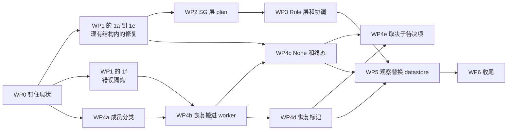

# ModelServing 滚动与恢复：重构方案

## 0. 文档信息

| 项 | 内容 |
| --- | --- |
| 状态 | 方案，待评审。没有修改 controller 代码。每个工作包开始之前仍然需要单独批准 |
| 代码基线 | `volcano-sh/kthena` `main` @ `b4e536bb` |
| 目标 | 把 controller 从当前实现改到[状态机改进方案](04-state-machine.md)描述的设计，同时修掉检视里发现的 57 条问题 |
| 输入 | [检视意见](../modelserving-rollout-implementation-review.md)的 49 条；[Pod 状态入口的检视](02-pod-state-entry-review.md)新增的 8 条和改判的几条；[复评结论](01-rereview-disposition.md)；决定 D1～D3、D9～D11 |
| 取代 | 状态设计第 6 节「迁移路径」和检视意见第 5 节「建议的整改顺序」 |

代码位置的缩写沿用检视意见：`msc.go`、`surge.go`、`obs.go`、`coord.go`、`ipu.go`、`aux.go`、`store.go` 在 `pkg/model-serving-controller/` 下；另有 `pdt.go`（`controller/pod_deletion_targets.go`）、`rh.go`（`controller/revision_history.go`）、`ctl.go`（`pkg/controller/controller.go`）。

## 1. 结论

重构分七个工作包，每个都能单独合入、单独回退。

| 工作包 | 做什么 | 解决什么 |
| --- | --- | --- |
| WP0 | 把现状钉成测试，补测试夹具，在 Kind 上取一次基线 | 之后每一步都有东西可以对照 |
| WP1 | 在现有结构里修掉偏离规范的决定和几处会卡死的地方 | 2 条 P0 和大部分 P1 |
| WP2 | 把 ServingGroup 层的决定抽成纯函数 `plan` | 阶段显式、预算统一、场景可以表驱动 |
| WP3 | Role 层改用同一个 `plan`，合并两套 surge，协调的候选函数独立出来 | 两层同构，去掉测试与生产分叉 |
| WP4 | 恢复并入 worker：成员分类、`recover`、`None` 的新语义、恢复标记、退避 | Pod 状态入口的全部问题，D9、D10、D11 |
| WP5 | 用「缓存加在途写操作」的观察替换 datastore 里的状态；任何 Pod 变化都入队；`status` 写出阶段和原因 | 重启和丢事件时的健壮性 |
| WP6 | 清理、文档、契约和 runner 用例的迁移 | 收尾 |

三点说明。

- **先钉住，再搬动。**WP0 不改行为。WP4 里「把删除搬进 worker」和「改恢复的语义」分成不同的 PR，前者不改语义。
- **WP1 和 WP4 的前半可以马上开始**，它们不依赖待决项。依赖待决项的部分列在[第 9 节](#9-决策前置和风险)。
- **WP0、WP1、WP4 覆盖 2 条 P0 和 21 条 P1 里的 20 条。**其中 REC-4、REC-7 在这三个工作包里先止血，根治在 WP5。剩下的一条 P1 是 CO-3，它等行为规范的 D7，单独立项，不在本方案的承诺之内。WP2、WP3、WP5 解决的是结构和健壮性，价值在于以后不再出同类问题。

## 2. 原则

| 原则 | 含义 |
| --- | --- |
| 行为变化和结构变化不放在同一个 PR 里 | 改结构的 PR 用现有测试和 WP0 的测试证明行为没变；改行为的 PR 一次只改一条规则，带着它自己的用例 |
| 每个 PR 改写的断言要点名 | 现有测试里断言了要改的行为的，在 PR 里逐条列出、改写，不删除、不放宽 |
| 探针转成正式测试 | 两轮探针共 130 个测试函数，都只打印不断言。修哪条意见，就把对应的探针改写成带断言的单测 |
| 决定是纯函数 | 成员分类、`plan`、`recover` 不调用 API、不读时钟，输入输出都是值。场景表直接当测试表 |
| 每个改代码的工作包都在 Kind 上验证 | workspace 的规则。单测和探针不能代替 |
| 不新增 API 字段 | 新增的只有一个 Pod 注解（恢复标记）、若干事件和 condition 的原因。现有 condition 的 `type` 和 `reason` 只增不改 |

## 3. 目标结构

重构完成后，一轮 reconcile 的代码按管线分成下面几块。文件名是建议。

| 块 | 职责 | 性质 | 取代现在的 |
| --- | --- | --- | --- |
| `events.go` | informer 回调：记录真实的删除、入队。Pod 失去归属时只入队 | 不调用 API，不改单元状态 | `updatePod`、`deletePod`、`handleReadyPod`、`handleErrorPod`、`handleDeletedPod` 里的决定和请求 |
| `observe.go` | 从缓存取 Pod，叠加在途的写操作，归并成成员和单元 | 只读 | datastore 的状态字段、`syncAll`、每轮的 Ready 重算 |
| `classify.go` | 成员状态、单元状态、属性和标志 | 纯函数 | `updatePod` 的 `switch`、`rolePodsComplete`、各处的 `IsPodRunningAndReady` 判断 |
| `budget.go` | 三个计数和两个额度 | 纯函数 | SG 分支内联的预算（`msc.go:1814-1841`）、`rolloutBudget`（`obs.go:112-143`） |
| `plan.go` | 四个阶段、阻塞原因、基线推进 | 纯函数 | `syncServingGroupReplicas`、`manageRollingUpdateWithPolicy`、`surge.go` 和 `obs.go:214-379` 的两套 surge |
| `plan_coordination.go` | 协调模式的候选 | 纯函数，输入是同一份观察 | `coord.go` 里与观察耦合的部分、13 处 `ms.ResourceVersion != ""` |
| `recover.go` | 触发、范围、计时、退避、恢复标记 | 纯函数；内存状态作为输入输出 | `handleErrorPod`、`handlePodAfterGraceTime`、`handleDeletedPod`、`recreatedSinceDeletion`、`graceMap` |
| `execute.go` | 按顺序发请求，登记在途的写操作和本进程发出的删除，逐个动作复核，错误隔离 | 唯一发写请求的地方 | 散在各处的 CREATE、DELETE、PATCH；`podDeletions`、`roleCleanups` |
| `status.go` | 副本计数、阶段、阻塞原因、事件 | 每轮都执行 | `updateModelServingStatus`，以及各处的提前返回 |

去掉的东西：datastore 里的单元状态和 Running 集合；`graceMap` 和 grace 的 goroutine；`podDeletions` 和 `roleCleanups` 两张内存表；固定 1 秒的重入队；通过 `context.Context` 传递的隐式状态（检视意见 RD-7）。

## 4. 工作包

### WP0 钉住现状

不改行为。

| 项 | 内容 |
| --- | --- |
| 测试夹具 | 把第一轮 `probes/behavior-regression` 的驱动整理成包内的测试辅助：fake clientset，手动同步 informer 缓存，按脚本投递 spec 变更和 Pod 事件，步进 `syncModelServing`，记录每一步的单元、UID、`status` 和发出的请求。第二轮的驱动加了三样：扣住某个 Pod 的缓存更新、模拟进程重启、在 worker 发 CREATE 之前插入回调，一并收进来 |
| 组合场景 | 35 个场景里当前符合的 26 个，写成断言现状的表驱动用例。部分符合的 7 个和不符合的 2 个随 WP1 对应的 PR 加入 |
| Pod 状态矩阵 | [02](02-pod-state-entry-review.md) 第 3 节的每一行，断言当前的反应：是否入队、datastore 的变化、谁发了什么请求。标出哪些行会在 WP4、WP5 改写 |
| 协调路径 | 夹具构造的 ModelServing 带 `resourceVersion`，让协调的测试走生产分支。分支本身在 WP3 去掉 |
| Kind 基线 | 在当时的 `main` 上跑 runner 的 RUN-618～652、恢复和重启套件，把探针结论换成 Kind 证据。按探针推断，RUN-636（SG-C12）和 RUN-649（SG-P09）不会通过 |

意见：TS-2、TS-3、TS-4。

### WP1 现有结构内的修复

六组，可以分开合入。1a 到 1e 彼此没有依赖，每一项都是一处局部改动加它的用例。1f 改的是一条调用链，不是局部改动，单独成组。

| 组 | 改动 | 意见 | 位置 |
| --- | --- | --- | --- |
| 1a 预算与阶段 | SG 模式加健康删除额度；受保护的未就绪组不再让健康的旧组被删；缩容没结束不替换；基线只在 P 为 0 且 N 大于 0 时推进；零副本时也检查 U 和 S | BG-1、BG-2、BG-3、BG-5、VER-1 | `msc.go:1753-1853`、`msc.go:795-868`、`webhook/validator.go:234-250` |
| 1b 序号与 surge | surge 只建在序号 ≥ N；缩容只选正式单元，并先刷新状态；surge 单元里补建的 Pod 继承标记；整个单元空了之后按当前期望重新判断它是正式单元还是 surge；Role 模式下新建的组按 Role 的 partition 选版本；回收 surge 之前对候选单元的 Pod 按 UID 直读一次标记 | ORD-1、ORD-2、ORD-3、ORD-4、ORD-5、ORD-6 | `surge.go`、`msc.go:982-1024`、`msc.go:3248-3267` |
| 1c 协调 | 按实例的实际版本判断有没有工作；依赖门控不看与滚动无关的删除 | CO-1、CO-2、CO-4 | `coord.go:770-1027` |
| 1d InPlace | 重启次数的基准覆盖全部容器；恢复时用目标版本；目标改回原版本时走预算；完成步骤放到 Role 同步之前 | IP-1、IP-2、IP-3、BG-6 | `inplace/state.go:215-240`、`ipu.go:490-500`、`ipu.go:732-756` |
| 1e 止血 | 失主时退出进程；Ready 时清除 grace 记录；grace 到期前重读策略和 grace；`deleteServingGroup` 里 LIST 出错时触发补偿入队 | PL-2、REC-2、REC-3、EV-5 | `ctl.go:157-190`、`msc.go:2247-2350` |
| 1f 错误隔离 | 身份不符的同名 Pod、版本读不出来的单元只阻塞所在单元，其余单元和 `status` 照常处理。见下面的说明 | PL-3；REC-4 的止血 | `msc.go:3299-3309`、`msc.go:651-734`、`controller/auxiliary_cleanup.go:45-72` |

说明。

- 1b 里「回收前直读标记」是 ORD-3 时序缺口的止血办法，候选最多 S 个，开销很小。根治在 WP5（清标记进在途的写操作）。
- 1b 里 ORD-4 是 WP4c 的前置：`None` 下终态 Pod 被重建之后，如果补建的 Pod 不带 surge 标记，单 Pod 的 surge 单元故障一次，滚动结束后的序号集合就不对了。
- 1d 里「恢复时用目标版本」按[状态机](04-state-machine.md) 6.7 的优先级做：单元里还有带进度注解的 Pod 时用目标版本，整单元消失后重建按 R15。
- 1e 里的 REC-2、REC-3 改的是 WP4b 会整体替换的代码。它们是 P1，改动只有几行，不等 WP4b。
- 1e 的「失主时退出」只影响启用了 `--leader-elect` 的部署。
- 1f 要改的不止 `createPod` 的返回值。身份不符的错误现在从创建 Pod 一路返回：实例的循环、组的创建、`syncModelServing`，每一层都是遇错即返回，后面的滚动和写 `status` 都被跳过（`msc.go:651-734`）。每轮最先会中止整轮的是 `finishPendingDeletions`，它遇到第一个错误就返回（`controller/auxiliary_cleanup.go:45-72`）；排在它前面的 `cleanupOrphanServices` 出错不提前返回。1f 把这几层逐层改成「记下这个单元的错误，继续处理其余单元」，出错的单元本轮不算就绪，错误在最后汇总返回，`status` 在汇总之前照常写。它是 4b 的前置：恢复搬进 worker 之后，一轮中途出错不能挡住恢复。

行为变化见[第 6 节](#6-对外变化和发布)。风险：低到中，项数多。

### WP2 ServingGroup 层的计划函数

| 项 | 内容 |
| --- | --- |
| 改动 | 新增纯函数 `plan`（[状态机](04-state-machine.md) 5.2）和预算函数。`syncServingGroupReplicas` 和 `manageRollingUpdateWithPolicy` 的 SG 分支改成「从 datastore 取快照、调用 `plan`、执行结果」。候选顺序用显式的排序键，不再靠列表拼接和 datastore 的排序 |
| 测试 | 行为规范的 35 个场景和附录 B 的查表写成 `plan` 的单测；与参考模型 `rollout_model.py` 用同一批输入做差分测试 |
| 意见 | RD-1、RD-2、RD-4、BG-4 |
| 依赖 | WP1 的 1a、1b |
| 行为变化 | 原地更新中的单元显式占用额度。取决于 D6：回退为重建的单元能否用 surge |
| 风险 | 中。除列出的变化外，行为应与 WP1 之后相同，用 WP0 的测试和现有 e2e 把关 |

### WP3 Role 层、surge 合并、协调

| 项 | 内容 |
| --- | --- |
| 改动 | Role 层改用同一个 `plan`，调用前按[状态机](04-state-machine.md)第 8 节准备输入。合并 `surge.go` 和 `obs.go:214-379` 的两套 surge，标记按层区分。协调模式的候选函数独立出来，输入是同一份观察；去掉 `ms.ResourceVersion != ""` 的 13 处分支。拆开 `manageRoleReplicasPerGroup` 和 `resolveRoleRolloutState` |
| 测试 | 跨层的场景（SG-R01 一类）需要两层一起的测试。协调模式现有的断言全部保留，改成走同一条路径：`TestCoordinatedActionRechecksDependencyBudgetAndReplacementAfterPlanning`、`TestRoleRolloutAvailabilityAndOrderedCandidates` |
| 意见 | RD-3、RD-5、RD-6、RD-7、RD-8、CO-7、CO-8 |
| 依赖 | WP2、WP1 的 1c |
| 行为变化 | Role 模式下原地更新中的实例显式占用额度 |
| 风险 | 中到高。协调模式的主要单测目前不走生产分支，要先靠 WP0 的夹具补上 |

CO-3、CO-5、CO-6 不在这个工作包里，它们等行为规范的 D7、D8 和本方案的 O5。

### WP4 恢复并入 worker

分五个 PR。前两个不改语义。

| PR | 改动 | 意见 | 行为变化 |
| --- | --- | --- | --- |
| 4a 成员分类 | 新增纯函数，按[状态机](04-state-machine.md) 2.1 把 Pod 归到成员状态。`updatePod` 的 `switch` 和 worker 的「在位」「Ready」判断都改成调用它，各自保持现在的反应 | — | 无 |
| 4b 恢复搬进 worker | 新增纯函数 `recover`，先只实现现有的触发、范围和时机，包括现有的两步顺序：先删故障的 Pod，看到它消失之后再展开到范围内其余的 Pod。grace 改成内存里的起点加 `AddAfter`；回调不再调用 `deleteServingGroup`、`DeleteRole`，只记录真实的删除并入队，Pod 失去归属不再当作删除；删除 `handlePodAfterGraceTime` 和 `graceMap`。恢复的删除排在其他步骤之前，并做错误隔离。DELETE 失败由队列重试。本进程发出的删除按 UID 记到它的删除事件处理完为止。原地更新超期时对没打上补丁的成员的直接删除是恢复的一种触发，不记成普通的自己发出的删除：它消失之后照常展开到范围，与现在相同 | REC-2、REC-3、REC-6、REC-7、REC-8、EV-2、EV-5、PL-5 | 恢复的第一个 DELETE 从 worker 发出，多一段排队的时间。删除失败会重试。故障 Pod 的删除不再早于第一轮 reconcile。摘掉 ownerReference 不再触发范围恢复 |
| 4c `None` 和终态 | `Succeeded` 归入终态。`None` 下终态 Pod 立即单独重建，带退避。有终态成员的单元不选作原地更新。每次删除发一条事件，记在被删的 Pod 上，并写日志。改写 API 注释并重新生成 CRD | PL-1、PL-4、PL-8（单 Pod 的部分）、IP-6（终态的部分） | D10，见[第 6 节](#6-对外变化和发布) |
| 4d 恢复标记 | 范围重建改成先标记后删除（[状态机](04-state-machine.md) 6.3 的 M1～M7）。故障的 Pod 到期各自被删，这一步不变；其余 Pod 的删除等范围内正在终止的 Pod 都消失。外部删除的记录保留到范围内的 Pod 全部带上标记。开始担任 leader 时已经在终止的 Pod 不算外部删除。创建 Pod 时不从模板复制标记的 key | REC-5 | D11，见[第 6 节](#6-对外变化和发布) |
| 4e 取决于待决项 | 范围重建的退避（O3）；终态 Pod 跳过 grace（O2）；`-1` 的处理（O1）；范围恢复是否改成一起删除（O8） | PL-8（范围的部分） | 取决于决定 |

说明。

- 4b 之后、WP5 之前，worker 的恢复仍然通过现有的 `DeleteRole` 和 `deleteServingGroup` 执行，单元的 `Deleting` 状态还在 datastore 里，由 worker 一方写，回调不再写。4d 用恢复标记取代恢复这一路的内存批次；滚动和缩容那一路在 WP5 去掉。
- 4b 要保留现有的两步顺序才算不改语义。当前实现里每个故障的 Pod 各自计时、到期各自被删（`msc.go:2308-2350`），收到第一个删除事件之后才删范围内其余的 Pod（`msc.go:2352-2386`）；故障的 Pod 卡在终止中时，其余的 Pod 一直保留。范围内有几个故障的 Pod 时，4b 同样逐个删除，不能只删第一个。`DeleteRole` 和 `deleteServingGroup` 是一次删除整个范围的，所以 4b 里由 `recover` 先只发故障 Pod 的删除，在看到其中最先消失的那一个消失的那一轮，再调用这两个函数。4d 沿用这个顺序（[状态机](04-state-machine.md) 6.3 的 M2），只有一处不同：其余 Pod 的删除从「被删的 Pod 里最先消失的那一个消失时」改成「范围内正在终止的 Pod 都消失之后」，因为前者在重启之后判断不出来。标记写全之后一起删除是待决项 O8，不在 4b、4d 里。
- 4b 把恢复和滚动放进同一轮之后，一轮中途出错不能挡住恢复。当前实现里恢复由回调发出，不受 reconcile 出错的影响；搬进 worker 之后要靠执行顺序和错误隔离保证（[状态机](04-state-machine.md) 4.3）。1f 是它的前置；`finishPendingDeletions` 的重试也在 1f 里改成逐单元进行。
- 「开始担任 leader 时已经在终止的 Pod 不算外部删除」这条规则放在 4d，不放在 4b。场景：`RoleRecreate`，故障的 Pod 已被删除、还在终止时 controller 重启。现在新进程把它的删除事件当成一次真实的删除，重建整个实例。没有恢复标记时加上这条规则，结果会变成只补一个 Pod；有了标记，范围按标记做完，结果与现在相同。所以 4b 保持现在的重启结果，这条规则和标记一起引入。「有了标记」的前提是上一任 leader 也是含 4d 的构建：升级到 4d 的那一刻，旧构建在途的恢复没有标记，见 [6.2](#62-升级说明) 第 10 条。它同时解决 REC-5 的另一半：上一任 leader 因缩容或滚动留下的终止中的 Pod，消失时不再被当成外部删除。
- 4c 依赖 1b 的 ORD-4。按标记续做的恢复在范围清空之后，对 PodGroup 的处理和 plugin 删除钩子的调用应当与一次做完的恢复相同，由「范围内没有 Pod」这个观察触发；4d 的实现要写明并验证。
- WP5 依赖 4c 和 4d，不依赖 4e。
- 测试：`recover` 的单测按[状态机](04-state-machine.md) 6.1 的表和 2.4 的矩阵写；与推演模型 `recovery_model.py` 做差分测试；[第 7 节](#7-验证)列出的单元级和 Kind 级用例。

风险：中。恢复的时序会变，恢复和重启的用例要全部重跑。

### WP5 用观察替换 datastore

| 项 | 内容 |
| --- | --- |
| 改动 | 单元状态每轮从缓存里的 Pod 推导，不再存储。在途写操作的记录覆盖创建、删除、打补丁、清标、写和清除恢复标记，按对象叠加到观察上，不整轮等待（[状态机](04-state-machine.md) 4.1）。任何 Pod 变化都入队，打开周期 resync。去掉 `syncAll`、`podDeletions`、`roleCleanups`。`status` 每轮都写，condition 增加阶段和阻塞原因。每轮直连 apiserver 的 Service LIST 和 ControllerRevision LIST 改成读缓存 |
| 意见 | EV-1、EV-3、EV-4、REC-4、VER-4、IP-6、PL-6；ORD-3、PL-3、REC-7 的根治 |
| 依赖 | WP3、4c、4d |
| 行为变化 | Pod 只是变成未就绪或开始终止，也会及时反映到 `status`。`status.conditions` 多出阶段和阻塞原因 |
| 风险 | 高。这是结构性的替换，放在最后。需要先测「任何 Pod 变化都入队」的开销 |

### WP6 收尾

| 项 | 内容 |
| --- | --- |
| 清理 | 只有测试调用的生产函数、没有用到的参数、与实现不符的注释和事件文案；没有调用者的 `utils.ContainerRestarted` |
| 历史 | `revisionHistoryLimit`；历史读不到时阻塞的范围 |
| 文档 | 用户文档补一节恢复策略；开发者文档按新结构重写 |
| 契约和 runner | 按[第 6 节](#6-对外变化和发布)迁移 |

意见：VER-2、VER-3、RD-9、PL-7。

## 5. 意见到工作包的对照

| 意见 | 级别 | 工作包 |
| --- | --- | --- |
| BG-1、BG-2 | P0 | 1a |
| BG-3、VER-1 | P1 | 1a |
| BG-5 | P3 | 1a |
| BG-4 | P2 | WP2（SG 模式）、WP3（Role 模式） |
| BG-6、IP-1、IP-2、IP-3 | P1 | 1d |
| ORD-1、ORD-4、ORD-6 | P1 | 1b |
| ORD-2、ORD-5 | P2 | 1b |
| ORD-3 的时序缺口 | P2 | 1b 止血，WP5 根治 |
| VER-2、VER-3 | P2 | WP6 |
| VER-4 | P3 | WP5 |
| CO-1、CO-2、CO-4 | P1 | 1c |
| CO-3 | P1 | 等 D7，单独立项 |
| CO-5 | 不定级 | 等 D8 |
| CO-6 | P2 | 等 O5 |
| CO-7、CO-8 | P2 | WP0 补测试，WP3 去掉分支 |
| REC-1 | 关闭 | D9 决定不要求，不改代码 |
| REC-2、REC-3 | P1 | 1e 止血，4b 替换 |
| REC-4 | P1 | 1f 解除卡死，WP5 根治 |
| REC-5 | P1 | 4d |
| REC-7 | P1 | 4b（恢复不再由回调展开），WP5 根治 |
| REC-6、REC-8 | P2 | 4b |
| IP-5 | P2 | 等 D6；WP2、WP3 |
| IP-6 | P2 | 4c（终态的部分）、WP5（报告的部分） |
| EV-1、EV-3 | P2 | WP5 |
| EV-2 | P2 | 4b |
| EV-4 | P3 | WP5 |
| EV-5 | P3 | 1e 止血，4b 替换 |
| RD-1、RD-2、RD-4 | P3 | WP2 |
| RD-3、RD-5、RD-6、RD-7、RD-8 | P3 | WP3 |
| RD-9 | P3 | WP6 |
| PL-1 | P1 | 4c |
| PL-2 | P1 | 1e |
| PL-3 | P1 | 1f，WP5 根治 |
| PL-4 | P2 | 4c；`-1` 下的报告在 WP5 |
| PL-5 | P2 | 4b |
| PL-6 | P2 | WP5 |
| PL-7 | P3 | WP6 |
| PL-8 | P2 | 4c、4e |
| TS-1 | 测试 | 随各 PR 改写点名的断言 |
| TS-2、TS-3、TS-4 | 测试 | WP0 |

## 6. 对外变化和发布

### 6.1 行为变化

下表列的是会被用户或运维观察到的变化，相对当前实现。

| 变化 | 规则或决定 | 工作包 |
| --- | --- | --- |
| SG 模式下，受保护的单元未就绪时不再删除健康的旧单元。保护区的故障会让灰度停住，同时给出看得见的阻塞原因 | R8、R9、D2 | 1a |
| 缩容的单元彻底消失之前不开始滚动 | R24 | 1a |
| 缩容对象卡在终止中时，不再多删一个健康的正式单元 | R24 | 1a |
| P 大于 0 或 N 为 0 时不推进基线 | R17 | 1a |
| 滚动途中缩容不再先删 surge | R20、R26 | 1b |
| 稀疏布局下 surge 建在高位并带标记，滚动结束后原来的序号集合不变 | R1、R2 | 1b |
| 缩容按刷新之后的状态选对象 | R20 | 1b |
| surge 单元里被重建的 Pod 仍带标记，滚动结束时这个单元会被回收 | 行为规范第 3 节 | 1b |
| Role 模式下新建的组按 Role 的 partition 选版本 | R15 | 1b |
| 协调模式：模板改回基线的 Role、回滚到 `currentRevision` 的滚动按协调规则更新；依赖启动门控不再被无关的删除打开 | R31 | 1c |
| 原地更新中的单元里补建的 Pod 是目标版本；中途把目标改回原版本时按预算排队，不再立即删除，被 partition 盖住的单元也照样替换（与现在相同）；升级前就有重启记录的容器不再让原地更新被判为崩溃 | R35、R37 | 1d |
| 启用 leader election 时，失主的进程退出并由 Deployment 重新拉起。同一个进程里还有 ModelBooster、Autoscaler、LWS 三个 controller 和全部 admission webhook；单副本部署时，进程重启期间 webhook 不可用，ModelServing 等对象的写入会被拒绝，启用驱逐 webhook 时节点排空也会被拒绝 | — | 1e |
| 名字被外来 Pod 占用、或 Pod 的 revision 标签读不出来时，只有那一个单元停住，其余单元照常滚动，`status` 照常更新 | — | 1f |
| grace 等待期间改策略或 grace 会生效；Pod 恢复就绪后再次故障重新计时 | 契约 API §6.2 | 1e |
| 原地更新中的单元显式占用额度，同时更新的单元数不会超过 `maxScaleDown` | R36 | WP2、WP3 |
| InPlace 启用时，实际走重建的变更照常使用 surge | R38、D6 待定 | WP2、WP3 |
| 恢复的删除由 worker 发出，时点会晚一点；删除失败会重试；故障 Pod 的删除不再早于各 ModelServing 的第一轮 reconcile | — | 4b |
| 摘掉 Pod 的 ownerReference 不再触发范围恢复。这个 Pod 被当作外来的 Pod，所在的单元停住并报告冲突。它所在的范围在冲突解决之前不做范围恢复：故障的成员不删，外部删除只补缺失的成员。以前恢复照常删掉范围内属于自己的 Pod，实例停在 `Deleting` | — | 4b、4d |
| 改掉 Pod 的身份标签，以前让整个 ModelServing 的 reconcile 每轮中止，现在只有所在的单元停住 | — | 1f |
| `None` 下，`Failed` 或 `Succeeded` 的 Pod 被立即删除并按原名字重建，其余 Pod 不动；同一位置连续失败时退避。以前这样的 Pod 一直留着 | D10 | 4c |
| `Succeeded` 成为恢复的触发条件。`RoleRecreate` 和 `ServingGroupRecreate` 下它和 `Failed` 一样按范围重建。以前所有策略都不处理它 | D10 | 4c |
| `None` 下，只有一个 Pod 的单元因为终态被重建时按序号重新选版本：不受保护的用目标版本，受保护的用基线版本。以前只有 Pod 被人删除时才会这样 | R15、D10 | 4c |
| `None` 下，原地更新中进入终态的 Pod 被单独重建，更新不再永久卡住。多 Pod 的单元里它被重建成目标版本；它是单元里唯一的 Pod 时按序号重新选版本 | R15、R37、D10 | 4c |
| 旧单元里有终态的成员时，即使模板只改了镜像也按重建处理，不做原地更新，并发出现有的 `InPlaceUpdateFallback` 事件 | R35 | 4c |
| 每次因为终态删除 Pod，发一条带 Pod 名字、原因和退避信息的事件，记在被删的 Pod 上，同时写日志；ModelServing 上另有一条不带明细的汇总事件。记在 Pod 上的事件用 `kubectl events --for pod/<名字>` 查，`kubectl describe` 同名的新 Pod 看不到 | D10 | 4c |
| controller 重启或换主之后退避归零，等待中的终态 Pod 在新 leader 的第一轮被删除 | D9、D10 | 4c |
| 协调模式下依赖启动门控关闭期间，单 Pod 的根 Role 实例进入终态后被删除而暂时不重建。以前这个 Pod 留着 | D10；O5 待定 | 4c |
| Role 实例或 ServingGroup 的恢复一旦开始（范围内已经有 Pod 被删除），重启或换主之后会做完，幸存的健康成员也会被删除。以前取决于重启的时刻。例外是[状态机](04-state-machine.md) 6.3 的三个窗口，那时只补缺失的成员 | D11 | 4d |
| controller 开始担任 leader 时已经在终止、所在范围又没有恢复标记的 Pod，消失之后只补这一个。以前新进程会把它的删除事件当作一次外部删除，重建整个范围，不论它是被谁删的：上一任 leader 因缩容或滚动删掉的 Pod 也会连带删掉健康的成员（REC-5）。受影响的还有 controller 不在期间被外部删除、新 leader 开始工作时还在终止的 Pod，以前会触发范围重建，现在不会；节点排空把 controller 和成员 Pod 一起驱逐时就是这种情况 | D11；契约 2.7 的重启收敛 | 4d |
| 恢复途中改了 `recoveryPolicy` 或 grace：在途的恢复按原来的范围种类做完，改成 `None` 也不取消；新策略下的范围恢复要等旧范围做完、或它的标记被清除之后才开始。以前展开时读当时的策略。改成 `-1` 在不重启的路径上与现在相同：现在展开时只读策略，不看 grace | D11 | 4d |
| 被外部删除的 Pod 一带上 `deletionTimestamp`，同范围的 Pod 就被写上标记，这次恢复从这时起不可撤销：终止期内把策略改成 `None` 不再取消。终止期内范围内不补建，组内扩容等待，单元在 `status` 里不算可用。其余 Pod 被删除的时点不变。以前终止期内 controller 什么都不做，单元仍算可用，到被删的 Pod 消失时才按当时的策略决定 | D11 | 4d |
| 范围内同时有几个 Pod 在终止时，其余 Pod 的删除等它们全部消失。以前在第一个消失时就删 | D11 | 4d |
| 恢复已经开始、触发的 Pod 卡在终止中的期间，范围内其余的 Pod 继续运行但带着标记：这时再删掉其中一个，不补建，也不连带删除其余的；把 N 或 `roles[].replicas` 调小也删不到它们，要等卡住的 Pod 消失。以前删掉一个同伴，它消失时其余同伴也被删；缩容会把整个单元的 Pod 都删掉。没有受支持的撤销办法，处理掉卡住的 Pod 之后恢复继续 | D11 | 4d |
| `None` 下 controller 仍然可能删除健康的 Pod，有两种情况：做完一个已经开始的范围；范围带着还没清除的残留标记时，范围内又有 Pod 被外部删除。`-1` 配范围重建的策略时这两种都不是新增的：现在展开时不看 grace，外部删除也照样重建整个范围；变化只是范围取自标记，不取自当时的策略 | D11 | 4d |
| 范围带着残留的恢复标记时（重启、回退再升级之后），范围内的单元暂时不被缩容、回收和替换，`None` 下的终态 Pod 也暂时不删，直到标记被清除，通常是一轮。`status` 里报告 `UnitLocked`。这个单元如果正是缩容的对象，缩容完成之前整个预算范围不建 surge、不替换（R24）；额度只有 1 而它排在最前面时，其余待替换单元也等 | D11 | 4d |
| 原地更新中的单元被整个重建时按序号选版本。更新开始之后 partition 被提高到盖住它的单元，重建出来的是基线版本。这是相对行为规范 R37 的变化；SG 模式下当前实现对空组已经按序号和 partition 选版本，Role 模式没有核对 | R15；R37 的收窄，待批准 | 4d |
| 恢复期间不往范围内补建，整个单元一起重建。以前可能多建又多删一个 Pod | D11 | 4d |
| 恢复范围内的 Pod 在被删除之前带一个恢复标记注解。它是 controller 保留的注解，值的格式不是接口。手工写入一个 UID 正确、n 大于现有 Pod 数的标记，会让 controller 删除整个范围；Pod 模板里的同名 key 不会被复制到 Pod 上 | D11 | 4d |
| 恢复的等待、承诺、完成、退避和清除残留标记各有事件。现有的 `RoleCreating`、`RoleRunning`、`RoleDeleting` 等事件保留，同一次转换只发一条；controller 重启之后不再给每个 Role 实例补发一条 `RoleRunning` | — | 4b、4d、WP5 |
| Pod 只是变成未就绪或开始终止，也会及时反映到 `status` | — | WP5 |
| 执行出错的轮次也写 `status`，`observedGeneration` 随之推进；只有观察阶段就失败的轮次不推进。以前一轮在写 `status` 之前出错时不推进。LWS 适配层把 `observedGeneration` 落后当作 `status` 过期，它的投影会受影响 | — | WP5 |
| `status.conditions` 增加阶段和阻塞原因 | R28、R29 | WP5 |

下面两项不在表里，因为当前实现本来就是这样。

- 新 leader 重新观察故障并重新计满 grace。它是相对契约 2.7 的变化。
- 范围恢复先删故障的 Pod，它消失之后再删其余的。本方案保留这个顺序，是否改成一起删除是待决项 O8。4b 在各个重启时刻的结果都与现在相同。4d 在触发的 Pod 还在终止、标记已经写上时与现在相同，其余时刻的变化见表里 D11 的各行。

### 6.2 升级说明

`None` 的含义在已发布的版本里变过两次。

| 版本 | `None` 下 `Failed` 的 Pod |
| --- | --- |
| v1.0.0 | 删除，不补建 |
| v1.1.0-rc.0（预发布） | 等 grace 之后删除，只补这一个 Pod |
| v1.1.0 | 不删除。发布说明把「`None` no longer deletes Pods」列为默认行为变化 |
| D10 | 立即删除，只补这一个 Pod，带退避 |

D10 相对 v1.1.0 是一次反转。发布时需要写明下面这些事。第 1～5 条和第 8 条针对 `None`，第 6、7、10 条针对范围重建的策略，第 9 条不限策略，第 11 条针对协调模式。

1. 升级之后的第一轮 reconcile 会把所有 `None` 的 ModelServing 里现存的终态 Pod 一次删掉。它们失败的原因如果还在，替代的 Pod 会再次失败，之后进入退避。
2. 把 `None` 当作「保留失败的 Pod 用来排查」的用户，需要一个替代办法。按 O1 的建议，办法是 `restartGracePeriodSeconds: -1`。退避推迟的是删除，等待期间失败的 Pod 也还在。
3. Pod 模板用 `restartPolicy: Never` 或 `OnFailure` 的负载，含义从「崩了就停着」变成「controller 反复重建」，节奏由退避决定。
4. 回退到旧版本没有残留：`None` 这一路没有持久状态。
5. 存量的终态 Pod 如果是所在单元里唯一的 Pod，升级后按当前的 partition 重新选版本：不受保护的变成目标版本，受保护的变成基线版本。
6. `RoleRecreate` 和 `ServingGroupRecreate` 下，存量的 `Succeeded` Pod 在升级后的第一轮成为范围重建的触发条件，同范围的健康成员一起重建。以前它们不被处理。
7. `restartPolicy` 是 `OnFailure` 或 `Never`、容器以 0 退出的负载，在范围重建的策略下会进入「重建、`Succeeded`、再重建」的循环。范围重建目前没有退避（O3 未定），以前这种 Pod 只是停在那里。建议把「`Succeeded` 触发范围重建」和 O3 放在同一个版本里。
8. 退避只在内存里。controller 每次重启或换主之后，等待中的终态 Pod 会立即被删除一次。
9. 被删的 Pod 的现场（`phase`、原因、退出码）只留在事件和 controller 日志里。事件记在被删的 Pod 上，用 `kubectl events --for pod/<名字>` 查，默认保留一小时。
10. 升级到含恢复标记的版本的那一刻，旧版本已经删掉故障的 Pod、还没有展开到其余成员的恢复不再展开，只补这一个 Pod；那一刻正在终止的外部删除同理。旧版本不写标记，新版本把开始担任 leader 时已经在终止的 Pod 都当作不需要展开的删除。补建的 Pod 如果加入不了原来的一组，只有在它崩溃重启或者进入终态时才会再按策略重建范围；它一直不 Ready 而不重启时没有自动的补救，要人工删除一个成员来触发。
11. 协调模式下依赖启动门控关闭期间，单 Pod 的根 Role 实例进入终态后会被删除而暂时不重建（O5 未定之前的已知行为）。

### 6.3 需要一起改的东西

| 类别 | 位置 | 改动 | 工作包 |
| --- | --- | --- | --- |
| API 注释 | `pkg/apis/workload/v1alpha1/model_serving_types.go:127-140` | `None`：重启后未就绪的 Pod 不删除，`Failed` 或 `Succeeded` 的 Pod 删除并只重建这一个。另外两种策略补上 `Succeeded` | 4c |
| API 注释 | `pkg/apis/workload/v1alpha1/servinggroup_types.go:117-121`；`model_serving_types.go:138-139` | `-1` 的「the controller never deletes it」和 `None` 的「A Pod deleted by others is recreated on its own」各有例外：已经开始的恢复会做完；范围带着没清除的残留标记时，外部删除会重建整个范围。`None` 加 `-1` 的含义取决于 O1 | 4c、4d |
| 生成物 | CRD、`client-go/applyconfiguration`、CRD 参考文档 | 用 `make generate` 重新生成，不手改 | 4c |
| 用户文档 | `docs/kthena/docs/user-guide/multi-node-inference.md:434` | 「`None` … leaves the Pods alone」收窄到超时仍在运行的 Pod。新增一节恢复策略，写明恢复标记是 controller 保留的注解 | 4c、4d、WP6 |
| 现有单测，改写 | `TestHandleErrorPodRecoveryDisabledLeavesPod` 的 `None leaves a failed pod` | 改成断言恰好一次带 UID 前置条件的 DELETE，目标是这个 Pod。同表的 `None leaves a restarted pod` 保留 | 4c |
| 现有单测，改写 | `TestServingGroupRollingUpdateIgnoresUnavailableProtectedGroups`（BG-1）、`TestReplacementPodIsPreservedAndDiagnosedDuringCleanupRetry`（REC-7）、`TestSurgeDisabledWhileUpdatingInPlace`（IP-5，取决于 D6） | 断言改成规范要求的行为 | 1a、4b、WP2 |
| 现有单测，换入口 | `TestHandlePodAfterGraceTime`、`TestHandlePodWithoutGraceTimeUsesUIDPrecondition`、`TestHandleErrorPodTracksReplacementByUID`、`TestUpdatePodRecoversCrashDuringInPlaceUpdate`、`TestGraceTimeKeepsOnlyPodsThatFinishedTheUpdate`、`TestDelayedDeleteEventDoesNotRecoverRecreatedUnit` | 断言原样保留，改成走 worker 的路径 | 4b |
| 现有单测，改写 | `TestCompleteInPlaceUpdatesRevertedToSourceRevisionRecreates`、`TestRoleLevelRevertRecreatesPatchedRole`、`TestInPlaceIntegrationCanonicalRoleRevertRecreatesAbandonedImage`（BG-6） | 它们断言目标改回原版本之后单元立即处于删除中。改成：单元成为待替换单元，有额度的那一轮被删除重建，额度为 0 时不删 | 1d |
| 现有单测，换入口 | `TestHalfPatchedUnitHitsDeadline`、`TestRetargetedHalfPatchedUnitHitsDeadline`、`TestRetargetedUnitStillHitsDeadline`、`TestInPlaceDeadlineFollowsRecoveryPolicy` | 进度期限这一路的结果不变，断言原样保留，改成走 worker 的路径 | 4b |
| 现有单测，换入口 | `TestSyncAllWithFailedPods`、`TestSyncAllWithContainerRestartedPods`、`TestSyncAllWithMixedPods`、`TestSyncAllBeforeFixBehavior` | 它们断言 `syncAll` 发出删除。改成断言第一轮 reconcile 发出同样的删除 | 4b、WP5 |
| 现有单测，保留 | `TestCompleteInPlaceUpdates` 的 `extra crash on the target image` 三项；`TestOnTargetIgnoresCrashes`；`TestReconciliationEmitsRoleRunningEvent`、`TestRepeatedRoleStatusUpdateEmitsOneEvent`；`lws_controller_test.go` 里 `status` 过期的投影 | 行为不变：恢复不生效时原地更新的完成不看计划外重启；Role 状态事件同一次转换只发一条。结构改动之后这些断言要继续通过 | 4c、WP5 |
| 行为规范 | R32、R34、R37、4.10 末尾、D9、6.2 | 见[状态机](04-state-machine.md)第 14 节。逐条需要批准 | WP6，与 4c、4d 同一个版本 |
| 契约 | API §6.1 的 `None` 一行、触发条件、重启一段、「`None` 与 grace=-1 不能被绕过」一句；§6.2 的故障起点和 `None` 一列；§11；SG 规范 A.4 的重启收敛表；`README.md` 的版本和修订记录；英文版同步 | 见[状态机](04-state-machine.md)第 14 节。逐条需要批准 | WP6，与 4c、4d 同一个版本 |
| runner 用例 | `cases/recovery-contract` 的 `Failed is retained for None and -1`；执行器里的 `failed-none` | 拆成 `None` 和 `-1` 两条。`None`：只有目标 Pod 的 UID 变化 | 4c |
| runner 用例 | RC-01～RC-04 及其判定器、`docs/RESTART_CONVERGENCE.md` | 期望反过来：幸存者带恢复标记、范围已经开始时被删除，整个单元一起重建。判定要以「重启时幸存者是否带标记」为前提；三个丢失窗口下只补缺员也是合法的结果 | 4d |
| runner 用例，需要重跑确认 | `cases/lost-deletion`（RUN-443～448）、`cases/eviction`（RUN-433、434）、deletion-replay、protected-recovery、initial-sync、leader-switch、grace-restart | 按用例文字走读没有发现冲突，没有运行。lost-deletion 要求不重启就从丢失的删除通知里恢复，WP5 去掉 `podDeletions` 之后靠在途写操作到期时的直读（[状态机](04-state-machine.md) 4.1） | 4b、4d、WP5 |
| runner 用例 | RUN-652（SG-R01）；RUN-013、014、043、044 | 见行为规范第 9 节 | 已有结论，不属于本轮 |
| 不用改的 | RUN-341～352、377～388（真实删除）；RUN-389～400（容器重启）；RUN-436、439（滚动删除被重启打断，不写标记） | — | — |

### 6.4 回退

| 工作包 | 回退之后 |
| --- | --- |
| WP1、WP2、WP3 | 没有持久状态的变化。`[0, N)` 内带 surge 标记的单元会被旧版本清除标记并保留 |
| 4b、4c | 没有持久状态。已经重建的 Pod 留着，之后出现的终态 Pod 又会被保留 |
| 4d | 旧版本不认识恢复标记，按自己的规则处理这些 Pod。回退的步骤里要清除这个注解，在旧版本接管之后执行：`kubectl annotate pods -n <命名空间> -l modelserving.volcano.sh/name=<名字> modelserving.volcano.sh/recovery-scope-`，每个 ModelServing 一次。新版本还在运行时清除没有用：已经开始的范围会被补回标记。不清除的话，再升级时分两种情况：范围内没在删除的 Pod 数不少于标记里的 n，标记是残留，按 M6 清除；少于 n（回退期间这个范围缩过容，或者再升级的那一刻范围内有 Pod 正在终止），范围被当作已经开始，整个重建一次，不看策略和成员是否健康。没有验证 |
| WP5 | 新增的 condition 类型在旧版本里没有人维护，会停在回退前的值 |

## 7. 验证

每个改代码的工作包要过四道：单测、`make lint`、改了 API 注释或生成物时的 `make gen-check`、Kind。Kind 上按 workspace 的规则做：镜像从任务分支构建并带任务编号的标签，确认运行中的 Pod 用的是这个镜像，工作负载用 `schedulerName: volcano`，修复之前先复现，证据记进任务目录。

| 工作包 | 单元级 | Kind 级 |
| --- | --- | --- |
| WP0 | 夹具自身；26 个场景；Pod 状态矩阵 | RUN-618～652 和恢复、重启套件的基线 |
| 1a | SG-P09、SG-C02、C05、C07、C10、P05；附录 B 的查表；BG-2 的探针转成测试 | RUN-649；缩容加更新的组合；缩容对象卡在终止中 |
| 1b | SG-C12、SG-S03、SG-S04（从规定的初态）；`N` 从 3 到 4 再到 3 的缓存时序；surge 单元里的 Pod 故障；Role 模式下扩容新建一个组，各 Role 实例按该 Role 的 partition 选版本 | RUN-636；`maxSurge=1` 的滚动中让单 Pod 的 surge 单元故障，看滚动结束后的序号集合 |
| 1c | CO-1、CO-2、CO-4 在生产分支上的探针转成测试 | 协调模式的回滚和依赖门控 |
| 1d | IP-1、IP-2、IP-3、BG-6 的探针转成测试；v1→v2 的原地更新途中提交 v3，分序号 ≥ P 和被 partition 盖住两种，成员已经就绪和没有完成各一例：是否待替换、是否计入 `ready`、走哪一种额度；作废而成员都就绪的单元和一个真正未就绪的旧单元同时待替换时，先动未就绪的那个；途中把目标改回原版本并把 partition 提高到盖住它：仍然按预算被替换；补丁打到一半就过了进度期限：`RoleRecreate` 下没打上补丁的成员不等 grace 被删，它消失后同范围的其余成员也被删，整个范围按目标版本重建，`None` 下不删除、每轮继续续补；SG 模式、`RoleRecreate`、grace 为 0，另一个 Role 实例已经在目标镜像上就绪并带着进度注解：超期后重建出来的成员还没 Ready 时不被再次删除，Ready 之后单元完成更新；v1→v2 途中提交 v3、序号 ≥ P 而额度为 0 的单元，排队期间超期照样按策略处理 | 带 sidecar 重启记录的原地更新；更新中途改回原版本 |
| 1e | Ready 后再次故障；等待中改策略 | 启用 leader election，断开 apiserver 超过续约期限，看进程是否退出并恢复工作；进程重启期间 `kubectl apply` 一个 ModelServing 的结果，启用驱逐 webhook 时 `kubectl drain` 的结果 |
| 1f | 身份不符的同名 Pod、版本读不出来的单元：其余单元的创建和滚动照常，`status` 每轮更新；`finishPendingDeletions` 里一个单元出错时其余单元的清理继续 | 手工创建一个同名的外来 Pod，看其余单元的滚动和 `status` |
| WP2、WP3 | `plan` 的场景表；与参考模型的差分；跨层场景；原地更新打到一半（一个 Pod 打了补丁，另一个的 PATCH 失败）下一轮续补、额度只占一次 | 全部组合用例；Role 模式的同构场景 |
| 4b | `recover` 的表；先删故障 Pod、它消失后再展开的两步顺序与现在相同；一个范围里两个故障的 Pod、先到期的带 finalizer：两个各自到期被删，后一个消失的那一轮其余成员被删，不等卡住的那个（钉住现状，4d 改这一条）；删除失败重试；一个单元每轮出错时其他单元的恢复照常；回调迟到的三种交错；摘掉 ownerReference 不触发恢复；controller 自己缩容删掉的 Role 实例，删除事件晚到也不触发恢复 | 恢复和重启套件；`RoleRecreate`、`ServingGroupRecreate` 下的故障、重启、真实删除与现在相同 |
| 4c | 见下 | 见下 |
| 4d | 见下 | 见下 |
| WP5 | 在途写操作的叠加和期限：创建被接受之后 Pod 在缓存看到之前就被删；删除已经完成而缓存一直没有收到通知；清标成功之后 N 缩小；一个单元的写操作迟迟不被确认时其他单元照常。目标版本解析失败的轮次不推进 `observedGeneration`，LWS 的投影不出现假的 `Available=True`。每种阻塞原因出现和清除。丢事件后的收敛；重启时全故障、全终止的单元 | 全量回归；「任何 Pod 变化都入队」的开销 |

4c 的用例。

| 级别 | 用例 | 要观察的 |
| --- | --- | --- |
| 单元 | `None`，一个 worker 变成 `Failed`；同样的 `Succeeded` | 恰好一次 DELETE，带这个 Pod 的 UID 前置条件，由 worker 发出；它消失后恰好一次 CREATE，同名；其余 UID 不变；一条事件 |
| 单元 | `None`，未就绪、重启故障、CrashLoopBackOff、Pending、终止中 | 多轮之后 DELETE 数为 0 |
| 单元 | `None`，grace 省略、0、60 | 删除的时点相同 |
| 单元 | controller 不在时 Pod 变成 `Failed`，然后启动；运行中事件被丢弃 | 不需要这个 Pod 的事件也会处理 |
| 单元 | 滚动途中：多 Pod 的旧单元里一个成员进入终态；不受保护的单 Pod 旧单元；受保护的单 Pod 单元 | 补建的版本分别是单元已应用的版本、目标版本、基线版本；`ready` 和 `maxScaleDown` 不变 |
| 单元 | surge 单元的一个成员进入终态；单 Pod 的 surge 单元进入终态 | 补建的 Pod 带 surge 标记；滚动结束后序号是 `[0, N)` |
| 单元 | 多 Pod 的单元在原地更新中，一个 Pod 进入终态 | 用目标版本补建；更新完成 |
| 单元 | 单 Pod 的单元在原地更新中进入终态，分 partition 没变和已经提高到盖住它两种 | 分别重建成目标版本和基线版本 |
| 单元 | 旧单元里有一个终态成员，模板只改了镜像，其余原地更新的条件都满足 | 按重建处理；不给终态的 Pod 打补丁；有 `InPlaceUpdateFallback` 事件 |
| 单元 | 模板只改了镜像，被选中时单元里一个成员正在终止；另一例：一个成员缺失 | 前者等待，不打补丁也不重建；后者现存的成员打补丁，缺的成员补建后续补 |
| 单元 | `None` 和 `-1` 各一例：原地更新中的 Pod 在目标镜像上多崩一次，再 Ready | 单元完成并翻转标签（现有断言保留） |
| 单元 | `None`，三个终态 Pod 在退避等待中，模拟重启 | 新进程第一轮删除这三个，之后间隔从最小值重新增长 |
| 单元 | 同一个 ModelServing 连续 30 次终态删除 | 每一次的 Pod 名字、UID、原因、退出码都能从事件或日志里查到 |
| 单元 | `RoleRecreate`，grace 为 0，替代的 Pod 每次都 `Succeeded`；另一例：启动时已有 `Succeeded` 的 Pod | 前者记录循环的节奏（采纳 O3 之后间隔按退避增长）；后者第一轮按范围重建，范围外 UID 不变 |
| 单元 | 同一个名字连续失败 | 间隔按退避增长并有上限；另一个名字不受影响；模板改了之后从头开始 |
| 单元 | 被删除的终态 Pod 卡在终止中 | 不发 CREATE，不重复发 DELETE |
| 单元 | 另一个单元每轮都出错 | 终态 Pod 仍然被处理 |
| 单元 | `RoleRecreate`、`ServingGroupRecreate`，一个成员 `Succeeded` | 按范围重建 |
| Kind | `None`，`restartPolicy: Never`，容器 20 秒后 `exit 1`（上游 PR #2006 的复现清单） | 只有这一个 Pod 的 UID 在变，间隔按退避增长 |
| Kind | `None`，让 worker 被 kubelet 驱逐 | 只有它被替换；PodGroup 不变；新 Pod 被 Volcano 调度 |
| Kind | 升级：旧镜像下造出若干保留着的终态 Pod，再换成新镜像 | 第一轮里被删除的数量；之后的退避 |
| Kind | 给 Pod 加 finalizer 再让它进入终态 | 没有替代者；去掉 finalizer 后出现 |
| Kind | 配了驱逐预算；一个终态 Pod；排空另一个节点 | 替代 Pod 就绪之前驱逐被拒绝，之后被允许 |
| Kind | 默认策略，`restartPolicy: OnFailure`，容器以 0 退出；另一例：旧镜像下留着 `Succeeded` 的 Pod，再换新镜像 | 范围重建的节奏和事件；升级后第一轮被删的 Pod |
| Kind | `None`，终态 Pod 在退避等待中时重启 controller | 重启后第一次删除的时点 |
| Kind | 硬性的 `networkTopology`，`None`，让一个 Pod 所在的节点不可用 | 补建的 Pod 能否调度；一直 Pending 时 `status` 怎么显示 |
| Kind | 默认的客户端限速；`None` 下 100 个存量终态 Pod 时升级 | 完成时间，其他 ModelServing 的 reconcile 延迟，留下的事件条数 |

4d 的用例。行为回归终审和复查给出的完整清单在任务目录的 `subagents/r2-behavior-regression-final.md` 第 4 节和 `r2-behavior-regression-final-recheck.md` 第 5 节；下表收了其中与本设计的规则直接对应的。终审清单里按「一起删除」写的几条期望已经过时，采纳 O8 的话要恢复。

| 级别 | 用例 | 要观察的 |
| --- | --- | --- |
| 单元 | `RoleRecreate`，grace 到期 | 先对实例的每个 Pod 写标记，再删故障的 Pod；它消失之后才删其余的 Pod；标记的值含范围、Pod 的 UID 和 n |
| 单元 | `RoleRecreate`，外部删除一个 Pod，它带着 `deletionTimestamp` 还没消失 | 其余的 Pod 写上标记，n 把被删的 Pod 算在内；它消失之前不删其余的 Pod，范围内不创建；消失之后其余的 Pod 被删除 |
| 单元 | 恢复被重启打断的三个时刻：故障 Pod 还在终止、已经消失、其余成员都在终止 | 三个时刻的终态相同：范围内全部是新 UID，范围外不变；没有多余的创建。第一个时刻的结果与只含 4b 的构建相同 |
| 单元 | [状态机](04-state-machine.md) 6.3 的三个丢失窗口各一例 | 只补缺失的成员，幸存者 UID 不变，没有标记残留 |
| 单元 | 只标了一部分就重启，分两种：范围内已经少了 Pod（外部删除触发）；一个没少 | 前者其余成员被补标，整个范围重建；后者标记被清除，或在触发条件仍然成立时接着做 |
| 单元 | 创建到一半的单元（有成员从未创建过）里，故障的成员被标记之后重启，故障自己恢复 | 标记被清除，现存成员的 UID 不变，缺的成员补上 |
| 单元 | 带残留标记的范围里：`None` 下出现终态 Pod；组内缩容选中其中的 Role 实例；滚动选中它 | 标记清除之前不发这些删除，清除之后照常；范围不会因此被整个删除 |
| 单元 | 三个组，U 为 1，最高序号的组带残留标记，清标的 PATCH 持续失败；N 从 3 改成 2，同时另一个组待替换；多轮之后让 PATCH 成功 | 失败期间不删这个组，也不改删别的组；不建 surge，另一个组不替换；`status` 里同时有 `ScaleDownInProgress` 和 `UnitLocked`，有连续失败的事件。PATCH 成功后一轮之内缩容，随后替换 |
| 单元 | N 为 3，U 为 1，三个健康的旧单元，序号最高的带残留标记，清标持续失败；提交新模板 | 它占着替换的名额，另外两个不替换；`UnitLocked`。PATCH 恢复后滚动继续 |
| 单元 | `serving-group` 的残留标记只写在实例 A 的 Pod 上，策略是 `None`，实例 B 的 Pod 进入终态 | 清标之前不删 B 的 Pod |
| 单元 | `None`，实例带残留标记（n 为 3，三个 Pod 健康）；清标之前外部删除一个 Pod；对照：清标之后再删 | 前者其余两个被删，整个实例重建，有事件；后者只补一个 |
| 单元 | 范围带残留标记，还没清除时摘掉其中一个 Pod 的 ownerReference | 范围不算已经开始，其余 Pod 的 UID 不变 |
| 单元 | 范围内有一个结果不明的在途创建时，另一个成员的故障满 grace | 本轮不承诺；创建确认或到期之后再承诺，n 只数确认存在的 Pod |
| 单元 | 健康的范围：手工写入有效的标记且 n 大于现有 Pod 数；中途摘掉一个 Pod 的标记；摘掉全部标记；模板和 plugin 带同名 key | 第一种范围被重建；第二种标记被补回；第三种只补缺失的成员；最后一种不发生删除 |
| 单元 | 一个健康的旧单元带着残留标记，另有受保护的未就绪单元占着额度 | 它计入 `ready`；不会被当作未就绪的候选删除 |
| 单元 | 恢复途中策略从 `RoleRecreate` 改成 `ServingGroupRecreate`，又出现新的触发；另一例：原范围里故障的 Pod 带 finalizer 卡住 | 先做完或清除 `role` 的标记，再承诺 `serving-group`；任何时刻组内只有一种标记。卡住期间不写 `serving-group` 的标记，`status` 里有原因 |
| 单元 | 范围已经开始之后把 grace 改成 `-1`；对照：第一个 DELETE 之前改 | 前者做完；后者标记被清除，UID 不变 |
| 单元 | 外部删除触发，第一个 PATCH 失败 | 记录保留，下一轮重试，范围仍然重建 |
| 单元 | 因故障承诺，只给故障的 Pod 写上了标记，其余的 PATCH 失败；随后故障的 Pod 被外部删除并消失，controller 没有重启 | 记录还在，范围重新承诺并重建；期间范围内不补建 |
| 单元 | 标记写完、没有发出任何 DELETE 就重启，期间故障的 Pod 恢复就绪 | 标记被清除，UID 不变 |
| 单元 | 标记写完之后把策略改成 `None`，分别在第一个 DELETE 生效之前和之后 | 之前：标记被清除；之后：范围做完 |
| 单元 | 故障的 Pod 带 finalizer，范围恢复开始 | 故障的 Pod 消失之前，其余的 Pod 保留并继续运行，范围内不创建；去掉 finalizer 之后其余的 Pod 被删除，整个范围重建 |
| 单元 | 多 Pod 的单元在原地更新中，`RoleRecreate` 触发整单元重建，分 partition 没变和提高到盖住它两种 | 分别重建成目标版本和基线版本 |
| 单元 | Pod 上的标记 UID 对不上 | 不删除，标记被清除 |
| 单元 | 恢复中的单元被缩容选中；恢复中的单元是 surge 单元 | 清空后不重建；或按 surge 的规则重新判断 |
| 单元 | 滚动删除被重启打断 | Pod 上没有标记；重启后重新选中 |
| 单元 | 开始担任 leader 时一个 Pod 已经在终止，同范围的 Pod 都没有标记，分三种来源：controller 不在时被外部删除；上一任 leader 缩容删掉的 Role 实例；不写标记的旧构建因故障删掉的触发 Pod | 三种都是：它消失之后不触发范围恢复，其余成员的 UID 不变；第一种和第三种补这一个 Pod |
| 单元 | `RoleRecreate`，一个范围里两个 Pod 先后进入重启故障；另一例：先到期的那个带 finalizer | 两个 Pod 到期各自被删，都消失后删除其余成员。先到期的卡住时，后到期的照样被删，健康的成员保留到卡住的 Pod 消失 |
| 单元 | `RoleRecreate`，外部删除一个终止期长的 Pod；策略改成 `None`，分第一个标记写上之前和之后 | 之前：记录丢弃，没有标记，只补这一个。之后：被删的 Pod 消失后其余成员被删，整个实例重建 |
| 单元 | 恢复已经开始，触发的 Pod 带 finalizer：删掉一个同伴；N 调小并且这个单元本该被缩掉，另一例调小 `roles[].replicas`；清掉全部 Pod 的标记，对照只清运行中的 | 同伴不补建，其余同伴 UID 不变；缩容等卡住的 Pod 消失，之后范围清空、不重建；全部清掉后只补缺员，只清一部分时标记被补回。每一步的 `status` 计数 |
| 单元 | `RoleRecreate`、`ServingGroupRecreate` 各一例，范围内一个 Pod 被摘掉 ownerReference：另一个成员故障满 grace；另一个成员被外部删除并消失。然后删掉外来的 Pod。`ServingGroupRecreate` 下一个外来的 Pod 暂停整个组的范围恢复 | 冲突期间没有标记，没有范围删除，`IdentityConflict`；外部删除只补缺失的成员。冲突解除后仍然故障的成员重新触发恢复 |
| 单元 | informer 断连期间一个 Pod 被外部删除并消失，重新 LIST 时以 tombstone 交付 | 按外部删除处理，整个范围重建，与现在相同 |
| 单元 | 回退之后的遗留：四个健康的 Pod 带 `serving-group` 标记，n 为 4。三种初态：Pod 数仍为 4；`roles[].replicas` 已调小、剩 3 个；一个 Pod 在终止 | 第一种清标、UID 不变；后两种整组重建一次 |
| 单元 | 按标记续做的恢复，范围清空 | PodGroup 的删除和 plugin 的删除钩子各恰好一次，与一次做完的恢复相同 |
| 单元 | 与 `recovery_model.py` 的差分 | 同一串事件下动作相同 |
| Kind | 改写后的 RC-01～RC-04 | 幸存者被删除，整个单元一起重建，版本按重建时的 partition |
| Kind | 回退再升级三种：原样；回退期间调小 `roles[].replicas`；再升级时范围内有一个带 finalizer 的终止中 Pod。各做一遍不清除注解和按回退步骤清除注解 | 不清除时，第一种标记被清除、UID 不变，后两种健康的范围被重建一次；清除之后三种都不删健康的 Pod |
| Kind | `RoleRecreate` 和 `ServingGroupRecreate`，给一个 worker 加 finalizer 再让它 `Failed`；先在 `main` 上取基线 | 其余成员被删的时刻与基线相同（finalizer 去掉之后）；卡住期间其余成员在运行 |
| Kind | `terminationGracePeriodSeconds: 120` 加 preStop；`kubectl delete pod` 和 Eviction API 各一次 | 其余成员收到删除的时刻不早于目标 Pod 消失的时刻 |
| Kind | `ServingGroupRecreate` 加 Volcano gang；恢复中途重启一次 controller | PodGroup 的 UID 和 `minMember`，新 Pod 是否整组调度，headless Service 是否重建 |
| Kind | 默认的客户端限速；32 个 Pod 的组做一次范围恢复 | 完成时间，其间其他 ModelServing 的 reconcile 延迟 |
| Kind | 在改动后的构建上跑 runner 的 lost-deletion、eviction、deletion-replay、protected-recovery、initial-sync、leader-switch、grace-restart | 逐例结果 |
| Kind | 在 `main` 或只含 4b 的构建上触发范围恢复，触发的 Pod 带 preStop、终止期 120 秒；终止期内把 controller 换成含 4d 的构建 | 同伴不被删，只补一个 |
| Kind | `ServingGroupRecreate`，排空一个同时运行 controller 和一个成员 Pod 的节点；先在 `main` 上取基线 | 新 controller 起来之后这个组是整组重建还是只补一个；只补一个时这个组能否正常服务，补建的 Pod 不 Ready 也不重启的话记下来 |
| Kind | `terminationGracePeriodSeconds: 120`，`kubectl delete pod`；另一次在终止期内把策略改成 `None`；`main` 上取基线 | 终止期内同伴的注解、`availableReplicas`、condition，组内扩容是否等待；改成 `None` 之后同伴是否仍被删 |
| Kind | 恢复已经开始、触发的 Pod 带 finalizer 时调小 `replicas`，另一例调小 `roles[].replicas`；`main` 上取基线 | 同伴占着的资源什么时候释放 |

## 8. 证据

| 证据 | 内容 | 位置（任务目录下） |
| --- | --- | --- |
| 滚动的参考模型 | 第一轮。行为规范 R1～R29 的单个预算范围：37 个场景脚本、15 种预算组合、18 万条随机序列，没有违例 | `model/rollout_model.py`、`model/summary.md` |
| 恢复的推演模型 | 本轮。见下 | `model/recovery_model.py`、`model/recovery-fuzz.txt` |
| 探针 | 第一轮 79 个测试函数，第二轮 51 个。fake clientset，驱动真实的 controller 函数 | `probes/` |
| 调研 | 故障 Pod 的处理和组级恢复的先例，全部是一手来源 | `subagents/r2-community-failed-pod-research.md` |
| Kind | 没有 | — |

**恢复的推演模型。**一个 ServingGroup、两个 Role 实例，每个实例一个 entry 和一个 worker。环境随机注入崩溃循环、终态、恢复就绪、外部删除、Pod 消失、策略和 grace 的变更、从别处复制来的标记、一段时间内创建不出来的成员。controller 在每次 API 调用之前有 8% 的概率崩溃并丢掉内存，每次 API 调用有 3% 的概率失败。每条序列 60 轮，之后停止注入，检查是否收敛。模型里 Pod 的健康状态和标记互相独立，规则按[状态机](04-state-machine.md) 6.6 的伪代码写；两者之间的差别列在本节末尾。

模型检查的内容：

| 检查 | 内容 |
| --- | --- |
| I3 | 范围删除只删带有效标记的 Pod，发出时范围内现存的 Pod 都已带标记（模型里没有外来的 Pod）。`None` 下不承诺范围，单 Pod 删除的对象是终态的 Pod |
| I4 | 因故障删除一个成员时，它已满 grace |
| I5 | 标记写全、范围内已经少了 Pod 之后，旧成员消失之前范围内不创建。「带标记期间不创建」由创建规则本身保证，没有独立的断言 |
| I11 | 因故障删除一个成员时，它仍然是故障或终态，并且没在删除 |
| I13 | 被续做的范围，承诺时算在 n 里的 Pod 确实少了 |
| I14 | 范围少的 Pod 不全是 controller 自己的单 Pod 删除造成的 |
| 记录 | 外部删除触发的承诺，第一个标记写失败之后，记录仍在内存里 |
| 收敛 | 停止注入之后，每个成员都存在、没有标记、没在删除；除了策略不处理的故障，全部就绪 |

| 运行 | 序列数 | 违例 | 承诺次数 | 按 M6 清除残留 | 标记不全时丢失 | 其中没有崩溃的 |
| --- | --- | --- | --- | --- | --- | --- |
| M1～M7，种子 5 | 20000 | 0 | 152387 | 2086 | 4 | 0 |
| M1～M7，种子 11 | 20000 | 0 | 151657 | 1945 | 3 | 0 |
| M1～M7，种子 2026 | 20000 | 0 | 152074 | 1951 | 7 | 0 |
| M1～M7，策略固定为 `None` | 20000 | 0 | 0 | 0 | 0 | 0 |
| M1～M7，策略固定为 `RoleRecreate` | 20000 | 0 | 213956 | 1973 | 5 | 0 |
| M1～M7，策略固定为 `ServingGroupRecreate` | 20000 | 0 | 151019 | 1412 | 11 | 0 |

「标记不全时丢失」合计 30 次：29 次是标记写到一半，1 次是残留清到一半，之后带标记的 Pod 被外部删除并且消失。每一次都发生在第一个标记写上之后 controller 崩溃过的序列里，属于[状态机](04-state-machine.md) 6.3 列出的后两个窗口。没有一次是 controller 自己的删除造成的，也没有一次是因为标记写在了已经在删除的 Pod 上。策略固定为 `None` 的 2 万条序列里 controller 没有写过一个恢复标记，173071 次单 Pod 重建的对象都是终态的 Pod。

去掉或放宽一条规则的对照（种子 5，各 2 万条）：

| 变体 | 结果 |
| --- | --- |
| 不用标记，范围删除只记在内存里 | 19514 条序列里新旧成员混在一起 |
| M1 的顺序反过来，先标记已经在删除的 Pod | 丢失 609 次，其中 605 次是因为标记写在了正在消失的 Pod 上 |
| 放宽 M2，标记一个就删一个 | 丢失 663 次，全部是 controller 自己删掉了唯一带标记的 Pod |
| M2 的另一种顺序（待决项 O8）：标记写全之后一起删除 | 没有违例；承诺 170536 次，丢失 12 次，种类与默认顺序相同。其中 1 次没有崩溃，当时策略已经改成 `None`，按 `None` 只补缺失的成员 |
| M3 改成「范围不齐全就算已经开始」（本方案的第一版） | 3070 条序列里续做了一个 Pod 一个没少的范围 |
| 放宽 M4，范围已承诺或带标记时也允许补建 | 19375 条序列里新旧成员混在一起，另有 136 条续做了没有开始的范围 |
| 去掉 M6，带标记的范围一律做完 | 8291 条序列里续做了没有开始的范围 |
| 放宽 M6，残留清除之前允许单 Pod 删除 | 12 条序列里残留的范围被 controller 自己的删除变成了「已经开始」 |
| 去掉 M7，两种范围的标记可以并存 | 90 条序列里新旧成员混在一起 |
| 外部删除的记录用过一次就丢弃 | 1042 次承诺在第一个标记写上之前丢了依据，范围恢复退化成只补一个 Pod |
| 退避 | 一个每次创建后立刻失败的 Pod，64 个时间单位里：没有退避时重建 32 次，有退避时 10 次 |

规则是在模型和评审之间来回改出来的，经过如下。

| 来源 | 发现 | 改动 |
| --- | --- | --- |
| 模型，第一版 | 外部删除触发时，如果先给已经在删除的 Pod 写标记然后崩溃，标记随 Pod 一起消失，新 leader 只会补缺员 | M1 规定顺序 |
| 行为回归分析 | 回退再升级之后残留的标记会删掉健康的范围 | 增加 M6 |
| 提案分析 | 「范围不齐全」不能证明删除过：创建到一半的单元、扩容都会让范围不齐全 | 标记里记 n，「已经开始」改成个数少于 n |
| 提案分析 | 把「已标记」做成成员状态会盖住故障，也会让带残留标记的健康单元绕过健康额度被删除 | 标记改成属性，成员状态不看它；残留清除之前不在范围内删除 |
| 提案分析 | 两种范围的标记并存时，补标记和封闭的规则对不上 | 增加 M7，去掉范围升级 |
| 提案分析 | 外部删除的记录在第一个 PATCH 失败时已经被消费；自己发出的删除在缓存确认之后会被当成外部删除 | 记录保留；另记不算外部删除的删除 |
| 行为回归终审 | 标记写全之后一起删除，会在故障的 Pod 卡住时删掉原本还在运行的成员；D11 没有要求这一点 | M2 改回当前实现的两步顺序；一起删除列为待决项 O8，模型里两种顺序都跑 |
| 独立评审 | n 怎么对待还没建出来的 Pod、删除请求的时间、失去归属的 Pod、清标之前的复核，都没有定义 | 写明计数的口径；删除请求的时间取时间戳减宽限期；开始担任 leader 时已经在终止的 Pod 不算外部删除；清标和创建之前复核 |
| 模型，终审之后 | 只有一部分 Pod 带标记时就丢弃了外部删除的记录。带标记的正是被删的那个 Pod，它消失之后既没有标记也没有记录，没有崩溃也会丢 | 记录保留到范围内的 Pod 全部带上标记 |
| 独立评审复查 | 一个范围里有几个故障成员时只先删一个，其余的要等它消失；当前实现是到期各自被删 | M2 的第一步删除范围内每个已满 grace 的故障成员，范围已经开始之后新到期的也删 |
| 独立评审复查 | 清除残留标记的几次 PATCH 之间模型不会崩溃，第三个窗口没有按文档的条件走过 | 模型在每次 PATCH 之前都可能崩溃 |
| 独立评审第二次复查 | `None` 下的终态 Pod 不清故障起点：策略改成 `None` 又改回来之后 grace 没有重新计。范围已经开始的分支里，伪代码也没有清不再故障的成员的起点 | 伪代码和模型在这两处清起点。模型的 I4 用的是「连续故障的起点」，策略变化不重置它，之前检不出 |

模型的规则与[状态机](04-state-machine.md) 6.5、6.6 的差别：

- 「早于这次删除创建」在模型里按逻辑顺序判断；文档按秒比较，同一秒创建的算之后创建的。
- 模型里每次删除只生成一条记录，「不算外部删除的删除」在进程存活期间不清理；文档是两个时刻生成、按 UID 去重，集合保留到删除事件处理完。记录在集合清理之后才到的情形，模型没有走过。
- 「开始担任 leader 时已经在终止的 Pod 不算外部删除」在模型里靠「记录只在删除发生时生成、崩溃时清空」实现，没有单独的集合。
- 模型没有 ownerReference、在途的创建和原地更新，所以计数口径里的这几条、原地更新超期这一种触发，都没有覆盖。退避的键只有名字。
- 模型按清标、承诺、单 Pod 删除、创建的顺序执行，创建和单 Pod 删除在执行时才查标记：残留在本轮清除成功之后，同一轮就能在这个范围内补建或做单 Pod 删除。文档在计划时就按「带标记」「锁定」排除，要到下一轮。只差一轮，结果相同。
- 模型在执行承诺时再查一次 M7。模型里计划和执行之间环境不变，这个复查不起作用；文档的复核表没有这一行。

模型的限制：只有一个 ServingGroup；没有滚动、缩容、surge、原地更新和协调，所以锁定对候选选取的影响、I14 里缩容和滚动的部分都没有覆盖；缓存是同步的，没有模拟在途写操作的叠加；崩溃只发生在两次 API 调用之间；它是对规则的推演，不是实现，也不是 Kind 证据。

## 9. 决策前置和风险

### 9.1 决策前置

| 待决项 | 内容 | 建议 | 挡住什么 |
| --- | --- | --- | --- |
| O1 | `restartGracePeriodSeconds: -1` 下的终态 Pod，包括 `None` 加 `-1` | `-1` 在所有策略下都表示故障一律不删 | 4c 的 `-1` 分支；升级说明里「怎样保留失败的 Pod」的答案 |
| O2 | 范围重建的策略下，终态 Pod 是否跳过 grace | 跳过，与 O3 一起做 | 4e |
| O3 | 范围重建是否加退避 | 加 | 4e |
| D6（O4） | InPlace 启用时回退为重建的单元能否用 surge | 行为规范的建议不变 | WP2、WP3 里的一个分支；IP-5 |
| D7 | `maxSkew` 与旧依赖保留互相等待 | 单独立项 | CO-3 |
| D8（O5） | 依赖启动顺序是否只约束根 Role；恢复创建是否受门控约束 | 行为规范的建议不变 | CO-5、CO-6 |
| D4、D5 | 两套候选顺序是否统一；显式缩容是否继续按健康度选择 | 行为规范的建议不变 | 不挡任何工作包。`plan` 按现在的规则写 |
| O6 | 重启故障的判定是否区分历史上的重启 | 规范层面另行讨论 | 不挡 |
| O7 | 是否限制 Pod 模板的 `restartPolicy` | 先写进文档 | 不挡 |
| O8 | 范围恢复是否改成标记写全之后一起删除 | 不改，保持先删故障的 Pod、正在终止的 Pod 消失后删其余的 | 不挡。4b、4d 按现在的顺序做；采纳的话在 4e 里改 |
| 契约条款 | [状态机](04-state-machine.md)第 14 节的每一行 | 逐条批准 | 4c、4d 的发布 |

WP0、WP1 和 4a、4b 不依赖任何待决项。

### 9.2 风险

| 风险 | 说明 | 处理 |
| --- | --- | --- |
| 恢复搬进 worker 之后被 reconcile 的错误挡住 | 当前实现里恢复由回调发出，不受 reconcile 出错的影响 | 恢复排在最前；错误隔离；1f 先合入；用例「另一个单元每轮都出错」 |
| 升级瞬间批量删除终态 Pod | 数量是所有 `None` 的 ModelServing 里终态 Pod 的总和 | 升级说明；Kind 上测一次规模 |
| 只有一个 Pod 的单元因终态被重建时换了版本 | 滚动途中不受保护的旧单元直接变成目标版本；目标模板本身是坏的时候，一次节点故障会让若干旧单元都被重建成坏的版本。它们本来就不可用，可用性不比现在差 | 写进文档和事件 |
| 残留的恢复标记 | 回退再升级、备份还原、粘贴的清单、模板里带了同一个 key | 值里带 Pod 的 UID；M6；创建时不从模板复制这个 key；是否在 webhook 里拒绝保留的 key 可以另行决定。带残留标记的范围在标记清除之前不参与任何删除，通常只有一轮 |
| 恢复的承诺丢失 | 承诺只存在 Pod 上，有三个窗口会丢（[状态机](04-state-machine.md) 6.3）。都需要 controller 崩溃和外部删除叠在一起 | 丢失之后只补缺失的成员。被删的 Pod 在新进程开始工作之前已经消失时，今天的结果也是这样；还在终止时，今天会重建整个范围。关掉这些窗口需要 `status` 里的逐单元字段，没有采用 |
| 带标记的 Pod 删不掉 | 触发恢复的 Pod 卡在终止中时（finalizer、节点失联），范围内其余的 Pod 保留并继续运行，范围在它消失之前不重建，也不补建。到这里与当前实现相同。不同的是恢复已经不可撤销：缩容和滚动动不了这些 Pod，要等卡住的 Pod 消失 | 阻塞原因 `RecoveryInProgress`、`PodStuckTerminating`；处理掉卡住的 Pod 之后恢复继续；写进用户文档 |
| 担任 leader 时已经在终止的 Pod 不展开 | controller 不在期间的外部删除、升级到 4d 那一刻旧构建在途的恢复，都只补一个 Pod。节点排空把 controller 和成员 Pod 一起驱逐时会遇到。对依赖整组一起重启的负载，补建的 Pod 可能加入不了原来的一组 | 补建的 Pod 崩溃重启或进入终态时会再按策略重建范围；一直不 Ready 而不重启时没有自动的补救，要人工删除一个成员。写进升级说明；Kind 上验证一次 |
| 回退再升级时残留的标记 | 回退期间残留一直留着。再升级时范围内的 Pod 数少于标记里的 n（回退期间缩过容，或那一刻有 Pod 在终止），健康的范围会被整个重建一次 | 回退步骤里清除注解（[6.4](#64-回退)）；Kind 上按三种情形验证；写进升级和回退说明 |
| 残留标记清不掉 | 清标的 PATCH 持续失败时，所在的单元一直锁定，对它的缩容、回收和替换推迟。它是缩容对象时，整个预算范围的替换一起等（R24）；额度为 1 而它排在最前面时，其余待替换单元也等 | 不改删别的单元来凑数；`UnitLocked` 和连续失败的事件；用例见[第 7 节](#7-验证) |
| 标记和批量删除的 API 负载 | 范围恢复每个 Pod 多一次 PATCH，清残留再多一次；`None` 下每个终态 Pod 一次 DELETE、一次 CREATE、一条事件，升级瞬间集中发生。客户端限速默认 QPS 5、burst 10；Pod、Event、Service 的请求共用同一个限速器，同进程的三个 controller 共用同一个客户端 | Kind 上按规模测；O3 未采纳时范围重建的热循环每轮多一批 PATCH，建议 O3 作为 4d 之后的第一项 |
| 事件被限流 | 事件按来源和对象限流。记在 ModelServing 上的事件在批量删除时会被丢掉 | 删除事件记在被删的 Pod 上，同时写日志 |
| 失主退出连带 webhook 不可用 | 单副本部署时，进程重启期间 admission webhook 不应答 | 只影响启用 `--leader-elect` 的部署；写进发布说明；Kind 上测恢复时间。另一种做法是失主后不退出、取消 context 并重新参选，要求所有 goroutine 都受 context 约束 |
| grace 比 controller 的重启间隔长 | 持续的故障一直等不到恢复。当前实现同样如此 | 写进文档。O2 采纳后终态 Pod 不受影响 |
| 重建的 Pod 调度不回原来的拓扑域 | 配了硬性的网络拓扑时，单个补建的 Pod 可能一直 Pending；整组重建可以整体换域 | `None` 固有的限制，写进文档；Kind 上验证一次 |
| 改回原版本的原地更新单元要排队 | 成员已经就绪而健康额度为 0 时，它继续跑着被放弃的镜像，直到额度放开；现在是立即重建。等多久没有测量。排队期间成员没完成又过了进度期限时，恢复按原来的目的 revision 补建成员（[状态机](04-state-machine.md) 6.7 第 2 条），之后单元仍然要被替换成目标版本 | BG-6 的取舍。它在状态里是待替换单元；1d 的用例覆盖额度为 0 的一例 |
| 协调模式的测试覆盖 | 主要单测不走生产分支 | WP0 先补 |
| WP5 的开销 | 任何 Pod 变化都入队 | 先把直连 apiserver 的 LIST 改成读缓存；状态没变不写 `status`；按规模测 |

## 10. 没有做的事

- 没有修改 controller 代码、现有测试、runner 的契约和用例。
- 没有在 Kind 上运行任何东西。
- 没有创建或发布 GitHub issue、PR、评论。
- 工作包的规模没有估算工期。
