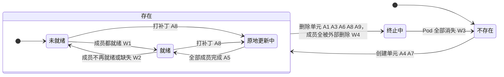
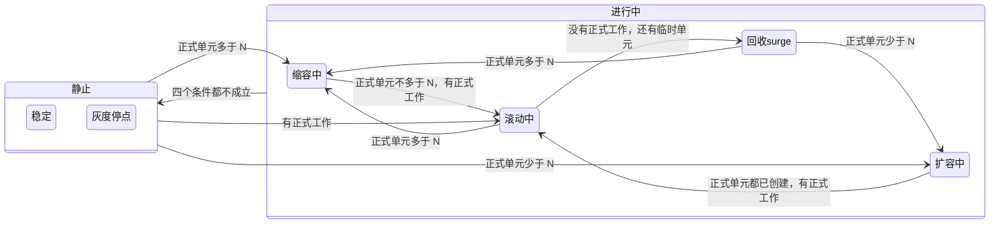

# ModelServing 理想状态机与改造对照

## 0. 文档信息

| 项 | 内容 |
| --- | --- |
| 用途 | 两件事。第 1～3 节画出理想的状态机：controller 应当怎样运转，状态怎样流转。第 4 节对照当前代码，逐个环节、逐条边、逐个函数指出要改哪里 |
| 状态 | 第 1～3 节是[状态机改进方案](04-state-machine.md)的统一画法，没有新增规则，没有实现。第 4 节是对照基线代码的走读 |
| 代码基线 | `volcano-sh/kthena` `main` @ `b4e536bb` |
| 以谁为准 | 规则以 04 为准；改造怎样拆分、先后顺序以[重构方案](05-refactoring-plan.md)为准；当前实现以基线代码为准。本文和它们有出入时是本文的错误 |
| 范围 | ServingGroup 层和独立 Role。协调 Role（roleCoordination）只标出入口函数。plugin、PodGroup、Service 只标出入口 |
| 附录 | 当前代码的逐行对照、函数索引、入队点。它们描述的是现状，是第 4 节的依据，不是目标 |

04 把状态分成成员、单元、阶段、恢复四层，各有一张图。这里把它们合成一条线和一台状态机：成员状态是状态机的输入，滚动和恢复是状态机边上的条件，阶段是状态机输出给 `status` 的名字。04 的各层图仍然是细节的出处。

代码位置的缩写沿用其他几份文档，都在 `pkg/model-serving-controller/controller/` 下：`msc.go` 是 `model_serving_controller.go`，`ipu.go` 是 `inplace_update.go`，`surge.go` 是 `surge_rollout.go`，`aux.go` 是 `auxiliary_cleanup.go`，`obs.go` 是 `coordinated_role_observation.go`，`coord.go` 是 `role_rolling_update_coordinator.go`，`rh.go` 是 `revision_history.go`，`pdt.go` 是 `pod_deletion_targets.go`，`binpack.go` 是 `binpack_scaledown.go`。工作包的编号（1a～1f、WP2、WP3、4a～4d、WP5）是 05 第 4 节的。

## 1. 一条线

controller 只有一条线。所有的决定、所有的写请求都在这条线上，没有第二个入口。

```text
事件、定时、resync ──► 入队 ──► worker 的一轮：观察 ─► 分类 ─► 记账 ─► 计划 ─► 执行 ─► 写 status
        ▲                                                              │
        └──────── 执行改变了 Pod，Pod 的变化又是一次事件 ◄────────────────┘
```

| # | 环节 | 做什么 | 不做什么 |
| --- | --- | --- | --- |
| 1 | 入队 | 属于它的 Pod 的任何变化，包括 Pod 不再属于它（owner 被摘掉，身份标签被改），ModelServing 的新增、`generation` 变化和删除，Service、PodGroup 的删除，定时到期，周期 resync，都只把所属的 ModelServing 放进队列。另外只记一件事：看到的真实删除 | 不调用 API，不改任何状态，不做决定 |
| 2 | 观察 | 读最新的 `spec`；从 informer 取这个 ModelServing 的全部 Pod；叠加本进程已经发出、缓存里还没看到的写操作 | 不读上一轮留下的单元状态。没有这样的状态 |
| 3 | 分类 | 每个 Pod 归到一个成员状态；每个单元由它的成员得出一个单元状态，外加版本、surge 标记、更新方式、锁定几个属性 | 纯函数，不调用 API |
| 4 | 记账 | 数出 `active`、`live`、`ready`、`notReadyTarget`，算出 `minAvailable` 和两个额度 | 同上 |
| 5 | 计划 | 按固定的顺序走一遍[第 2 节](#2-单元状态机)的边 A1～A11，得出一份动作列表 | 纯函数，不调用 API，不中途返回错误 |
| 6 | 执行 | 唯一发写请求的地方。按固定的顺序发：清标记和翻转版本标签，写恢复标记，恢复的删除，创建，续补，缩容、回收 surge 和替换。每个动作发出之前复核；一个单元出错只放弃这个单元 | 不做决定 |
| 7 | 写 status | 每一轮最后都写，执行出错的轮次也写。副本计数、阶段、阻塞原因都按本轮的观察算。观察就失败的轮次（读不到 `spec`，解析不出目标版本）只写副本计数和一个说明原因的 condition（04 4.4） | 除了基线 `status.currentRevision`（A11），都只是输出，不作为下一轮的输入 |

三条性质贯穿整条线。

- **水平触发。**一轮的决定只取决于最新的 `spec` 和本轮观察到的对象。不需要知道「N 改了」「模板改了」，controller 重启之后看到同样的对象，做同样的事。例外只有四项内存信息，丢了只会让恢复晚一点或范围小一点（04 1.3）。
- **等事件就返回，等时间就定时。**等 Pod 就绪、等 Pod 消失时这一轮直接结束，下一轮由 Pod 的事件带来。等 grace、等原地更新的进度期限、等在途写操作的期限时用 `AddAfter` 剩余的时间。没有 goroutine 里的睡眠，没有固定 1 秒的轮询；周期 resync 只作兜底。
- **丢了会改变结果的状态都放在对象上。**版本在 Pod 标签上，surge 标记、原地更新的进度、恢复标记在 Pod 注解上，基线在 `status.currentRevision`。

## 2. 单元状态机

### 2.1 状态图

状态机的主体是单元：`ServingGroupRollingUpdate` 下是一个 ServingGroup，`RoleRollingUpdate` 下是一个 ServingGroup 里某种 Role 的一个实例。两层用同一台状态机，各取各的 N、U、S、P；不负责滚动的那一层只走扩缩容和补成员的边（[2.3](#23-转换的条件)，04 第 8 节）。



- **五个状态只描述单元的生命周期。**它们都不存储，每一轮由分类从 Pod 得出（[2.2](#22-状态怎样得出)）。版本、surge 标记、更新方式、锁定是单元的属性，和序号、预算一起出现在边的条件里，不是状态。
- **动作只有四种。**创建和删除 Pod、改 Pod 镜像的动作是：创建单元，补成员，打补丁，删除（整个单元，或恢复范围里的 Pod）。扩容、缩容、建 surge、回收 surge、滚动替换、原地更新、故障恢复，都是这四种之一加上各自的条件（[2.3](#23-转换的条件)）。另有四种只写标记或 `status` 的操作：清除 surge 标记（A2），翻转 revision 标签（A5），写和清除恢复标记（A1、A9），推进基线（A11）。
- **边分两类。**W 开头的是 controller 等来的：由环境推动，kubelet 让 Pod 就绪、故障或消失，或者别人删除了 Pod，controller 只是在下一轮观察到。A 开头的是 controller 的动作：计划决定，执行发出。A 后面的数字是计划里固定的先后顺序，A11 除外，它的位置见 2.3。
- **不是每个 A 都改变单元的状态。**转正 A2、补成员 A10、原地更新的续补（A5 的一部分）、推进基线 A11 不改变，图上没有画。恢复的范围比单元小时，A1、A9 只删范围里的 Pod，单元不进入终止中，状态按 2.2 重新得出。
- **被选中不等于已经动手。**条件成立表示计划里有这个动作；动作发出之前还要经过锁定的推迟和执行前的复核（04 5.2、4.3）。
- **图上没有画更新作废。**原地更新的目的 revision 不再是最新目标时，单元不再算原地更新中，按成员回到未就绪或就绪，版本记为过期（04 第 3 节）。这是分类的结果，不是动作。

### 2.2 状态怎样得出

单元状态自上而下判定，取第一个成立的。

| 单元状态 | 条件 | 计入 |
| --- | --- | --- |
| 不存在 | 没有任何 Pod | 不计 |
| 终止中 | 现存的成员全部在终止；或所在范围的恢复已经开始；或本轮已经决定删除整个单元 | `active` |
| 原地更新中 | 有 Pod 带着未完成的原地更新进度注解，并且注解里的目的 revision 是最新的目标版本 | `active`、`live`、`notReadyTarget` |
| 就绪 | 已应用的版本要求的成员全部存在，全部就绪 | `active`、`live`、`ready` |
| 未就绪 | 其余全部 | `active`、`live`；版本是目标版本时还计入 `notReadyTarget` |

「没有 Pod 就是不存在」有一个例外：N 大于 0 而所有 Role 的期望实例数都是 0 的 ServingGroup。它没有 Pod，按 `spec` 计为存在并且就绪，不为它创建 Pod，也不因为它推进基线（04 第 3 节）。

成员状态是输入，同样自上而下判定。最后两行不对应一个属于自己的 Pod。「恢复生效」指 `recoveryPolicy` 不是 `None`，并且 grace（`restartGracePeriodSeconds`）不是 `-1`。

| 成员状态 | 条件 | 所在的单元 | 引出的边 |
| --- | --- | --- | --- |
| 终止中 | `deletionTimestamp` 非空 | 不能就绪；成员全部在终止时单元是终止中 | 等它消失。是看到的外部删除、策略又不是 `None` 时走 A9 |
| 终态 | `phase` 是 `Failed` 或 `Succeeded` | 不能就绪 | A9。任何策略、任何 grace 下都有，不等 grace |
| 重启故障 | 有计划外的容器重启，并且不 Ready 或正在原地更新中 | 不能就绪 | 恢复生效时 A9，满 grace 之后。恢复不生效时没有，只报告 |
| 原地更新中 | 原地更新的进度注解还没有完成 | 目的 revision 是最新目标时，单元是原地更新中 | A5。超过进度期限并且恢复生效时 A9 |
| 就绪 | `Running` 并且 Ready | 可以就绪 | W1 |
| 未就绪 | 其余全部：Pending，或不 Ready 而没有计划外重启 | 不能就绪 | 没有，等待 |
| 缺失 | 该有这个成员而没有 Pod | 不能就绪 | A10 |
| 外来 | 名字和某个成员相同，但 owner 不是这个 ModelServing，或者没有 owner，或者身份标签不是 controller 生成的形式 | 不能就绪 | 没有。只阻塞这个单元，报告冲突 |

所在单元的原地更新超期、恢复又生效时，从没打上补丁的成员不论就绪还是未就绪都走 A9，不等 grace。

### 2.3 转换的条件

条件里的量，完整的定义在 04 第 3 节和 5.1。

- **正式单元**是不带本层 surge 标记的单元，加上带标记而序号小于 N 的。**临时单元**是带标记、序号不小于 N 的。Pod 全部在终止的临时单元算哪一边，04 还没有规定（待决项 O11）。
- **待替换单元**是没在删除、版本不等于目标版本、序号不小于 P 的，原地更新中的单元不算。另有一种不看序号：原地更新已经作废，而目标等于 Pod 标签上的 revision。版本未知的单元和有外来成员的单元不是候选。
- **正式工作**是待替换单元里除去临时单元的。

**环境推动的边**，controller 没有动作。

| # | 边 | 条件 | 之后 |
| --- | --- | --- | --- |
| W1 | 未就绪 → 就绪 | 全部必需成员就绪 | 额度随之回来，下一轮可以再替换，不等同一批的其他单元 |
| W2 | 就绪 → 未就绪 | 任一成员不再就绪、缺失、进入终态，或开始终止而还有成员没在终止 | 缺成员的走 A10，故障的成员走 A9，只是不再就绪的等待 |
| W3 | 终止中 → 不存在 | 全部 Pod 消失 | 空出来的位置要不要再建，由 A4、A7 按当时的条件决定 |
| W4 | 存在 → 终止中 | 现存的成员全部被别人请求删除 | 等 W3。看到的外部删除在范围策略下同时走 A9 |

**controller 推动的边**，按计划里的顺序：A1；ServingGroup 层；然后对每个没在删除、恢复没有开始的 ServingGroup 的每种 Role 走 Role 层；A9；A10。A11 在 `plan` 的末尾、阶段 4 之后算出，早于 A9、A10，写 `status` 时落盘。每决定一个动作就记进工作副本，后面的边按更新过的计数判断；两层都计划完之后才统一执行。本轮新建的 ServingGroup 整组创建，Role 层从下一轮起管它。

负责滚动的那一层走 A2～A8，另一层只做扩缩容。

| 滚动单位 | ServingGroup 层 | Role 层 |
| --- | --- | --- |
| `ServingGroupRollingUpdate` | A2～A8 | 只做阶段 1、2（A3、A4）和补成员。S 视为 0，P 不参与；新建的成员用所在组已应用的版本（R18、R22） |
| `RoleRollingUpdate` | 只做阶段 1、2（A3、A4）。新建的组里各 Role 实例的版本由 Role 层按 R15 决定 | A2～A8 |

| # | 边 | 条件：这一轮观察到 | 动作 | 规则 |
| --- | --- | --- | --- | --- |
| A1 | 存在 → 终止中；范围比单元小时状态按 2.2 重新得出 | 恢复续做。所在的范围带有效的恢复标记，并且已经开始：范围里没在删除的 Pod 少于标记里记的个数 | 补全标记；范围里没有正在终止的 Pod 之后，删除其余的 Pod。细节见下面的「恢复」 | 04 6.3 的 M3 |
| A2 | 属性变化 | 转正。带本层 surge 标记，序号小于 N | 清除标记，从这一轮起算正式单元 | R3 |
| A3 | 存在 → 终止中 | 缩容。没在删除的正式单元多于 N。选多出的那几个：未就绪优先，deletion cost 低优先，序号高优先 | 删除单元 | R20 |
| — | 缩容门控 | 正式单元连同正在删除的多于 N | 这一轮不走 A7、A8 | R24 |
| A4 | 不存在 → 未就绪 | 补正式单元。正式单元连同正在删除的少于 N。在 `[0, N)` 的空闲序号上从低到高，补到正式单元数等于 N 或 `active` 达到 N + S 为止 | 创建单元。序号小于 P 用基线版本，否则用目标版本 | R1、R7、R15 |
| A5 | 原地更新中 → 就绪，或状态不变 | 原地更新收尾，按顺序判断。全部成员完成：完成。没有完成而超过进度期限、恢复又生效：不再续补，交给 A9。其余：续补 | 完成：翻转 revision 标签。续补：给还没打补丁的成员打补丁，终止中和终态的成员除外 | R36、04 5.2 |
| A6 | 存在 → 终止中 | 回收 surge。临时单元，并且没有正式工作，或者 `live` 多于 N + S 而只回收超出的。先未就绪的，同类先序号高的。未就绪的直接选；就绪的要求删除之后 `ready` 不低于 `minAvailable` | 删除单元 | R26、R27 |
| A7 | 不存在 → 未就绪 | 建 surge。有正式工作，其中有按重建处理的；不在缩容门控中；`live` 不多于 N + S。建在从 N 起最低的空闲序号上，建到 `active` 等于 N + S | 创建临时单元：目标版本，带 surge 标记 | R2、R25、R38。原地更新回退为重建的单元能不能用 surge 仍待定（O4） |
| A8 | 存在 → 终止中，或 → 原地更新中 | 替换。有正式工作，不在缩容门控中。候选是全部待替换单元。未就绪的候选取 k1 个，就绪的取 k2 个，都是序号高的先；k1、k2 由两个额度算出（04 5.3） | 更新方式是重建的删除单元，是原地的给成员打补丁 | R8、R9、R12、R35 |
| A9 | 存在 → 终止中；范围比单元小时状态按 2.2 重新得出 | 恢复的新触发。成员进入终态；看到了外部删除；恢复生效时，重启故障或原地更新超期的成员到期。时机和范围见下面的「恢复」 | 范围策略：给范围里的 Pod 写恢复标记，然后删除范围。`None`：只删除终态的那个 Pod | 04 6.1、6.3 |
| A10 | 状态不变 | 补成员。未就绪或原地更新中的单元缺成员，没有被选中删除，缺的成员不在带恢复标记的范围里 | 创建缺的 Pod，版本按 04 6.7；临时单元里补建的 Pod 带 surge 标记 | R18 |
| A11 | ModelServing 的基线 | 推进基线。P 为 0，N 大于 0，单元数等于 N，全部是正式单元、没在删除、就绪、目标版本 | `status.currentRevision` 改成目标版本 | R17 |

**恢复：A9 和 A1。**A9 看的是成员。四种触发的时机不同（04 6.1）。

| 成员的情形 | `RoleRecreate`、`ServingGroupRecreate` | `None` |
| --- | --- | --- |
| 终态 | 立即，不看 grace，`-1` 也一样 | 立即删除这一个 Pod，按原名字重建 |
| 看到的外部删除 | 立即，不看 grace | 只补这一个 Pod（A10） |
| 重启故障；原地更新超期而带着未完成的进度注解 | grace 为 0 立即；正数时等满 grace，从本 leader 第一次观察到它故障或超期起算；`-1` 不触发，只报告 | 不触发，只报告 |
| 原地更新超期而从没打上补丁 | grace 不是 `-1` 时立即，不等 grace；`-1` 不触发 | 不触发，只报告 |

范围由 `recoveryPolicy` 决定：`RoleRecreate` 是所在的 Role 实例，`ServingGroupRecreate` 是所在的 ServingGroup。重建一个范围按下面的规则进行（04 6.3、6.6）。

- **承诺（A9）。**先给范围里现存的每个 Pod 写恢复标记，全部写成之后才删除。删除分两步：先删到期的故障成员，每个成员各自计时；范围已经开始、并且范围里正在终止的 Pod 都消失之后，再删其余的 Pod。
- **续做（A1）。**范围里没在删除的 Pod 少于标记里记的个数，这次恢复就是已经开始，必须做完：范围取自标记，不看最新的策略，也不看成员现在是否健康，换了 leader 也一样。范围已经开始之后新到期的故障成员照样逐个删除。带标记的范围里不创建任何 Pod。
- **残留。**带标记而没有开始的范围，和它有交集的单元本轮锁定：对它的删除和原地补丁都推迟。本轮触发条件仍然成立就沿用这些标记接着做，否则清除标记，下一轮解锁。值里的 UID 不是这个 Pod 的标记无效，直接清除。
- **让路。**A9 排在两层的滚动之后。本轮 A3、A6、A8 会删除的单元整个跳过；本轮会被打上原地补丁的成员只跳过它自己。被选中而动作推迟的单元（锁定，或原地更新在等终止中的成员）不跳过。上一轮对这个成员的 DELETE 或补丁确定失败时不让路；这一条只对故障的成员适用，外部删除的记录不看它。被跳过的单元里的外部删除记录丢弃，不留到下一轮。承诺一个范围时，撤掉本轮计划里落在这个范围内的创建和原地补丁（04 4.2）。
- **不承诺的情形。**范围里有外来的 Pod，或有结果不明的在途创建；同一个 ServingGroup 里另一种范围的标记还在。
- **之后。**范围等于单元时单元进入终止中，W3 之后由 A4 或 A7 按当时的条件重建。范围比单元小时单元不进入终止中，状态按 2.2 重新得出，被删的成员由 A10 补回。

读这几张表的办法是把一件事拆成几条边。

- **扩容**：调大 N 之后正式单元少于 N，走 A4，再等 W1。
- **缩容**：调小 N 之后正式单元多于 N，走 A3，再等 W3。等的时候缩容门控挡住 A7、A8。
- **滚动，重建的方式**：改了模板之后有了正式工作。A7 建 surge；A8 在额度内删旧单元；W3 之后正式单元少于 N，A4 在 `[0, N)` 最低的空闲序号上补建，版本按序号和 P 选。通常补的就是空出的序号、目标版本；被替换的单元在 `[0, N)` 之外时补到更低的空位，序号小于 P 时是基线版本。W1 之后额度回来，再走 A8。正式工作没有了，A6 回收 surge。P 为 0 时最后走 A11。
- **滚动，原地的方式**：A8 打补丁，单元进入原地更新中；A5 续补和完成。正式工作全部按原地处理时不建 surge。
- **故障恢复**：W2 之后单元未就绪。A9 承诺并删除范围；范围等于单元时 W3 之后由 A4 重建整个单元，范围比单元小时由 A10 补回被删的成员。controller 中途重启，A1 接着做完。

下面几样没有画进来，见 04：锁定和执行前的复核（5.2、4.3），原地更新作废之后的四种去向（第 3 节），协调 Role 的候选取法（第 8 节）。

## 3. 阶段

阶段是这台状态机在一个预算范围里的汇总，写进 `status` 的 condition 给人看，不参与任何决定。



「静止」「进行中」只是图上的分组，不是 condition 的取值。

| 阶段 | 这一轮观察到 | 这时状态机里在走的边 |
| --- | --- | --- |
| 缩容中 | 正式单元连同正在删除的多于 N | A3，然后等 W3。缩容门控挡住 A7、A8 |
| 扩容中 | 正式单元连同正在删除的少于 N | A4，然后等 W1 |
| 滚动中 | 有正式工作，并且正式单元不多于 N | `live` 多于 N + S 时先走 A6 回收超出的，否则 A7；然后 A8。被替换的单元消失后由 A4 补回；原地的方式走 A5 |
| 回收 surge | 没有正式工作，还有临时单元 | A6 |
| 稳定 | 上面四个条件都不成立，P 为 0。是否还要求全部就绪、没有正在删除的单元，04 没有规定 | 没有扩缩容和替换的边。R17 的条件成立时走 A11 |
| 灰度停点 | 同上，P 大于 0 | 没有扩缩容和替换的边。基线不推进 |

- 阶段可以重叠：扩容中和滚动中可以同时成立。
- 恢复、补成员、在途的原地更新不是阶段。A1、A5、A9、A10 在任何阶段都按自己的条件进行；恢复在 `status` 里以阻塞原因出现。
- 静止的两个阶段有一处没有规定。数量已经够、没有正式工作、没有临时单元，但还有单元未就绪或正在删除时，这一轮报告哪个阶段，04 没有规定：滚动收尾时最后一个替代者还没有就绪，稳定之后单元发生故障，都是这个状态。它不影响动作。重叠时 condition 怎样表达也没有规定。这几处是 04 的待决项 O10。完整的阶段图和阻塞原因在 04 5.1。

## 4. 改造对照

下面三张表对照当前代码：4.1 以第 1 节的环节为行，4.2 以第 2 节的边为行，4.3 以当前的函数为行。「当前代码」写现在由哪些函数做；「差在哪里」写它和理想的差别；「改造」写要做的改动，括号里是 05 的工作包。更细的现状在附录。

三张表只收与环节和边有关的改动。05 里不在表里的有：1a 的 webhook 零副本校验，1c 协调的三项，1e 的 `deleteServingGroup` 里 LIST 出错时的补偿入队，WP3 的去掉 context 里的隐式状态，WP0 和 WP6。

### 4.1 一条线上的每个环节

| # | 环节 | 当前代码 | 差在哪里 | 改造 |
| --- | --- | --- | --- | --- |
| 1 | 入队 | `addModelServing`、`updateModelServing`；`updatePod` 的五个分支及 `handleReadyPod`、`handleErrorPod`、`handleInPlaceUpdatingPod`；`deletePod` → `handleDeletedPod`；`deleteService`、`deletePodGroup` | 回调里在做决定和发请求：分类，改 datastore，调 plugin，启动 grace 的 goroutine，在回调线程里删除整个范围。Pending、不 Ready 而没有重启、`Succeeded`、开始终止这几种变化不入队（协调模式除外）。没有 resync。worker 的函数里还散着 20 多处手工入队，其中十几处是固定 1 秒之后 | 故障处理和范围删除搬进 worker，回调只记录真实的删除并入队（4b）。分类改成调共用的分类函数（4a）。`Failed`、`Succeeded` 入队（4c）。就绪时写 datastore 到 WP5 去掉；任何 Pod 变化都入队，打开 resync（WP5）。grace 改成 `AddAfter`（4b）；固定 1 秒的重入队去掉（05 第 3 节）。plugin 的 `OnPodReady` 改在哪里调，04、05 没有规定 |
| 2 | 观察 | datastore 里的单元记录，回调、worker、`syncAll` 都在写；协调模式另外直读 apiserver；`unitHasPods` 在缓存里没有时直读；`cleanupOrphanServices` 和 ControllerRevision 的读取每轮直连 apiserver 做 LIST | 观察不是只读的：下一轮读到的是上一轮和回调留下的状态，重启后要靠 `syncAll` 重放事件来重建，重放不出来的就丢了。缓存滞后靠内存里的 `Deleting`、`podDeletions` 挡。每轮的 LIST 让「任何 Pod 变化都入队」的开销变大 | 单元记录和 Running 集合去掉，每轮从缓存里的 Pod 推导；在途的写操作按对象叠加；去掉 `syncAll`、`podDeletions`、`roleCleanups`；Service 和 ControllerRevision 的 LIST 改成读缓存（WP5） |
| 3 | 分类 | 回调用 `updatePod` 的 `switch` 分五类；worker 用 `rolePodsComplete` 只问「在位」和「Ready」 | 两套分类不一致。回调眼里的故障、其他、终止中，在 worker 眼里都只是在位而不 Ready。`Succeeded` 没有自己的类别 | 新增一个成员分类的纯函数，两边都调它（4a）。`Succeeded` 归入终态（4c）。单元状态改成由它推导（WP5） |
| 4 | 记账 | ServingGroup 模式在 `manageRollingUpdateWithPolicy` 里内联一个额度；Role 模式用 `roleRolloutBudget` 两个额度 | ServingGroup 模式没有健康删除的额度，受保护的未就绪组不占预算。在途的替换靠每轮被重新选中来占位，没有显式的一项 | ServingGroup 模式加健康删除额度（1a）。两层统一成三个计数和两个额度，原地更新中的单元显式计入 `notReadyTarget`（WP2、WP3） |
| 5 | 计划 | 三个函数边判断边执行：`syncServingGroupReplicas`、`syncRoleReplicas`、`manageRollingUpdateWithPolicy`。恢复不在其中 | 阶段是隐含的，藏在三个函数的调用顺序和期望数的公式里。恢复的决定在回调里 | 抽成纯函数 `plan`：ServingGroup 层（WP2），Role 层和协调的候选（WP3）。恢复抽成纯函数 `recover`（4b）。目标 revision 解析不出来的轮次今天仍然做显式缩容，理想里这一轮没有计划，保留与否是待决项 O12 |
| 6 | 执行 | CREATE、DELETE、PATCH 散在十几个函数里；回调和 grace 的 goroutine 也发 DELETE | 没有唯一的出口。主流程里一步出错就返回，后面的步骤和写 `status` 都被跳过；只有清理孤儿 Service 的错误和历史 revision 读不到的错误是记下来、把这一轮做完才返回的。执行前的复核只有协调模式有 | 一个单元出错只放弃这个单元（1f）。恢复的删除改由 worker 发出，失败会重试（4b）。请求集中到 `execute` 一处，复核推广到所有破坏性的动作：这两项在 05 第 3 节的目标结构里，05 没有把它们列进工作包 |
| 7 | 写 status | `updateModelServingStatusInRound`，在一轮的最后 | 前面的步骤出错返回就不写。计数取自 datastore，Pod 只是不再 Ready 时会滞后。没有阶段，阻塞原因只有协调模式有 | 身份冲突、版本读不出这类单元级的错误不再挡住写 `status`（1f）。执行出错的轮次一律写，按观察算，加阶段和阻塞原因（WP5） |

启动、重启和失主也在这条线上。

- **启动和重启。**理想里第一轮和之后的每一轮相同。当前代码在 `Run` 里先调 `syncAll`，把每个 Pod 的事件重放一遍，grace 为 0 时故障 Pod 的 DELETE 早于第一轮。改造是去掉 `syncAll`（WP5）；恢复搬进 worker 之后删除就不再早于第一轮（4b）。
- **失主。**只在启用 `--leader-elect` 时有这个问题。理想里 worker 的所有请求都用 leader 的 context，失主后被取消；延迟的动作都是队列里的定时项，随队列停止；进程退出（04 第 10 节）。当前代码里 `OnStoppedLeading` 只打一条日志（`pkg/controller/controller.go:187-189`），进程不退出，grace 的 goroutine 继续运行。改造是失主时退出进程（1e）。

### 4.2 状态机的每条边

| # | 边 | 当前代码 | 差在哪里 | 改造 |
| --- | --- | --- | --- | --- |
| W1、W2 | 就绪的判定 | 单元状态存在 datastore 里。回调的 `handleReadyPod`、`markPodUnavailable` 写，worker 的 `syncRoleReplicas`、`manageRoleReplicasPerGroup` 每轮重算 | 两个线程写同一个状态。Pod 只是不再 Ready 或开始终止时不入队，状态和 `status` 要等别的事件带来下一轮 | 状态不存，每轮推导；任何 Pod 变化都入队（WP5）。分类函数两边共用（4a） |
| W3、W4 | 终止中的判定，终止中 → 不存在 | datastore 里的 `Deleting`，`deleteServingGroup`、`DeleteRole` 写；`finishPendingDeletions` 每轮对它再执行一次删除；Pod 都消失后移除记录并入队。被别人删除的 Pod 由 `deletePod` 回调处理，见 A9 | `Deleting` 只在内存里，重启就丢。回调线程也在写。删除时取的 Pod 快照之外又出现 Pod 时，单元一直停在 `Deleting` | 终止中由 Pod 的 `deletionTimestamp` 得出。去掉 `finishPendingDeletions`、`podDeletions`、`roleCleanups`（WP5）。在那之前先把 `finishPendingDeletions` 的重试改成逐单元进行（1f）。空出来的单元按当前期望重新判断是正式单元还是 surge（1b） |
| A1 | 恢复续做 | 没有对应的东西。「恢复进行中」只体现为内存里的 `Deleting` 和回调的调用栈 | 重启后的结果取决于重启的时刻：故障的 Pod 还在终止就做完整个范围，已经消失就只补缺的。上一任留下的终止中的 Pod 消失时被当成一次新的删除，会删掉健康的幸存成员 | 新增恢复标记这个 Pod 注解，先标记后删除，已经开始的范围按标记做完。开始担任 leader 时已经在终止的 Pod 不算外部删除（4d） |
| A2 | 转正 | `adoptServingGroupSurge`、`adoptRoleSurge` → `clearSurgeMarker`，在各层同步函数的开头；协调模式另有 `adoptCoordinatedSurge` | 清标成功而缓存还没更新时 N 又缩小，会把刚转正的单元当临时单元回收 | 回收之前直读一次标记作止血（1b）。清标记进在途的写操作（WP5）。`surge.go` 和 `obs.go` 的两套并成一套（WP3） |
| A3 | 缩容 | `scaleDownServingGroups`、`scaleDownRoles`，排序在 `calculateServingGroupScore` | 候选是所有不在删除的单元，包含 surge，滚动途中缩容可能删掉 surge。按刷新之前的状态选对象。有可更新的旧单元、S 大于 0、又不按原地更新处理时期望数是 N + S，显式缩容只缩到 N + S，剩下的等滚动结束 | 只在正式单元里选，选之前先刷新状态（1b）。判断抽进 `plan` 的阶段 1（WP2、WP3） |
| — | 缩容门控 | 没有 | `syncServingGroupReplicas` 刚把多出的组置为 `Deleting`，`manageRollingUpdateWithPolicy` 接着就删旧组，缩容和替换在同一轮里先后发生 | 缩容没结束不建 surge、不替换（1a）。05 第 4 节 1a 的摘要只写了不替换，检视意见 BG-3 和 05 6.1 的「缩容的单元彻底消失之前不开始滚动」包含两者。缩容的触发要同时改，这是走读推出的，没有运行，见 [4.4](#44-对照时发现的缺口) 第 3 行 |
| A4 | 补正式单元 | `syncServingGroupReplicas` → `scaleUpServingGroups`；Role 层 `manageRoleReplicasPerGroup` → `scaleUpRoles`；记录还在而 Pod 全没时由 `syncRoleReplicas` 重选 revision | 期望数把 N 和 S 加在一起，在 `[0, N + S)` 里补最低的缺失序号；创建时只按序号是不是不小于 N 决定带不带 surge 标记，正式单元和额外的容量是同一步补出来的。Role 模式下新建的 ServingGroup 不看 Role 的 partition。Role 层给受保护的序号选版本时另有一个回退分支，见 [4.4](#44-对照时发现的缺口) | 正式单元只补 `[0, N)`；Role 模式下新建的组按 Role 的 partition 选版本（1b）。判断抽进 `plan` 的阶段 2（WP2、WP3） |
| A5 | 原地更新收尾 | `completeInPlaceUpdates` → `reconcileInPlaceUnit` | 重启次数的基准只记被打补丁的容器。完成放在 Role 同步之后，翻转到一半重启可能卡住。目标改回时不经预算直接删除整个单元。超期时在 worker 里直接删 Pod，再调回调用的 `handleErrorPod` | 基准覆盖全部容器，目标改回走预算，完成提前（1d）。续补和完成成为 `plan` 的输出（WP2、WP3）。超期并入 `recover`（4b） |
| A6 | 回收 surge | ServingGroup 模式 `retireSurgeServingGroups` 加期望数里的 `expectedWithSurge`；Role 模式 `surgeRolesToRetire`；协调模式 `retireCoordinatedSurge` | 两个文件、三处各写各的。缩容也可能删掉 surge，见 A3。反过来，滚动途中调小 `maxSurge` 时，超出 N + S 的部分走的是缩容的路径：候选是所有没在删除的单元，未就绪优先，不看 Ready 的底线，可能删掉一个未就绪的正式单元 | 两套并成一套（WP3）。判断抽进 `plan` 的阶段 3，超出的部分也只回收 surge（WP2） |
| A7 | 建 surge | 没有单独的一步。`syncServingGroupReplicas` 把期望数加上 S，由 `scaleUpServingGroups` 一起补；Role 层同理 | 布局稀疏时额外的容量落进 `[0, N)` 的洞里，不带标记，滚动结束后空洞移位。缩容没结束也会建。`updatesInPlace` 为真时（配置了 InPlace，plugin 链支持，ServingGroup 模式下 U 大于 0）完全不建 surge，哪怕这次变更实际走重建 | surge 只建在序号不小于 N 的位置（1b）。缩容没结束不建（1a）。判断抽进 `plan` 的阶段 3，实际走重建的变更照常用 surge（WP2、WP3；后一条取决于 D6） |
| A8 | 替换 | `manageRollingUpdateWithPolicy` → `deleteOutdatedServingGroups` 或 `deleteOutdatedRoles` → `updateServingGroup` 或 `updateRole` → `decideInPlace` | ServingGroup 模式只有一个额度，健康的旧组可以被删到低于底线。有终态成员的单元照样打补丁。候选的顺序靠列表拼接和 datastore 的排序 | 加健康删除额度（1a）。有终态成员的单元不选作原地更新（4c）。判断抽进 `plan` 的阶段 4，候选用显式的排序键（WP2、WP3） |
| A9 | 恢复的新触发 | 重启故障和外部删除不在 worker 里。`updatePod` 的故障分支 → `handleErrorPod` 写 `graceMap`，启动 goroutine `handlePodAfterGraceTime` 发 DELETE；`deletePod` → `handleDeletedPod` 在回调里调 `deleteServingGroup`、`DeleteRole` 删除整个范围。原地更新超期是例外，已经在 worker 里，见 A5 | 删除不经过 worker，失败只打日志，到期不读最新的策略和 grace。Pod 恢复 Ready 之后不清计时。`Succeeded` 不处理，`None` 或 grace 为 `-1` 时 `Failed` 永久留着。摘掉 ownerReference 被当成一次删除。回调和 worker 抢着处理同一个范围，会多删，或者卡在 `Deleting` | 先止血：Ready 时清计时，到期前重读配置（1e）。触发、范围、计时搬进 `recover`，去掉 goroutine 和 `graceMap`，回调只记录真实的删除（4b）。终态的新语义（4c）。恢复标记（4d） |
| A10 | 补成员 | `manageRoleReplicasPerGroup` → `createPodsByRoleWithContext` → `createPod` | surge 单元里补建的 Pod 不带标记。原地更新中的单元按旧 revision 补建，过了进度期限之后又被当成没打补丁的成员删掉。同名 Pod 身份不符时整轮返回错误，其他单元和 `status` 都被挡住 | 补建的 Pod 继承标记（1b）。版本按 04 6.7 选（1d）。错误只挡住这个单元（1f）。带恢复标记的范围里不补（4d） |
| A11 | 推进基线 | `updateModelServingStatusInRound`：各组都已更新、都可用、组数等于 N，没有单独判断 P | P 大于 0 时，缩容删掉全部旧版本单元之后基线被推进。N 为 0 时同一个条件也成立 | 只在 P 为 0 并且 N 大于 0 时推进（1a） |

### 4.3 按当前的函数

同一件事反过来看：当前的函数各自怎么处理。这张表不是全量，位置、每个函数现在做什么、其余函数的去向在[附录 B](#附录-b-函数索引)。

| 处理 | 函数 | 去向 | 工作包 |
| --- | --- | --- | --- |
| 删除 | `handlePodAfterGraceTime` 和 `graceMap` | 计时由 `recover` 每轮现算，没到期用 `AddAfter` | 4b |
| 删除 | `syncAll`、`addServingGroupAndRoleFromPod` | 没有启动时的重放，第一轮从缓存观察 | WP5 |
| 删除 | `markPodUnavailable`、`handleDeletionInProgress`、`finishPendingDeletions`，以及 `podDeletions`、`roleCleanups` | 单元状态不存储，终止中由 Pod 得出 | WP5 |
| 删除 | `recreatedSinceDeletion` | 由 `recover` 对外部删除记录的核对取代 | 4b |
| 只留入队 | `updatePod`、`handleReadyPod`、`handleInPlaceUpdatingPod`、`deletePod` | 分类搬到成员分类函数；就绪的判断由 worker 每轮推导；`deletePod` 另外记录真实的删除 | 4a、4b、WP5 |
| 搬进 worker | `handleErrorPod`、`handleDeletedPod` | 触发、范围、计时进 `recover`，删除由执行发出 | 4b、4c、4d |
| 并入 `recover` | `handleInPlaceTimeout` | 已经在 worker 里。超期成为恢复的一种触发，不再直接删 Pod | 4b、4d |
| 抽出判断，ServingGroup 层 | `syncServingGroupReplicas`、`scaleUpServingGroups`、`scaleDownServingGroups`、`manageRollingUpdateWithPolicy` 的 ServingGroup 分支、`deleteOutdatedServingGroups`、`retireSurgeServingGroups` | 判断进 `plan`，函数只剩取快照、调 `plan`、执行结果 | 1a、1b、WP2 |
| 抽出判断，Role 层 | `syncRoleReplicas`、`manageRoleReplicasPerGroup`、`scaleUpRoles`、`scaleDownRoles`、`deleteOutdatedRoles`、`rolesToDeleteForRoleRollingUpdateInRound`、`surgeRolesToRetire` | 同一个 `plan`，按 04 第 8 节准备输入。`manageRoleReplicasPerGroup` 要拆开 | 1b、WP3 |
| 抽出判断，原地更新 | `updateServingGroup`、`updateRole`、`decideInPlace`、`completeInPlaceUpdates`、`reconcileInPlaceUnit` | 更新方式是单元的属性；续补和完成是 `plan` 的输出 | 1d、4c、WP2、WP3 |
| 并成一套 | `surge.go` 的 surge 函数和 `obs.go` 里协调模式的 surge 函数 | 一套 surge，标记按层区分 | WP3 |
| 协调的候选独立出来 | `resolveRoleRolloutPolicy`、`resolveRoleRolloutState` | 候选函数的输入是同一份观察；`resolveRoleRolloutState` 要拆开；去掉 13 处 `ms.ResourceVersion != ""` 的分支，生产和测试走同一条路径 | 1c、WP3 |
| 只发请求 | `createPod`、`CreatePodsForServingGroup`、`createPodsByRoleWithContext`、`deleteServingGroup`、`DeleteRole`、`clearSurgeMarker`、`startInPlaceUpdate` | 不再判断该不该做，也不再改单元状态；错误按单元隔离 | 1f、WP2、WP3、WP5 |
| 改读缓存 | `cleanupOrphanServices`，ControllerRevision 的 LIST（`utils/controller_revision_lifecycle.go`） | 每轮直连 apiserver 的 LIST 改成读缓存。是「任何 Pod 变化都入队」的前置 | WP5 |
| 每轮都执行 | `updateModelServingStatusInRound` | 出错的轮次也写；计数按观察算；加阶段和阻塞原因 | 1a、1f、WP5 |
| 失主时退出 | leader election 的 `OnStoppedLeading`（`pkg/controller/controller.go`） | 失主时退出进程 | 1e |
| 待决 | `scaleDownOnRevisionError` | 目标 revision 解析不出来的轮次是否保留显式缩容，是 04 的待决项 O12 | — |
| 不变 | `worker`、`processNextWorkItem`、`enqueueModelServing`、`enqueueModelServingAfter` | — | — |

### 4.4 对照时发现的缺口

下面几处是对照当前代码时发现的：理想的规则和当前代码有差别，而 04、05 还没有写到，或者只写了一半。它们都没有问过维护者，本文没有替它们做选择。

| # | 当前代码 | 没有写到的是什么 |
| --- | --- | --- |
| 1 | 目标 revision 解析不出来的轮次仍然做显式缩容（`scaleDownOnRevisionError`，`msc.go:893`），然后返回错误，不写 `status` | 理想里这一轮没有计划，只写副本计数和一个 condition（04 4.4）。缩容保留与否是 04 的待决项 O12；不保留是对外的变化，05 6.1 没有列。05 6.1 对这种轮次只列了不推进 `observedGeneration` |
| 2 | 滚动途中调小 `maxSurge`：不按原地更新处理时，超出 N + S 的部分走缩容的路径（`msc.go:819-841`），候选是所有没在删除的单元，未就绪优先，不看 Ready 的底线（`msc.go:3040-3072`） | 理想里超出的部分只回收 surge，就绪的 surge 受底线约束（A6）。05 6.1 只列了反方向的「滚动途中缩容不再先删 surge」 |
| 3 | 滚动途中调小 N：有可更新的旧单元、S 大于 0、又不按原地更新处理时期望数是 N + S，显式缩容只缩到 N + S（`msc.go:819-841`） | 理想里立即缩到 N（A3），缩容结束之前不建 surge、不替换。05 6.1 列了它的后果，没有这句话本身。1a 的缩容门控依赖它：只加门控而缩容仍然按「总数多于 N + S」触发时，滚动途中调小 N 可能停住。例：5 个旧单元，N 从 5 调到 4，S 为 2。期望数是 N + S，总数 5 不多于它，不缩容；正式单元 5 个，多于 N，门控成立，不建 surge、不替换，一直停在这里。05 把 1a～1e 写成彼此没有依赖，也没有写哪个工作包改缩容的触发条件。这个例子是走读推出来的，没有运行 |
| 4 | Role 层扩容给受保护的序号选版本时有一个回退分支：`currentRevision` 为空或等于传入的 revision 时，用现存受保护实例的 revision（`msc.go:1326-1344`） | 理想里只有「序号小于 P 用基线版本」（R15）。1a 修掉基线推进过早之后这个分支还要不要，没有分析 |
| 5 | plugin 的 `OnPodReady` 在 Pod 回调里调（`msc.go:2156`）；去掉网络拓扑时的 PodGroup 清理在 `updateModelServing` 回调里做，失败只打日志（`msc.go:295-303`） | 回调只留入队之后它们放到哪里。04 第 15 节写明 plugin 钩子的时机和辅助资源不在范围内，05 没有对应的工作包 |
| 6 | 名字被外来 Pod 占着时每轮返回错误，固定 1 秒后重试（`msc.go:3299-3309`），冲突解除后约 1 秒恢复 | 理想里它是这个单元的阻塞原因，不影响其他单元（04 4.2）；这一轮最后返回什么，04 没有写。占着名字的 Pod 没有 ownerReference 时，它被删除的事件过不了按 owner 的过滤（`msc.go:226-233`），04 第 9 节没有为它规定入队；这一轮如果不返回错误，就要等周期 resync。其余十几处固定 1 秒的重入队去掉之后各靠什么再来一轮，05 也没有逐处写 |
| 7 | `replicas` 为 0 时 webhook 跳过依赖副本数的检查（`webhook/validator.go:234`），API 注释也这样写（`pkg/apis/workload/v1alpha1/model_serving_types.go:281-282`） | 05 的 1a 改成零副本时也检查 U 和 S。这是对外的变化，05 6.1 没有列；注释要一起改并重新生成 CRD |

## 附录 A 当前代码逐行对照

这个附录描述的是当前代码，不是目标。它是[第 4 节](#4-改造对照)「当前代码」「差在哪里」两列的依据：A.1 是代码的骨架和内存里的状态，A.2 把每一种状态变化在当前代码里怎样被处理逐行列出，A.3 是 worker 一轮里各个函数的顺序。

### A.1 代码骨架

controller 只有两侧。入队侧是 informer 回调，出队侧是 worker。两侧之间是一个 workqueue 和一份内存里的 datastore：回调和 worker 都读写 datastore 里的单元状态。

```text
入队侧：informer 回调，都在 msc.go
  ModelServing    addModelServing、updateModelServing ─► 入队
                  deleteModelServing                   不入队，清内存记录
  Pod 新增、更新   addPod ─► updatePod ─► 五个分支之一                                   P1～P19
                    原地更新故障、故障   handleErrorPod ─► go handlePodAfterGraceTime ─► DELETE Pod   F1～F3
                    原地更新中           handleInPlaceUpdatingPod
                    就绪                 handleReadyPod
                    其他                 只在协调模式下入队
  Pod 删除         deletePod ─► handleDeletedPod ─► deleteServingGroup 或 DeleteRole，在回调里删除   P12、F4～F7
  Service、PodGroup 删除   deleteService、deletePodGroup ─► 入队
  启动             Run ─► syncAll：对每个 Pod 调 addPod，再把每个 ModelServing 入队

          │  enqueueModelServing、enqueueModelServingAfter
          ▼
  workqueue：key 是 namespace/name，同一个 key 串行

出队侧：worker
  worker ─► processNextWorkItem ─► syncModelServing
    1  cleanupOrphanServices
    2  finishPendingDeletions             对 Deleting 的单元再执行一次删除          U6
    3  desiredRevision                    解析并持久化目标 revision
    4  syncServingGroupReplicas           ServingGroup 的转正、扩缩容、建 surge     G1～G4
    5  syncRoleReplicas                   逐组逐 Role 调 manageRoleReplicasPerGroup  G5～G7、U2、U3
    6  manageRollingUpdateWithPolicy      原地更新收尾，替换，回收 surge            G8～G11
    7  updateModelServingStatusInRound    写 status                                 G12、G13
```

行尾是 A.2 里对应的行。三件事读代码时要先知道。

- **datastore 里存着单元状态。**ServingGroup 有 `Creating`、`Running`、`Scaling`、`Deleting`，Role 实例有 `Creating`、`Running`、`Deleting`。回调、worker 和启动时的 `syncAll` 都在写。本设计不存这些状态，每轮从 Pod 推导（[04](04-state-machine.md) 第 3 节）。
- **因故障而发的删除不经过 worker。**它们出自 `handlePodAfterGraceTime` 这个 goroutine 和 `deletePod` 回调。例外只有原地更新超期：`handleInPlaceTimeout` 在 worker 里直接删除没打上补丁的 Pod（P16）。本设计里所有写请求都由 worker 发出（04 的 C1）。
- **worker 是边判断边执行的。**第 4、5、6 步各自读 datastore、各自发请求，先创建后删除，一步出错返回就跳过后面的步骤和 `status`，例外见 T2。本设计先只读地观察、分类、记账、计划，再统一执行，最后写 `status`（04 第 4 节）。

回调和 worker 共用的内存状态有下面几样，读函数时会反复遇到。

| 载体 | 内容 | 谁写 | 什么时候清 | 相关的行 |
| --- | --- | --- | --- | --- |
| datastore 的单元记录 | 每个 ServingGroup 和 Role 实例的状态和 revision | 回调、worker、`syncAll` | 单元删完之后移除；ModelServing 删除时清空 | U1～U6 |
| datastore 的 Running 集合 | 每个 ServingGroup 里走过「就绪」分支的 Pod 名字。它不是单元的 `Running` 状态：worker 判断单元是否 Ready 时按 informer 里的 Pod 重算，不读这个集合 | `handleReadyPod` 加入；`markPodUnavailable`、`deletePod` 移出 | 随单元记录 | P2、P12、U3 |
| `initialSync` | 初始同步是否已经做完。为假时 `addServingGroupAndRoleFromPod` 才登记单元 | `syncAll` 结束时置为真 | 不清 | P1、P19、U1 |
| `graceMap` | 正在计时的故障 Pod，键是名字加 UID | `handleErrorPod` | `handlePodAfterGraceTime` 结束时删除。Pod 恢复 Ready 时不删除 | P5、F1、F2 |
| `podDeletions` | 一次单元删除要删的 Pod：第一次调用时 LIST 一次，记下名字和 UID，之后的重试只删这些，不再取快照。快照之外又出现的同范围 Pod 留着不删，发 `DeletionIdentityChanged` 事件 | `deleteServingGroup`、`DeleteRole` | 单元从 datastore 移除时；ModelServing 删除时 | U5、U6、F4、F5 |
| `roleCleanups` | plugin 的删除钩子要用的现场，在删除 Pod 之前由 `prepareRoleCleanup` 记下 | `deleteServingGroup`、`DeleteRole` | 同上 | U5、U6 |

### A.2 状态变化逐行

每一种状态变化一行，写当前代码怎样处理它，最后一列是 04 里对应的处理。各段的列相同。

| 列 | 内容 |
| --- | --- |
| 看到什么 | 状态变化，或 worker 里成立的条件 |
| 入队侧 | 当前代码里 informer 回调和它启动的 goroutine 做什么。写「入队」指调用 `enqueueModelServing`；全部入队点列在[附录 C](#附录-c-入队点) |
| worker 侧 | 当前代码里 `syncModelServing` 的哪个函数判断、哪个函数动手 |
| 之后 | datastore 里的单元状态，接下来走哪一行 |
| 本设计 | 状态机改进方案里对应的处理，括号里是 04 的章节 |

行号的前缀：M 是 ModelServing 的变化，P 是 Pod 的变化，U 是单元状态，G 是扩缩容和滚动，F 是故障恢复，T 是时间、错误和重启。

#### ModelServing 的变化

| # | 看到什么 | 入队侧 | worker 侧 | 之后 | 本设计 |
| --- | --- | --- | --- | --- | --- |
| M1 | ModelServing 新建 | `addModelServing`：入队 | 整轮 `syncModelServing`。还没有单元，走 G2 | 见 G2 | 相同。第一轮看到正式单元少于 N（04 5.1） |
| M2 | `spec` 变化：`replicas`、模板、partition、`roles[].replicas`、策略 | `updateModelServing`：新旧 `spec` 不同才入队。去掉网络拓扑时在回调里清理 PodGroup | 整轮。没有「改了什么」的记录：每一步拿最新的 `spec` 和 datastore 里的单元比较，落到 R 段的某一行 | 见 R 段 | `generation` 变化就入队，回调不调用 API（04 第 9 节）。同样不记改了什么，每轮按观察判断（04 5.1） |
| M3 | 只有 `status`、标签或注解变化 | `updateModelServing`：`spec` 相同，返回 | — | — | 相同 |
| M4 | ModelServing 删除 | `deleteModelServing`：清掉 datastore、`podDeletions`、`roleCleanups` 里它的记录，不入队 | 队列里还有它的 key 时，`syncModelServing` 读不到对象，返回 nil | Pod 靠 ownerReference 级联删除 | 入队（04 第 9 节） |

#### Pod 的变化

行号与 04 2.4、[02](02-pod-state-entry-review.md) 第 3 节的表相同，可以逐行对照。

`updatePod` 在分类之前有四个直接返回的检查：Pod 带 `deletionTimestamp`；事件已经过期，也就是 lister 里没有这个 Pod、UID 不同或它正在删除；找不到所属的 ModelServing，也就是 Pod 没有 ModelServing 名或组名的标签，或者 lister 里已经没有这个 ModelServing，M4 之后它的 Pod 的事件都在这里返回；`shouldSkipHandling` 为真，也就是 owner 的 UID 不符，或组名、Role 实例名不是 controller 生成的形式。通过之后按顺序落进五个分支之一：原地更新故障、原地更新中、就绪、故障、其他。

| # | 看到什么 | 入队侧 | worker 侧 | 之后 | 本设计 |
| --- | --- | --- | --- | --- | --- |
| P1 | 创建后还没 Ready | `updatePod` 的「其他」分支：只在协调模式下入队。初始同步期间 `addServingGroupAndRoleFromPod` 登记单元，之后什么都不做 | `manageRoleReplicasPerGroup` 用 `rolePodsComplete` 判断：在位，不 Ready | 实例和组 `Creating` | 成员「未就绪」。入队，等待（04 2.4 第 1 行） |
| P2 | 第一次 Ready | 「就绪」分支，`handleReadyPod`：调 plugin 的 `OnPodReady`，出错时直接返回，不记 Running 集合也不入队；记入 Running 集合；实例的 Pod 都 Ready 时实例置 `Running`；全组 Ready 并且组不是 `Deleting` 时组置 `Running` 并入队，每个这样的 Ready 事件都入队；组还没 Ready 而实例这次刚变 `Running` 时也入队。读不到 Pod 的历史 revision 时跳过 plugin，1 秒后再入队 | `syncRoleReplicas` 每轮重算实例和组的 Ready；`manageRollingUpdateWithPolicy` 按 `Running` 的数量重算额度，走 G8～G10 | 实例和组 `Running` | 成员「就绪」。回调只入队；单元状态和额度每轮现算，不等同批的其他单元（04 第 3 节、R10） |
| P3 | 不再 Ready，没有重启 | 「其他」分支：不改 datastore，不入队，协调模式除外 | 有别的事件带来一轮时，`syncRoleReplicas` 把实例和组降为 `Creating` | datastore 和 `status` 在下一轮之前仍把它算作可用 | 成员「未就绪」。入队，`status` 随即反映；不删除（04 2.4 第 3 行） |
| P4 | 容器计划外重启，并且不 Ready | 「故障」分支，`handleErrorPod`，走 F1 或 F3 | 不参与删除。下一轮看到单元 `Creating` | 见 F1、F3 | 成员「重启故障」。回调只入队；恢复生效时由 `recover` 计时，不生效时不处理（04 6.1） |
| P5 | 重启之后恢复 Ready | 「就绪」分支，同 P2。`graceMap` 里的记录不清除 | 同 P2 | 实例和组 `Running`。计时的 goroutine 结束之前同一个 Pod 再次故障，沿用旧的计时 | 成员「就绪」。结束这次计时，再次故障重新计（04 6.4） |
| P6 | `phase` 变成 `Failed` | 同 P4 | 认为它在位，不补建 | 恢复开启时走 F1、F2；`None` 或 grace 为 `-1` 时永久保留 | 成员「终态」。`None` 下立即删除并重建这一个；范围策略下不等 grace，重建范围（04 6.1，D13） |
| P7 | `phase` 变成 `Succeeded` | 「其他」分支：不改 datastore，不入队，协调模式除外 | 下一轮单元变成 `Creating`，之后一直如此 | 任何策略下都不处理 | 同 P6 |
| P8 | 长期 Pending，没有重启 | 同 P1 | 同 P1 | 没有恢复，没有专门的报告 | 成员「未就绪」。不处理，`status` 里报告 `PodNotRecovered`（04 5.1） |
| P9 | 被本进程以外的操作者请求删除 | `updatePod` 第一个检查就返回：不改 datastore，不入队 | — | 没有别的事件带来一轮时，终止期间 `status` 仍把它算作可用。消失时走 P12 | 成员「终止中」。回调生成外部删除记录并入队，由 `recover` 按策略处理（04 6.5） |
| P10 | 被本进程请求删除 | 同 P9 | 删除整个单元时（缩容、替换、回收 surge、范围恢复），发 DELETE 之前 `deleteServingGroup` 或 `DeleteRole` 已经把单元置为 `Deleting`。只删一个 Pod 的两处不改单元状态：F2 的 goroutine，P16 里没打上补丁的 Pod | 整单元删除时单元 `Deleting`，见 U5；只删一个 Pod 时它消失后走 P12 | 成员「终止中」。UID 记进「不算外部删除的删除」，等它消失（04 6.5） |
| P11 | 长期停在终止中 | 没有事件 | 有一轮时：本进程删的，`finishPendingDeletions` 对 `Deleting` 的单元再执行一次删除；别人删的，`rolePodsComplete` 认为它在位、不 Ready | 本进程删的单元停在 `Deleting`，别人删的停在 `Creating`；都占着序号，不重建 | 成员「终止中」，占着名字和容量。不强制删除，报告 `PodStuckTerminating`（04 2.4 第 11 行、5.1） |
| P12 | 对象消失，controller 看到了这次删除 | `deletePod`，依次是：`recreatedSinceDeletion` 为真只入队；移出 Running 集合；`shouldSkipHandling` 为真返回；`handleDeletionInProgress` 发现单元是 `Deleting`，入队后返回；否则 `handleDeletedPod`，走 F4～F6 | `finishPendingDeletions` 接着删；单元从 datastore 移除之后走 G2、G5 重建，或走 G6 补 Pod | 见 F4～F6 | 回调只记录删除并入队。`recover` 核对记录、承诺范围，`execute` 发删除（04 6.5、6.6） |
| P13 | 对象消失，controller 没有看到 | 没有事件 | 下一轮走 G6 补建 | 实例 `Creating` | 成员「缺失」。只补这一个 Pod（04 2.4 第 13 行） |
| P14 | 原地更新的正常过程 | 打过补丁、还没完成时走「原地更新中」分支，`handleInPlaceUpdatingPod`：`markPodUnavailable`，入队。成员完成后走「就绪」分支并入队 | G11 | 单元从 `Creating` 回到 `Running`，revision 更新 | 成员「原地更新中」，完成后「就绪」。单元全部成员完成后翻转版本（04 第 7 节） |
| P15 | 原地更新期间计划外重启，或 `Failed` | 「原地更新故障」分支，排在最前，Pod 当前 Ready 也进这里；`handleErrorPod`，走 F1 或 F3 | G11 | 见 F1、F3 | 成员「重启故障」或「终态」，同 P4、P6 |
| P16 | 原地更新超过进度期限 | 没有 Pod 事件。期限由 `reconcileInPlaceUnit` 和 `enforceInPlaceDeadline` 用 `enqueueModelServingAfter` 定时入队 | `handleInPlaceTimeout`：发 `InPlaceUpdateTimeout` 事件。恢复开启时，没打上补丁的 Pod 直接 DELETE，没完成的 Pod 交给 `handleErrorPod`；恢复关闭时只发事件 | 见 F1、F2 | 恢复的一种触发，由 `recover` 处理（04 6.1） |
| P17 | 标签或注解变化 | 按当时的健康状况走普通的更新事件 | — | — | 入队。用来确认在途的写操作（04 4.1） |
| P18 | 外来的同名 Pod；ownerReference 被摘掉；身份标签被改 | 外来 Pod 的事件被处理器的 owner 过滤和 `shouldSkipHandling` 跳过。摘掉 owner 被 `FilteringResourceEventHandler` 转成一次 `deletePod` | `createPod` 遇到 AlreadyExists 而身份不符：返回错误，并在 1 秒后再入队 | 整个 ModelServing 的这一轮中止，`status` 不更新 | 成员「外来」。只阻塞所在的单元，报告 `IdentityConflict`；不算删除（04 2.3、6.5） |
| P19 | controller 启动后第一次看到 | `Run` 等缓存同步之后调 `syncAll`：对每个 Pod 调 `addPod`，再把每个 ModelServing 入队，然后才启动 worker。informer 的 Add 事件也会对同一个 Pod 调 `addPod`，每个 Pod 处理两遍 | 第一轮从 `syncAll` 留下的 datastore 开始。故障的和终止中的 Pod 不登记单元，全是这类 Pod 的单元第一轮不在 datastore 里（状态设计 3.9） | 故障的 Pod 在 `syncAll` 期间就开始计时，grace 为 0 时 DELETE 早于第一轮 | 没有 `syncAll`。第一轮和之后的每一轮相同（04 第 10 节） |

#### 单元状态

当前代码把 ServingGroup 和 Role 实例的状态存在 datastore 里，下面是每一种转移由谁写。本设计没有这些字段，「本设计」一列是每轮推导时对应的单元状态（04 第 3 节）。

| # | 看到什么 | 入队侧 | worker 侧 | 之后 | 本设计 |
| --- | --- | --- | --- | --- | --- |
| U1 | 单元不存在，变成 `Creating` | 初始同步期间 `addServingGroupAndRoleFromPod`；之后是第一个 Ready 的 Pod，`handleReadyPod` | ServingGroup：`scaleUpServingGroups` 创建之后登记。Role 实例：`scaleUpRoles`、`CreatePodsForServingGroup` | `Creating` | 不需要登记。单元状态每轮按成员推导 |
| U2 | `Creating` 或 `Scaling`，变成 `Running` | `handleReadyPod`：`checkRoleReady`、`checkServingGroupReady` 通过 | `syncRoleReplicas` 每轮重算；`manageRoleReplicasPerGroup` 用 `rolePodsComplete` 重算实例；`updateModelServingStatusInRound` 再查一次 | `Running`，计入可用 | 「就绪」：全部必需成员就绪 |
| U3 | `Running`，变成 `Creating` | `markPodUnavailable`，调用方是 `handleErrorPod`、`handleInPlaceUpdatingPod`、`handleDeletedPod` 的 `None` 分支；另有 `handleDeletedPod` 的 `RoleRecreate` 分支 | `syncRoleReplicas` 每轮重算；历史 revision 读不到时；`startInPlaceUpdate` 打补丁时 | `Creating`，不计入可用 | 「未就绪」：任一成员不再就绪或缺失。原地更新期间是「原地更新中」 |
| U4 | 组内 Role 扩缩容，组变成 `Scaling` | — | `scaleUpRoles`、`scaleDownRoles` | `Scaling`，Ready 之后回到 `Running` | 没有这个状态。新增的实例就绪之前组是「未就绪」（R22） |
| U5 | 变成 `Deleting` | `handleDeletedPod` 调 `deleteServingGroup` 或 `DeleteRole`，在回调线程里 | `deleteServingGroup`、`DeleteRole`，调用方是缩容、替换、回收 surge | `Deleting`：不参与 Ready 重算，不补 Pod，Ready 事件不会把它改回 `Running` | 「终止中」：现存成员全部在终止；或所在范围的恢复已经开始；或本轮已经决定删除它 |
| U6 | `Deleting`，Pod 全部消失；ServingGroup 还要等 PodGroup 消失 | `deletePod` → `handleDeletionInProgress`：入队 | `finishPendingDeletions` 再调一次 `deleteServingGroup` 或 `DeleteRole`：`isServingGroupDeleted` 或 `isRoleDeleted` 为真时从 datastore 移除，并入队 | 单元不存在，下一轮可以重建 | 「不存在」：没有任何 Pod |

#### 扩缩容和滚动

这一段的判断都在 worker 里。「入队侧」一列写的是通常由哪一行的入队带来这一轮。配置了 roleCoordination 时，worker 侧另有 `withCoordinatedRound`、`persistCoordinatedRoleRevision`、`resolveRoleRolloutPolicy`、`refreshCoordinatedAvailabilityInRound`、`finishCoordinatedSurge`、`retireCoordinatedSurge`，不在这张表里展开。

| # | 看到什么 | 入队侧 | worker 侧 | 之后 | 本设计 |
| --- | --- | --- | --- | --- | --- |
| G1 | 带 surge 标记的单元，序号小于 N | M2，调大了 N | `syncServingGroupReplicas` → `adoptServingGroupSurge` → `clearSurgeMarker`。Role 层是 `manageRoleReplicasPerGroup` → `adoptRoleSurge` | 标记清除，成为正式单元。清除失败时 1 秒后再入队 | 转正：从这一轮起算正式单元，执行阶段最先清标（04 4.3，R3） |
| G2 | ServingGroup 数少于期望数 | M1、M2；U6，被删的组移除之后入队 | `syncServingGroupReplicas`：组数是 datastore 里的全部组，包含 `Deleting` 的。期望数是 N；G4 成立时是 N + S；没有可更新的旧组而还有带标记的 surge 组时由 `expectedWithSurge` 决定，通常是 N 加上还没回收的 surge 数，这样最后腾出的序号才补得回来。组数不足时 `scaleUpServingGroups`：`forEachMissingOrdinal` 从低到高补缺失的序号，序号小于 P 用 `status.currentRevision`，它为空时和其余序号一样用目标 revision；`CreatePodsForServingGroup` → `createPod` | 新组 `Creating` | 阶段 2：正式单元少于 N 时，在 `[0, N)` 的空闲序号上创建，补到正式单元数等于 N 或 `active` 达到 N + S 为止（04 5.1） |
| G3 | ServingGroup 数多于期望数。组数包含 `Deleting` 的组，缩容的候选不包含 | M2，调小了 N | `syncServingGroupReplicas` → `scaleDownServingGroups`：跳过 `Deleting` 的组，`calculateServingGroupScore` 按未就绪、deletion cost、序号排序，对多出的调 `deleteServingGroup` | 被选中的组 `Deleting` | 阶段 1：只在正式单元里选。被删的单元消失之前不建 surge、不替换（04 5.1，R24） |
| G4 | 有可更新的旧组，也就是序号不小于 P、模板不同；S 大于 0；不是原地更新 | M2，改了模板或调低了 P | `syncServingGroupReplicas`：`hasUpdateableOutdatedServingGroup` 为真时期望数加 S，`scaleUpServingGroups` 在 `[0, N + S)` 里补最低的缺失序号，序号不小于 N 的带 surge 标记。Role 模式对应的是 `manageRoleReplicasPerGroup`：有可更新的旧实例时期望的实例数加该 Role 的 S，再走 G5 | surge 组或 surge 实例 `Creating` | 阶段 3 建 surge：只建在序号不小于 N 的位置；要求 `workRecreate` 不空，不在缩容门控中（04 5.1、5.3） |
| G5 | 组里某种 Role 的实例数不等于期望数 | M2，改了 `roles[].replicas`；U6 | `syncRoleReplicas` → `manageRoleReplicasPerGroup`：多了调 `scaleDownRoles` → `DeleteRole`；少了调 `scaleUpRoles`，每创建一个实例入队一次。`scaleUpRoles` 选 revision：序号小于该 Role 的 P 时用 `status.currentRevision`，它为空或等于传入的 revision 时看现存的受保护实例：有别的 revision 就用它，不止一个时不建，一个都没有时用传入的 revision；否则用传入的 revision，ServingGroup 模式下是组已应用的 revision，Role 模式下是目标 revision | 组 `Scaling`；实例 `Deleting` 或 `Creating` | Role 层的阶段 1、2（04 5.1、第 8 节，R22） |
| G6 | 实例里缺 Pod | P12、P13 | `manageRoleReplicasPerGroup`：`rolePodsComplete` 为假时 `createPodsByRoleWithContext` → `createPod` | 实例 `Creating` | 补员，版本按 04 6.7 选（04 4.2 第 5 步） |
| G7 | 单元的记录还在，一个 Pod 都没有 | U6、P12 | ServingGroup 模式：`syncRoleReplicas` 用 `unitHasPods` 判断，按序号和 P 重新选 revision；选出的和记录的不同时换掉 datastore 里的记录、刷新 PodGroup、调 `CreatePodsForServingGroup` 重建整组，相同时不在这里处理，由 G6 逐实例补 Pod。Role 模式：`manageRoleReplicasPerGroup` 对实例同样重新选 revision，不同时换掉记录并入队，Pod 由 G6 补 | `Creating`，revision 可能改变 | 单元「不存在」，由阶段 2 按序号和 P 选版本创建（R15）。空掉的是临时单元时由阶段 3 重新判断要不要它（04 6.7） |
| G8 | ServingGroup 模式，有可更新的旧组 | M2；P2，组就绪后入队，额度随之释放 | `manageRollingUpdateWithPolicy`：`maxScaleDown` 是组数减去 N − U，再减去不可用数；不可用数是序号不小于 P、不是 `Running`、模板也不是「不同」的组，加上序号小于 P、不是 `Running`、模板读不出的组。没有额度就返回。`deleteOutdatedServingGroups` 先取不是 `Running` 的旧组，再取 `Running` 的，各自从序号高的取 → `updateServingGroup` → `decideInPlace`：重建调 `deleteServingGroup`，原地调 `startInPlaceUpdate`。`Deleting` 的旧组和已经打过补丁的旧组都在不是 `Running` 的旧组里，每轮被重新选中、各占一个额度：`deleteServingGroup` 对前者只是再执行一次删除，`decideInPlace` 对后者直接返回。当前代码靠这个给在途的替换记账，预算里没有单独的在途项；`decideInPlace` 返回等待时同样占一个额度 | 组 `Deleting`，或原地更新中 | 阶段 4 替换：`maxScaleDown` 和 `maxHealthyScaleDown` 两个额度，未就绪的候选先选（04 5.3） |
| G9 | Role 模式，有可更新的旧实例 | 同 G8 | `manageRollingUpdateWithPolicy` → `deleteOutdatedRoles`：逐组调 `rolesToDeleteForRoleRollingUpdateInRound`，额度是 `roleRolloutBudget`，候选是 `selectRoleRolloutCandidates` → `updateRole` → `DeleteRole` 或 `startInPlaceUpdate` | 实例 `Deleting`，或原地更新中 | 同 R8，范围是一个 ServingGroup 里的一种 Role（04 第 8 节） |
| G10 | 没有可更新的旧单元，还有带 surge 标记的单元 | P2 | ServingGroup 模式：`manageRollingUpdateWithPolicy` → `retireSurgeServingGroups`，`Running` 的 surge 要有额度才删；在这之前 `syncServingGroupReplicas` 用 `expectedWithSurge` 让期望数暂时留着 surge 的位置。Role 模式：`rolesToDeleteForRoleRollingUpdateInRound` → `surgeRolesToRetire` → `DeleteRole` | surge `Deleting` | 阶段 3 回收 surge：未就绪的直接删除，就绪的要求删除之后 `ready` 不低于 `minAvailable`（04 5.1） |
| G11 | 单元在原地更新中 | P14；进度期限的定时入队 | `manageRollingUpdateWithPolicy` 开头的 `completeInPlaceUpdates` → `reconcileInPlaceUnit`，依次是：有成员在终止就等；目标改回了 Pod 标签上的 revision 调 `recreateInPlaceUnit`；还有没打补丁的成员调 `resumeInPlaceUnit`，超期并且恢复开启时改调 `handleInPlaceTimeout`；目标换成了别的版本时不完成，只按 `enforceInPlaceDeadline` 看期限；全部完成则翻转标签并入队；其余情况 `enforceInPlaceDeadline`，到期调 `handleInPlaceTimeout` | 完成后单元的 revision 更新 | 续补和完成是计划的输出 `continueInPlace`、`completeInPlace`；超期并且恢复生效时交给恢复，不生效时继续续补、只报告超期（04 5.2、2.4 第 16 行） |
| G12 | 每一轮的末尾 | — | `updateModelServingStatusInRound`：`replicas` 数 datastore 里的全部组，包含 `Deleting` 的；`availableReplicas` 数 `Running` 的组；`updatedReplicas` 数不是 `Deleting`、模板与目标等价的组；写 `status`。前面的步骤出错返回时这一步不执行，例外见 T2 | — | `status` 放在最后，出错的轮次也写（04 4.4） |
| G13 | 没有待回收的 surge，各组的 Role 实例数齐全，`updatedReplicas`、`availableReplicas`、组数都等于 N | — | `updateModelServingStatusInRound`：把 `currentRevision` 推进到目标 revision。条件里没有单独判断 P。`currentRevision` 为空时不等这个条件：没有没更新的组就直接取目标 revision，新建的 ModelServing 第一轮就是这样；有没更新的组时取其中数量最多的那个 revision。之后只在条件成立时推进 | 之后序号小于 P 的新单元用新的基线 | 基线只在全量完成时推进：P 为 0，N 大于 0，单元数等于 N，全部是正式单元、没在删除、就绪、目标版本（04 5.2，R17） |

#### 故障恢复

「恢复开启」指 `recoveryDisabled` 为假：策略不是 `None`，并且 grace 不是 `-1`。

| # | 看到什么 | 入队侧 | worker 侧 | 之后 | 本设计 |
| --- | --- | --- | --- | --- | --- |
| F1 | 故障的 Pod，恢复开启 | `handleErrorPod`：`graceMap` 里已有它的记录就返回；否则写入记录，`markPodUnavailable`，启动 goroutine `handlePodAfterGraceTime`，入队 | 不参与 | 单元 `Creating`，计时中 | 故障起点记在内存里，每轮由 `recover` 现算是否到期，没到期用 `AddAfter`（04 6.4） |
| F2 | grace 到期，或 grace 是 0 | goroutine `handlePodAfterGraceTime`：grace 大于 0 时睡到期，重读 Pod，仍然不 Ready 或还在原地更新中才 DELETE；grace 是 0 时立即 DELETE，不重读。DELETE 带 UID 前置条件，失败只打日志 | 不参与 | Pod 终止中，消失时走 P12 | DELETE 由 worker 发出，失败会重试。范围策略下先给范围内的 Pod 写恢复标记，再删到期的故障成员（04 6.3 的 M1、M2） |
| F3 | 故障的 Pod，恢复关闭 | `handleErrorPod`：只 `markPodUnavailable`，入队 | 不删除，不补建 | 单元 `Creating`。重启故障的 Pod 自己恢复 Ready 时走 P5；`Failed` 的 Pod 一直留着，直到有人删除它 | 重启故障：不处理，报告 `PodNotRecovered`。终态：照样处理，见 P6（D13） |
| F4 | 被删的 Pod 消失，策略是 `ServingGroupRecreate` | `handleDeletedPod` → `deleteServingGroup`：在回调里把组置为 `Deleting`，删除 PodGroup 和组里其余的 Pod | `finishPendingDeletions` 接着删；全部消失后走 U6、G2 | 组 `Deleting`，之后重建 | `recover` 承诺 ServingGroup 这个范围，分两步删除，清空后按 04 6.7 重建（04 6.3、6.6） |
| F5 | 同上，策略是 `RoleRecreate` | `handleDeletedPod`：组是 `Deleting` 时调 `deleteServingGroup`，通常走不到，`deletePod` 前一步的 `handleDeletionInProgress` 已经拦住；否则组若是 `Running` 先降为 `Creating`，再调 `DeleteRole` 删除实例里其余的 Pod | `finishPendingDeletions` 接着删；实例移除后走 U6、G5 | 实例 `Deleting`，之后重建 | 同 F4，范围是 Role 实例 |
| F6 | 同上，策略是 `None` | `handleDeletedPod`：`markPodUnavailable`，入队 | G6 补这一个 Pod | 实例 `Creating` | 相同：只补这一个 Pod。两种例外见 04 6.3：已经开始的范围照样做完；范围带着残留标记时发生的外部删除 |
| F7 | 迟到或重复的删除事件 | `deletePod`：`recreatedSinceDeletion` 为真时只入队；`handleDeletionInProgress` 为真时入队后返回 | — | — | 记录按 Pod 的 UID 去重，由 worker 核对之后丢弃或承诺（04 6.5） |
| F8 | 恢复做到一半 controller 重启 | `syncAll` 重放每个 Pod 的事件，`graceMap` 是空的，重新计满 grace | `Deleting` 的标记已经丢失，按缺口补建 | 取决于重启的时刻：故障的 Pod 还在终止就做完整个范围，已经消失就只补缺的 | 已经开始的范围靠 Pod 上的恢复标记做完；计时重新计满（04 6.3 的 M3，第 10 节） |

#### 时间、错误和重启

| # | 看到什么 | 入队侧 | worker 侧 | 之后 | 本设计 |
| --- | --- | --- | --- | --- | --- |
| T1 | 一轮返回 nil | — | `processNextWorkItem`：`Forget` | 等下一次入队 | 相同 |
| T2 | 一轮返回错误 | — | `processNextWorkItem`：`AddRateLimited`。出错那一步之后的步骤和 `status` 都被跳过。两类错误例外，记下来、把这一轮做完、最后才返回：`cleanupOrphanServices` 的错误；`syncRoleReplicas` 里只是历史 revision 读不到的错误，由 `onlyRevisionErrors` 判断，以及本轮各步记在 revision 历史里的同类错误 | 限速重试 | 错误只阻塞出错的单元，其他单元和 `status` 照常；最后汇总返回，限速重试（04 4.3、4.4） |
| T3 | 要等一段时间再看 | grace 是 goroutine 里的 `time.Sleep` | `enqueueModelServingAfter`：原地更新的期限用剩余时间，PodGroup 重试用管理器给出的间隔；清标失败、身份冲突、`handleReadyPod` 读不到 Pod 的历史 revision、协调模式的几处用固定的 1 秒 | — | 都用 `AddAfter` 剩余时间，没有固定 1 秒的轮询，没有 goroutine 里的睡眠（04 第 9 节） |
| T4 | Service 或 PodGroup 被删除 | `deleteService`、`deletePodGroup`：入队 | 下一轮补建。PodGroup 由 `syncServingGroupReplicas` 末尾的 `createOrUpdatePodGroupByServingGroup` 补建或刷新 | — | 入队 owner（04 第 9 节） |
| T5 | 周期 resync | 没有，两个 informer factory 的 resync 周期都是 0 | — | 丢了事件就没有下一轮 | 有，10 分钟量级，只作兜底（04 第 9 节） |
| T6 | controller 启动 | 见 P19 | — | — | 见 P19 |

### A.3 worker 一轮的顺序

当前代码和本设计各一列，按执行顺序。编号与 A.1 的骨架相同，「协调」几行只在配置了 roleCoordination 时有内容。

| 顺序 | 当前代码 | 做什么 | 本设计的对应 |
| --- | --- | --- | --- |
| 入口 | `processNextWorkItem` | 取 key，调 `syncModelServing`，按返回值 `Forget` 或 `AddRateLimited` | 相同 |
| 入口 | `syncModelServing` 开头 | 从 lister 读 ModelServing，读不到返回 nil | 观察（04 4.1）：读 `spec`，从 informer 取全部 Pod，叠加在途的写操作 |
| 1 | `cleanupOrphanServices` | 清理孤儿 Service，错误合并进返回值 | 辅助资源不在 04 的范围内 |
| 2 | `finishPendingDeletions` | 对每个 `Deleting` 的组和 Role 实例再执行一次删除。出错返回 | 没有这一步。滚动、缩容的删除靠每轮重新选中，恢复的删除靠恢复标记（04 6.3） |
| 协调 | `withCoordinatedRound` | 只在协调模式下有内容：建立这一轮直读的观察 | 协调用的观察与其他部分是同一份（04 第 8 节） |
| 3 | `desiredRevision` | 解析并持久化目标 revision。失败时只做 `scaleDownOnRevisionError` 然后返回错误 | 观察的一部分。解析不出目标时只写副本计数和一个 condition（04 4.4）。当前的缩容是否保留是 04 的待决项 O12 |
| 协调 | `persistCoordinatedRoleRevision`、`scaleDownServingGroups`、`refreshCoordinatedAvailabilityInRound` | 只在协调模式下有内容：记副本数的基线；先做 ServingGroup 的缩容；刷新各 Role 实例的可用性 | 协调内部的算法不在 04 的范围内 |
| 4 | `syncServingGroupReplicas` | 转正；算期望的组数；`scaleUpServingGroups` 或 `scaleDownServingGroups`；刷新 PodGroup。出错返回 | 分类、记账之后，计划 ServingGroup 层的阶段 1、2 和建 surge（04 5.2） |
| 协调 | `resolveRoleRolloutPolicy` | 算各组各 Role 的限额。没有配置协调时也调，返回空的策略 | 协调模式的候选函数（04 第 8 节） |
| 5 | `syncRoleReplicas` | 逐组：ServingGroup 模式下整组没有 Pod、并且该换 revision 时重建；每种 Role 调 `manageRoleReplicasPerGroup`，依次是转正、算期望数、缩容、逐实例（重算 Ready、补 Pod、调 plugin 的 `OnRoleSync`）、扩容；最后重算组的 Ready | 分类（04 第 3 节）；计划 Role 层的阶段 1、2；补员（04 4.2） |
| 6 | `manageRollingUpdateWithPolicy` | `completeInPlaceUpdates`；ServingGroup 模式算 `maxScaleDown`，回收 surge 或替换；Role 模式调 `deleteOutdatedRoles` | 记账（04 第 4 节的图、5.3）；计划阶段 3 的回收、阶段 4 和在途的原地更新 |
| — | — | — | 执行（04 4.3）：按固定的顺序发请求，逐个动作复核，错误隔离到单元 |
| 7 | `updateModelServingStatusInRound` | 算副本计数和 revision，写 `status` | 写 `status`（04 4.4）：正常和出错两条路径都经过 |

故障恢复基本不在当前的 worker 里：计时和删除都在入队侧（F 段）。例外是原地更新超期，`handleInPlaceTimeout` 在 worker 里直接删除没打上补丁的 Pod，并对没完成的 Pod 调 `handleErrorPod`（P16）。本设计把恢复放进计划：带标记的范围排在两层的滚动计划之前，新的触发排在之后（04 4.2）。

## 附录 B 函数索引

「线程」一列：回调指 informer 回调，worker 指 `syncModelServing` 之内，两者都调的写两个。「重构后」一列是[重构方案](05-refactoring-plan.md)第 3 节的文件名，决定和发请求分到了不同的块；它只说明这份职责归到哪一块，不表示保留当前的每一个分支。「见」一列是 A.2 里用到这个函数的行，从函数找回状态用。

### B.1 入队侧

| 函数 | 位置 | 线程 | 做什么 | 重构后 | 见 |
| --- | --- | --- | --- | --- | --- |
| `NewModelServingController` | `msc.go:122` | 启动 | 注册四类事件处理器。Pod、Service、PodGroup 的处理器先按 ownerReference 过滤 | `events.go` | A.1 |
| `addModelServing` | `msc.go:267` | 回调、启动 | 入队 | `events.go` | M1 |
| `updateModelServing` | `msc.go:277` | 回调 | `spec` 变了才入队 | `events.go` | M2、M3 |
| `deleteModelServing` | `msc.go:308` | 回调 | 清内存记录，不入队 | `events.go` | M4 |
| `addPod` | `msc.go:343` | 回调、启动 | 调 `updatePod` | `events.go` | P 段、P19 |
| `updatePod` | `msc.go:347` | 回调 | 四个前置检查，五个分支 | 入队在 `events.go`，分类在 `classify.go` | P 段 |
| `shouldSkipHandling` | `msc.go:2508` | 回调 | owner 的 UID 和身份形式的检查 | `classify.go` 的「外来」 | P12、P18 |
| `handleReadyPod` | `msc.go:2137` | 回调 | 调 plugin；记入 Running 集合；实例和组置 `Running`；入队 | 入队在 `events.go`，就绪的判断在 `classify.go` | P2、P5、U1、U2 |
| `checkRoleReady` | `msc.go:3614` | 回调 | `checkRoleReadyInRound` 的包装 | `classify.go` | P2、U2 |
| `checkServingGroupReady` | `msc.go:2388` | 回调 | 组里每种 Role 的实例是否都 `Running`，是 `checkServingGroupReadyWithContext` 的包装 | `classify.go` | P2、U2 |
| `handleErrorPod` | `msc.go:2247` | 回调、worker | 标记不可用；写 `graceMap`；启动 grace 的 goroutine；入队 | `recover.go` | P4、P6、P15、P16、F1、F3 |
| `recoveryDisabled` | `msc.go:2242` | 回调、worker | 策略是 `None`，或 grace 是 `-1` | `recover.go` | P16、F1、F3 |
| `markPodUnavailable` | `msc.go:2278` | 回调、worker | 移出 Running 集合；实例和组从 `Running` 降为 `Creating` | 去掉，单元状态不存储 | P14、U3、F1、F3、F6 |
| `handlePodAfterGraceTime` | `msc.go:2308` | goroutine | 睡到 grace 到期，重读，DELETE Pod | 计时在 `recover.go`，DELETE 在 `execute.go` | F2 |
| `handleInPlaceUpdatingPod` | `msc.go:435` | 回调 | 标记不可用，入队 | 入队在 `events.go` | P14、U3 |
| `addServingGroupAndRoleFromPod` | `msc.go:421` | 回调、启动 | 初始同步期间登记单元 | 去掉，由 `observe.go` 取代 | P1、P19、U1 |
| `deletePod` | `msc.go:443` | 回调 | 过期判断；移出 Running 集合；单元在删除就入队；否则 `handleDeletedPod` | 记录删除并入队在 `events.go` | P12、F4～F7 |
| `recreatedSinceDeletion` | `msc.go:510` | 回调 | 范围内的 Pod 是否都是这次删除之后创建的 | `recover.go` | P12、F7 |
| `handleDeletionInProgress` | `msc.go:2563` | 回调 | 单元是 `Deleting` 时入队，并让调用方返回 | 去掉 | P12、U6、F7 |
| `handleDeletedPod` | `msc.go:2352` | 回调 | 按 `recoveryPolicy` 调 `deleteServingGroup`、`DeleteRole`，或只标记并入队 | `recover.go` | P12、F4～F6 |
| `deleteService` | `msc.go:534` | 回调 | 入队 | `events.go` | T4 |
| `deletePodGroup` | `msc.go:570` | 回调 | 入队 | `events.go` | T4 |
| `enqueueModelServing` | `msc.go:607` | 两侧 | `workqueue.Add` | 不变 | 各行的「入队」 |
| `enqueueModelServingAfter` | `msc.go:617` | 两侧 | `workqueue.AddAfter` | 不变 | P16、T3 |
| `Run` | `msc.go:736` | 启动 | 启动 informer，等缓存同步，`syncAll`，启动 worker | 去掉 `syncAll` 这一步 | P19、T6 |
| `syncAll` | `msc.go:767` | 启动 | 对每个 Pod 调 `addPod`，把每个 ModelServing 入队 | 去掉 | P19、F8 |

### B.2 出队侧：主流程

| 函数 | 位置 | 做什么 | 重构后 | 见 |
| --- | --- | --- | --- | --- |
| `worker` | `msc.go:627` | 循环调 `processNextWorkItem` | 不变 | A.3 |
| `processNextWorkItem` | `msc.go:632` | 取 key，调 `syncModelServing`，`Forget` 或 `AddRateLimited` | 不变 | T1、T2 |
| `syncModelServing` | `msc.go:651` | 一轮 reconcile，顺序见 A.3 | 按管线拆开 | A.3 |
| `cleanupOrphanServices` | `aux.go:77` | 清理孤儿 Service | 不在 04 的范围内 | A.3、T2 |
| `finishPendingDeletions` | `aux.go:45` | 对 `Deleting` 的单元再执行一次删除 | 去掉 | P11、P12、U6、F4、F5 |
| `desiredRevision` | `rh.go:339` | 解析并持久化目标 revision | 解析在 `observe.go`。持久化 ControllerRevision 是写请求，05 第 3 节没有写它归哪一块 | A.3 |
| `scaleDownOnRevisionError` | `msc.go:893` | 目标 revision 解析不出时只做缩容 | 当前的特殊路径。本设计在目标解析不出时只写副本计数和一个 condition（04 4.4），是否保留这条缩容是 04 的待决项 O12 | A.3 |
| `onlyRevisionErrors` | `rh.go:48` | 一个错误是否只由历史 revision 读不到组成 | 不需要：错误按单元隔离（04 4.3） | T2 |
| `updateModelServingStatusInRound` | `msc.go:2679` | 算副本计数和 revision，写 `status` | `status.go` | G12、G13、U2 |

### B.3 出队侧：扩缩容、创建和删除

这一段里有几个函数回调线程也在调：`deleteServingGroup`、`DeleteRole` 以及它们调用的 `prepareRoleCleanup`、`isServingGroupDeleted`、`isRoleDeleted`，调用方是 `handleDeletedPod`（F4、F5）；`rolePodsComplete`、`checkRoleReadyInRound`、`checkServingGroupReadyWithContext`，调用方是 `handleReadyPod`（P2）。其余只在 worker 里。

| 函数 | 位置 | 做什么 | 重构后 | 见 |
| --- | --- | --- | --- | --- |
| `syncServingGroupReplicas` | `msc.go:795` | ServingGroup 的转正、期望数、扩容、缩容、PodGroup | `plan.go`，请求在 `execute.go` | G1～G4、G10 |
| `hasUpdateableOutdatedServingGroup` | `msc.go:874` | 有没有序号不小于 P、模板不同的组 | `plan.go` | G4 |
| `compareServingGroupTemplate` | `rh.go:391` | 一个组的模板和目标比较，结果有三种：等价、不同、未知。未知不授权替换，未就绪时在预算里按不可用计 | `classify.go` 的版本 | G4、G8、G12 |
| `scaleUpServingGroups` | `msc.go:982` | 补缺失的序号，按序号和 P 选 revision，创建整组 | `plan.go`，请求在 `execute.go` | G2、G4、U1 |
| `forEachMissingOrdinal` | `msc.go:3012` | 从低到高枚举缺失的序号 | `plan.go` | G2、G4 |
| `scaleDownServingGroups` | `msc.go:3040` | 排序后删除多出的组 | `plan.go`，请求在 `execute.go` | G3 |
| `calculateServingGroupScore` | `binpack.go:158` | 缩容的排序依据：未就绪、deletion cost、序号 | `plan.go` | G3 |
| `syncRoleReplicas` | `msc.go:1029` | 逐组处理 Role；ServingGroup 模式下整组没有 Pod、并且该换 revision 时重建；重算组的 Ready | `plan.go`、`classify.go` | G5、G7、U2、U3 |
| `manageRoleReplicasPerGroup` | `msc.go:1378` | 一个组里一种 Role：转正、算期望数、缩容、逐实例（重算 Ready、补 Pod、调 plugin 的 `OnRoleSync`）、扩容 | `plan.go`、`classify.go` | G1、G4～G7、U2 |
| `scaleUpRoles` | `msc.go:1198` | 创建 Role 实例 | `plan.go`，请求在 `execute.go` | G5、U1、U4 |
| `scaleDownRoles` | `msc.go:1135` | 排序后删除多出的 Role 实例 | `plan.go`，请求在 `execute.go` | G5、U4 |
| `rolePodsComplete` | `rh.go:274` | 实例的 Pod 是否在位，是否都 Ready | `classify.go` | P1、G6、U2 |
| `unitHasPods` | `rh.go:295` | 单元是否还有 Pod：先查缓存，缓存里没有时直读 apiserver 确认 | `observe.go` | G7 |
| `checkServingGroupReadyWithContext` | `msc.go:2392` | 组里每种 Role 的实例是否都 `Running` | `classify.go` | U2 |
| `checkRoleReadyInRound` | `msc.go:2424` | 用 `rolePodsComplete` 判断实例的 Pod 是否在位并且都 Ready；协调模式下按直读的 Pod | `classify.go` | P2、U2 |
| `CreatePodsForServingGroup` | `msc.go:3131` | 创建一个组的全部 Role 实例 | `execute.go` | G2、G7、U1 |
| `createPodsByRoleWithContext` | `msc.go:3186` | 创建一个 Role 实例的 entry 和 worker Pod | `execute.go` | G6 |
| `createPod` | `msc.go:3218` | 发 CREATE；AlreadyExists 时核对身份 | `execute.go` | P18、G2、G6 |
| `createOrUpdatePodGroupByServingGroup` | `msc.go:3389` | 创建或刷新一个组的 PodGroup；需要稍后重试时定时入队 | 辅助资源，不在 04 的范围内 | T3、T4 |
| `deleteServingGroup` | `msc.go:3318` | 组置为 `Deleting`；删除 PodGroup 和 Pod；全部消失后从 datastore 移除并入队 | `execute.go` | G3、G8、G10、F4、U5、U6 |
| `DeleteRole` | `msc.go:1660` | 实例置为 `Deleting`；删除 Pod；全部消失后从 datastore 移除并入队 | `execute.go` | G5、G9、G10、F5、U5、U6 |
| `prepareRoleCleanup` | `aux.go:215` | 删除 Pod 之前记下 plugin 删除钩子要用的现场 | plugin 钩子，不在 04 的范围内 | A.1 的载体表 |
| `isServingGroupDeleted` | `msc.go:2574` | 缓存里是否已经没有这个组的 Pod 和 PodGroup | `observe.go` | U6 |
| `isRoleDeleted` | `msc.go:2598` | 缓存里是否已经没有这个 Role 实例的 Pod | `observe.go` | U6 |

### B.4 出队侧：滚动、surge 和原地更新

| 函数 | 位置 | 做什么 | 重构后 | 见 |
| --- | --- | --- | --- | --- |
| `manageRollingUpdateWithPolicy` | `msc.go:1729` | 原地更新收尾；候选分类；ServingGroup 模式的额度、回收 surge、替换；Role 模式转给 `deleteOutdatedRoles` | `budget.go`、`plan.go` | G8～G11 |
| `deleteOutdatedServingGroups` | `msc.go:1858` | 从尾部取 `maxScaleDown` 个组，调 `updateServingGroup` | `plan.go` | G8 |
| `deleteOutdatedRoles` | `msc.go:1881` | 逐组选出要替换的 Role 实例，调 `updateRole` 或 `DeleteRole` | `plan.go` | G9 |
| `rolesToDeleteForRoleRollingUpdateInRound` | `msc.go:1958` | 一个组里各 Role 的候选：替换的，和要回收的 surge | `plan.go` | G9、G10 |
| `outdatedRolesInRound` | `msc.go:2095` | 一种 Role 里模板不同的实例和不可用数，受 P 保护的由调用方去掉。独立 Role 把不是 `Running` 的排在前面，再按序号从高到低；它会把入参里正在删除的实例改标成 `Deleting` | `plan.go` | G9 |
| `compareRoleTemplate` | `rh.go:478` | 一个 Role 实例的模板和目标比较，结果同样是等价、不同、未知 | `classify.go` 的版本 | G9 |
| `hasUpdateableOutdatedRoleInRound` | `msc.go:1580` | 一种 Role 有没有序号不小于 P、模板不同的实例 | `plan.go` | G4、G9、G10 |
| `roleRolloutBudget` | `obs.go:128` | Role 的两个额度 | `budget.go` | G9 |
| `selectRoleRolloutCandidates` | `coord.go:154` | 在额度内选 Role 实例；协调模式的入口也在这里 | `plan.go`、`plan_coordination.go` | G9 |
| `adoptServingGroupSurge` | `surge.go:135` | 序号小于 N 的带标记的组，清除标记 | `plan.go` | G1 |
| `adoptRoleSurge` | `surge.go:150` | 同上，Role 实例 | `plan.go` | G1 |
| `clearSurgeMarker` | `surge.go:168` | 发 PATCH 清除 surge 注解 | `execute.go` | G1、T3 |
| `surgeServingGroups` | `surge.go:91` | 哪些组是 surge：序号不小于 N 并且有带标记的 Pod | `classify.go` | G4、G10 |
| `surgeRoles` | `surge.go:112` | 哪些 Role 实例是 surge：序号不小于该 Role 的 N 并且有带标记的 Pod | `classify.go` | G4、G10 |
| `expectedWithSurge` | `surge.go:193` | 没有可更新的旧单元时，期望数还要不要留着 surge | `plan.go` | G10 |
| `retireSurgeServingGroups` | `surge.go:204` | 回收 surge 组 | `plan.go` | G10 |
| `surgeRolesToRetire` | `surge.go:237` | 回收 surge 的 Role 实例 | `plan.go` | G10 |
| `updateServingGroup` | `ipu.go:144` | 替换一个组：原地还是重建 | `plan.go`，请求在 `execute.go` | G8、G11 |
| `updateRole` | `ipu.go:173` | 替换一个 Role 实例：原地还是重建 | `plan.go`，请求在 `execute.go` | G9、G11 |
| `updatesInPlace` | `ipu.go:105` | 这个 ModelServing 的滚动能不能用原地更新：`updateMethod` 是 InPlace，plugin 链建得出来并且都支持，ServingGroup 模式下 U 大于 0。为真时期望的组数不加 S | `classify.go` 的更新方式 | 4.2 的 A7、4.4 |
| `decideInPlace` | `ipu.go:203` | 一个单元能不能原地更新：等待、原地、重建 | `classify.go` 的更新方式 | G8、G9 |
| `startInPlaceUpdate` | `ipu.go:309` | 给单元的 Pod 打补丁 | `execute.go` | G8、G9、U3 |
| `completeInPlaceUpdates` | `ipu.go:406` | 逐个单元调 `reconcileInPlaceUnit`，没有在途更新的单元只做修复 | `plan.go` | G11 |
| `reconcileInPlaceUnit` | `ipu.go:462` | 等待、目标改回、续补、目标变化、完成、期限 | `plan.go`，超期在 `recover.go` | P16、G11 |
| `resumeInPlaceUnit` | `ipu.go:758` | 给没打上补丁的成员续补 | `plan.go` | G11 |
| `recreateInPlaceUnit` | `ipu.go:765` | 目标改回原版本时删除整个单元 | `plan.go` | G11 |
| `enforceInPlaceDeadline` | `ipu.go:717` | 没到期就定时入队，到期调 `handleInPlaceTimeout` | `recover.go` | P16、G11 |
| `handleInPlaceTimeout` | `ipu.go:732` | 发事件；没打上补丁的 Pod 直接 DELETE，没完成的交给 `handleErrorPod` | `recover.go` | P16、G11 |

### B.5 协调模式的入口

| 函数 | 位置 | 做什么 | 重构后 | 见 |
| --- | --- | --- | --- | --- |
| `resolveRoleRolloutPolicy` | `coord.go:770` | 算各组各 Role 的限额 | `plan_coordination.go` | A.2 的说明 |
| `resolveRoleRolloutState` | `coord.go:598` | 协调模式下算一个组里一种 Role 的进度：要更新的个数、已经开始的、目标版本已就绪的、还有没有旧版本。由 `resolveRoleRolloutPolicy` 逐个调用 | `plan_coordination.go`；05 的 WP3 要把它拆开 | 4.3 |
| `refreshCoordinatedAvailabilityInRound` | `obs.go:64` | 按直读的 Pod 刷新实例的可用性 | `observe.go` | A.2 的说明 |
| `adoptCoordinatedSurge` | `obs.go:251` | 协调模式的转正：序号小于该 Role 的 N 的带标记实例，清除它的 surge 标记 | `plan.go`，与独立 Role 合并成一套 surge；请求在 `execute.go` | G1 |
| `finishCoordinatedSurge` | `obs.go:278` | 没有可更新的旧实例而还有 surge 时：先补回缺的正式实例，再调 `retireCoordinatedSurge`。建 surge 不在这里，在 `scaleUpRoles` 里 | `plan.go`，与独立 Role 合并成一套 surge；协调的门控在 `plan_coordination.go`，请求在 `execute.go` | A.2 的说明 |
| `retireCoordinatedSurge` | `obs.go:316` | 协调模式回收 surge | `plan.go`，与独立 Role 合并成一套 surge；协调的门控在 `plan_coordination.go`，请求在 `execute.go` | A.2 的说明 |
| `withCoordinatedRound` | `coordinated_round.go:59` | 建立协调模式的一轮：缓存一次直读的 Pod LIST 和读到的 ControllerRevision | `observe.go` | A.2 的说明 |
| `persistCoordinatedRoleRevision` | `coord.go:317` | 协调模式下把各 Role 当前的 `replicas` 记到目标 ControllerRevision 的注解上，作为副本数的基线；内容没变就不写 | 05 第 3 节没有写。它是写请求，不在 `plan_coordination.go` 的纯函数里 | A.2 的说明 |

### B.6 大函数里常查的位置

A.2 提到的几处判断在比较长的函数里，这里给出行的范围。

| 找什么 | 位置 | 见 |
| --- | --- | --- |
| `updatePod` 的五个分支 | `msc.go:384-419` | P 段 |
| ServingGroup 的期望数 | `msc.go:801-828` | G2～G4、G10 |
| 整组没有 Pod 时重新选 revision | `msc.go:1072-1107` | G7 |
| 每轮重算组的 Ready | `msc.go:1114-1126` | U2、U3 |
| Role 的期望实例数 | `msc.go:1408-1429` | G4、G5 |
| 每轮重算 Role 实例的 Ready，补 Pod | `msc.go:1527-1543` | U2、G6 |
| 替换候选的分类和不可用数 | `msc.go:1765-1788` | G8 |
| `maxScaleDown` | `msc.go:1808-1837` | G8、G10 |
| 候选的拼接和取法 | `msc.go:1840`、`msc.go:1868` | G8 |
| 基线推进的条件，`currentRevision` 为空时的取法 | `msc.go:2829-2857` | G13 |
| `status` 的副本计数 | `msc.go:2866-2871` | G12 |

## 附录 C 入队点

非测试代码里调用 `enqueueModelServing` 的有 22 处，调用 `enqueueModelServingAfter` 的有 18 处，加上 `processNextWorkItem` 里的 `AddRateLimited`。下表一处一行或几处并一行，位置是调用所在的行。标「回调」的 Pod 入队点，启动时也由 `syncAll` → `addPod` 走到。

| 函数 | 位置 | 线程 | 什么时候 | 方式 | 见 |
| --- | --- | --- | --- | --- | --- |
| `addModelServing` | `msc.go:274` | 回调、启动 | ModelServing 新建；启动时 `syncAll` 对每个 ModelServing 调一次 | 立即 | M1、P19 |
| `updateModelServing` | `msc.go:305` | 回调 | `spec` 变了 | 立即 | M2 |
| `updatePod` | `msc.go:399` | 回调 | 「就绪」分支，Pod 带在途的原地更新 | 立即 | P14 |
| `updatePod` | `msc.go:414` | 回调 | 「其他」分支，配置了 roleCoordination | 立即 | P1、P3 |
| `handleInPlaceUpdatingPod` | `msc.go:440` | 回调 | 「原地更新中」分支 | 立即 | P14 |
| `handleReadyPod` | `msc.go:2147` | 回调 | 读不到 Pod 的历史 revision | 1 秒后 | P2、T3 |
| `handleReadyPod` | `msc.go:2201` | 回调 | 协调 Role 的实例这次刚变 `Running` | 立即 | P2 |
| `handleReadyPod` | `msc.go:2226` | 回调 | 全组 Ready，组不是 `Deleting` | 立即 | P2 |
| `handleReadyPod` | `msc.go:2233` | 回调 | 组还没 Ready，实例这次刚变 `Running` | 立即 | P2 |
| `handleErrorPod` | `msc.go:2253` | 回调 | 恢复关闭 | 立即 | F3 |
| `handleErrorPod` | `msc.go:2271` | 回调、worker | 恢复开启，开始计时 | 立即 | F1 |
| `deletePod` | `msc.go:469` | 回调 | `recreatedSinceDeletion` 为真 | 立即 | F7 |
| `handleDeletionInProgress` | `msc.go:2568` | 回调 | 单元是 `Deleting` | 立即 | P12、U6 |
| `handleDeletedPod` | `msc.go:2383` | 回调 | 策略是 `None` | 立即 | F6 |
| `deleteService` | `msc.go:567` | 回调 | Service 被删除 | 立即 | T4 |
| `deletePodGroup` | `msc.go:604` | 回调 | PodGroup 被删除 | 立即 | T4 |
| `deleteServingGroup` | `msc.go:3337` | 回调、worker | 删除过程出错 | 立即 | U5 |
| `deleteServingGroup` | `msc.go:3384` | 回调、worker | 组从 datastore 移除之后 | 立即 | U6 |
| `DeleteRole` | `msc.go:1681` | 回调、worker | 删除过程出错 | 立即 | U5 |
| `DeleteRole` | `msc.go:1714` | 回调、worker | 实例从 datastore 移除之后 | 立即 | U6 |
| `scaleUpRoles` | `msc.go:1292` | worker | 每创建一个 Role 实例 | 立即 | G5 |
| `scaleUpRoles` | `msc.go:1290` | worker | 同上，协调模式另加一次 | 1 秒后 | G5 |
| `scaleUpRoles` | `msc.go:1227`、`msc.go:1242`、`msc.go:1310`、`msc.go:1316`、`msc.go:1321`、`msc.go:1362` | worker | 协调模式下读观察或创建实例出错 | 1 秒后 | A.2 的说明 |
| `manageRoleReplicasPerGroup` | `msc.go:1400` | worker | 协调模式下转正出错 | 1 秒后 | G1 |
| `manageRoleReplicasPerGroup` | `msc.go:1515` | worker | 空的 Role 实例换了 revision | 立即 | G7 |
| `createPod` | `msc.go:3300` | worker | 同名 Pod 已存在而身份不符 | 1 秒后 | P18 |
| `createOrUpdatePodGroupByServingGroup` | `msc.go:3404` | worker | PodGroup 需要稍后重试 | 管理器给出的间隔 | T3 |
| `clearSurgeMarker` | `surge.go:183` | worker | 清除 surge 标记失败 | 1 秒后 | G1 |
| `reconcileInPlaceUnit` | `ipu.go:514` | worker | 还有没打补丁的成员，期限没到 | 剩余时间后 | P16、G11 |
| `reconcileInPlaceUnit` | `ipu.go:555` | worker | 单元的原地更新完成 | 立即 | G11 |
| `enforceInPlaceDeadline` | `ipu.go:720` | worker | 期限没到 | 剩余时间后 | P16 |
| `finishCoordinatedSurge` | `obs.go:281`、`obs.go:288` | worker | 读带标记的 Pod 出错（`obs.go:281`）；还有带标记的 surge 实例时每轮都定时一次（`obs.go:288`） | 1 秒后 | A.2 的说明 |
| `retireCoordinatedSurge` | `obs.go:319`、`obs.go:372` | worker | 读带标记的 Pod 出错（`obs.go:319`）；`DeleteRole` 出错（`obs.go:372`） | 1 秒后 | A.2 的说明 |
| `processNextWorkItem` | `msc.go:646` | worker | 一轮返回错误 | `AddRateLimited` | T2 |
