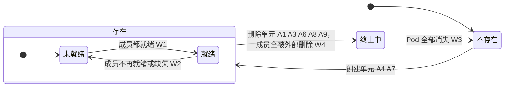
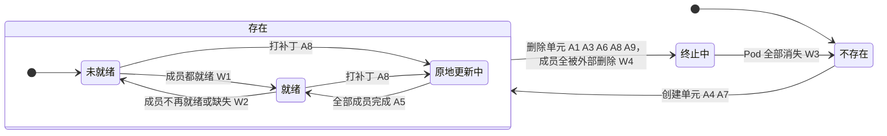

# ModelServing 核心状态机（不含原地更新）

## 0. 文档信息

| 项 | 内容 |
| --- | --- |
| 用途 | 把[理想状态机与改造对照](06-state-table.md)拆成两层。A 部分（第 2～5 节）是核心：不含原地更新的状态机，和它对照当前代码的改造表。B 部分（第 6～8 节）是原地更新：它在核心之上加了什么，它的约束，它自己的改造表 |
| 状态 | 与 06 是同一批规则的另一种排法，没有新增规则，没有实现。本文拆分的是阅读的视图：不关闭已有的功能，不改变 05 的实施顺序；原地更新的改造要不要推迟，本文不决定。规则以[状态机改进方案](04-state-machine.md)为准，工作包以[重构方案](05-refactoring-plan.md)为准，当前实现以基线代码为准。本文和它们有出入时是本文的错误 |
| 代码基线 | `volcano-sh/kthena` `main` @ `b4e536bb` |
| 与 06 的关系 | 06 没有改，它画的是带原地更新的完整状态机。本文的编号与 06 相同：环节 1～7，边 W1～W4、A1～A11。函数的位置、入队点在 06 的附录 B、C，这里不重复 |
| 范围 | 与 06 相同：ServingGroup 层和独立 Role。协调 Role、plugin、PodGroup、Service 只标出入口 |

代码位置的缩写与 06 相同，都在 `pkg/model-serving-controller/controller/` 下：`msc.go` 是 `model_serving_controller.go`，`ipu.go` 是 `inplace_update.go`，`surge.go` 是 `surge_rollout.go`，`obs.go` 是 `coordinated_role_observation.go`。

## 1. 为什么分开，核心指什么

06 的状态机里，原地更新是五个单元状态之一，而且不止一个状态：它还带来一个成员状态、一个单元属性、一条专门的边 A5、替换的第二种动作、恢复的两种触发、补成员时的另一条选版本的规则。它的约束也多，单列在[第 7 节](#7-原地更新的约束)。把它拿开之后，剩下的部分简单得多。

| | 核心（A 部分） | 加上原地更新（B 部分，即 06） |
| --- | --- | --- |
| 单元状态 | 4 个：不存在、未就绪、就绪、终止中 | 5 个，多「原地更新中」 |
| 成员状态 | 5 个，另有缺失和外来 | 6 个，多「原地更新中」 |
| 单元属性 | 版本、surge 标记、锁定 | 多「更新方式」 |
| controller 的边 | A1～A4、A6～A11，共 10 条 | 多 A5；A8 多一种动作 |
| 改 Pod 的动作 | 创建单元、补成员、删除 | 多「打补丁」 |
| 恢复的触发 | 终态、外部删除、重启故障 | 多两种原地更新超期 |
| Pod 上的状态 | revision 标签、surge 标记、恢复标记 | 多进度注解 |
| 等时间的定时 | grace、在途写操作的期限 | 多进度期限 |

**核心不是简化，也不是去掉这个功能。**它是 04 的规则在下面这个范围里的样子：`spec.rolloutStrategy.updateMethod` 是 `Recreate`（API 的默认值），并且没有 Pod 带着原地更新的注解。在这个范围里，没有单元会进入原地更新中，更新方式永远是重建，替换只有删除，06 的每一条规则都退化成 A 部分的写法。

后一个条件不能省。`updateMethod` 随时可以改，没有不可变的校验，而 Pod 上的注解会留着，有两种。

- **未完成的注解**，包括已经作废的更新留下的。单元是不是原地更新中只看注解，不看 `updateMethod`。更新做到一半把 `updateMethod` 改回 `Recreate` 之后怎样处理，04 没有规定，当前代码的做法和 04 的字面也不一样，见 [8.4](#84-原地更新这一层没有写到的地方)。
- **已经完成的注解**。完成之后注解不删除，里面的重启基准留着，重启故障的判定要用它。所以 A 部分说「计划外的重启」，不说「重启过」：在核心的范围里基准是 0，两者相同。

配置了 `InPlace` 的 ModelServing 不在这个范围里，即使这次变更没有一个单元走原地。分两种。全局的条件不满足时（有 plugin 不支持，或 U 为 0），当前代码的行为与 `Recreate` 完全相同，照常用 surge。全局的条件满足而单元逐个回退为重建时，能不能用 surge 还没有决定（O4），当前代码不用。

## A 部分　核心

## 2. 一条线

与 06 第 1 节相同，这里是核心的写法。

```text
事件、定时、resync ──► 入队 ──► worker 的一轮：观察 ─► 分类 ─► 记账 ─► 计划 ─► 执行 ─► 写 status
        ▲                                                              │
        └──────── 执行改变了 Pod，Pod 的变化又是一次事件 ◄────────────────┘
```

| # | 环节 | 做什么 | 不做什么 |
| --- | --- | --- | --- |
| 1 | 入队 | 属于它的 Pod 的任何变化，包括 Pod 不再属于它（owner 被摘掉，身份标签被改），ModelServing 的新增、`generation` 变化和删除，Service、PodGroup 的删除，定时到期，周期 resync，都只把所属的 ModelServing 放进队列。另外只记一件事：看到的真实删除 | 不调用 API，不改任何状态，不做决定 |
| 2 | 观察 | 读最新的 `spec`；从 informer 取这个 ModelServing 的全部 Pod；叠加本进程已经发出、缓存里还没看到的写操作 | 不读上一轮留下的单元状态。没有这样的状态 |
| 3 | 分类 | 每个 Pod 归到一个成员状态；每个单元由它的成员得出一个单元状态，外加版本、surge 标记、锁定几个属性 | 纯函数，不调用 API |
| 4 | 记账 | 数出 `active`、`live`、`ready`、`notReadyTarget`，算出 `minAvailable` 和两个额度 | 同上 |
| 5 | 计划 | 按固定的顺序走一遍[第 3 节](#3-核心状态机)的边，得出一份动作列表 | 纯函数，不调用 API，不中途返回错误 |
| 6 | 执行 | 唯一发写请求的地方。按固定的顺序发，共五步：清标记，写恢复标记，恢复的删除，创建，缩容、回收 surge 和替换。每个动作发出之前复核；一个单元出错只放弃这个单元 | 不做决定 |
| 7 | 写 status | 每一轮最后都写，执行出错的轮次也写。副本计数、阶段、阻塞原因都按本轮的观察算。观察就失败的轮次（读不到 `spec`，解析不出目标版本）只写副本计数和一个说明原因的 condition（04 4.4） | 除了基线 `status.currentRevision`（A11），都只是输出，不作为下一轮的输入 |

三条性质不变：水平触发；等事件就返回，等时间就用 `AddAfter`；丢了会改变结果的状态都放在对象上。核心里等时间的只有 grace 和在途写操作的期限；放在对象上的是 revision 标签、surge 标记、恢复标记和基线。

## 3. 核心状态机

### 3.1 状态图

状态机的主体是单元：`ServingGroupRollingUpdate` 下是一个 ServingGroup，`RoleRollingUpdate` 下是一个 ServingGroup 里某种 Role 的一个实例。两层用同一台状态机，各取各的 N、U、S、P；不负责滚动的那一层只走扩缩容和补成员的边（[3.3](#33-转换的条件)，04 第 8 节）。



- **四个状态只描述单元的生命周期。**它们都不存储，每一轮由分类从 Pod 得出（[3.2](#32-状态怎样得出)）。版本、surge 标记、锁定是单元的属性，和序号、预算一起出现在边的条件里，不是状态。
- **改 Pod 的动作只有三种。**创建单元，补成员，删除（整个单元，或恢复范围里的 Pod）。扩容、缩容、建 surge、回收 surge、滚动替换、故障恢复，都是这三种之一加上各自的条件（[3.3](#33-转换的条件)）。另有三种只写标记或 `status` 的操作：清除 surge 标记（A2），写和清除恢复标记（A1、A9），推进基线（A11）。
- **边分两类。**W 开头的是 controller 等来的：kubelet 让 Pod 就绪、故障或消失，或者别人删除了 Pod，controller 只是在下一轮观察到。A 开头的是 controller 的动作：计划决定，执行发出。A 后面的数字是计划里固定的先后顺序，A11 除外，它的位置见 3.3。编号与 06 相同；缺的 A5 在 B 部分，核心的范围里没有这一步。
- **不是每个 A 都改变单元的状态。**转正 A2、补成员 A10、推进基线 A11 不改变，图上没有画。恢复的范围比单元小时，A1、A9 只删范围里的 Pod，单元不进入终止中，状态按 3.2 重新得出。
- **被选中不等于已经动手。**条件成立表示计划里有这个动作；动作发出之前还要经过锁定的推迟和执行前的复核（04 5.2、4.3）。

### 3.2 状态怎样得出

单元状态自上而下判定，取第一个成立的。

| 单元状态 | 条件 | 计入 |
| --- | --- | --- |
| 不存在 | 没有任何 Pod | 不计 |
| 终止中 | 现存的成员全部在终止；或所在范围的恢复已经开始；或本轮已经决定删除整个单元 | `active` |
| 就绪 | 已应用的版本要求的成员全部存在，全部就绪 | `active`、`live`、`ready` |
| 未就绪 | 其余全部 | `active`、`live`；版本是目标版本时还计入 `notReadyTarget` |

「没有 Pod 就是不存在」有一个例外：N 大于 0 而所有 Role 的期望实例数都是 0 的 ServingGroup。它没有 Pod，按 `spec` 计为存在并且就绪，不为它创建 Pod，也不因为它推进基线（04 第 3 节）。

成员状态是输入，同样自上而下判定。最后两行不对应一个属于自己的 Pod。「恢复生效」指 `recoveryPolicy` 不是 `None`，并且 grace（`restartGracePeriodSeconds`）不是 `-1`。

| 成员状态 | 条件 | 所在的单元 | 引出的边 |
| --- | --- | --- | --- |
| 终止中 | `deletionTimestamp` 非空 | 不能就绪；成员全部在终止时单元是终止中 | 等它消失。是看到的外部删除、策略又不是 `None` 时走 A9 |
| 终态 | `phase` 是 `Failed` 或 `Succeeded` | 不能就绪 | A9。任何策略、任何 grace 下都有，不等 grace |
| 重启故障 | 有计划外的容器重启（普通容器或 init 容器），并且 Pod 不 Ready。计划外指重启次数超过基准；在核心的范围里基准是 0。Ready 的 Pod 不看历史上的重启次数（这条判定要不要改是 04 的待决项 O6） | 不能就绪 | 恢复生效时 A9，满 grace 之后。恢复不生效时没有，只报告 |
| 就绪 | `Running` 并且 Ready | 可以就绪 | W1 |
| 未就绪 | 其余全部：Pending，或不 Ready 而没有计划外重启 | 不能就绪 | 没有，等待 |
| 缺失 | 该有这个成员而没有 Pod | 不能就绪 | A10 |
| 外来 | 名字和某个成员相同，但 owner 不是这个 ModelServing，或者没有 owner，或者身份标签不是 controller 生成的形式 | 不能就绪 | 没有。只阻塞这个单元，报告冲突 |

### 3.3 转换的条件

条件里的量，完整的定义在 04 第 3 节和 5.1。

- **正式单元**是不带本层 surge 标记的单元，加上带标记而序号小于 N 的。**临时单元**是带标记、序号不小于 N 的。Pod 全部在终止的临时单元算哪一边，04 还没有规定（待决项 O11）。
- **待替换单元**是没在删除、版本不等于目标版本、序号不小于 P 的。版本未知的单元和有外来成员的单元不是候选。
- **正式工作**是待替换单元里除去临时单元的。
- **N、U、S、P** 每层各取各的。ServingGroup 层是 `spec.replicas` 和顶层的 `rollingUpdateConfiguration`；Role 层是该 Role 的 `replicas`、`maxUnavailable`、`maxSurge`、`partition`。
- **计数**按单元数。`active` 是全部单元，`live` 是其中没在删除的，`ready` 是 `live` 里就绪的，`notReadyTarget` 是 `live` 里版本是目标版本而未就绪的。四个数都包含临时单元。
- **额度。**`minAvailable = max(0, N − U)`；`maxScaleDown = max(0, live − minAvailable − notReadyTarget)`；`maxHealthyScaleDown = max(0, ready − minAvailable)`。
- **A8 一轮替换几个。**未就绪的候选取 `k1 = min(未就绪的候选数, maxScaleDown)` 个，就绪的候选取 `k2 = min(就绪的候选数, maxScaleDown − k1, maxHealthyScaleDown)` 个（04 5.2）。

**环境推动的边**，controller 没有动作。

| # | 边 | 条件 | 之后 |
| --- | --- | --- | --- |
| W1 | 未就绪 → 就绪 | 全部必需成员就绪 | 额度随之回来，下一轮可以再替换，不等同一批的其他单元 |
| W2 | 就绪 → 未就绪 | 任一成员不再就绪、缺失、进入终态，或开始终止而还有成员没在终止 | 缺成员的走 A10，故障的成员走 A9，只是不再就绪的等待 |
| W3 | 终止中 → 不存在 | 全部 Pod 消失 | 空出来的位置要不要再建，由 A4、A7 按当时的条件决定 |
| W4 | 存在 → 终止中 | 现存的成员全部被别人请求删除 | 等 W3。看到的外部删除在范围策略下同时走 A9 |

**controller 推动的边**，按计划里的顺序：A1；ServingGroup 层；然后对每个没在删除、恢复没有开始的 ServingGroup 的每种 Role 走 Role 层；A9；A10。A11 在 `plan` 的末尾、阶段 4 之后算出，早于 A9、A10，写 `status` 时落盘。每决定一个动作就记进工作副本，后面的边按更新过的计数判断；两层都计划完之后才统一执行。本轮新建的 ServingGroup 整组创建，Role 层从下一轮起管它。

负责滚动的那一层走 A2～A8，另一层只做扩缩容。`updateMethod` 是整个 ModelServing 的，两种滚动单位都在核心的范围里。

| 滚动单位 | ServingGroup 层 | Role 层 |
| --- | --- | --- |
| `ServingGroupRollingUpdate` | A2～A8 | 只做阶段 1、2（A3、A4）和补成员。S 视为 0，P 不参与；新建的成员用所在组已应用的版本（R18、R22） |
| `RoleRollingUpdate` | 只做阶段 1、2（A3、A4）。新建的组里各 Role 实例的版本由 Role 层按 R15 决定 | A2～A8 |

| # | 边 | 条件：这一轮观察到 | 动作 | 规则 |
| --- | --- | --- | --- | --- |
| A1 | 存在 → 终止中；范围比单元小时状态按 3.2 重新得出 | 恢复续做。所在的范围带有效的恢复标记，并且已经开始：范围里没在删除的 Pod 少于标记里记的个数 | 补全标记；范围里没有正在终止的 Pod 之后，删除其余的 Pod。细节见下面的「恢复」 | 04 6.3 的 M3 |
| A2 | 属性变化 | 转正。带本层 surge 标记，序号小于 N | 清除标记，从这一轮起算正式单元 | R3 |
| A3 | 存在 → 终止中 | 缩容。没在删除的正式单元多于 N。选多出的那几个：未就绪优先，deletion cost 低优先，序号高优先 | 删除单元 | R20 |
| — | 缩容门控 | 正式单元连同正在删除的多于 N | 这一轮不走 A7、A8 | R24 |
| A4 | 不存在 → 未就绪 | 补正式单元。正式单元连同正在删除的少于 N。在 `[0, N)` 的空闲序号上从低到高，补到正式单元数等于 N 或 `active` 达到 N + S 为止 | 创建单元。序号小于 P 用基线版本，否则用目标版本 | R1、R7、R15 |
| A6 | 存在 → 终止中 | 回收 surge。临时单元，并且没有正式工作，或者 `live` 多于 N + S 而只回收超出的。先未就绪的，同类先序号高的。未就绪的直接选；就绪的要求删除之后 `ready` 不低于 `minAvailable` | 删除单元 | R26、R27 |
| A7 | 不存在 → 未就绪 | 建 surge。有正式工作；不在缩容门控中；`live` 不多于 N + S。建在从 N 起最低的空闲序号上，建到 `active` 等于 N + S | 创建临时单元：目标版本，带 surge 标记 | R2、R25 |
| A8 | 存在 → 终止中 | 替换。有正式工作，不在缩容门控中。候选是全部待替换单元。未就绪的候选取 k1 个，就绪的取 k2 个，都是序号高的先；k1、k2 由两个额度算出（04 5.3） | 删除单元 | R8、R9、R12 |
| A9 | 存在 → 终止中；范围比单元小时状态按 3.2 重新得出 | 恢复的新触发。成员进入终态；看到了外部删除；恢复生效时，重启故障的成员到期。时机和范围见下面的「恢复」 | 范围策略：给范围里的 Pod 写恢复标记，然后删除范围。`None`：只删除终态的那个 Pod | 04 6.1、6.3 |
| A10 | 状态不变 | 补成员。未就绪的单元缺成员，没有被选中删除，缺的成员不在带恢复标记的范围里 | 创建缺的 Pod，用单元已应用的版本，不借补建提前应用新模板；临时单元里补建的 Pod 带 surge 标记 | R18 |
| A11 | ModelServing 的基线 | 推进基线。P 为 0，N 大于 0，单元数等于 N，全部是正式单元、没在删除、就绪、目标版本 | `status.currentRevision` 改成目标版本 | R17 |

**恢复：A9 和 A1。**A9 看的是成员。三种触发的时机不同（04 6.1）。

| 成员的情形 | `RoleRecreate`、`ServingGroupRecreate` | `None` |
| --- | --- | --- |
| 终态 | 立即，不看 grace，`-1` 也一样 | 立即删除这一个 Pod，按原名字重建 |
| 看到的外部删除 | 立即，不看 grace | 只补这一个 Pod（A10） |
| 重启故障 | grace 为 0 立即；正数时等满 grace，从本 leader 第一次观察到它故障起算；`-1` 不触发，只报告 | 不触发，只报告 |

范围由 `recoveryPolicy` 决定：`RoleRecreate` 是所在的 Role 实例，`ServingGroupRecreate` 是所在的 ServingGroup。重建一个范围按下面的规则进行（04 6.3、6.6）。

- **承诺（A9）。**先给范围里现存的每个 Pod 写恢复标记，全部写成之后才删除。删除分两步：先删到期的故障成员，每个成员各自计时；范围已经开始、并且范围里正在终止的 Pod 都消失之后，再删其余的 Pod。
- **续做（A1）。**范围里没在删除的 Pod 少于标记里记的个数，这次恢复就是已经开始，必须做完：范围取自标记，不看最新的策略，也不看成员现在是否健康，换了 leader 也一样。范围已经开始之后新到期的故障成员照样逐个删除。带标记的范围里不创建任何 Pod。
- **残留。**带标记而没有开始的范围，和它有交集的单元本轮锁定：对它的删除都推迟。本轮触发条件仍然成立就沿用这些标记接着做，否则清除标记，下一轮解锁。值里的 UID 不是这个 Pod 的标记无效，直接清除。
- **让路。**A9 排在两层的滚动之后。本轮 A3、A6、A8 会删除的单元整个跳过。被选中而动作推迟的单元（锁定的）不跳过。上一轮对这个成员的 DELETE 确定失败时不让路；这一条只对故障的成员适用，外部删除的记录不看它。被跳过的单元里的外部删除记录丢弃，不留到下一轮。承诺一个范围时，撤掉本轮计划里落在这个范围内的创建（04 4.2）。
- **不承诺的情形。**范围里有外来的 Pod，或有结果不明的在途创建；同一个 ServingGroup 里另一种范围的标记还在。
- **之后。**范围等于单元时单元进入终止中，W3 之后由 A4 或 A7 按当时的条件重建。范围比单元小时单元不进入终止中，状态按 3.2 重新得出，被删的成员由 A10 补回。

读这几张表的办法是把一件事拆成几条边。

- **扩容**：调大 N 之后正式单元少于 N，走 A4，再等 W1。
- **缩容**：调小 N 之后正式单元多于 N，走 A3，再等 W3。等的时候缩容门控挡住 A7、A8。
- **滚动**：改了模板之后有了正式工作。A7 建 surge；A8 在额度内删旧单元；W3 之后正式单元少于 N，A4 在 `[0, N)` 最低的空闲序号上补建，版本按序号和 P 选。通常补的就是空出的序号、目标版本；被替换的单元在 `[0, N)` 之外时补到更低的空位，序号小于 P 时是基线版本。W1 之后额度回来，再走 A8。正式工作没有了，A6 回收 surge。P 为 0 时最后走 A11。
- **故障恢复**：W2 之后单元未就绪。A9 承诺并删除范围；范围等于单元时 W3 之后由 A4 重建整个单元，范围比单元小时由 A10 补回被删的成员。controller 中途重启，A1 接着做完。

下面两样没有画进来，见 04：锁定和执行前的复核（5.2、4.3），协调 Role 的候选取法（第 8 节）。

## 4. 阶段

阶段是这台状态机在一个预算范围里的汇总，写进 `status` 的 condition 给人看，不参与任何决定。阶段之间的转移图与 06 第 3 节相同，这里不重复。

| 阶段 | 这一轮观察到 | 这时状态机里在走的边 |
| --- | --- | --- |
| 缩容中 | 正式单元连同正在删除的多于 N | A3，然后等 W3。缩容门控挡住 A7、A8 |
| 扩容中 | 正式单元连同正在删除的少于 N | A4，然后等 W1 |
| 滚动中 | 有正式工作，并且正式单元不多于 N | `live` 多于 N + S 时先走 A6 回收超出的，否则 A7；然后 A8。被替换的单元消失后由 A4 补回 |
| 回收 surge | 没有正式工作，还有临时单元 | A6 |
| 稳定 | 上面四个条件都不成立，P 为 0。是否还要求全部就绪、没有正在删除的单元，04 没有规定（待决项 O10） | 没有扩缩容和替换的边。R17 的条件成立时走 A11 |
| 灰度停点 | 同上，P 大于 0 | 没有扩缩容和替换的边。基线不推进 |

阶段可以重叠；重叠时 condition 怎样表达，04 没有规定（O10）。恢复和补成员不是阶段：A1、A9、A10 在任何阶段都按自己的条件进行，恢复在 `status` 里以阻塞原因出现。

## 5. 改造对照：核心

三张表与 06 第 4 节的三张对应，只留核心的行和句子；其余的在 B 部分的[第 8 节](#8-改造对照原地更新)。工作包沿用 05 的编号，05 没有只含核心的工作包，哪些工作包两边都碰见 [8.3](#83-核心的改造碰到原地更新的地方)。「当前代码」写现在由哪些函数做；「差在哪里」写它和理想的差别；「改造」写要做的改动，括号里是 05 的工作包。

### 5.1 一条线上的每个环节

| # | 环节 | 当前代码 | 差在哪里 | 改造 |
| --- | --- | --- | --- | --- |
| 1 | 入队 | `addModelServing`、`updateModelServing`；`updatePod` 的就绪、故障、其他三个分支及 `handleReadyPod`、`handleErrorPod`；`deletePod` → `handleDeletedPod`；`deleteService`、`deletePodGroup` | 回调里在做决定和发请求：分类，改 datastore，调 plugin，启动 grace 的 goroutine，在回调线程里删除整个范围。Pending、不 Ready 而没有重启、`Succeeded`、开始终止这几种变化不入队（协调模式除外）。没有 resync。worker 的函数里还散着 20 多处手工入队，其中十几处是固定 1 秒之后 | 故障处理和范围删除搬进 worker，回调只记录真实的删除并入队（4b）。分类改成调共用的分类函数（4a）。`Failed`、`Succeeded` 入队（4c）。就绪时写 datastore 到 WP5 去掉；任何 Pod 变化都入队，打开 resync（WP5）。grace 改成 `AddAfter`（4b）；固定 1 秒的重入队去掉（05 第 3 节）。plugin 的 `OnPodReady` 改在哪里调，04、05 没有规定 |
| 2 | 观察 | datastore 里的单元记录，回调、worker、`syncAll` 都在写；协调模式另外直读 apiserver；`unitHasPods` 在缓存里没有时直读；`cleanupOrphanServices` 和 ControllerRevision 的读取每轮直连 apiserver 做 LIST | 观察不是只读的：下一轮读到的是上一轮和回调留下的状态，重启后要靠 `syncAll` 重放事件来重建，重放不出来的就丢了。缓存滞后靠内存里的 `Deleting`、`podDeletions` 挡。每轮的 LIST 让「任何 Pod 变化都入队」的开销变大 | 单元记录和 Running 集合去掉，每轮从缓存里的 Pod 推导；在途的写操作按对象叠加；去掉 `syncAll`、`podDeletions`、`roleCleanups`；Service 和 ControllerRevision 的 LIST 改成读缓存（WP5） |
| 3 | 分类 | 回调用 `updatePod` 的 `switch` 分类；worker 用 `rolePodsComplete` 只问「在位」和「Ready」 | 两套分类不一致。回调眼里的故障、其他、终止中，在 worker 眼里都只是在位而不 Ready。`Succeeded` 没有自己的类别 | 新增一个成员分类的纯函数，两边都调它（4a）。`Succeeded` 归入终态（4c）。单元状态改成由它推导（WP5） |
| 4 | 记账 | ServingGroup 模式在 `manageRollingUpdateWithPolicy` 里内联一个额度；Role 模式用 `roleRolloutBudget` 两个额度 | ServingGroup 模式没有健康删除的额度，受保护的未就绪组不占预算。在途的替换靠每轮被重新选中来占位，没有显式的一项 | ServingGroup 模式加健康删除额度（1a）。两层统一成三个计数和两个额度（WP2、WP3） |
| 5 | 计划 | 三个函数边判断边执行：`syncServingGroupReplicas`、`syncRoleReplicas`、`manageRollingUpdateWithPolicy`。恢复不在其中 | 阶段是隐含的，藏在三个函数的调用顺序和期望数的公式里。恢复的决定在回调里 | 抽成纯函数 `plan`：ServingGroup 层（WP2），Role 层和协调的候选（WP3）。恢复抽成纯函数 `recover`（4b）。目标 revision 解析不出来的轮次今天仍然做显式缩容，理想里这一轮没有计划，保留与否是待决项 O12 |
| 6 | 执行 | CREATE、DELETE、PATCH 散在十几个函数里；回调和 grace 的 goroutine 也发 DELETE | 没有唯一的出口。主流程里一步出错就返回，后面的步骤和写 `status` 都被跳过；只有清理孤儿 Service 的错误和历史 revision 读不到的错误是记下来、把这一轮做完才返回的。执行前的复核只有协调模式有 | 一个单元出错只放弃这个单元（1f）。恢复的删除改由 worker 发出，失败会重试（4b）。请求集中到 `execute` 一处，复核推广到所有破坏性的动作：这两项在 05 第 3 节的目标结构里，05 没有把它们列进工作包 |
| 7 | 写 status | `updateModelServingStatusInRound`，在一轮的最后 | 前面的步骤出错返回就不写。计数取自 datastore，Pod 只是不再 Ready 时会滞后。没有阶段，阻塞原因只有协调模式有 | 身份冲突、版本读不出这类单元级的错误不再挡住写 `status`（1f）。执行出错的轮次一律写，按观察算，加阶段和阻塞原因（WP5） |

启动、重启和失主与 06 4.1 表后的两条相同：去掉 `syncAll`（WP5），恢复搬进 worker（4b），失主时退出进程（1e）。

### 5.2 状态机的每条边

| # | 边 | 当前代码 | 差在哪里 | 改造 |
| --- | --- | --- | --- | --- |
| W1、W2 | 就绪的判定 | 单元状态存在 datastore 里。回调的 `handleReadyPod`、`markPodUnavailable` 写，worker 的 `syncRoleReplicas`、`manageRoleReplicasPerGroup` 每轮重算 | 两个线程写同一个状态。Pod 只是不再 Ready 或开始终止时不入队，状态和 `status` 要等别的事件带来下一轮 | 状态不存，每轮推导；任何 Pod 变化都入队（WP5）。分类函数两边共用（4a） |
| W3、W4 | 终止中的判定，终止中 → 不存在 | datastore 里的 `Deleting`，`deleteServingGroup`、`DeleteRole` 写；`finishPendingDeletions` 每轮对它再执行一次删除；Pod 都消失后移除记录并入队。被别人删除的 Pod 由 `deletePod` 回调处理，见 A9 | `Deleting` 只在内存里，重启就丢。回调线程也在写。删除时取的 Pod 快照之外又出现 Pod 时，单元一直停在 `Deleting` | 终止中由 Pod 的 `deletionTimestamp` 得出。去掉 `finishPendingDeletions`、`podDeletions`、`roleCleanups`（WP5）。在那之前先把 `finishPendingDeletions` 的重试改成逐单元进行（1f）。空出来的单元按当前期望重新判断是正式单元还是 surge（1b） |
| A1 | 恢复续做 | 没有对应的东西。「恢复进行中」只体现为内存里的 `Deleting` 和回调的调用栈 | 重启后的结果取决于重启的时刻：故障的 Pod 还在终止就做完整个范围，已经消失就只补缺的。上一任留下的终止中的 Pod 消失时被当成一次新的删除，会删掉健康的幸存成员 | 新增恢复标记这个 Pod 注解，先标记后删除，已经开始的范围按标记做完。开始担任 leader 时已经在终止的 Pod 不算外部删除（4d） |
| A2 | 转正 | `adoptServingGroupSurge`、`adoptRoleSurge` → `clearSurgeMarker`，在各层同步函数的开头；协调模式另有 `adoptCoordinatedSurge` | 清标成功而缓存还没更新时 N 又缩小，会把刚转正的单元当临时单元回收 | 回收之前直读一次标记作止血（1b）。清标记进在途的写操作（WP5）。`surge.go` 和 `obs.go` 的两套并成一套（WP3） |
| A3 | 缩容 | `scaleDownServingGroups`、`scaleDownRoles`，排序在 `calculateServingGroupScore` | 候选是所有不在删除的单元，包含 surge，滚动途中缩容可能删掉 surge。按刷新之前的状态选对象。有可更新的旧单元并且 S 大于 0 时期望数是 N + S，显式缩容只缩到 N + S，剩下的等滚动结束 | 只在正式单元里选，选之前先刷新状态（1b）。判断抽进 `plan` 的阶段 1（WP2、WP3） |
| — | 缩容门控 | 没有 | `syncServingGroupReplicas` 刚把多出的组置为 `Deleting`，`manageRollingUpdateWithPolicy` 接着就删旧组，缩容和替换在同一轮里先后发生 | 缩容没结束不建 surge、不替换（1a）。05 第 4 节 1a 的摘要只写了不替换，检视意见 BG-3 和 05 6.1 的「缩容的单元彻底消失之前不开始滚动」包含两者。缩容的触发要同时改，这是走读推出的，没有运行，见 06 4.4 第 3 行 |
| A4 | 补正式单元 | `syncServingGroupReplicas` → `scaleUpServingGroups`；Role 层 `manageRoleReplicasPerGroup` → `scaleUpRoles`；记录还在而 Pod 全没时由 `syncRoleReplicas` 重选 revision | 期望数把 N 和 S 加在一起，在 `[0, N + S)` 里补最低的缺失序号；创建时只按序号是不是不小于 N 决定带不带 surge 标记，正式单元和额外的容量是同一步补出来的。Role 模式下新建的 ServingGroup 不看 Role 的 partition。Role 层给受保护的序号选版本时另有一个回退分支，见 06 4.4 第 4 行 | 正式单元只补 `[0, N)`；Role 模式下新建的组按 Role 的 partition 选版本（1b）。判断抽进 `plan` 的阶段 2（WP2、WP3） |
| A6 | 回收 surge | ServingGroup 模式 `retireSurgeServingGroups` 加期望数里的 `expectedWithSurge`；Role 模式 `surgeRolesToRetire`；协调模式 `retireCoordinatedSurge` | 两个文件、三处各写各的。缩容也可能删掉 surge，见 A3。反过来，滚动途中调小 `maxSurge` 时，超出 N + S 的部分走的是缩容的路径：候选是所有没在删除的单元，未就绪优先，不看 Ready 的底线，可能删掉一个未就绪的正式单元 | 两套并成一套（WP3）。判断抽进 `plan` 的阶段 3，超出的部分也只回收 surge（WP2） |
| A7 | 建 surge | 没有单独的一步。`syncServingGroupReplicas` 把期望数加上 S，由 `scaleUpServingGroups` 一起补；Role 层同理 | 布局稀疏时额外的容量落进 `[0, N)` 的洞里，不带标记，滚动结束后空洞移位。缩容没结束也会建 | surge 只建在序号不小于 N 的位置（1b）。缩容没结束不建（1a）。判断抽进 `plan` 的阶段 3（WP2、WP3） |
| A8 | 替换 | `manageRollingUpdateWithPolicy` → `deleteOutdatedServingGroups` 或 `deleteOutdatedRoles` → `updateServingGroup` 或 `updateRole`。这两个函数在 `ipu.go` 里，在核心的范围里直接调 `deleteServingGroup`、`DeleteRole` | ServingGroup 模式只有一个额度，健康的旧组可以被删到低于底线。候选的顺序靠列表拼接和 datastore 的排序 | 加健康删除额度（1a）。判断抽进 `plan` 的阶段 4，候选用显式的排序键（WP2、WP3） |
| A9 | 恢复的新触发 | 不在 worker 里。`updatePod` 的故障分支 → `handleErrorPod` 写 `graceMap`，启动 goroutine `handlePodAfterGraceTime` 发 DELETE；`deletePod` → `handleDeletedPod` 在回调里调 `deleteServingGroup`、`DeleteRole` 删除整个范围 | 删除不经过 worker，失败只打日志，到期不读最新的策略和 grace。Pod 恢复 Ready 之后不清计时。`Succeeded` 不处理，`None` 或 grace 为 `-1` 时 `Failed` 永久留着。摘掉 ownerReference 被当成一次删除。回调和 worker 抢着处理同一个范围，会多删，或者卡在 `Deleting` | 先止血：Ready 时清计时，到期前重读配置（1e）。触发、范围、计时搬进 `recover`，去掉 goroutine 和 `graceMap`，回调只记录真实的删除（4b）。终态的新语义（4c）。恢复标记（4d） |
| A10 | 补成员 | `manageRoleReplicasPerGroup` → `createPodsByRoleWithContext` → `createPod` | surge 单元里补建的 Pod 不带标记。同名 Pod 身份不符时整轮返回错误，其他单元和 `status` 都被挡住 | 补建的 Pod 继承标记（1b）。错误只挡住这个单元（1f）。带恢复标记的范围里不补（4d） |
| A11 | 推进基线 | `updateModelServingStatusInRound`：各组都已更新、都可用、组数等于 N，没有单独判断 P | P 大于 0 时，缩容删掉全部旧版本单元之后基线被推进。N 为 0 时同一个条件也成立 | 只在 P 为 0 并且 N 大于 0 时推进（1a） |

### 5.3 按当前的函数

位置、每个函数现在做什么、其余函数的去向在 06 的[附录 B](06-state-table.md#附录-b-函数索引)。

| 处理 | 函数 | 去向 | 工作包 |
| --- | --- | --- | --- |
| 删除 | `handlePodAfterGraceTime` 和 `graceMap` | 计时由 `recover` 每轮现算，没到期用 `AddAfter` | 4b |
| 删除 | `syncAll`、`addServingGroupAndRoleFromPod` | 没有启动时的重放，第一轮从缓存观察 | WP5 |
| 删除 | `markPodUnavailable`、`handleDeletionInProgress`、`finishPendingDeletions`，以及 `podDeletions`、`roleCleanups` | 单元状态不存储，终止中由 Pod 得出 | WP5 |
| 删除 | `recreatedSinceDeletion` | 由 `recover` 对外部删除记录的核对取代 | 4b |
| 只留入队 | `updatePod`、`handleReadyPod`、`deletePod` | 分类搬到成员分类函数；就绪的判断由 worker 每轮推导；`deletePod` 另外记录真实的删除 | 4a、4b、WP5 |
| 搬进 worker | `handleErrorPod`、`handleDeletedPod` | 触发、范围、计时进 `recover`，删除由执行发出 | 4b、4c、4d |
| 抽出判断，ServingGroup 层 | `syncServingGroupReplicas`、`scaleUpServingGroups`、`scaleDownServingGroups`、`manageRollingUpdateWithPolicy` 的 ServingGroup 分支、`deleteOutdatedServingGroups`、`updateServingGroup` 的删除分支、`retireSurgeServingGroups` | 判断进 `plan`，函数只剩取快照、调 `plan`、执行结果 | 1a、1b、WP2 |
| 抽出判断，Role 层 | `syncRoleReplicas`、`manageRoleReplicasPerGroup`、`scaleUpRoles`、`scaleDownRoles`、`deleteOutdatedRoles`、`rolesToDeleteForRoleRollingUpdateInRound`、`updateRole` 的删除分支、`surgeRolesToRetire` | 同一个 `plan`，按 04 第 8 节准备输入。`manageRoleReplicasPerGroup` 要拆开 | 1b、WP3 |
| 并成一套 | `surge.go` 的 surge 函数和 `obs.go` 里协调模式的 surge 函数 | 一套 surge，标记按层区分 | WP3 |
| 协调的候选独立出来 | `resolveRoleRolloutPolicy`、`resolveRoleRolloutState` | 候选函数的输入是同一份观察；`resolveRoleRolloutState` 要拆开；去掉 13 处 `ms.ResourceVersion != ""` 的分支，生产和测试走同一条路径 | 1c、WP3 |
| 只发请求 | `createPod`、`CreatePodsForServingGroup`、`createPodsByRoleWithContext`、`deleteServingGroup`、`DeleteRole`、`clearSurgeMarker` | 不再判断该不该做，也不再改单元状态；错误按单元隔离 | 1f、WP2、WP3、WP5 |
| 改读缓存 | `cleanupOrphanServices`，ControllerRevision 的 LIST（`utils/controller_revision_lifecycle.go`） | 每轮直连 apiserver 的 LIST 改成读缓存。是「任何 Pod 变化都入队」的前置 | WP5 |
| 每轮都执行 | `updateModelServingStatusInRound` | 出错的轮次也写；计数按观察算；加阶段和阻塞原因 | 1a、1f、WP5 |
| 失主时退出 | leader election 的 `OnStoppedLeading`（`pkg/controller/controller.go`） | 失主时退出进程 | 1e |
| 待决 | `scaleDownOnRevisionError` | 目标 revision 解析不出来的轮次是否保留显式缩容，是 04 的待决项 O12 | — |
| 不变 | `worker`、`processNextWorkItem`、`enqueueModelServing`、`enqueueModelServingAfter` | — | — |

### 5.4 对照时发现的缺口

06 的 [4.4](06-state-table.md#44-对照时发现的缺口) 列了 7 处 04、05 都还没有写到的地方，它们都属于核心，不重复。第 2、3 行各带一个前提，在核心的范围里总是成立；B 部分另有自己的几处，见 [8.4](#84-原地更新这一层没有写到的地方)。待决项 O10、O11、O12 在核心里同样存在。

## B 部分　原地更新

## 6. 原地更新加了什么

### 6.1 状态图

在核心的图上加一个状态和三条边，就是 06 2.1 的图。加的是「原地更新中」，进入它的两条「打补丁 A8」，和离开它的「全部成员完成 A5」。



图上没有画的有两样。续补是 A5 的一部分，单元留在原地更新中。更新作废是分类的结果：目的 revision 不再是最新目标时，单元不再算原地更新中，按成员回到未就绪或就绪，版本记为过期。一个原地更新中的单元经过的全部情形在 04 第 7 节的图里。

### 6.2 对核心的每一项加了什么

| 项 | 核心 | 加上原地更新之后 | 04 |
| --- | --- | --- | --- |
| Pod 上的状态 | revision 标签、surge 标记、恢复标记 | 多一个进度注解：打补丁的目的 revision、各容器的重启基准、期限。完成之后注解不删除，只标记完成，重启基准保留。controller 重启后从注解接着做 | 1.3、第 3 节、第 10 节 |
| 成员状态 | 5 个 | 多「原地更新中」：进度注解还没有完成。排在终态和重启故障之后、就绪之前 | 2.1 |
| 重启故障的判定 | 有计划外的容器重启，并且不 Ready；基准是 0 | 做过原地更新的 Pod，基准是打补丁时各容器的重启次数，加上补丁预期引起的那一次。条件多一半「或正在原地更新中」：更新期间 Pod 当前 Ready，有计划外重启也算故障 | 2.1 |
| 单元状态 | 4 个 | 多「原地更新中」：有 Pod 带未完成的进度注解，并且目的 revision 是最新的目标版本。排在终止中之后、就绪之前 | 第 3 节 |
| 单元属性 | 版本、surge 标记、锁定 | 多「更新方式」：原地或重建。版本多一个取值「过期」：更新已经作废的单元 | 第 3 节 |
| 计数 | 未就绪的目标版本单元计入 `notReadyTarget` | 原地更新中的单元按目标版本的未就绪单元算：计入 `live` 和 `notReadyTarget`，不计入 `ready` | R36 |
| 待替换单元 | 没在删除、版本不等于目标版本、序号不小于 P | 原地更新中的单元不算。多一种不看序号的：更新已经作废，而目标等于 Pod 标签上的 revision | 第 3 节、5.1 |
| 锁定 | 推迟对它的删除 | 推迟的动作多一种：原地补丁 | 第 3 节、5.2 |
| 在途的写操作 | 创建、删除、清除 surge 标记、写和清除恢复标记 | 多「打补丁」：这个 Pod 在缓存看到之前就算原地更新中。确定失败的补丁和确定失败的 DELETE 一样多记一轮，用于让路 | 4.1 |
| A5 | 没有 | 新增的边，见 [6.3](#63-多出来的边) | 5.2 |
| A7 建 surge | 有正式工作 | 正式工作里要有按重建处理的。待替换单元全部可以原地更新时不建 | R38；回退为重建的单元能不能用 surge 待定（O4） |
| A8 替换 | 删除单元 | 更新方式是原地的不删除，给成员打补丁，单元进入原地更新中。单元缺成员不妨碍开始 | R35、第 3 节 |
| A9 恢复的触发 | 终态、外部删除、重启故障 | 多两种，见 [6.3](#63-多出来的边) | 6.1 |
| 让路 | 本轮会被删除的单元整个跳过；上一轮的 DELETE 确定失败时不让路 | 多一条：本轮会被打上原地补丁的成员只跳过它自己，上一轮的补丁确定失败时不让路。被选中而动作推迟的情形多一种：原地更新在等终止中的成员。承诺范围时还要撤掉范围内的原地补丁 | 4.2 |
| A10 补成员 | 未就绪的单元；用单元已应用的版本 | 原地更新中的单元也补。补建时单元里还有别的 Pod 带未完成的进度注解，就用注解里的目的 revision；注解以本轮观察到的为准，不看本轮刚计划的补丁 | 6.7 |
| A11 推进基线 | 条件不变 | 条件不变。原地更新中的单元不是就绪的，它完成之前不推进 | R17 |
| 执行的顺序 | 五步：清标记，写恢复标记，恢复的删除，创建，缩容、回收 surge 和替换 | 六步：第 1 步多「翻转 revision 标签」；创建之后多一步「续补」；最后一步的替换多一种做法「打补丁」 | 4.3 |
| 执行前的复核 | 缩容、回收 surge、替换发出之前按 04 4.3 第 6 步复核 | 按原地执行的替换与按删除执行的替换复核的内容相同；原地补丁还要求 UID 相同、成员没有被请求删除 | 4.3 |
| 故障的计时 | 成员恢复就绪、进入终态、消失，或恢复不再生效时结束 | 多两种结束的情形：成员被打上原地补丁，重启基准重置；原地更新完成 | 6.4 |
| 定时 | grace，在途写操作的期限 | 多进度期限 | 第 9 节 |
| 阶段 | 滚动中走 A6、A7、A8 | 滚动中多 A5；A5 在任何阶段都按自己的条件进行 | 5.1 |
| `status` 和事件 | 阶段、阻塞原因、恢复的事件 | 保留 `InPlaceUpdateFallback`、`InPlaceUpdateTimeout` 两种事件；`PodNotRecovered` 多一种来源（原地更新超期）；`UnitLocked` 多一种（等终止中的成员消失）。当前代码还发 `InPlaceUpdateStarted`、`InPlaceUpdateCompleted`，04 没有说它们的去留 | 5.1、第 11 节 |

### 6.3 多出来的边

| # | 边 | 条件：这一轮观察到 | 动作 | 规则 |
| --- | --- | --- | --- | --- |
| A8（打补丁） | 未就绪或就绪 → 原地更新中 | 单元被 A8 选中，更新方式是原地 | 给成员打补丁。有成员正在终止时本轮不打，单元照样占着名额 | R35 |
| A5 | 原地更新中 → 就绪，或状态不变 | 原地更新收尾，按顺序判断。全部成员完成：完成。没有完成而超过进度期限、恢复又生效：不再续补，交给 A9。其余：续补 | 完成：翻转 revision 标签。续补：给还没打补丁的成员打补丁，终止中和终态的成员除外 | R36、04 5.2 |

- A5 在每个预算范围里排在 A4 之后、A6 之前。它不占新的额度，这些单元已经计入 `notReadyTarget`；它不看 partition；在任何阶段都照常进行。
- 「还没打补丁的成员」指没有未完成的进度注解、revision 标签也不是目的 revision 的。按目的 revision 补建的成员没有注解，标签已经是目的 revision：它不需要补丁，单元超期之后也不算下面第二行的故障成员。
- 成员「完成」指在目标镜像上 Ready；恢复生效时还要求没有计划外重启。

A9 多出两种触发，都只在恢复生效时有。

| 成员的情形 | `RoleRecreate`、`ServingGroupRecreate` | `None` |
| --- | --- | --- |
| 原地更新超期而带着未完成的进度注解 | 同重启故障：grace 为 0 立即；正数时等满 grace，从本 leader 第一次观察到它超期起算；`-1` 不触发，只报告 | 不触发，只报告 |
| 原地更新超期而从没打上补丁 | grace 不是 `-1` 时立即，不等 grace；`-1` 不触发，只报告 | 不触发，只报告 |

恢复不生效时不重建：还没有作废的更新每轮继续给没打上补丁的成员续补，已经作废的不再续补。`None` 和 `-1` 只是不因这两种成员发起重建，不关闭滚动。

已经开始的恢复不看它当初是被什么触发的：范围按标记做完（A1），与核心相同。

原地更新中的单元怎样离开这个状态。

| 去向 | 条件 |
| --- | --- |
| 就绪，目标版本 | 全部成员完成，翻转标签（A5） |
| 留在原地更新中 | 还没有全部完成：在等成员就绪，或还在续补；或者超期而恢复不生效 |
| 未就绪或就绪，版本过期 | 目标再次变化，更新作废。之后有四种去向，见[第 7 节](#7-原地更新的约束)第 8 条 |
| 未就绪，版本是单元已应用的版本 | 最后一个带未完成注解的 Pod 被删除，单元里还有别的成员。这次更新的意图就没有了（第 7 节第 10、11 条） |
| 终止中 | 被缩容或回收 surge 选中（A3、A6）；范围等于单元的恢复（A1、A9）；成员全被外部删除（W4） |

## 7. 原地更新的约束

这一节把约束集中在一处，它们是原地更新不放在核心里的原因。前 13 条出自 04，括号里是出处；最后两条是仓库里已经发布的说明和当前代码的检查。

1. **满足全部条件才走原地。**`updateMethod` 是 `InPlace`；从当前版本到目标版本只改了容器镜像；U 大于 0；plugin 链支持原地更新；Pod 和容器的重启策略是 `Always`；单元里没有终态的成员。差一条就按重建处理（R35，04 第 3 节）。
2. **更新方式按单元确定。**同一次滚动里可以有的单元原地、有的单元重建。`updateMethod` 是整个 ModelServing 的，没有按 Role 的字段；`RoleRollingUpdate` 下各 Role 看自己的 U。
3. **有成员正在终止时等待。**不打补丁也不重建，单元在替换里占着名额；缩容、回收 surge 和恢复照常可以处理它（04 第 3 节）。
4. **更新期间单元不可用。**从开始打补丁到全部成员在目标镜像上就绪，单元算目标版本的未就绪单元，占 `maxScaleDown`。所以 U 为 0 时不能原地更新，只能靠 surge，也就是重建（R35、R36）。
5. **不用 surge。**待替换单元全部可以原地更新时不建 surge（R38）。配置了 `InPlace` 而回退为重建的单元能不能用 surge 还没有决定（D6、O4）。
6. **进度只记在 Pod 的注解上。**多 Pod 的单元逐个 Pod 打补丁；打到一半请求出错或 controller 重启，下一轮从注解推导出还差哪些，接着补。续补不经预算和 partition（04 5.2）。
7. **有进度期限。**超过期限而恢复生效时交给恢复：带着未完成注解的成员按重启故障计时，从没打上补丁的成员不等 grace。恢复不生效时不重建，还没有作废的更新每轮继续续补，只报告超期（04 6.1、第 7 节）。
8. **目标再次变化时这次更新作废。**作废的单元有四种去向：目标改回了 Pod 标签上的 revision，不论序号都是待替换单元，partition 不保护它；目标换成别的版本、序号不小于 P，是待替换单元；序号小于 P 而成员都已就绪，保持原样，版本记为过期，不推进基线；序号小于 P 而成员没有完成，留在原处等进度期限。作废不停止进度期限，作废的单元不再续补（04 第 3 节）。
9. **「完成」依赖重启基准。**恢复生效时，成员完成要求没有计划外重启；恢复不生效时不看。基准要覆盖单元内的全部容器（04 2.1、5.2，检视意见 IP-1）。
10. **重建时的版本有三条优先级。**单元里一个 Pod 都没有了，按序号和 partition 选，不论它之前是否在原地更新中；补建时单元里还有别的 Pod 带未完成的进度注解，用注解里的目的 revision；其余用单元已应用的版本。第一条压过第二条，是对 R37 的收窄（D12）：最后一个带注解的 Pod 消失之后，更新的意图就没有了（04 6.7）。
11. **与恢复策略交叉。**`None` 或 grace 为 `-1` 时，重启故障和超期都不重建，还没有作废的单元留在原地更新中。更新期间成员进入终态：`None` 下这个成员被单独重建，范围策略下立即重建范围（04 第 7 节，D10、D13）。
12. **有终态成员的单元不选作原地更新。**补丁救不活终态的 Pod，这样的单元按重建处理（04 第 3 节）。
13. **没有模型。**两个参考模型都不含原地更新。它们各推演了核心的一部分：单个预算范围的滚动，一个 ServingGroup 的恢复；锁定、两层嵌套、恢复和滚动的交互没有模型。原地更新并入一条线、与恢复的交叉，都只有设计（04 第 15 节）。
14. **已经发布的说明。**`updateMethod: InPlace` 在 v1.1.0 的发布说明里标为 Alpha（`docs/kthena/blog/release-v1.1.0/index.md:142`）。用户指南的「In-place Update」一节（`docs/kthena/docs/user-guide/multi-node-inference.md:415-438`）列了它对用户的限制：只在仅改普通容器镜像时原地更新；有 plugin 不支持或 U 解析为 0 时全部重建；`maxSurge` 只在全部重建时生效；更新中的单元占一个 `maxUnavailable` 的名额；超过 `progressDeadlineSeconds` 按 `recoveryPolicy` 处理；可以随时改回 `Recreate`；只有一个 ServingGroup、一个 Role 副本时，原地更新期间服务不可用。
15. **当前代码另外的检查**（`ipu.go:203-263`、`276-290`）。Pod 里缺目标模板的某个容器，或者 Pod 现在的镜像既不是旧模板的也不是新模板的，按重建处理；容器带 `restartPolicyRules` 按重建处理；Pod 来自的历史 revision 读不出来时等待，不打补丁也不重建。「只改了镜像」比较的是普通容器的镜像（`inplace/eligibility.go:34-57`）。plugin 链建不出来、有 plugin 不支持、ServingGroup 模式下 U 为 0 时，整个 ModelServing 都不走原地（`ipu.go:105-124`）；`RoleRollingUpdate` 下某个 Role 的 U 为 0 时，这个 Role 不走原地（`ipu.go:127-140`）；其余的条件是逐个单元回退。

当前实现在这些约束上已知的问题是检视意见的 IP-1～IP-6、BG-4、BG-6，对应的改造见下一节。

## 8. 改造对照：原地更新

### 8.1 环节和边

只列 06 第 4 节里属于原地更新的行和句子。

| # | 环节或边 | 当前代码 | 差在哪里 | 改造 |
| --- | --- | --- | --- | --- |
| 1 | 入队 | `updatePod` 的五个分支里有两个属于原地更新：原地更新期间故障的分支排在最前，Pod 当前 Ready 也进这里；原地更新中的分支调 `handleInPlaceUpdatingPod`。就绪的分支里还有一处：更新中的 Pod 就绪时多入队一次（`msc.go:397-400`） | 与核心相同：回调里在分类和改 datastore | 分类搬到共用的分类函数（4a）；回调只留入队（WP5） |
| 2 | 观察 | `startInPlaceUpdate` 打补丁之后调 `markPodUnavailable`，单元在 datastore 里不是 `Running`，靠这个挡住缓存滞后 | 没有在途写操作的记录 | 在途的写操作包含打补丁（WP5） |
| 3 | 分类 | 计划外重启用进度注解里的基准判断；`rolePodsComplete` 把还在更新的 Pod 算作不 Ready | 基准只记被打补丁的容器，升级前就有重启记录的容器会让 Pod 被判为崩溃 | 基准覆盖单元内的全部容器（1d）。原地更新中由进度注解推导（WP5） |
| 4 | 记账 | 已经打过补丁的旧单元留在「不是 `Running` 的旧单元」里，每轮被重新选中、各占一个额度 | 预算里没有在途的原地更新这一项，靠重新选中隐式占位 | 原地更新中的单元显式计入 `notReadyTarget`（WP2、WP3） |
| A5 | 原地更新收尾 | `manageRollingUpdateWithPolicy` 开头的 `completeInPlaceUpdates` → `reconcileInPlaceUnit`。不看 `updateMethod`，每轮都跑 | 完成放在 Role 同步之后，翻转到一半重启可能卡住。目标改回时不经预算直接删除整个单元。超期时在 worker 里直接删 Pod，再调回调用的 `handleErrorPod` | 目标改回走预算，完成提前（1d）。续补和完成成为 `plan` 的输出（WP2、WP3）。超期并入 `recover`（4b） |
| A7 | 建 surge | 期望数加不加 S 由 `updatesInPlace` 决定 | `updatesInPlace` 为真时完全不建 surge，哪怕这次变更实际走重建 | 实际走重建的变更照常用 surge（WP2、WP3；取决于 D6） |
| A8（打补丁） | 替换 | `updateServingGroup`、`updateRole` → `decideInPlace`：等待、原地、重建三种结果；原地调 `startInPlaceUpdate` | 有终态成员的单元照样打补丁。更新方式是在执行替换的时候才判断的，不是单元的属性 | 有终态成员的单元不选作原地更新（4c）。更新方式成为分类的结果，`plan` 按它输出删除或打补丁（WP2、WP3） |
| A9 | 超期的两种触发 | 已经在 worker 里：`handleInPlaceTimeout` 直接删除没打上补丁的 Pod，对没完成的 Pod 调 `handleErrorPod` | 走的是回调用的函数和 `graceMap`；没打上补丁的 Pod 的删除靠它的删除事件再展开到范围 | 超期成为 `recover` 的一种触发（4b）；先承诺范围、写标记，再删除（4d） |
| A10 | 补成员的版本 | `createPod` | 原地更新中的单元按旧 revision 补建，过了进度期限之后又被当成没打补丁的成员删掉 | 版本按 04 6.7 选（1d） |

05 6.1 里专属原地更新的对外变化有六行：补建的 Pod 是目标版本和改回原版本走预算（1d），显式占用额度（WP2、WP3），回退为重建时用 surge（WP2、WP3，D6 待定），`None` 下更新中进入终态的 Pod 被单独重建（4c），有终态成员按重建（4c），原地更新中的单元整个重建时按序号选版本（4d）。

### 8.2 按当前的函数

06 的附录 B 里没有的函数，在这里注明位置。

| 处理 | 函数 | 去向 | 工作包 |
| --- | --- | --- | --- |
| 只留入队 | `handleInPlaceUpdatingPod` | 分类搬到成员分类函数 | 4a、WP5 |
| 并入 `recover` | `handleInPlaceTimeout`、`enforceInPlaceDeadline` | 已经在 worker 里。超期成为恢复的一种触发，不再直接删 Pod；没到期用 `AddAfter` | 4b、4d |
| 抽出判断，更新方式 | `updateServingGroup` 和 `updateRole` 的原地分支、`decideInPlace`、`updatesInPlace`、`roleUpdatesInPlace`（`ipu.go:127`） | 更新方式是单元的属性，在分类里得出 | 4c、WP2、WP3 |
| 抽出判断，收尾 | `completeInPlaceUpdates`、`reconcileInPlaceUnit`、`inPlaceMembersPresent`（`ipu.go:562`） | 续补和完成是 `plan` 的输出 | 1d、WP2、WP3 |
| 续补 | `resumeInPlaceUnit` | 今天它回到 `updateServingGroup`、`updateRole`，要再过一次 `updatesInPlace`；理想里是 `plan` 的输出 `continueInPlace`，执行只发补丁 | WP2、WP3 |
| 与 datastore 的衔接 | `repairInPlaceRevision`（`ipu.go:618`）、`recordInPlaceRevision`（`ipu.go:777`） | 完成之后把单元的 revision 补进 datastore。单元状态改成推导之后不再需要；在那之前要留着 | WP5 |
| 只发请求 | `startInPlaceUpdate` | 不再判断该不该做；错误按单元隔离 | 1f、WP2、WP3 |
| 基本不变 | `inplace` 包里读写注解的函数，`utils/controller_revision.go` 里保留未完成更新所引用的历史 revision 的逻辑 | 注解的格式和历史的保留是已有的约定。只有 1d 把写进注解的重启基准扩到全部容器（`inplace/state.go`） | 1d |

### 8.3 核心的改造碰到原地更新的地方

当前代码已经有原地更新。05 的工作包里只有 1d 是专属原地更新的；其余的即使不改它的规则，也会改到它所在的函数。A5 不在核心的图上，不等于核心的工作包可以先不管它。

| 工作包 | 碰到的地方 |
| --- | --- |
| 1a、1b | `syncServingGroupReplicas` 的期望数里有 `updatesInPlace` 的分支；`manageRoleReplicasPerGroup` 里是 `roleUpdatesInPlace`；`scaleDownOnRevisionError` 两个都用 |
| 4a 成员分类 | `updatePod` 的 `switch` 里原地更新的两个分支排在最前。共用的分类函数从一开始就要认进度注解和重启基准 |
| 4b 恢复搬进 worker | `handleInPlaceTimeout` 调的是 `handleErrorPod`；去掉 `graceMap` 之后超期要改由 `recover` 处理。05 写明这种删除在 4b 里是恢复的一种触发，不记成普通的自己发出的删除 |
| 4c 终态的 Pod | `decideInPlace` 要加「有终态成员按重建」；原地更新期间进入终态的成员按 D10、D13 处理 |
| 4d 恢复标记 | 超期成员的删除改成先承诺范围、写标记；带标记的范围里不打补丁 |
| WP2、WP3 `plan` | `manageRollingUpdateWithPolicy` 开头调 `completeInPlaceUpdates`；替换经 `updateServingGroup`、`updateRole`。`plan` 的输出里要有续补和完成，预算里要有原地更新中的单元 |
| WP5 观察 | 在途的写操作要包含打补丁；单元状态改成推导之后，原地更新中由进度注解得出，`repairInPlaceRevision`、`recordInPlaceRevision` 随之去掉 |

**能不能把原地更新的改造整体排在核心之后，05 没有写，本文不替它决定。**05 能支持的只有两条：各工作包的「依赖」一行和说明里没有哪一项点名 1d（依赖图把 1a～1e 画成一个节点，WP2 和 4c 从它引出）；WP2 写着除列出的变化外行为应与 WP1 之后相同。

下面几条是按代码读出来的检查点，不是 05 的原话，没有运行过。它们不构成「核心的 `plan` 加旧的执行函数」的衔接方案，也不保证行为不变；衔接方案要另行设计和验证。

- **分类。**分类函数如果只按核心的五种成员状态写、基准取 0，会有两处误判。补丁预期引起的那一次容器重启可能被判成重启故障；一旦误判，默认的 `RoleRecreate`、grace 0 会立即重建范围。打了补丁而旧的 Ready 条件还在的 Pod 会被算作就绪，单元不占额度。
- **计划和执行。**`plan` 如果只按核心写，至少要看住四件事。`completeInPlaceUpdates` 仍然每轮在 `plan` 之前运行，否则打过补丁的单元不会完成。打了补丁而没完成的单元今天作为未就绪的旧单元每轮被重新选中、占着额度。替换的执行今天走 `updateServingGroup`、`updateRole`：计划的是删除，实际可能是打补丁，工作副本的记账要和实际的动作一致。建不建 surge 今天按层分别判断，ServingGroup 层看 `updatesInPlace`，各 Role 看 `roleUpdatesInPlace`，不能用一个值代替。
- **用户看到的。**这些都看住之后，`InPlace` 的用户在只含核心改造的构建里看到的应当是：核心的变化照常作用在他们身上；原地更新自己的行为和今天相同，包括已知的缺陷。

### 8.4 原地更新这一层没有写到的地方

下面三处是改 `updateMethod` 的情形。04、05、06 和行为规范都没有写到，设计的字面和当前代码也不一样。它们没有问过维护者，本文没有替它们做选择。

| # | 情形 | 04 的字面 | 当前代码 |
| --- | --- | --- | --- |
| 1 | 更新做到一半，把 `updateMethod` 从 `InPlace` 改成 `Recreate`，单元只打了一部分补丁 | 单元状态只看注解，它仍是原地更新中，A5 接着续补 | 续补走 `resumeInPlaceUnit` → `updateServingGroup` 或 `updateRole`，这时 `updatesInPlace` 为假，整个单元被直接删除，不看预算和 partition（`ipu.go:509-517`、`758-763`、`147-149`、`175-177`） |
| 2 | 同上，单元已经全部打上补丁，还没完成 | 仍是原地更新中，不是待替换单元，等完成或超期 | 成员都在目标镜像上 Ready 时照常完成。在那之前它是未就绪的旧单元，被替换选中后删除，占额度 |
| 3 | 滚动途中把 `updateMethod` 从 `Recreate` 改成 `InPlace`，已经建了 surge | 有正式工作而没有按重建处理的：不建也不回收，surge 留到正式工作做完 | 期望数回到 N，多出的走缩容的路径，在全部单元里按分数删（`msc.go:819-823`、`836-841`） |

- 用户指南对第 1、2 行写的是「未完成的单元算作过期，由滚动重建」（`docs/kthena/docs/user-guide/multi-node-inference.md:435`）。这是已经发布的说明：按 04 的字面实现会改变它，而 05 6.1 没有这一行。第 1 行当前代码的做法也比这句话宽，删除时不看预算和 partition。
- 与这两行相关的现成单测只有一个，`TestCompleteInPlaceUpdatesStillRunsAfterSwitchToRecreate`（`controller/inplace_update_test.go:755`）。它断言的是改回 `Recreate` 之后超期仍然生效，不覆盖第 1 行的直接删除，也不覆盖第 2 行被替换选中的一支。这两行是按调用路径读出来的，没有运行。
- 配置了 `InPlace` 而单元回退为重建时能不能用 surge，是已有的待决项 O4（行为规范的 D6），不在这张表里。当前代码不用（`msc.go:820-822`），用户指南也这样写（`multi-node-inference.md:433`）。
