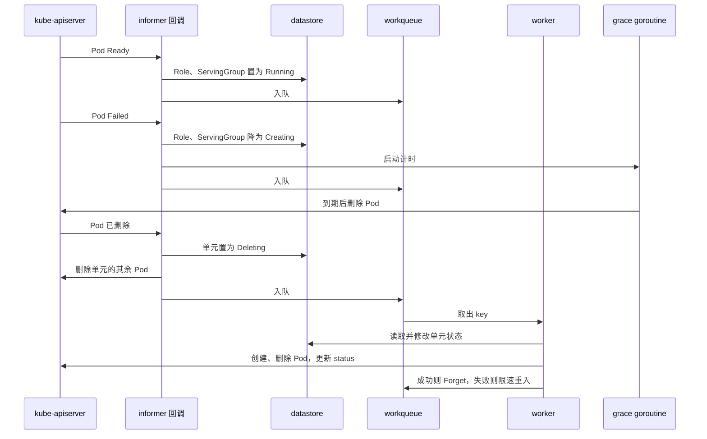
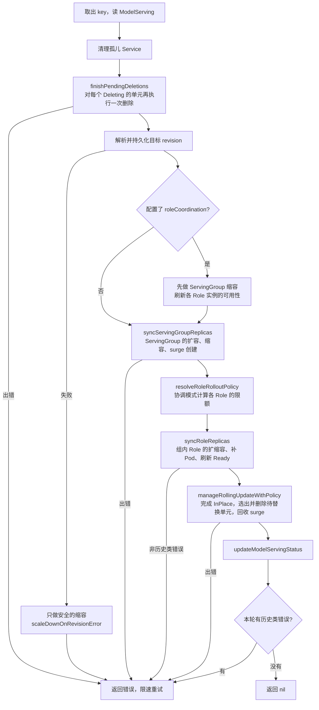
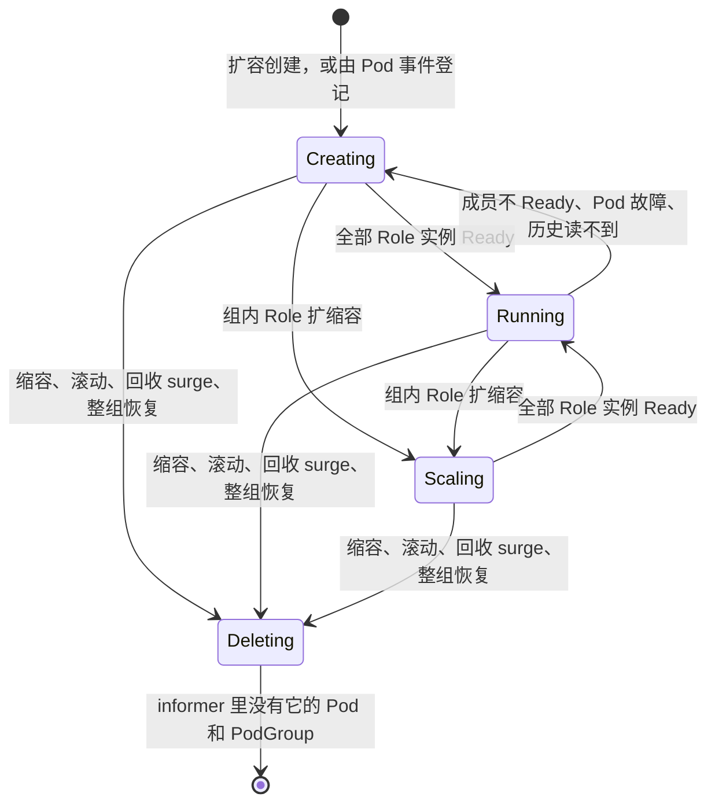
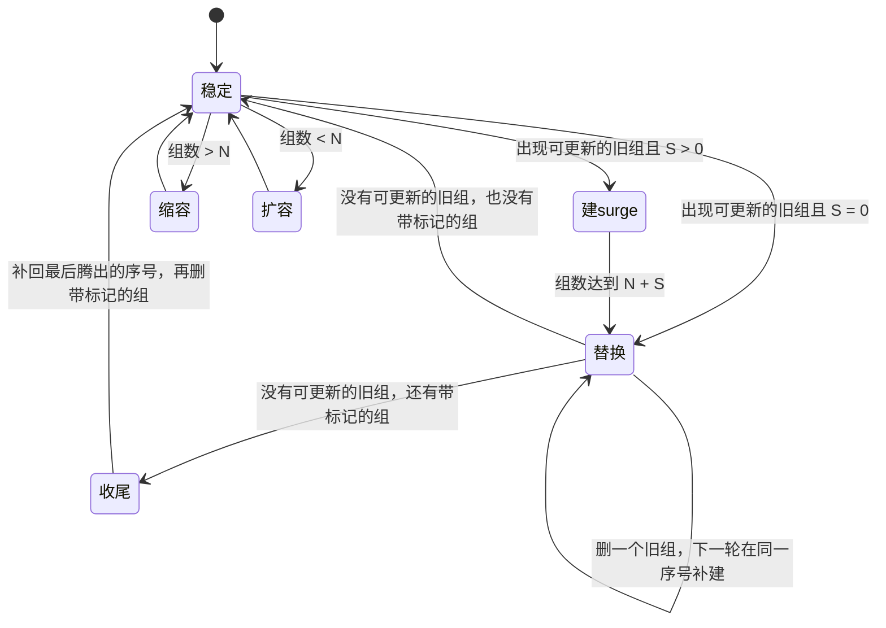
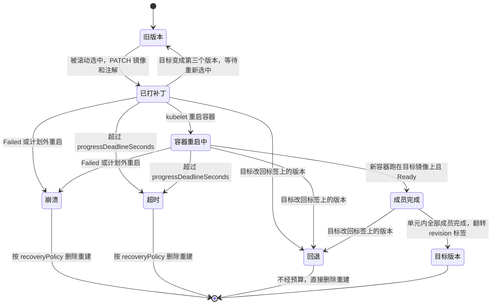
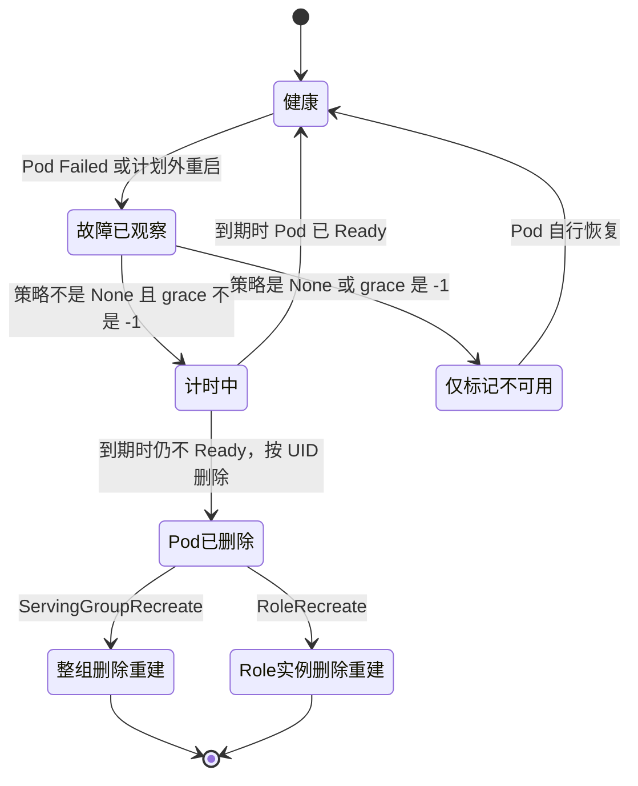
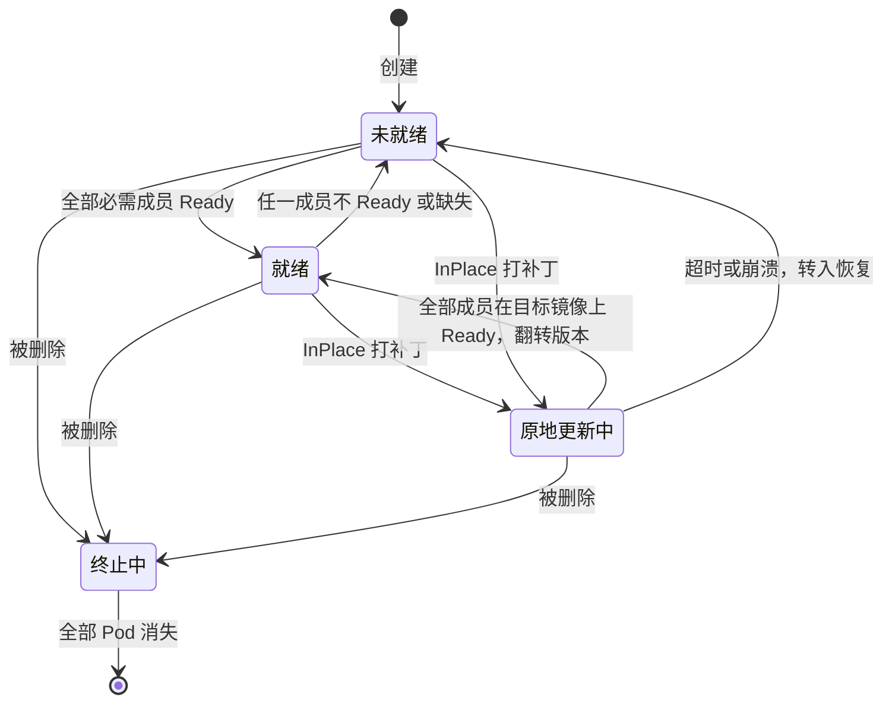
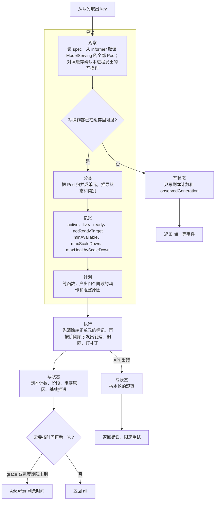
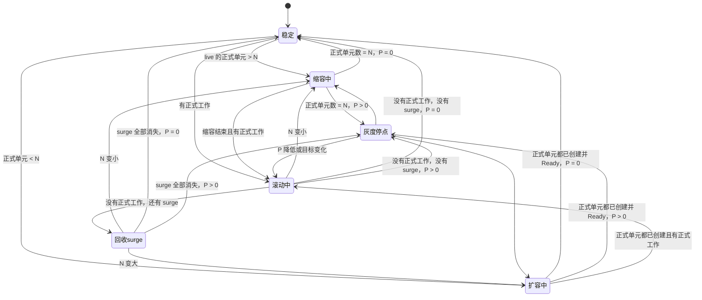
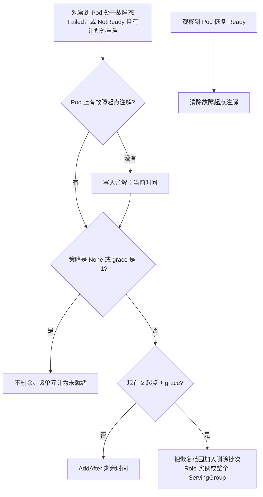

# ModelServing reconcile 逻辑与状态机：当前实现与优化设计

## 0. 文档信息

| 项 | 内容 |
| --- | --- |
| 状态 | 草案。行为规范的 D1（转正并清除标记）、D2（目前保持占用）、D3（立即应用）已由维护者在 2026-11-12 决定，优化设计按这三项写 |
| 当前状态机的基线 | `volcano-sh/kthena` `main` @ `b4e536bb` |
| 优化状态机的依据 | [行为规范修订草案](modelserving-rollout-behavior-spec.md)的规则 R1～R38 |
| 配套文档 | [检视意见](modelserving-rollout-implementation-review.md) |
| 范围 | ModelServing controller 的事件处理、工作队列、reconcile 主流程、ServingGroup 与 Role 的单元状态、滚动、故障恢复、InPlace。plugin 的实现不在范围内 |

文中的代码位置写成 `文件:行`，都相对于 `pkg/model-serving-controller/`，并使用下面的缩写。

| 缩写 | 文件 |
| --- | --- |
| `msc.go` | `controller/model_serving_controller.go` |
| `surge.go` | `controller/surge_rollout.go` |
| `obs.go` | `controller/coordinated_role_observation.go` |
| `coord.go` | `controller/role_rolling_update_coordinator.go` |
| `ipu.go` | `controller/inplace_update.go` |
| `aux.go` | `controller/auxiliary_cleanup.go` |
| `store.go` | `datastore/store.go` |

第 3 节是从代码读出来的现状，不是设计意图。第 4 节是按修订规则给出的目标设计，还没有实现。

## 1. 结论

**当前实现**是事件驱动和水平触发的混合体。

- 状态分散在九处，其中四处只在进程内存里（datastore、`graceMap`、`podDeletions`、`roleCleanups`）。重启后，「正在删除」的标记、删除批次、grace 计时、内存中的 ServingGroup revision 都会丢失。
- 内存状态有多个写入者。datastore 由 informer 回调、worker 和启动时的 `syncAll` 写；`graceMap` 由 informer 回调和 grace goroutine 写。informer 回调里会直接删除 Pod 和整个 ServingGroup。
- 滚动没有显式的阶段。「先缩容、再补正式单元、再建 surge、再替换、最后回收 surge」这个顺序没有写在任何一处，它是三个函数的调用顺序加上一个 `expectedCount` 公式共同作用的结果。阶段之间的门控（例如缩容没结束不开始替换）因此无处安放。
- 入队依赖特定的 Pod 状态转换。Pod 只是变成 NotReady、没有重启时不入队；两个 informer factory 的 resync 周期都是 0，没有兜底。

**优化设计**把一轮 reconcile 写成一条单向管线：观察、分类、记账、计划、执行、写状态。

- 计划是一个纯函数，输入是最新 spec 和本轮观察到的单元列表，输出是四个阶段各自要做的动作。行为规范里的每个场景都可以写成它的一条表驱动单测。
- 所有决定只在 worker 里做。事件处理器只入队。
- 持久状态有五样，全部在集群对象上：Pod 的身份与版本标签、surge 标记、故障起点、InPlace 进度注解、ControllerRevision 与 `status.currentRevision`。进程内只保留三样可丢弃的东西：对自己刚发出的写操作的预期、本进程存活期间的删除批次、还没处理的外部删除记录。
- ServingGroup 层和 Role 层用同一个计划函数，roleCoordination 是替换阶段上的一个附加过滤器。

从当前实现到优化设计可以分五步走，每一步都能单独合入，见[第 6 节](#6-迁移路径)。

## 2. 对象与状态载体

| 载体 | 内容 | 是否跨重启 | 写入者 |
| --- | --- | --- | --- |
| ModelServing `spec` | N、U、S、P、模板、恢复策略 | 是 | 用户 |
| ModelServing `status` | `currentRevision`（基线）、`updateRevision`、各副本计数、conditions | 是 | worker |
| ControllerRevision | 每个 revision 的模板快照；协调模式另有各 Role 副本数的注解 | 是 | worker |
| Pod 标签 | 所属 ServingGroup、Role、Role 实例、revision、Role 模板 hash | 是 | worker 创建时写；InPlace 完成时改 |
| Pod 注解 | `modelserving.volcano.sh/surge`（surge 标记）；InPlace 进度 | 是 | worker |
| datastore（`store.go`） | 每个 ServingGroup 的状态、revision、Running 的 Pod 集合；每个 Role 实例的状态、revision、模板 hash | 否 | informer 回调、worker、启动时的 `syncAll` |
| `graceMap`（`msc.go:114`） | 正在 grace 计时的 Pod UID | 否 | informer 回调、grace goroutine |
| `podDeletions`（`msc.go:118`） | 每个正在删除的单元的 Pod UID 快照和完成情况 | 否 | informer 回调、worker |
| `roleCleanups`（`msc.go:119`） | 每个正在删除的 Role 实例的 plugin 清理进度 | 否 | informer 回调、worker |

datastore 里的 ServingGroup 状态有五个取值：`Creating`、`Running`、`Scaling`、`Deleting`，以及表示不存在的 `NotFound`。Role 实例有四个：`Creating`、`Running`、`Deleting`、`NotFound`（`store.go:81-98`）。

## 3. 当前状态机

### 3.1 事件与入队

controller 注册了四类事件处理器（`msc.go:195-260`）。Pod、Service、PodGroup 的处理器先按 ownerReference 过滤。

| 事件 | 处理 | 对 datastore 的修改 | 入队 |
| --- | --- | --- | --- |
| ModelServing 新增 | `addModelServing`（`msc.go:267`） | 无 | 入队 |
| ModelServing 更新 | `updateModelServing`（`msc.go:277`） | 无 | `spec` 有变化才入队（`msc.go:289-293`） |
| ModelServing 删除 | `deleteModelServing`（`msc.go:308`） | 清掉该 ModelServing 的全部记录 | 不入队 |
| Pod 新增或更新，Pod 正在删除 | 直接返回（`msc.go:355-359`）。此外，事件里的 Pod 在 lister 里已经不存在、UID 不同或正在删除时也直接返回（`msc.go:365-368`） | 无 | 不入队 |
| Pod 新增或更新，Running 且 Ready | `handleReadyPod`（`msc.go:2137`） | 记入 Running 集合；成员齐全则 Role 变 `Running`、ServingGroup 变 `Running` | ServingGroup 变 Ready，或 Role 刚变 `Running` 时入队；其余不入队 |
| Pod 新增或更新，Failed 或有计划外重启 | `handleErrorPod`（`msc.go:2247`） | 移出 Running 集合；Role、ServingGroup 从 `Running` 降为 `Creating` | 首次观察到时入队，并启动 grace goroutine。同一 Pod 已在计时则什么都不做。恢复关闭时（策略是 `None`，或 grace 是 `-1`）每次都入队，不启动 goroutine（`msc.go:2242-2255`） |
| Pod 新增或更新，正在 InPlace 更新 | `handleInPlaceUpdatingPod`（`msc.go:435`） | 同上一行 | 入队 |
| Pod 新增或更新，其他情况（Pending、没有重启的 NotReady） | default 分支（`msc.go:412-418`） | 初始同步期间登记单元；之后无 | 只有配置了 roleCoordination 才入队 |
| Pod 删除 | `deletePod`（`msc.go:443`）→ `handleDeletedPod`（`msc.go:2352`） | 移出 Running 集合 | 见下文 |
| Service 删除、PodGroup 删除 | `deleteService`（`msc.go:534`）、`deletePodGroup`（`msc.go:570`） | 无 | 入队 |

Pod 删除事件的处理取决于它所属单元的状态和恢复策略。

| 条件 | 动作 |
| --- | --- |
| 单元在这个 Pod 被删之后已经整体重建（`recreatedSinceDeletion`，`msc.go:510`） | 忽略事件，入队 |
| 所属 ServingGroup 或 Role 实例是 `Deleting` | 入队，由下一轮的 `finishPendingDeletions` 收尾 |
| `recoveryPolicy` 是 `ServingGroupRecreate` | **在 informer 回调里**调用 `deleteServingGroup`，删除整个组 |
| `recoveryPolicy` 是 `RoleRecreate` | ServingGroup 降为 `Creating`；**在 informer 回调里**调用 `DeleteRole`，删除整个 Role 实例 |
| `recoveryPolicy` 是 `None` | 标记不可用，入队 |

reconcile 内部也会入队，分下面几类。

| 位置 | 时机 | 方式 |
| --- | --- | --- |
| `deleteServingGroup`（`msc.go:3384`）、`DeleteRole`（`msc.go:1714`） | 单元的 Pod 全部消失、从 datastore 移除之后 | 立即 |
| 同上（`msc.go:3335-3339`、`msc.go:1679-1683`） | 删除过程中出错 | 立即 |
| `scaleUpRoles`（`msc.go:1288-1292`） | 创建了一个 Role 实例 | 立即；协调模式 1 秒后 |
| `createPod`（`msc.go:3300`） | 同名 Pod 已存在但身份不符 | 1 秒后 |
| `clearSurgeMarker`（`surge.go:183`） | 清除 surge 标记失败 | 1 秒后 |
| `createOrUpdatePodGroupByServingGroup`（`msc.go:3404`） | PodGroup 需要稍后重试 | PodGroup 管理器给出的间隔 |
| `handleReadyPod`（`msc.go:2147`） | Pod 的历史 revision 读不到 | 1 秒后 |
| InPlace（`ipu.go`） | 设置进度期限；单元完成 | 剩余时间后；立即 |
| 协调模式（`obs.go:288`） | 还有 surge 待回收且没有可更新的旧实例 | 1 秒后 |
| 协调模式的创建路径（`msc.go:1227`、`msc.go:1242`、`msc.go:1310-1321`、`msc.go:1362`、`msc.go:1400`） | 读取观察或创建 Role 实例出错 | 返回错误的同时 1 秒后再入队一次 |

启动时，`syncAll`（`msc.go:767`）对缓存里的每个 Pod 调用一次 `addPod`，对每个 ModelServing 入队一次，然后才启动 worker。



### 3.2 出队与重试

- 队列是 `DefaultControllerRateLimiter` 的限速队列，key 是 `namespace/name`（`msc.go:185`）。同一个 key 不会被两个 worker 同时处理。
- `processNextWorkItem`（`msc.go:632`）：`syncModelServing` 返回 nil 就 `Forget`，返回错误就 `AddRateLimited`。
- 「在等某件事发生」和「出错」的区分不统一。等 Pod 消失、等新单元 Ready 时返回 nil，靠后续事件再次入队。历史 revision 读不到时返回错误，靠限速重试。同名 Pod 身份不符时既返回错误又自己设 1 秒定时。
- 两个 informer factory 的 resync 周期都是 0（`msc.go:133-143`）。没有任何周期性的兜底。

### 3.3 reconcile 主流程

`syncModelServing`（`msc.go:651-734`）。



三点值得注意。

1. 顺序是先创建、后删除。被删单元的重建不在本轮，要等它的 Pod 全部消失、记录从 datastore 移除之后的下一轮。
2. 第 H 步在每一轮都按 informer 里的 Pod 重新计算每个非 `Deleting` 单元的 `Running` 或 `Creating`（`msc.go:1114-1126`、`msc.go:1527-1536`）。所以第 I 步做删除决定时用的 Ready 是新鲜的，不依赖事件处理器是否及时。滞后的只有 `status`。
3. 任何一步提前返回都会跳过后面所有步骤，包括 `status` 更新。

### 3.4 ServingGroup 单元状态机



| 转移 | 触发者 | 线程 | 位置 |
| --- | --- | --- | --- |
| 不存在 → `Creating` | `scaleUpServingGroups` 创建成功 | worker | `msc.go:1020` |
| 不存在 → `Creating` | 第一个 Ready 的 Pod 事件 | informer | `msc.go:2177`、`store.go:385` |
| 不存在 → `Creating` | 初始同步期间的非 Ready Pod | 启动线程 | `msc.go:421-431` |
| `Creating` → `Running` | Pod Ready 事件后全组检查通过 | informer | `msc.go:2218-2226` |
| `Creating`、`Scaling` → `Running` | 每轮的 Ready 重算 | worker | `msc.go:1114-1126`、`msc.go:2786-2795` |
| `Running` → `Creating` | Pod 故障、InPlace 开始、`None` 策略下 Pod 被删 | informer | `msc.go:2298-2304` |
| `Running` → `Creating` | `RoleRecreate` 下 Pod 被删 | informer | `msc.go:2367-2374` |
| `Running` → `Creating` | 每轮的 Ready 重算；历史 revision 读不到 | worker | `msc.go:1048-1056`、`msc.go:1122-1124` |
| → `Scaling` | `scaleDownRoles`、`scaleUpRoles` | worker | `msc.go:1176`、`msc.go:1250` |
| → `Deleting` | `deleteServingGroup` | worker 或 informer | `msc.go:3330` |
| `Deleting` → 不存在 | `deleteServingGroup` 发现 Pod 和 PodGroup 都没了 | worker 或 informer | `msc.go:3377-3385` |
| 重置为 `Creating` 并换 revision | SG 模式下组还在记录里但一个 Pod 都没有，且按 partition 该用另一个版本 | worker | `msc.go:1102-1104` |

`Deleting` 有两处保护：Ready 事件不会把 `Deleting` 的组改回 `Running`（`msc.go:2211-2217`）；每轮的 Ready 重算跳过 `Deleting`（`msc.go:1119-1120`）。两处都是先读后写，中间没有锁。

Role 实例的状态机形状相同，只是没有 `Scaling`。写入者有三个：Ready 事件（`msc.go:2189-2204`）、每轮重算（`msc.go:1527-1536`）、协调模式的可用性刷新（`obs.go:85-103`）。完整的转移表见任务目录 `subagents/whitebox-role-coordination.md` 第 2 节。

### 3.5 ServingGroup 滚动：隐式的阶段

SG 模式的滚动由两个函数完成，中间隔着 Role 同步。

`syncServingGroupReplicas`（`msc.go:795-868`）先算一个期望数量，再和当前数量比较：

```text
expected = N
若 S > 0 或存在带标记的 surge 组：
    若存在可更新的旧组（序号 ≥ P 且模板不同）：
        未启用 InPlace 时 expected = N + S
    否则：
        没有带标记的组，或不带标记的组已经多于 N：expected = N
        其余情况：expected = min(N + 带标记的组数, max(N + S, 当前组数))

当前组数 < expected：在 [0, expected) 里从低到高补缺失的序号，序号 ≥ N 的打 surge 标记
当前组数 > expected：按（NotReady 优先，deletion cost 低优先，序号高优先）删除多出的组
```

当前组数包含 `Deleting` 的组。缩容的候选是所有非 `Deleting` 的组，不区分是否带 surge 标记。

`manageRollingUpdateWithPolicy` 的 SG 分支（`msc.go:1753-1853`）：

```text
对每个序号 ≥ P 的组：
    非 Running 且模板不是「不同」 → unavailable += 1
    非 Running 且模板不同        → 进入 notRunningOutdated
    Running 且模板不同           → 进入 runningOutdated
对每个序号 < P 的组：
    非 Running 且模板未知        → unavailable += 1

minAvailable = N − U
maxScaleDown = 全部组数 − minAvailable − unavailable

没有任何 outdated 组 → 回收 surge（额度再取 min(maxScaleDown, Running 数 − minAvailable)）
否则 → 从 runningOutdated ++ notRunningOutdated 的尾部向前取 maxScaleDown 个，逐个删除或原地更新
```

把两个函数连起来看，一次带 surge 的滚动经过下面这些阶段。阶段不是变量，是每轮根据「有没有可更新的旧组」「有没有带标记的组」「组数和 N 的关系」重新落到某个分支。



这段逻辑有四处和行为规范不一致，详见检视意见。图上的阶段画成了互斥的，实际上不是，第一条就是例子。

- 「缩容」和「替换」可以在同一轮里先后发生：`syncServingGroupReplicas` 刚把多出的组置为 `Deleting`，`manageRollingUpdateWithPolicy` 接着就删旧组。
- 滚动途中 N 变小时，缩容候选包含 surge 组，而 surge 的序号最高，会先被删。
- 「建 surge」是在 `[0, N + S)` 里补最低的缺失序号。原来就有洞时，这个额外容量落进洞里、不带标记，收尾阶段就认不出它。
- 健康旧组的删除只受 `maxScaleDown` 约束，没有单独的 `Ready − minAvailable` 上限。受 partition 保护的 NotReady 组不计入 `unavailable`。

### 3.6 Role 滚动

Role 模式下 ServingGroup 层只做数量同步，滚动发生在每个 ServingGroup 内部。独立 Role 模式和 SG 模式结构相同，区别有三处：

- 预算有两个额度，`total` 对应 `maxScaleDown`，`healthy` 对应 `maxHealthyScaleDown`（`obs.go:112-143`）。删除 Running 的实例要同时扣两者。
- surge 的创建、识别和回收与 SG 模式共用 `surge.go`，同样是在 `[0, N + S)` 里补最低的缺失序号。
- 每个 ServingGroup、每种 Role 独立计算，互不限制。

协调模式在此之上多了四样东西：

- 每轮建立一个「round」，缓存一次对 apiserver 的 Pod LIST 和读到的 ControllerRevision（`controller/coordinated_round.go:37-108`）。Role 实例的版本和 Ready 取自这次 LIST，不取自 datastore。
- `resolveRoleRolloutPolicy` 为每个 ServingGroup 的每个 Role 算出限额：`remainingDeletions`、`effectivePartition`、`allowTargetStart`、`retainOldReplica`（`coord.go:770-1027`）。
- 候选只按序号从高到低，最高的拿不到额度就停。
- 每次创建和每次删除之前，重新建一个 round、重新算一遍限额，候选不再合法就跳过（`msc.go:1906-1925`、`controller/coordinated_round.go:144-233`）。

协调模式的 surge 是另一套实现（`obs.go:214-379`）：先补正式的洞，其余才放到序号 ≥ N 的位置。

### 3.7 InPlace 单元

InPlace 的进度保存在 Pod 注解里，状态可以完全从 Pod 推导。



它和重建路径共用候选选择和计数。区别在于占位方式：在途单元被标为不可用、revision 仍是旧的，所以每一轮都作为「非 Running 的旧单元」被重新选中，占掉一个额度，更新函数发现已经打过补丁就什么都不做。预算里没有专门的「在途」项。协调模式不同，它把在途实例显式计入不可用（`coord.go:641-646`）。

单元完成（翻转标签）在 `manageRollingUpdateWithPolicy` 的开头执行（`msc.go:1735-1739`），早于预算计算。其中的续打、目标回退时的删除、超时删除都不经过预算。

### 3.8 故障恢复与 grace



- 计时用的是进程内的 `graceMap` 和一个 `time.Sleep` 的 goroutine（`msc.go:2308-2350`）。故障起点没有写到任何对象上。
- goroutine 持有事件发生时的 ModelServing 对象，醒来后只复核 Pod，不重新读恢复策略和 grace。
- Pod 被真正删除后，恢复范围内的其余 Pod 由 informer 回调直接删除。
- reconcile 路径不扫描故障 Pod。恢复只能由该 Pod 的事件触发。

### 3.9 重启

启动时 datastore 是空的，由 `syncAll` 逐个 Pod 重建。

| Pod 在重启时的状态 | 写入 datastore 的内容 |
| --- | --- |
| Running 且 Ready | 单元（`Creating`）、Role 实例、Running 集合；成员齐全则变 `Running` |
| Pending，或没有重启的 NotReady | 单元和 Role 实例（`Creating`） |
| 正在 InPlace 更新 | 同上，并标记不可用 |
| Failed，或 NotReady 且有重启 | **不登记单元**，只启动 grace 计时 |
| 正在删除 | **不登记** |

丢失的内存状态和后果：

| 丢失的状态 | 后果 |
| --- | --- |
| `Deleting` 标记、删除批次 | 还有存活 Pod 的单元回到 `Creating` 或 `Running`，按当前事实重新决定。这符合行为规范 R34 |
| `graceMap` 和计时 goroutine | 仍然故障的 Pod 从重启时刻起重新计满一个 grace |
| 全部 Pod 都在删除、或全部处于故障态的单元 | datastore 里没有这个单元，第一轮 reconcile 会把它当成缺失的序号去创建 |
| datastore 里 ServingGroup 的 revision | 取第一个被处理的 Pod 的标签。Role 模式下组内各 Role 版本不同时，结果取决于 Pod 的处理顺序 |

### 3.10 隐式约定

下面这些约定没有写在类型或注释里，但代码依赖它们成立。它们是读代码时最容易漏掉的东西，也是优化设计要消除的对象。

1. datastore 返回的 ServingGroup 列表按序号升序。`deleteOutdatedServingGroups` 从尾部向前取，靠这个顺序实现「序号高的先删」，也靠 `runningOutdated ++ notRunningOutdated` 的拼接顺序实现「NotReady 的先删」（`msc.go:1840`、`msc.go:1868`）。
2. 组数包含 `Deleting` 的组。「正在删除的单元仍占容量」「同名单元不会在旧的消失前重建」都靠这一点。
3. `Deleting` 的旧组在预算里既算在总数里，又作为 not-running outdated 被「再删一次」并占掉一个额度，两者相抵。`Deleting` 的目标版本组算在 `unavailable` 里，同样相抵。受保护的 `Deleting` 组算在组数里，但既不是候选，也不计入 `unavailable`，没有东西和它相抵，额度多出一个（检视意见 BG-2）。
4. InPlace 在途单元靠「每轮被重新选中」占额度。
5. surge 的身份是「序号 ≥ N 且带标记」。序号 < N 的带标记单元在 `syncServingGroupReplicas` 开头被清掉标记（`surge.go:135-148`）。
6. `outdatedRolesInRound` 会修改调用者传入的切片，把有 Pod 正在删除的实例改成 `RoleDeleting`；后面的 `roleRolloutBudget` 依赖这个副作用（`msc.go:2100-2101`）。
7. 协调模式用 `ms.ResourceVersion != ""` 区分真实对象和单测构造的对象，共 13 处。为真时读 live Pod，为假时读 datastore。
8. `revisionHistory`、协调 round、InPlace round、surge 作用域都通过 `context.Context` 传递。函数签名看不出它依赖哪些。

## 4. 设计优化状态机

### 4.1 目标

| 性质 | 含义 |
| --- | --- |
| 单一决策点 | 创建、删除、打补丁只在 worker 里发生。事件处理器只入队 |
| 水平触发 | 一轮 reconcile 的决定只取决于最新 spec 和本轮观察到的对象。事件丢失后，下一轮能得到同样的决定。有一处例外：Pod 被外部删除后是重建整个恢复范围还是只补缺失的成员，取决于 controller 有没有看到这次删除，见 4.7 |
| 阶段显式 | 四个阶段和一条门控写在一个函数里，顺序就是代码顺序 |
| 可测 | 决定是一个纯函数的输出。行为规范的每个场景对应一条表驱动单测，不需要 fake client |
| 可重启 | 重启不需要重建任何状态。重启前后对同一份集群状态做出的决定相同，除了行为规范明确允许不同的那一处（不续删重启前的批次） |
| 同构 | ServingGroup 层和 Role 层用同一份计划逻辑 |

### 4.2 单元状态

单元不再有存储的状态字段。每轮从 Pod 推导出下面五个状态之一。



| 状态 | 从 Pod 推导的条件 | 在预算中（`active`、`live`、`ready`、`notReadyTarget` 的定义见行为规范第 3 节和 R8） |
| --- | --- | --- |
| 就绪 | 已应用版本要求的成员全部存在、全部 Ready、没有成员在删除、不在 InPlace 中 | 计入 `live` 和 `ready` |
| 未就绪 | 至少有一个没在删除的成员，但不满足就绪 | 计入 `live` |
| 原地更新中 | 有成员带未完成的 InPlace 注解 | 计入 `live`；按目标版本计入 `notReadyTarget`（R36） |
| 终止中 | 所有现存成员都在删除，或者单元在本进程的删除批次里 | 只计入 `active` |
| 不存在 | 没有任何 Pod | 不计 |

另外四个属性也从 Pod 读出。

| 属性 | 来源 |
| --- | --- |
| 序号 | 名字 |
| 版本 | revision 标签。成员的标签不一致时记为未知，未知的单元既不是候选，也不算已就位 |
| surge 标记 | 注解 `modelserving.volcano.sh/surge`，它的值注明标记属于哪一层（`serving-group` 或 `role`）。ServingGroup 层只看值为 `serving-group` 的标记，Role 层只看值为 `role` 的。「单元带标记」指它至少有一个没在删除的 Pod 带本层的标记。临时单元里后来创建的 Pod 带标记，正式单元里的不带 |
| 更新方式 | 待替换单元从当前版本到目标版本是否只改了镜像、`updateMethod` 是否为 `InPlace`、U 是否大于 0（R35）。三者都满足是「原地」，否则是「重建」 |

每轮还要给每个 `live` 单元定两个互相独立的标志，供计划使用。它们只看 spec 和上面的属性。两个标志可以同时成立：版本过期的临时单元既是待替换单元，也是临时单元。两者都不成立的单元称为已就位。

| 标志 | 条件 | 规则 |
| --- | --- | --- |
| 待替换单元 | 版本不等于目标且序号 ≥ P | R11 |
| 临时单元 | 带标记且序号 ≥ N | R2 |

「正式工作」是待替换单元里去掉临时单元的部分（R25）。其中更新方式是「重建」的那些决定要不要创建 surge（R38）。

带本层标记、序号 < N 的单元是待转正的单元（R3）。分类时它按正式单元对待，计划把它列进 `promote`，执行阶段清除它 Pod 上的标记。多 Pod 单元清到一半、或者清除失败时，下一轮它仍然满足「带标记且序号 < N」，会再被列进 `promote`，所以这一步不需要额外的状态。当前实现也是在数量同步的开头做这件事（`surge.go:135-148`）。

### 4.3 一轮 reconcile



- **观察**以 informer 缓存为准。为了避免读到自己刚写过、缓存还没跟上的状态，worker 为每个 ModelServing 记录「已发出、还没在缓存里看到的写操作」；这些预期没有清空之前，本轮不做计划。这是 ReplicaSet、CloneSet、RBG 等 controller 通用的 expectations 机制。预期只在内存里，重启后缓存本来就是新同步的，不需要它。预期必须有明确的生命周期，否则一次漏掉的事件会让这个 ModelServing 永远不再计划：

  | 写操作 | 登记 | 确认 | 释放 |
  | --- | --- | --- | --- |
  | 创建 Pod | 请求发出前，按名字登记 | 缓存里出现这个名字的 Pod | 请求返回确定的失败时立即释放 |
  | 删除 Pod | 请求发出前，按 UID 登记 | 缓存里这个 UID 已经带 `DeletionTimestamp`，或者已经不存在 | 请求返回确定的失败时立即释放；返回 NotFound 视为已确认 |
  | InPlace 打补丁 | 请求发出前，按 UID 和期望的 `resourceVersion` 下限登记 | 缓存里这个 Pod 的注解已经是打过补丁的状态 | 同上 |
  | 清除 surge 标记（转正） | 不登记 | 不需要 | 不需要。分类只看序号，缓存里标记还在不影响本轮的决定；下一轮看到标记还在就再清一次。例外是 N 恰好在这期间缩小到这个序号以下：计划会按缓存把它当成临时单元回收，结果仍在预算之内 |

  确认是每轮观察时对照缓存当前内容做的，不依赖是否收到了对应的事件。请求结果不明（超时）时保留预期。预期超过一个上限（Kubernetes 的同类机制用 5 分钟）仍未确认时，不直接丢弃，而是对 apiserver 做一次 LIST 重新核对，再继续。
- **计划**不调用任何 API。它的输入输出见 4.5。
- **执行**里任何一步失败，都停止本轮后续的动作并返回错误。已经发出的动作不回滚，下一轮重新观察。
- **写状态**放在最后，三条路径都要经过它：正常执行完、执行中途出错、写操作还没在缓存里可见所以本轮不计划。只要观察成功就写，`observedGeneration` 不会因为在等待或出错而落后。第三条路径没有计划结果，只写副本计数和 `observedGeneration`，阶段和阻塞原因保持上一轮的值，然后返回 nil，等 Pod 事件再次入队；预期超时的处理见上文。

### 4.4 滚动阶段

阶段由计划函数算出，写进 `status` 的 condition，不作为下一轮的输入。它只用来给人看和给测试断言。



「滚动中」内部每轮按固定顺序做两件事：surge 不足就补，然后在预算内替换。「扩容中」和「滚动中」可以重叠：正式单元已经全部创建但还没 Ready 时，是否能替换由预算决定（R8 的第一条推论：扩容出来还没 Ready 的单元计入 `notReadyTarget`），不需要单独的等待规则。「滚动中」遇到 N 变小就进入「缩容中」，替换暂停，直到缩容结束（R24）。

任何阶段都可以叠加一个阻塞原因。阻塞原因同样由计划函数给出。

| 阻塞原因 | 条件 |
| --- | --- |
| `ScaleDownInProgress` | 正式单元数（含正在删除的）> N（R24） |
| `BudgetExhausted` | 有待替换单元，但 `maxScaleDown` 为 0，或只剩 Ready 的候选而 `maxHealthyScaleDown` 为 0。后一种情形如果是受保护单元 NotReady 造成的，message 里要写明（D2） |
| `TargetNotReady` | `notReadyTarget > 0` 且因此额度为 0 |
| `CapacityFull` | 需要创建但 `active ≥ N + S` |
| `HistoryUnavailable` | 创建受保护单元或做局部修复时读不到所需的 revision |
| `Coordination…` | 协调过滤器给出的原因，沿用现有的 `CoordinatedRoleRolloutBlocked` |

### 4.5 计划函数

输入是 spec 解析后的 N、U、S、P、目标版本、基线版本，加上单元列表。输出是六个动作列表、是否推进基线、阶段和阻塞原因。下面的伪代码和参考模型 `rollout_model.py` 的 `reconcile` 是同一套逻辑；参考模型不含「更新方式」，它把所有待替换单元都当作重建。实现时应当用同一批输入对两者做差分测试，不靠人工比对。

```text
plan(spec, units):
    # units 是本轮观察的工作副本。每决定一个动作就更新它：
    # 被删的单元标为正在删除，新建的单元加入并记为 NotReady。
    # 下面的 active、live、ready 都按当时的工作副本计数。

    # 转正（R3）：带本层标记且序号 < N 的单元按正式单元对待，并清除它的标记
    promote = 带本层标记且序号 < N 的单元
    临时单元 = 带本层标记且序号 ≥ N 的单元；其余都是正式单元

    regularLive = 没在删除的正式单元
    regularAll  = 全部正式单元（含正在删除的）

    # 阶段 1：缩容（R20）
    若 |regularLive| > N：
        scaleDown = 按（NotReady 优先，deletion cost 低优先，序号高优先）取前 |regularLive| − N 个
    scalingDown = |regularAll| > N                                  # R24

    # 阶段 2：补正式单元（R1、R15、R7）
    missing = N − |regularAll|
    对 [0, N) 中没有任何单元占用的序号，从低到高：
        若 missing ≤ 0 或 active ≥ N + S：停止
        createRegular += (序号, 序号 < P ? 基线版本 : 目标版本)
        missing −= 1

    work = 待替换单元 − 临时单元
    workRecreate = work 中更新方式为「重建」的单元               # R38

    # 阶段 3：临时容量（R25、R26）
    若 work 为空，或 live > N + S：
        对临时单元，按（NotReady 优先，序号高优先）：
            work 非空且 live ≤ N + S 时停止
            NotReady 的直接加入 retireSurge
            Ready 的仅当 ready − 1 ≥ minAvailable 时加入
    否则若不在缩容中且 workRecreate 非空：
        从序号 N 起取空闲序号，createSurge 直到 active = N + S

    # 阶段 4：替换（R8、R9、R12）
    若不在缩容中且 work 非空：
        maxScaleDown        = max(0, live − minAvailable − notReadyTarget)
        maxHealthyScaleDown = max(0, ready − minAvailable)
        broken  = 待替换且 NotReady 的单元，序号从高到低
        healthy = 待替换且 Ready 的单元，序号从高到低
        k1 = min(|broken|, maxScaleDown)
        k2 = min(|healthy|, maxScaleDown − k1, maxHealthyScaleDown)
        replace = broken[:k1] ++ healthy[:k2]

    # 基线（R17）
    若 P = 0 且 N > 0 且 单元数 = N 且 全部单元是正式单元、没在删除、Ready、是目标版本：
        advanceBaseline = true

    返回 promote、scaleDown、createRegular、createSurge、retireSurge、replace、advanceBaseline、阶段、阻塞原因
```

每个单元传给计划函数的字段：序号、版本、是否 Ready、是否正在删除、是否带本层的 surge 标记、deletion cost、更新方式、是否处于原地更新中。原地更新中的单元按 R36 当作目标版本的 NotReady 单元，不进入待替换集合。

执行阶段先清除 `promote` 里各单元的标记。失败不中止本轮，重新入队后下一轮再清；连续失败给出 Event。然后按单元的更新方式处理 `replace` 里的每个单元：「原地」的打补丁，「重建」的删除。被删的单元在消失之后的某一轮里由阶段 2 或阶段 3 重新创建，计划函数不需要记住它删过什么。

### 4.6 入队与出队

| 事件 | 处理 |
| --- | --- |
| ModelServing 新增、更新（`generation` 变化）、删除 | 入队 |
| Pod 新增、更新、删除（owner 是某个 ModelServing） | 更新 expectations，入队 owner |
| Service、PodGroup 删除 | 入队 owner |
| informer 周期性 resync | 入队。建议周期 10 分钟量级，只作兜底 |

和当前实现的区别：

- Pod 的任何变化都入队，不再按「变成 Ready」「变成 Failed」筛选。同一个 key 在队列里会合并，多出来的开销是多跑几轮只读的观察和计划。
- 事件处理器不改任何状态、不调用 API。
- 等待分两种。等事件的（等 Pod Ready、等 Pod 消失）返回 nil。等时间的（grace 到期、InPlace 进度期限）用 `AddAfter(剩余时间)`，到期时间从对象上的时间戳算出。不再有固定 1 秒的轮询。
- 错误统一用 `AddRateLimited`。「同名 Pod 身份不符」这类情况归入等待：它意味着旧 Pod 还没消失，等它的删除事件即可。

出队侧不变：同一 key 串行，成功 `Forget`。

### 4.7 故障恢复

故障恢复并入同一条管线，成为计划之前的一个步骤。



- 故障起点写在 Pod 注解上，跨重启和主备切换保留。到期判断每轮现算，读的是最新的策略和 grace，所以把策略改成 `None` 或把 grace 改成 `-1` 立即生效。这同时满足现规范 API §6.2 的三条要求：起点跨重启保留；到期前读最新的策略和 grace；改成 `None` 或 `-1` 时取消已经在等的删除。
- Pod 被真正删除（不是 controller 发起的）时，行为规范要求在 controller 存活期间按策略范围重建整个 Role 实例或整个组，重启之后只补缺失的成员（R34）。这两种情况在集群状态上没有区别，区别只在 controller 有没有看到这次删除。因此这里保留一处事件语义，做法如下。
  - Pod 删除事件的处理器不做决定，只把一条记录放进内存里的待处理集合并入队。记录包含被删 Pod 的 UID、它所属的恢复范围、它开始删除的时间。
  - worker 在观察阶段处理这些记录。先排除两种情况：这个 UID 在本进程的删除批次里（是自己删的）；它开始删除的时间早于本进程开始工作的时间（是上一个进程或上一任 leader 删的）。
  - 剩下的是外部删除。判断它是否已经处理完，看的是恢复范围内还有没有**早于这次删除创建的成员**，不是看现在缺不缺成员。有，就把这些成员加入删除批次；没有，说明整个范围已经重建过，丢弃记录。这样即使某一轮 reconcile 抢在记录之前把缺失的 Pod 补上了，剩下的旧成员仍然会被重建。
  - 集合只在内存里，重启后为空，于是退化成只补缺失成员，这正是 R34 要求的。
  - 删除事件被漏掉时（informer 断连后重新 LIST），同样退化成只补缺失成员。这是尽力而为：要保证漏事件时也重建整个范围，就得把恢复意图持久化，本设计没有这样做。

- 删除批次沿用现有的做法：记下首次快照的 Pod UID，只删这些 UID，不扩大到同名的新 Pod（`controller/pod_deletion_targets.go`）。

### 4.8 ServingGroup 层与 Role 层

两层用同一个计划函数，只是输入不同。

| | ServingGroup 层 | Role 层 |
| --- | --- | --- |
| 作用域 | 一个 ModelServing | 一个 ServingGroup 内的一种 Role |
| 单元 | ServingGroup | Role 实例 |
| N、U、S、P | `spec.replicas` 和顶层 `rollingUpdateConfiguration` | 该 Role 的 `replicas`、`maxUnavailable`、`maxSurge`、`partition` |
| 单元的版本 | 组的 revision | 该实例的 Role 模板 hash |
| surge 标记 | 值为 `serving-group` 的注解 | 值为 `role` 的注解 |
| `ServingGroupRollingUpdate` 时 | 四个阶段都做 | 只做阶段 1、2 和局部修复。S 视为 0，P 不参与；创建成员用的版本是**所在组已应用的 revision**，不是最新模板（R18、R22） |
| `RoleRollingUpdate` 时 | 只做阶段 1、2。新建的组里，各 Role 实例的版本由 Role 层按 R15 决定 | 四个阶段都做 |

一轮 reconcile 先对 ServingGroup 层做一次计划并执行，再对每个没在删除的 ServingGroup、每种 Role 各做一次。ServingGroup 的「就绪」由它内部各 Role 实例的状态决定，这在观察阶段就已经算好，所以 ServingGroup 层的计划用的是本轮开始时的事实，不依赖同一轮里 Role 层的计划结果。

两层共用的是计划函数，不是全部输入。每种模式下每一层用什么版本、哪些预算生效，由上表决定，调用计划函数之前先按它准备好输入。SG-R01 这类跨层的场景需要用两层一起的测试覆盖，单层的参考模型覆盖不到。

roleCoordination 不改变计划函数。它是阶段 4 之后的一个过滤器：拿到各 Role 作用域算出的 `replace` 列表，按 `maxSkew`、依赖和有序前缀裁剪，并给出阻塞原因。创建一侧同理，过滤阶段 2 和阶段 3 里目标版本的创建。过滤器自己的输入（各 Role 的目标版本 Ready 比例等）来自同一份观察，不再单独 LIST。

### 4.9 重启

优化设计下，重启后不需要重建任何东西。

| 重启时丢失的内存内容 | 后果 |
| --- | --- |
| expectations | 无。缓存重新同步后本来就不需要 |
| 删除批次 | 不续删。有存活成员的单元成为「未就绪」，缺失的成员按已应用版本补齐。这是 R34 要求的行为 |
| 待处理的外部删除集合 | 退化为只补缺失成员。同上 |
| 队列里的定时项 | 每个 ModelServing 启动时入队一次，到期时间从对象上的时间戳重新算出 |

全部 Pod 都在删除的单元是「终止中」，占着序号和容量；全部 Pod 处于故障态的单元是「未就绪」。两者都来自同一次观察，不存在当前实现里「单元不在 datastore 中」的情况。

## 5. 当前与优化的对照

| 方面 | 当前实现 | 优化设计 |
| --- | --- | --- |
| 单元状态 | 存在 datastore 里，informer 回调、worker 和启动时的 `syncAll` 都在写 | 每轮从 Pod 推导，不存储 |
| 「正在删除」 | 内存标记；重启后丢失；全部 Pod 在删除的单元重启后不可见 | Pod 的 `DeletionTimestamp` 加本进程的删除批次 |
| 阶段 | 隐含在三个函数的调用顺序和 `expectedCount` 里 | 一个计划函数里的四段代码 |
| 缩容门控 | 没有 | `正式单元数 > N` |
| 预算 | SG 模式一个额度；Role 模式两个额度；在途额度靠「重新选中」隐式占位 | 两层都是 `live`、`ready`、`notReadyTarget` 三个计数和两个额度 |
| surge | 两套实现；`[0, N + S)` 里补最低缺失序号；N 扩大时清除标记转正 | 一套；只建在 ≥ N。N 扩大时清除标记转正，与当前相同 |
| 缩容对象 | 所有非 `Deleting` 的单元 | 只有正式单元 |
| 删除动作在哪里发出 | worker 和 informer 回调 | 只有 worker |
| 入队条件 | 特定的 Pod 状态转换；协调模式例外 | 任何 owner 相关的变化；有周期 resync |
| 等待时间 | goroutine 里 `time.Sleep`；多处固定 1 秒重入队 | 对象上的时间戳加 `AddAfter` |
| 故障起点 | 内存 | Pod 注解 |
| 基线版本 | 现存的组全部是目标版本时推进 | 全量完成（P 为 0）时推进 |
| 阻塞原因 | 只有协调模式有 condition，其余只有 Event | 每个阶段都给出原因并写入 condition |
| 测试 | 需要 fake client、手工维护 informer 缓存和 datastore | 计划函数是纯函数，表驱动 |

## 6. 迁移路径

每一步可以单独合入、单独回退。每一步都会改变对外行为，改变的内容和它对应的规则、决策项列在后面的表里。检视意见第 5 节的整改分组与这五步的对应关系列在那一节。

| 步骤 | 内容 | 依赖 | 风险 |
| --- | --- | --- | --- |
| 1 | 在现有结构里修正偏离规范的决定。预算与阶段：SG 模式加健康删除上限；缩容没结束不替换；基线只在 P 为 0 且 N 大于 0 时推进。序号：缩容只选正式单元，并先刷新状态；surge 只建在 ≥ N；重建的 Pod 继承单元的标记；Role 模式下新建的组按 Role 的 partition 选版本。协调：按实例的实际版本判断有没有工作；依赖门控不看与滚动无关的删除。InPlace：重启次数的基准覆盖全部容器；重建用目标版本；目标回退走预算；完成步骤放到 Role 同步之前。逐项对应检视意见里的条目 | 无。D2 已定为保持占用 | 低到中。每项改动局部，各有对应的场景用例；项数多，建议按这四组分开合入 |
| 2 | 把 SG 层的决定抽成纯函数 `plan`。`syncServingGroupReplicas` 和 `manageRollingUpdateWithPolicy` 的 SG 分支改成「从 datastore 取快照、调用 `plan`、执行结果」。把行为规范的场景表写成它的单测，并和参考模型做差分测试 | 步骤 1 | 中。除了下表列出的行为变化，其余应与步骤 1 之后相同，用现有单测和 e2e 把关 |
| 3 | Role 层改用同一个 `plan`，先按 4.8 把每种模式下的输入准备好。合并两套 surge 实现，surge 标记按层区分。协调逻辑收拢成过滤器，去掉 `ms.ResourceVersion != ""` 的分支 | 步骤 2 | 中到高。协调模式的单测目前不走生产分支，需要先补；跨层场景需要新的测试 |
| 4 | 故障恢复改为水平触发：故障起点写注解，到期用 `AddAfter`，去掉 grace goroutine；informer 回调不再调用删除，只记录外部删除并入队 | 无，可与 2、3 并行 | 中。恢复的时序会变，需要重跑恢复和重启用例 |
| 5 | 用「informer 缓存加 expectations」的观察替换 datastore 的状态字段；任何 Pod 变化都入队；打开周期 resync；condition 增加阶段和阻塞原因 | 步骤 2、3、4 | 高。这是结构性的替换，建议在前四步稳定之后做 |

对外行为的变化（相对当前实现）：

| 变化 | 规则 | 决策项 | 步骤 |
| --- | --- | --- | --- |
| SG 模式下，受保护的单元 NotReady 时不再删除健康的旧单元。保护区的故障会让灰度停住，所以这一步要同时给出看得见的阻塞原因，至少是 Event | R8、R9 | D2（已定为保持占用） | 1 |
| 缩容的单元彻底消失之前不开始滚动。「缩容加更新」的滚动会晚开始，晚的时间是缩容 Pod 的终止时间 | R24 | — | 1 |
| 缩容对象卡在 Terminating 时，不再多删一个健康的正式单元 | R24 | — | 1 |
| 滚动途中缩容不再先删 surge，少一次重建 | R20、R26 | — | 1 |
| 稀疏布局下 surge 建在高位并带标记，滚动结束后原来的序号集合不变 | R1、R2 | — | 1 |
| P 大于 0 或 N 为 0 时不推进基线 | R17 | — | 1 |
| 缩容按刷新之后的状态选对象，刚变成 NotReady 的单元会被优先选中 | R20 | — | 1 |
| surge 单元里被重建的 Pod 仍带标记，滚动结束时这个单元会被回收，不再留下来 | 行为规范第 3 节 | — | 1 |
| Role 模式下新建的组按 Role 的 partition 选版本 | R15 | — | 1 |
| 协调模式：模板改回基线的 Role、回滚到 `currentRevision` 的滚动会按协调规则更新，现在前者不更新、后者不受协调约束；依赖启动门控不再被无关的删除打开 | R31 | — | 1 |
| 原地更新中的单元超时或崩溃后，重建出来的是目标版本，不再是旧版本 | R37 | — | 1 |
| 原地更新中途把目标改回原版本，单元不再被立即删除，而是按预算排队处理 | R37 | — | 1 |
| 升级前就有重启记录的容器（例如重启过的 sidecar）不再让原地更新被判为崩溃而退化成重建 | R35 | — | 1 |
| 原地更新中的单元显式占用额度，同时更新的单元数不会再超过 `maxScaleDown` | R36 | — | 2（SG 模式）、3（Role 模式） |
| InPlace 启用时，实际走重建的变更照常使用 surge，容量峰值从 N 变成 N + S | R38 | D6 | 2（SG 模式）、3（Role 模式） |
| 故障起点跨重启保留，重启后仍在故障的 Pod 会比现在更早被处理；修改恢复策略和 grace 立即生效；Pod 上多一个注解 | R32 | D9 | 4 |
| 故障恢复的删除改由 worker 发出，时点会变 | — | — | 4 |
| Pod 只是变成 NotReady 也会及时反映到 `status` | — | — | 5 |
| `status.conditions` 增加阶段和阻塞原因。现有 condition 的 `reason` 如果改名，是对依赖它的告警和脚本的破坏性变更，应当只增不改 | R28、R29 | — | 5 |

上表列的是会被用户或运维观察到的变化，不包含只影响内部结构的改动。「多个范围外的旧 NotReady 单元可以不等前一个补建完成就连续替换进保护区」是修订规则相对现规范的变化，但当前实现已经是这样，所以不在上表里。

步骤 1 解决正确性问题，步骤 2 和 3 解决可读性问题，步骤 4 和 5 解决重启和事件丢失时的健壮性问题。只做前两步，已经能得到显式的阶段和可测的计划函数。

**接管旧 controller 留下的状态。**需要考虑下面几种，都应当在步骤 1、2 的测试里覆盖。

| 遗留状态 | 新 controller 的处理 | 说明 |
| --- | --- | --- |
| 已经转正、标记被清除的单元 | 按正式单元处理 | 无法再识别，也不需要识别 |
| `[0, N)` 内带标记的单元：转正到一半、部分 Pod 还带标记；或者历史上残留的标记，当前并没有滚动 | 清除剩下的标记，Pod 不动（R3） | 与当前实现的处理相同 |
| 稀疏布局下建在低位洞里、不带标记的额外单元，例如 `{0:旧, 1:旧, 2:新, 3:新}`、N=3 | 正式单元多出一个，按缩容处理 | 全部 Ready、cost 相同时被删的是序号最高的 `sg-3`，它是健康的新版本单元。Ready 不低于 N，代价是多一次删除和之后一次 surge 创建 |
| 当前实现留下的稳定稀疏布局，例如 `{1, 2, 3}`、N=3 | 不动 | 范围外的单元是正式单元。下一次滚动时它如果过期，替代者落到最低的洞 |

这几种情况都不会突破可用性底线，但终态的序号可能与规范不同。

**回退。**每一步回退后，旧版本 controller 会忽略新增的 Pod 注解（故障起点）；`[0, N)` 内带标记的单元会被旧版本清除标记并保留；步骤 5 新增的 condition 类型不再有人维护，会停在回退前的值，需要手工清理或在回退说明里写明。这些是按代码推断的，没有验证。

## 7. 没有覆盖的内容

- PodGroup、headless Service 等辅助资源的生命周期。它们跟随单元创建和删除，不影响上面的状态机，但删除单元时的先后顺序（现在是先删 PodGroup 再删 Pod）没有在这里重新设计。
- plugin 钩子的调用时机。优化设计里它们应当只在执行阶段被调用，具体位置没有展开。
- 协调过滤器内部的算法。本文只规定它在管线中的位置和输入来源。
- 优化设计没有原型实现。计划函数的逻辑（单个预算范围、全部按重建处理）由参考模型推演过；观察、expectations、恢复并入管线、两层嵌套、InPlace 并入这几部分只有设计，没有代码，也没有模型。
- 异步条件下的安全性没有验证：缓存滞后、API 请求部分成功或结果不明、Ready 在观察之后回落、leader 切换。预算保证的是「按本轮观察到的状态，动作不会突破底线」；观察之后外部又坏了一个单元，实际的 Ready 仍可能低于底线，这一点任何实现都一样。
- 「任何 Pod 变化都入队」的开销没有测量。同一个 key 会合并，但持续的 Pod 状态更新会让 reconcile 一直在跑；每轮要把该 ModelServing 的全部 Pod 归并一次，协调模式还要算各 Role 的限额。当前实现每轮还会直连 apiserver 做一次 Service LIST 和一次 ControllerRevision LIST（`aux.go:78`、`utils/controller_revision_lifecycle.go`），reconcile 次数增加后它们等比例增加，需要先改成读缓存。需要按实际规模测，并且在状态没有变化时不写 `status`。
- 故障起点注解的两个细节没有定：升级时已经处于故障态、没有注解的 Pod 从何时起算；清除注解失败后再次故障时如何不沿用旧起点。
