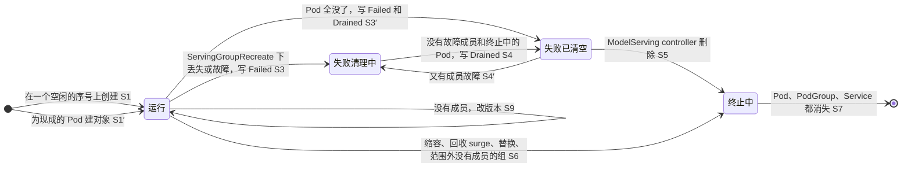
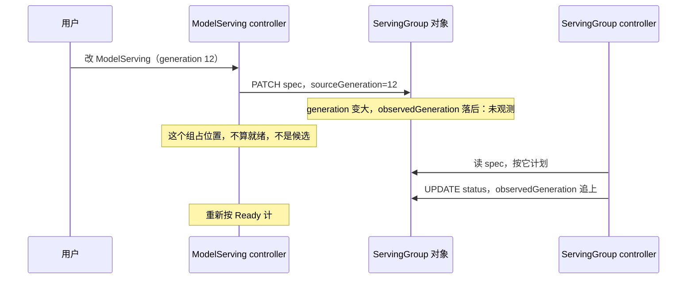
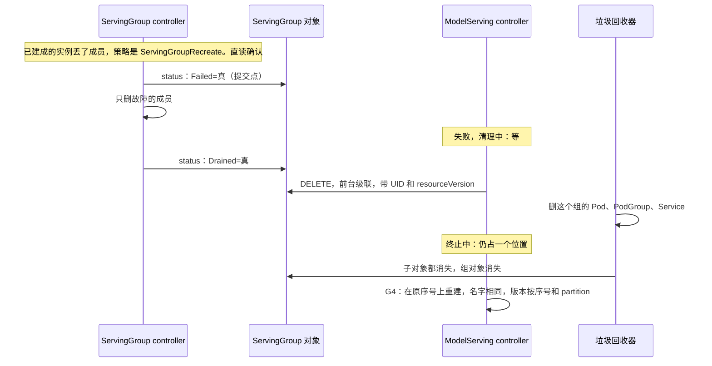
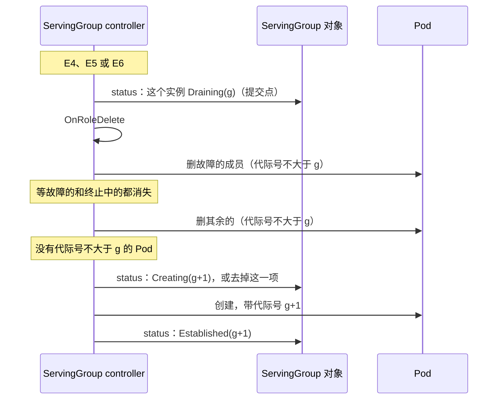
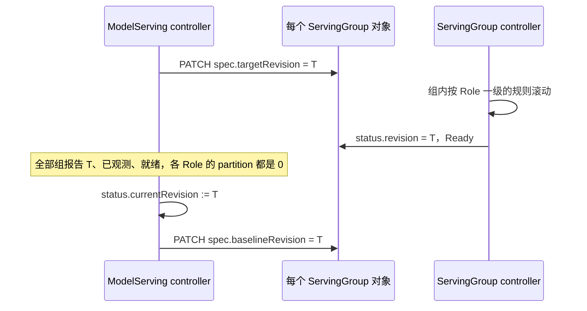

# 状态机

## 0. 文档信息

| 项 | 内容 |
| --- | --- |
| 用途 | 重画 [007 的 v4](../modelserving-state-machine-v3-v4/04-v4-servinggroup-cr.md) 第 4、5 节的状态机。读完这一份应当能回答三个问题：一轮 reconcile 做了什么；一个 ServingGroup、一个 Role 实例现在是什么状态、凭什么这样判定、下一步去哪；任何一个 controller 在任何一步换主或被接管，新进程会怎样 |
| 以谁为准 | 规则和理由以 [02](02-design.md) 为准，这里是它的逐条画法。两者有出入时是本文的错误 |
| 状态 | 设计提案，没有实现。每条边的证据来源在[第 12 节](#12-证据索引)：模型穷举过的，还是推演 |
| 记号 | E 开头是 Role 实例的转换，S 开头是 ServingGroup 的转换，S1′、G0–G6 是组一级一轮计划的各步（02 的 4.2），M、R 开头是两个 controller 一轮里的步骤，W 开头是写，L1–L7 是账本的规则（02 的 5.2），A1–A7 是两个 controller 之间的约定（02 第 3 节） |

## 1. 怎样读

| 想知道 | 看 |
| --- | --- |
| 一个状态是凭什么判定的 | 第 3–6 节每一层的判定表。条件都只用对象上的字段写，时间只和对象上的时间戳比较。一处例外：重启故障到没到期（第 3 节） |
| 一个状态能去哪、谁推动、要什么条件 | 第 4.3、5.3 节的转换表 |
| 一轮 reconcile 的完整过程 | 第 7、8 节，两个 controller 各一条线 |
| 两个 controller 怎样配合 | 第 9 节，四张时序图 |
| 在任何一步停下会怎样 | 第 10 节。10.2 把每一次写当作一个可能停下的点 |

三条贯穿全文的性质：

1. **状态不存储，只判定。**每一轮从对象重新得出；重启故障到没到期除外，它看进程里记的起点（第 3 节）。写在对象上的只有事实（账本的值、Failed、`deletionTimestamp`、版本），不是「我做到第几步」。
2. **每个状态的动作只取决于这个状态。**不取决于是怎样到达的、是哪个进程到达的。
3. **动作之前的提交点是一次带条件的写。**提交之后停下，下一个进程读到提交的事实，接着做；提交之前停下，下一个进程重新判断。

## 2. 状态在哪里

| 层 | 状态由什么得出 | 存在哪个对象上 | 谁写 |
| --- | --- | --- | --- |
| Pod 成员 | Pod 的 `deletionTimestamp`、`phase`、容器状态、原地更新的注解。重启故障到没到期另看起点 | Pod。重启故障的起点不在对象上，在进程里（D9） | kubelet、环境；ServingGroup controller 只创建和删除 |
| Role 实例 | 账本的值 × 成员的观察 × 组的 `spec` | `ServingGroup.status.roleInstances[]` | ServingGroup controller |
| ServingGroup | 名字里的序号；`deletionTimestamp`；surge 注解；`status` 的 Failed、Drained、Ready、`pods`；`observedGeneration`。确认就绪另看名下的 Pod | ServingGroup | 创建、删除、surge 注解、`spec`：ModelServing controller。`status`：ServingGroup controller |
| ModelServing | 名下各组的状态和版本；`spec` | 不存储。只有基线在 `status.currentRevision` | ModelServing controller |

除了重启故障的 grace 从什么时候起算（D9，第 3 节），内存里没有状态。决定的输入只来自对象；有写要发的轮次不按缓存发，按直读重算（M7、R7）。进程里不是对象副本的几样东西只会让动作晚一点，清单在 02 的 3.2。

## 3. 第一层：Pod 成员

ServingGroup controller 对名下每个期望的位置判定一个成员状态，自上而下取第一个成立的。与 v2 相同，没有 finalizer。

| 成员状态 | 条件 | 对所在实例的含义 |
| --- | --- | --- |
| 外来 | 这个位置的名字上有一个 Pod，它的 controller owner 的 UID 不是这个组，也不满足下一行。owner 是同名的上一个对象（旧 UID）的 Pod 属于这一种；正在终止的存量 Pod 也是 | 不删它，不数它。自己的这个成员按缺失算，但不创建：报告并等待（L7）。「被占着」要由直读或者创建返回的 AlreadyExists 确认：缓存里有而直读没有的（删除通知丢了），按缺失创建 |
| 待接管 | 标签是这个组的，名字是这个位置的名字，不在终止中，并且是下面三种之一。**无主**：没有 controller owner，带代际号标签（02 的 5.5）。**存量**：controller owner 是所属的 ModelServing（升级接管，[06](06-live-upgrade.md) 的 5.1）。**接管期间的无主存量**：所属 ModelServing 的接管还没有做完（没有接管注解，或者注解是 `InProgress`），没有 controller owner，不要求代际号标签（06 的 5.1） | 是成员。不为这个名字创建，也不删除它；换 owner。换 owner 之前直读这个 Pod 和这个组 |
| 终止中 | `deletionTimestamp` 非空 | 已建成的实例：丢失。创建中的实例：等它消失 |
| 终态 | `phase` 是 `Failed` 或 `Succeeded` | 故障，不等 grace |
| 原地更新中 | 原地更新的进度注解没有完成 | 不是故障。走原地更新的接口点 |
| 重启故障（范围已提交） | 有计划外的容器重启、不 Ready，并且它所在的范围已经提交：所在的组是 Failed，或者所在实例的账本是 Draining(g) 而它的代际号不大于 g | 故障。不看 grace 到没到期，不看恢复生不生效：这个成员反正要删，这一行只让它落在两步删除的第一步 |
| 重启故障（到期） | 有计划外的容器重启、不 Ready，恢复生效，并且从本进程第一次看到它这样起已经满了 grace | 故障 |
| 重启故障（未到期） | 同上，没满 grace；或者恢复不生效 | 未就绪。满 grace 的时刻定时入队；恢复不生效时只报告 |
| 就绪 | `Running` 并且 Ready | — |
| 未就绪 | 其余 | 等待 |
| 缺失 | 该有这个成员而没有 Pod | 已建成的实例：丢失。创建中的实例：创建 |

第三行起只对 controller owner 的 UID 是这个组的 Pod 判定。「恢复不生效」的重启故障不是故障，不触发恢复。「范围已提交」一行不是触发：范围已经因为别的成员、因为它自己到期、或者因为计划内的清空（E4）而提交了，这一行只定它在两步删除里的先后。条件成立时 E1 或 E2 先中，走不到 E5。

「恢复生效」指 `recoveryPolicy` 不是 `None`，并且 grace 不是 `-1`。计时的时候恢复生不生效、grace 有多长，取组里的副本和缓存里所属 ModelServing 两者中保守的一个（02 的 5.3）。

**故障的起点**在进程的内存里，与今天相同（D9）：ServingGroup controller 第一次看到一个成员进入重启故障的时刻，以 Pod 的 UID、Ready condition 的 `lastTransitionTime` 和原地更新的重启基准为键。键对不上（成员恢复过再坏、Pod 换了、打过原地更新的补丁），重新计。同一个进程里改 grace 不动起点，到期按当时生效的 grace 现算（副本和缓存里的 ModelServing 两者中较长的一个）。换主、重启之后新的进程从它第一次看到起重新计满一个 grace。这是成员状态里唯一不能只从对象判定的一格；用户的口径是 grace 的计时可以赦免，因为它只影响时间（02 的 5.3）。

**起点只决定提交什么时候发生。**范围提交之后（写上了 Failed 或 Draining），范围里在重启故障里的成员按上表「范围已提交」一行直接算故障，不再看起点。所以提交之后的两步删除（E1、E2、S4）只取决于对象，换了进程也照样先删故障的成员。恢复不生效时不计时，已有的起点去掉；生不生效取副本和缓存里的 ModelServing 两者中保守的一个，所以策略还没下发到组时把 grace 改成 `-1` 再改回来，改回来之后重新计满一个 grace（02 的 5.3）。

Pod 上值是 `serving-group` 的 surge 注解是组对象上那个注解的副本，不参与成员状态的判定。ServingGroup controller 只在 `ServingGroupRollingUpdate` 下让它跟随组对象（R10）；值是 `role` 的它不动。

## 4. 第二层：Role 实例

### 4.1 状态

一个 Role 实例是「组里某种 Role 的第 i 个」。它不是对象，状态记在组的账本里。

| 状态 | 判定 | 属性 |
| --- | --- | --- |
| 不存在 | 没有账本项，没有任何 Pod | — |
| 创建中 Creating(g) | 账本项是 Creating；或者没有账本项而有 Pod、或者在期望之内（零值） | — |
| 已建成 Established(g) | 账本项是 Established | 就绪：成员齐全并且全部就绪。否则未就绪 |
| 清空中 Draining(g) | 账本项是 Draining | — |

g 是代际号。没有账本项时 g 取现有 Pod 的最大代际号，没有 Pod 时取 0。

「在期望之内」：Role 一级的计划（v2 的规则）这一轮要它存在的实例。包括序号小于组 `spec` 里这种 Role 的 `replicas` 的，和带 Role 一级 surge 标记、还没有被回收的。不包括：协调扩容的依赖门控还没放行的新增实例；被 Role 一级的计划选中删除的（Role 缩容、按重建执行的滚动替换、回收 Role 一级的 surge）。Role 一级的计划沿用 v2，它把清空中当作 v2 的「终止中」，创建中当作「未就绪」。

组的 Ready 的口径与当前实现相同，本设计不改：每种 Role 的实例个数等于 `replicas`，每个实例运行并且就绪；空组为真。所以 Role 缩容时多出来的实例消失之前、有 Role 一级的 surge 实例时，组是未就绪的，今天也是这样。它只在 ServingGroup controller 里算；ModelServing controller 不另算一遍，只判断这份 `status` 新不新鲜（02 的 A7）。

### 4.2 图

```mermaid
stateDiagram-v2
    direction LR
    [*] --> 创建中: 在期望之内 E7
    创建中 --> 已建成: 成员齐全，写 Established E8
    已建成 --> 清空中: 丢失或故障，RoleRecreate，写 Draining E5 E6
    创建中 --> 清空中: 故障，RoleRecreate E5。不再期望 E4
    已建成 --> 清空中: 不再期望 E4
    清空中 --> 创建中: 清空了，还在期望之内，写 Creating(g+1) E3
    清空中 --> [*]: 清空了，不在期望之内，去掉账本项 E3
    已建成 --> 已建成: None 下补一个 E6
```

`ServingGroupRecreate` 下的丢失和故障不走实例的边：它让整个组失败（[5.3](#53-转换) 的 S3），之后实例冻结。`ServingGroupRollingUpdate` 下整个组的 Pod 都没了也是这样（S3′）。

### 4.3 转换

每一轮对每个实例自上而下取第一个成立的触发。每一格恰好一个反应。

| # | 触发 | 适用的状态 | 反应 | 写 | 之后 |
| --- | --- | --- | --- | --- | --- |
| E0 | 组在终止中 | 全部 | 不做事。垃圾回收器在删 | — | 不变 |
| E1 | 组已失败 | 全部 | 只删这个实例里故障的成员 | DELETE Pod | 不变 |
| E2 | 账本是 Draining(g)，还有代际号不大于 g 的 Pod | 清空中 | 本进程还没为它成功调过 `OnRoleDelete` 的先调：调之前直读这个组的 `status`，账本仍是 Draining(g) 才调。钩子不成功：这一轮不删，组报 `DrainBlocked`，下一轮重试。然后两步删除：先删故障的成员；没有故障的成员、也没有正在终止的 Pod 之后，删其余的 | 钩子；DELETE Pod | 清空中 |
| E3 | 账本是 Draining(g)，没有代际号不大于 g 的 Pod | 清空中 | 本进程还没为它成功调过 `OnRoleDelete` 的先调（同 E2；接管到一个已经清空的 Draining 时会走到这里）。然后，还在期望之内：写 Creating(g′)，g′ = max(g, 现有 Pod 的最大代际号) + 1，同一次写里把要建的个数记进 `pods`（L8）。不在：去掉账本项 | 钩子；status | 创建中，或不存在 |
| E4 | 不在期望之内，并且有账本项或有 Pod | 创建中、已建成 | 写 Draining(g) | status | 清空中 |
| E6′ | `ServingGroupRollingUpdate`；组期望有成员；有已建成的实例；一个成员 Pod 都没有了：属于这个组的没有，待接管的没有，终止中的也没有；直读确认过。这是对整个组判的条件，一轮判一次，先于逐实例的 E5、E6 | 已建成 | 写组的 Failed，Drained 同时为真。任何恢复策略下都这样 | status | 组失败 |
| E5 | 有故障的成员；证据直读确认过 | 创建中、已建成 | `None`：删这一个终态的成员。`RoleRecreate`：写 Draining(g)。`ServingGroupRecreate`：写组的 Failed | DELETE Pod，或 status | 不变；清空中；组失败 |
| E6 | 已建成，有成员缺失或在终止；证据直读确认过 | 已建成 | `None`：缺失的创建，在终止的等它消失。`RoleRecreate`：写 Draining(g)。`ServingGroupRecreate`：写组的 Failed | 创建 Pod，或 status | 已建成；清空中；组失败 |
| E7 | 创建中，成员不齐：有缺失的，或者有在终止的 | 创建中 | 缺失的创建，带代际号 g。组的 `status.pods` 是 0 时，PodGroup 建成之后先写 `status`、写成功才建第一个 Pod（L8）。位置上有终止中的 Pod：等它消失。位置被外来 Pod 占着（直读确认过，或者创建撞了名字）：报告，等 | 创建 Pod | 创建中 |
| E8 | 创建中，成员齐全，没有在终止的 | 创建中 | 全部成员都在缓存里看到了：写 Established(g)。还有没看到的：等缓存，不写 | status | 已建成，或创建中 |
| E9 | 已建成，成员齐全 | 已建成 | 不做事 | — | 已建成 |

几点说明。

- **E4、E5、E6、E6′ 的直读（L4，R7）。**这一轮要写 Draining、写 Failed、删 Pod 或者打原地更新的补丁时，直读这个组和它名下的 Pod，用读到的重新判定。要写 Draining、写 Failed 时另直读所属的 ModelServing，恢复策略和 grace 取它上面的最新值。把缺失当证据：要读到没有。把终止中、终态当证据：要读回同一个 UID 并且仍然如此。
- **E6′ 为什么不走账本。**整个组没有了，按契约要按序号和当时的 partition 重新选版本（D12）。P 和 B 不在 ServingGroup controller 手里，所以它让组失败，由 ModelServing controller 删掉对象、在这个序号上重建（02 的 5.3）。
- **E4 到 E6 先写再删（L1）。**status 写被拒绝（resourceVersion 冲突），本轮后面的删除和创建都不发。
- **E8 看的是缓存，不是创建请求的返回（L3）。**
- **`None` 下的重启故障**不到 E5：恢复不生效时它不是故障（第 3 节），只报告。
- **E5 和 E6 同时成立**（一个终态的成员加一个缺失的成员）时取 E5，缺失的成员下一轮处理。007 的账本模型是同一轮两样都做；轮次不同，终局相同。
- **有待接管成员的组**先换 owner（R2），一个实例的成员换完之前不为它创建、不删除它的成员。收养来的实例账本是零值，是创建中：这时缺的成员按 E7 补，不按范围恢复。无主的成员收养之后，`ServingGroupRollingUpdate` 下它的版本与组的 `spec.revision` 不同、组里又没有未完成的原地更新时，组报 `RecreateRequired`（02 的 5.5）。存量的成员（升级接管）不比较版本。
- **原地更新中的成员**不触发 E5、E6；超过进度期限并且恢复生效时按故障算（007 的 05）。
- **先写后建（L8）。**`status.pods` 是 0 的组建第一个 Pod 之前先写 `status`，`pods` 是要建的个数。这次写在 PodGroup 建成之后：PodGroup 建不出来的组 `pods` 仍然是 0，仍然是没有成员的组。ModelServing controller 给没有成员的组改版本（S9）的 PATCH 和这次写都以组的 resourceVersion 为条件，只有一个成功。E3 写 Creating(g′) 的那一次同样记上：实例恢复清空了组里全部 Pod 之后，组不是「没有成员」，按组自己的版本重建。
- **策略取动手那一刻的。**从直读到的 ModelServing 上取（R7）；组的 `spec` 里的是副本。账本的值不记策略：Draining 写上之后策略改了，清空照样做完；清空之后建不建，看当时的期望。

### 4.4 每个状态一张卡片

**不存在**

| 项 | 内容 |
| --- | --- |
| 判定 | 没有账本项，没有 Pod |
| 进入 | E3：清空了并且不在期望之内 |
| 离开 | `spec` 把它纳入期望：它就是创建中（零值），E7 开始创建 |
| 不允许 | — |
| 接管时 | 新进程看到的和原进程相同 |

**创建中 Creating(g)**

| 项 | 内容 |
| --- | --- |
| 判定 | 账本项是 Creating，或者没有账本项而在期望之内或有 Pod |
| 进入 | 新的期望；E3 清空之后重建 |
| 离开 | E8 → 已建成；E4、E5 → 清空中；E5（`ServingGroupRecreate`）→ 组失败 |
| 这个状态下缺成员的含义 | **没建完。只补。** |
| 不允许 | 因为缺失而删除任何 Pod |
| 接管时 | 新进程看到 Creating 和若干成员：缺的补（名字确定，重复创建撞名字），齐了写 Established。原进程写了 Established 而新进程的缓存还没看到时，新进程按 Creating 处理：这段时间里的丢失只补，比原进程保守 |

**已建成 Established(g)**

| 项 | 内容 |
| --- | --- |
| 判定 | 账本项是 Established |
| 进入 | E8 |
| 离开 | E4、E5、E6 → 清空中；E5、E6（`ServingGroupRecreate`）→ 组失败 |
| 这个状态下缺成员的含义 | **丢失。按策略的范围恢复。**与 controller 当时在不在、换没换主无关 |
| 不允许 | 不经直读就把缺失当丢失 |
| 接管时 | 新进程读到 Established。成员在不在，直读确认。结果与原进程相同。因为重启故障而离开（E5）的那一种：grace 在新进程里重新计，提交晚一个 grace（第 3 节） |

**清空中 Draining(g)**

| 项 | 内容 |
| --- | --- |
| 判定 | 账本项是 Draining |
| 进入 | E4、E5、E6。**进入是一次 status 写，它是提交点** |
| 离开 | E3 |
| 这个状态下的动作 | 删代际号不大于 g 的 Pod，两步；不创建 |
| 不允许 | 删代际号大于 g 的 Pod（L5）；在这个实例里创建 |
| 接管时 | 新进程读到 Draining(g)，接着删同一批。不问原因、不问是谁写的。`OnRoleDelete` 可能被再调一次。原进程已经写了 Creating(g+1) 并建了新 Pod，而另一个进程读到的还是 Draining(g)：它只能删代际号不大于 g 的，碰不到新的 |

## 5. 第三层：ServingGroup

### 5.1 状态

**序号是位置，对象是这一代。**同一个序号上先后可以有两个对象，名字相同，UID 不同。下面的状态属于对象，不属于序号；旧对象的状态随它一起消失，新对象从头开始。

一个序号在某一时刻是四种情形之一，只按名字判断：

| 序号 | 判定 | 含义 |
| --- | --- | --- |
| 空闲 | 命名空间里没有名字是 `<ModelServing 名>-<序号>` 的 ServingGroup 对象 | 规则可以在它上面建组 |
| 空闲，有无主的成员 Pod | 同上，并且有无主的成员 Pod 带着这个组名（02 的 5.5） | 先为它们建对象（S1′） |
| 被自己的组占着 | 有这个名字的对象，controller owner 的 UID 是这个 ModelServing。不论它在哪个状态 | 不能建同名的。组在终止中或已失败时，要等它消失 |
| 被外来的对象占着 | 有这个名字的对象，owner 不是这个 ModelServing | 不建，不删它，不计数。报 `OrdinalOccupied` |

一个组对象的生命周期有四个状态。ModelServing controller 自上而下判定。

| 状态 | 判定 | 计入 |
| --- | --- | --- |
| 终止中 | `deletionTimestamp` 非空 | `active` |
| 失败，已清空 | Failed 为真，Drained 为真 | `active` |
| 失败，清理中 | Failed 为真，Drained 不为真 | `active` |
| 运行 | 其余 | `active`、`live` |

组另有几组属性。它们不是状态，只出现在边的条件里：

| 属性 | 取值 | 判定 |
| --- | --- | --- |
| 身份 | surge | 带 surge 注解。临时容量。只在 `ServingGroupRollingUpdate` 下有意义 |
| | 正式 | 不带。计入 N |
| 可用性（运行的组） | 未观测 | `observedGeneration` 小于 `generation`。占位置，不算确认的就绪，不是替换的候选 |
| | 确认就绪 | 已观测，`status` 新鲜，Ready 为真。新鲜：`status.observedPods` 与 ModelServing controller 用 Pod 缓存、对这个组的成员 Pod 算出来的摘要相同（02 的 4.1）。空组的 Ready 为真 |
| | 确认未就绪 | 已观测，`status` 新鲜，Ready 不为真。包括还在创建的 |
| | 不新鲜 | 已观测，`observedPods` 与 Pod 缓存算出来的不同：这份 `status` 不是按现在这些成员 Pod 算的。按未观测算，直到 ServingGroup controller 重写。失败的组不新鲜时 G1 不删 |
| 成员（运行的组） | 没有成员 | `status.pods` 是 0（没写过 `status` 的新对象也是），Pod 缓存里没有它的成员 Pod。不要求已观测。其余的组都算有成员 |
| | 空组 | 各 Role 的副本数都是 0，按 `spec` 判断。Ready 为真；有空组时基线不推进 |
| | 待收养 | 名下还有无主的成员 Pod 没收养完（ModelServing controller 从 Pod 的索引看）。计入 `active` 和 `regular`，不计入 `regularLive`；不是缩容、回收、替换的候选。超过期限还没收养完，报 `GroupNotObserved` |
| 版本类（运行的组） | 目标、受保护、可替换 | 02 的 4.1。受保护和可替换由版本和序号得出：序号小于 P 的不可替换；没有成员的不可替换。可替换的正式的组，删掉之后补不上时这一轮跳过它（02 的 4.1 的「补得上」、4.2 的 G3c） |

给人看的阶段（`kubectl get servinggroup` 的一列）按同一张表，把「运行」细分成 Creating（还有期望的实例没建成）、Ready、NotReady。它不参与任何判断。

### 5.2 图

对象消失之后它的序号空出来。要不要在这个序号上再建，由规则按当时的 `spec` 决定：那是另一个对象的 S1。

### 5.3 转换

| # | 从 | 到 | 谁推动 | 条件 | 写和前置条件 |
| --- | --- | --- | --- | --- | --- |
| S1 | — | 运行 | ModelServing controller | G4：正式的组，小于 N 的最低空闲序号。G3a：surge 的组，不小于 N 的最低空闲序号，带 surge 注解 | 创建 ServingGroup，名字由序号确定。AlreadyExists 时直读，核对 owner 的 UID：是自己的，按读到的重新计划；不是，这个序号被外来的对象占着 |
| S1′ | — | 运行 | ModelServing controller | 找回：序号上有无主的成员 Pod 而没有同名的对象（02 的 5.5）；序号被外来的同名对象占着时不建，报 `OrdinalOccupied`。升级接管（06 的 T3） | 创建 ServingGroup，名字是 Pod 标签上的组名。版本取 Pod 的标签，读不到时按序号和 partition。surge 注解按 Pod 上的副本判定（02 的 5.5）。撞名字同 S1 |
| S2 | 运行，surge | 运行，正式 | ModelServing controller | G0。`ServingGroupRollingUpdate`：序号小于 N，并且正式的组少于 N。`RoleRollingUpdate`：无条件 | 摘掉 surge 注解，只带 UID。对象、Pod 都不动。终止中的、失败的组同样可以摘 |
| S3 | 运行 | 失败，清理中 | ServingGroup controller | E5 或 E6，策略是 `ServingGroupRecreate` | status：Failed 为真。带 resourceVersion。**提交点** |
| S3′ | 运行 | 失败，已清空 | ServingGroup controller | E6′：`ServingGroupRollingUpdate` 下，组期望有成员，有建成过的实例，一个成员 Pod 都没有了（待接管的也没有）。直读确认 | status：Failed 和 Drained 都为真。**提交点** |
| S4 | 失败，清理中 | 失败，已清空 | ServingGroup controller | 没有故障的成员，没有正在终止的 Pod | status：Drained 为真 |
| S4′ | 失败，已清空 | 失败，清理中 | ServingGroup controller | 又有成员故障 | status：Drained 为假 |
| S5 | 失败，已清空 | 终止中 | ModelServing controller | G1：Failed、Drained 都为真，并且 `observedPods` 与 Pod 缓存相同（Drained 说的是现在这些 Pod） | DELETE，前台级联，带 UID 和 resourceVersion。S4′ 已经写上的话，这次删除被拒绝。S4′ 该写而还没写出来时，Pod 已经变了，`status` 不新鲜，G1 的条件不成立；只有 Pod 缓存还没看到那次故障时挡不住（U6） |
| S6 | 运行 | 终止中 | ModelServing controller | G2 缩容、G2′(a) 范围外的没有成员的正式的组、G3b 回收 surge、G3c 替换 | 同上 |
| S7 | 终止中 | — | 垃圾回收器 | 带 `blockOwnerDeletion` 的子对象都消失 | — |
| S8 | 任何 | 终止中，或直接消失 | 用户 | `kubectl delete servinggroup` | 02 的 5.5 |
| S9 | 运行，没有成员 | 运行 | ModelServing controller | G2′(b)：版本不等于按它的序号现在新建会用的版本 | PATCH `spec.revision`，带 UID 和 resourceVersion。与 ServingGroup controller 先写后建的那次 status 写（L8）只有一个成功 |

失败不可逆：没有从失败回到运行的边。策略在 S3 之后改了，照样删。surge 注解只会被摘掉，不会后加：没有从正式回到 surge 的边。

### 5.4 每个状态一张卡片

**运行**

| 项 | 内容 |
| --- | --- |
| 判定 | 没有 `deletionTimestamp`，Failed 不为真 |
| ServingGroup controller 在里面做 | 第 8 节的全部步骤 |
| ModelServing controller 对它可以做 | G0 转正、G2 缩容、G2′ 没有成员时删掉或改版本、G3b 回收、G3c 替换、G5 下发 `spec` |
| 离开 | S3、S3′、S6、S8 |
| 接管时 | 两个 controller 的新进程都从对象重新判定。它是不是 surge、是哪个版本、在哪个序号，都在对象上 |

**失败，清理中**

| 项 | 内容 |
| --- | --- |
| 判定 | Failed 为真，Drained 不为真 |
| ServingGroup controller 在里面做 | 只删故障的成员（E1）。不创建，不推进账本，不做 Role 一级的任何事 |
| ModelServing controller 对它可以做 | 什么都不做，等。它占着它的序号，这个序号在它消失之前不能重建 |
| 为什么等 | D15：故障的成员停下并且消失之前，其余成员继续运行 |
| 离开 | S4 |
| 接管时 | 新进程读到 Failed：ServingGroup controller 接着删故障的成员，ModelServing controller 接着等。谁写的、因为什么写的，都不需要知道 |

**失败，已清空**

| 项 | 内容 |
| --- | --- |
| 判定 | Failed 和 Drained 都为真 |
| ModelServing controller 对它可以做 | G1：删除 |
| 离开 | S5；S4′ |
| 接管时 | 新进程的 ModelServing controller 直接删。DELETE 带 resourceVersion，读到的 `status` 不是最新时被拒绝 |

**终止中**

| 项 | 内容 |
| --- | --- |
| 判定 | `deletionTimestamp` 非空 |
| ServingGroup controller 在里面做 | 不做事。尽力调一次 `OnRoleDelete`（02 第 7 节） |
| ModelServing controller 对它可以做 | 不做事。它占着位置和序号直到消失。超过等待期限时直读一次：对象其实已经没有了的话，按没有处理 |
| 谁在推进 | 垃圾回收器。kthena 不在也照样推进 |
| 接管时 | 没有需要接着做的事。新进程看到这个序号被占着，等 |

## 6. 第四层：ModelServing

ModelServing 一级没有要存储的状态。对外是 `status` 的计数和 condition，全部按本轮的观察算；只有基线 `status.currentRevision` 是下一轮的输入。

**计数。**口径与当前实现相同。

| 字段 | 定义 | 终止中的组 | 失败的组 | 未观测的组 | surge 的组 |
| --- | --- | --- | --- | --- | --- |
| `replicas` | 全部组对象（`active`） | 计入 | 计入 | 计入 | 计入 |
| `updatedReplicas` | 其中版本等于 T、不在终止中的 | 不计，与今天相同 | 计入 | 计入 | 计入 |
| `currentReplicas` | 其中版本等于 B 的。B = T 时与 `updatedReplicas` 相同，稳态是 N | 计入 | 计入 | 计入 | 计入 |
| `availableReplicas` | `live` 里报告的就绪为真的（02 的 4.1） | 不计 | 不计 | 按上一次报告 | 就绪了就计入 |
| `currentRevision`、`updateRevision` | B、T | | | | |

接管注解是 `InProgress` 的期间不重算计数，保留上一次写的值，只更新 condition：刚接管来的组还没有写出 Ready，重算会让可用数掉到 0 再回来。回退开关在的时候（06 的 9.1）`status` 整个不更新。

`updatedReplicas` 不计 `RecreateRequired` 为真的组：它的 `spec.revision` 是 T，Pod 不是。空组的 Ready 是真，与今天相同：各 Role 的副本数都是 0 时 `availableReplicas` 是 N，`Available` 为真。

**condition。**现有三个 condition 的 type、reason 和互斥关系不变：`UpdateInProgress`、`Progressing`、`Available` 同一时刻至多一个为真。判定里的「就绪」取报告的就绪，与 `availableReplicas` 同一个口径：`spec` 下发造成的短暂未观测不会让 `Available` 掉下去。新的事实写在 message 里，或者写在新增的 `RolloutBlocked` 上。

| condition | 为真的条件，自上而下取第一个成立的 | message 里写什么 |
| --- | --- | --- |
| `UpdateInProgress` | 滚动中：有可替换的组；或者有带 surge 注解的组；或者 B ≠ T 并且有未就绪的目标组 | 已经是目标版本的组、还在进行的组 |
| `Progressing` | 不在滚动中，但有别的事在做：名下还有存量对象（升级接管没有做完）；有失败的组；`live` ≠ N 或者有终止中的组；有未就绪的组 | 是哪一种：接管中、整组恢复中、扩缩中、等待就绪 |
| `Available` | 以上都不是：恰好 N 个组，全部就绪，没有在进行的变更 | 灰度停点（B ≠ T，有受保护的组）时写明停在 partition 上，并列出受保护的组名。B ≠ T、有空组、基线因此没有推进时写明在等副本数调回来 |

| condition | 为真的条件 | 说明 |
| --- | --- | --- |
| `RolloutBlocked`（新增） | 有事要做，这一轮的计划却是空的，并且同一个原因已经持续超过期限。reason 见下表 | 可以和 `UpdateInProgress` 或 `Progressing` 同时为真。`Available` 为真时它一定是假 |
| `CoordinatedRoleRolloutBlocked`（已有） | 任何一个组的 `status` 报告了它 | ServingGroup controller 按组写，ModelServing controller 汇总，message 带组名 |

「有事要做」：有可替换的组，或者 `regular` 不等于 N，或者有失败的组，或者有该回收而没回收的 surge 组，或者有没有成员而版本该改的组，或者 B ≠ T、P = 0 而基线还没有推进（G6 的条件不成立；只差「没有空组」这一条的不算）。「计划是空的」：S1′、G0 到 G4 这一轮一个写也没有。这时在等什么，就是 reason，自上而下取第一个成立的：

| reason | 在等什么 | 持续时间的起点 | 例子 |
| --- | --- | --- | --- |
| `BaselineUnknown` | 要按 B 建组、要把没有成员的组改成 B、要替换序号小于 P 的组、要替换一个替代的容量得按 B 建的组，而 B 读不到 | 不设期限，立刻报 | 02 的 4.8 |
| `OrdinalOccupied` | 要建组的序号被外来的同名对象占着；或者要替换的组删掉之后，小于 N 的空闲序号一个都没有（都被外来的对象占着） | 不设期限，立刻报。message 里写明对象的名字 | 同名的 ModelServing 删了重建，上一个留下的组还没被回收；02 的 4.5 |
| `WaitingForDeletion` | 有终止中的组，或者有 Failed 而没有 Drained 的组 | 那个组的 `deletionTimestamp`，或者 Failed 的 `lastTransitionTime`。message 里写明序号 | 失败的组清不空；被替换的旧组卡在终止中，它的序号建不出新的；N 调小之后一个组卡在终止中 |
| `GroupNotObserved` | 有未观测的组，有 `status` 一直不新鲜的组（失败、已清空而不新鲜、所以还没被删的也算在这里），或者有待收养一直收养不完的组 | 未观测：ModelServing controller 最后一次写这个组的 `spec` 的时间（对象的 `managedFields` 里有）。不新鲜、待收养：ModelServing controller 第一次看到的时间，以组的 UID 为键，在它的内存里，进程重启之后重新计 | ServingGroup controller 写不出这个组的 `status`；换 owner 一直被拒绝。message 写明是哪个组、哪一种、哪些 Pod |
| `TargetNotReady` | 有没有确认就绪的目标组 | 这个组的 Ready 最后一次变化的时间，没有就绪过的取 `creationTimestamp` | 新版本起不来。没有可替换的组时就是 SG-C16 的终态和 U5：滚动只差它就绪 |
| `BudgetExhausted` | 其余：就绪数在下限上，未就绪的是受保护的组或者可替换的组自己 | 那个未就绪的组的 Ready 最后一次变化的时间 | 受保护的组未就绪（SG-P09） |

- **都带期限。**等一个组消失、等一个新组就绪、等 `status` 跟上，都是正常的过程：每一次缩容、每一次带 surge 的滚动收尾都会经过。同一个原因持续超过一个可配的期限才把 `RolloutBlocked` 写成真。起点除了「不新鲜」「待收养」两种都取对象上的时间，不需要记忆。这两种的起点在 ModelServing controller 的内存里：丢了只会让报告晚一个期限；两次重启的间隔一直短于期限时不报（02 的 3.2）。期限的默认值留给实现和真实验证定。
- **取第一个成立的。**一个卡住的失败组或终止中的组会盖住排在后面的原因；它本身也是要处理的异常。
- **空组不算有事要做。**各 Role 的副本数都是 0 是用户有意的。空组的 Ready 为真，不报 `TargetNotReady`；基线因为有空组而不推进，也不报 `RolloutBlocked`，写在 `Available` 的 message 里。
- **序号的状况写在 message 里。**范围内的空洞、范围外的正式的组（契约 A.5 的「身份债」），与今天相同。

给人看的阶段按固定的优先级取一个：接管中、恢复中、阻塞、扩缩中、滚动中、灰度停点、稳定。

## 7. ModelServing controller 的一轮

key 是一个 ModelServing。

| 步 | 做什么 | 读 | 写 | 这一步停下 |
| --- | --- | --- | --- | --- |
| M0 入队 | ModelServing 的新增、`generation` 变化、接管注解变化、删除；名下任何 ServingGroup 的新增、更新、删除；它的 ControllerRevision 的新增和删除；阻塞原因的期限到期；终止中的组的等待期限到期；有组的 `status` 不新鲜的轮次之后隔一小段时间重试（Pod 缓存追上时没有别的事件带来下一轮），带退避，上限取 `GroupNotObserved` 的期限的量级；周期 resync。另有两种 Pod 事件，都由 ServingGroup controller 的 Pod 事件处理转过来：接管期间存量 Pod 的事件；任何时候无主的成员 Pod 的事件（02 的 5.5） | — | — | — |
| M1 取对象 | ModelServing；它在删除中则返回，垃圾回收器会删名下的组 | 缓存 | — | 无影响 |
| M2 观察 | 名下的组（controller owner 的 UID 是这个 ModelServing）；同名而不是自己的组。Pod 缓存：哪些序号上有无主的成员 Pod；每个组的成员 Pod（02 的 4.1；复核的摘要、「没有成员」、缩容和回收的次序、deletion cost 用）。没有别的输入 | 缓存 | — | 无影响 |
| M3 升级闸门 | 接管注解不是 `Done`（没有、`InProgress`、`RollingBack`）：走 [06](06-live-upgrade.md) 的接管或回退，本轮不做 M6 之后的组一级的写 | 直读 | 06；接管注解 | 06 |
| M4 版本 | 解析 T：先在已有的 ControllerRevision 里找语义相同的，没有就创建。取 B（02 的 4.8） | 缓存 | W1 创建 ControllerRevision | 重复创建撞名字 |
| M5 分类和记账 | 02 的 4.1，包括复核 | — | — | 纯函数 |
| M6 计划 | S1′、G0 到 G6，在工作副本上迭代（02 的 4.2） | — | — | 纯函数 |
| M7 直读重算 | M6 的计划里有组一级的写（建、删、摘注解、下发、推进基线）：直读这个 ModelServing 和命名空间里带它的名字标签的全部组（按 owner 的 UID 分成自己的和外来的；外来的对象占着哪些序号另用 M2 从缓存看到的），S1′ 另直读那些无主的成员 Pod；用读到的重做 M4 到 M6。没有写要发：跳到 M9 | 直读 | — | 无影响 |
| M8 执行 | 发 M7 重算出来的写，次序：S1′、G0、G1、G2、G2′、G4、G3a、G3b、G3c、G5。一个写失败（被拒绝，或者出错）：这一轮后面的创建、删除、摘注解和改版本都不发，G5 的下发照发；发事件，重新入队。创建撞名字不算失败：直读那个对象，核对 owner 的 UID。是自己的，这一轮到此为止，下一轮按直读重算；是外来的，把那个序号记成被占着，在已经发出的写的基础上重算剩下的 | 直读 | W2 DELETE 组；W3 创建组；W3′ 摘掉 surge 注解；W4 PATCH 组的 `spec`（没有成员的组和原地更新改 `spec.revision` 也是它，这两种另带 resourceVersion） | 第 10.2 节 |
| M9 写 status | 每一轮都算，内容变了才写；出错的轮次也照此，并把哪个写失败记在当时为真的那个 condition 的 message 里。G6 的基线在这一次写里。接管注解是 `InProgress` 时不重算计数 | — | W5 `ModelServing.status` | 第 10.2 节 |
| M10 清理 | 清理不再引用的 ControllerRevision（02 的 8.6）。协调模式的基线仍然写在 ControllerRevision 的注解上（02 的 8.7） | 缓存 | W6 DELETE ControllerRevision；W1 的注解 | 下一轮重做 |

等待都是返回：等组就绪、等组消失，由组的事件带来下一轮。进程里没有要等到期的登记，也没有「自己发过什么」的记录：M7 的直读里都看得到。

新进程的第一轮与任何一轮相同。没有要先等的东西，除了缓存同步。

## 8. ServingGroup controller 的一轮

key 是一个 ServingGroup。

| 步 | 做什么 | 读 | 写 | 这一步停下 |
| --- | --- | --- | --- | --- |
| R0 入队 | 这个组的新增、更新、删除（一次更新事件里新旧对象的 UID 不同时按删除加新增处理，并对这个 key 调 `Forget`）；这个组的成员 Pod（02 的 4.1）的新增、更新、删除，包括 owner 被改：controller owner 是这个组的，映射时比对 ownerReference 的 UID；待接管的，按组名标签找到组、再按第 3 节的条件判定。入队的范围与摘要的范围是同一个集合；PodGroup、Service 的更新和删除；`spec` 引用的 ControllerRevision 的新增；所属 ModelServing 的 `recoveryPolicy` 或 grace 变了；grace 到期、原地更新期限到期；周期 resync | — | — | — |
| R1 取对象 | 这个组。它的 controller owner 不是一个现存的 ModelServing（按 UID）：发事件，返回，不创建、不删除、不恢复（02 的 2.4）。它在终止中：尽力调 `OnRoleDelete`，返回 | 缓存 | — | 无影响 |
| R2 接管成员 | 名下有待接管的成员：换 owner（06；02 的 5.5） | 直读 | W7 PATCH Pod、PodGroup、Service 的 owner | 06 |
| R3 观察 | 这个组的成员 Pod：controller owner 的 UID 是这个组的，和待接管的。摘要按这一轮算 `status` 用的那批成员 Pod 算（R11 写进 `observedPods`）：没有直读的轮次是缓存里的，R7 直读过的轮次是直读到的。读 `spec` 引用的 ControllerRevision；它不在：这一轮出错，分类之后跳到 R11，等它出现的事件 | 缓存 | — | 无影响 |
| R4 分类 | 成员（第 3 节）、实例（4.1）、组（5.1）。重启故障到没到期另看进程里记的起点 | — | — | 除这一格之外是对象的纯函数 |
| R5 组已失败 | 只做 E1；算 Drained；跳到 R11 | — | W10 DELETE Pod | 第 10.2 节 |
| R6 Role 一级的计划 | v2 的 Role 层规则：扩缩容、滚动（重建或原地）、协调。得出哪些实例不再期望、哪些成员要打补丁 | — | — | 纯函数 |
| R7 账本的转换 | 对每个实例走 4.3 的表，得出这一轮的全部转换。**这一轮要写 Failed、写 Draining、删 Pod 或者打原地更新的补丁时：直读这个组和它名下的 Pod，用读到的重做 R4 到 R7。要写 Failed、写 Draining 时另直读所属的 ModelServing，恢复策略和 grace 取它上面的** | 直读 | — | 无影响 |
| R8 提交 | 有转换（E3、E4、E5、E6、E6′、E8，或 S3、S3′）：写 status。**被拒绝：返回，本轮后面不发任何删除和创建** | — | W8 `ServingGroup.status`，带 resourceVersion | 第 10.2 节 |
| R9 钩子和删除 | 清空中的实例：`OnRoleDelete`（本进程第一次；调之前直读账本），不成功就不删、报 `DrainBlocked`；成功之后两步删除。`None` 下终态的成员：删 | 直读 | W9 plugin 钩子；W10 DELETE Pod，带 UID | 第 10.2 节 |
| R10 同步和创建 | 对每个在期望之内的实例调 `OnRoleSync`。PodGroup、Service 不在的建，内容与期望不同的更新（`minMember` 随 Role 的副本数和协调的阶段变化）；撞名字或者要更新时核对 owner 的 UID。E6（`None`）、E7 的成员：`OnPodCreate`，创建。`status.pods` 是 0 的组（L8）：PodGroup 建成之后、第一个 Pod 之前，先写一次 status，`pods` 是要建的个数，带 resourceVersion；写成功才建，被拒绝则这一轮不建。PodGroup 建不出来：不写，这一轮出错，`pods` 仍然是 0。原地更新的补丁，带 Pod 的 resourceVersion。Role 一级的 surge 标记和转正；非生效的那一层留下的标记摘掉。Pod 上组一级标记的副本跟随组对象（只在 `ServingGroupRollingUpdate` 下；值是 `role` 的不动） | 直读 | W11 创建和更新 Pod、PodGroup、Service；W8（L8 的那一次）；W12 Pod 的注解和镜像 | 第 10.2 节 |
| R11 写 status | 每一轮都算，内容变了才写；出错的轮次也照此：读到了成员的话，`observedGeneration` 照样推进，Ready 按看到的成员照实算，带 `ReconcileFailed`。这一轮第一次看到就绪的成员：`OnPodReady`。`observedGeneration`、Ready、Drained、版本、引用到的版本、deletion cost、计数（`pods` 含这一轮刚建的）、`observedPods`。成员 Pod 的判定用到的字段变了摘要就变，所以这样的变化之后都有一次写。这一轮没有 R8 时两次写合成一次 | — | W8 | 下一轮重写 |

`observedGeneration` 在 R8 或 R11 的写里推进，条件是「这一轮的决定是按这份 `spec` 做的」，不等动作做完。每次 status 写都把 Ready、版本按这一轮读到的 `spec` 重算，不带着上一份 `spec` 的结论。

进程里没有「在途的写」的叠加：创建撞名字；删除、Draining、Failed 之前直读；账本的写带 resourceVersion。

## 9. 跨 controller 的协议

### 9.1 下发 `spec`

### 9.2 整组恢复

### 9.3 清空一个 Role 实例

### 9.4 `RoleRollingUpdate` 下推进基线

## 10. 接管

「接管」包括：进程重启；换主；升级到同一设计的新版本。从旧版本升级过来的接管在 [06](06-live-upgrade.md)。

### 10.1 新进程面对的是同一张表

新进程里没有屏障，没有要重建的内存，两个 controller 之间没有先后。它等缓存同步，然后面对的就是第 3–6 节的判定表。不从对象来、又会推迟删除的输入只有一样：重启故障的 grace 从新进程第一次看到起重新计（D9，第 3 节）。进程里的另外几样见 10.2 表后的限定。靠的是三件事（02 的 6.3）：

| 担心 | 靠什么 |
| --- | --- |
| 缓存比对象旧，按它算出来的写落在别的对象上 | 有写要发的轮次按直读重算（M7、R7）。重复的创建撞名字 |
| 停机期间 Pod 坏了或者恢复了，组的 `status` 没有人更新 | 复核：Pod 缓存同步完之后，`status` 不是按现在这些 Pod 算的组按未观测算 |
| 原进程做到一半 | 留在对象上的事实落在判定表的某一格里，那一格的动作就是原进程下一步要做的（10.2） |

下面的表说明每一个可能停下的点落在哪一格。

### 10.2 每一次写都是一个可能停下的点

三栏分别是：停在这次写之前；写被 apiserver 接受了，进程在看到结果之前停下；写之后、同一步的下一个写之前停下。

**ModelServing controller**

| 写 | 之前停下 | 接受了、没看到 | 新进程的动作与原进程 |
| --- | --- | --- | --- |
| W2 DELETE 失败的组（G1） | 组是「失败，已清空」：再删 | 组是「终止中」：等 | 相同 |
| W2 DELETE 缩容的组（G2） | `regularLive` 仍大于 N：按同一个次序再选。对象没变，选中的是同一个；变了，按新的选 | 终止中；`regularLive` 少了一个 | 相同，或者按更新的事实 |
| W2 DELETE 替换的组（G3c）、回收的 surge 组（G3b） | 预算重算；候选没变则选同一个 | 终止中 | 相同 |
| W3 创建组（G4、G3a） | 位置仍然空着：再建，**名字相同** | 直读里有它：不再建。直读也读不到（请求还在路上）：再建一次，撞名字，核对 owner 的 UID | 相同。不会多建。原进程的请求晚到时也是撞名字（02 的 6.4） |
| W3 一批创建发到一半 | 已经建出的在对象里；没建的位置还空着：建剩下的 | 同上 | 相同 |
| W3′ 摘掉 surge 注解（G0） | 条件还成立：再摘 | 它已经是正式的组 | 相同 |
| W4 PATCH 组的 `spec`（G5；G3c 改 `spec.revision`） | 再发，内容相同 | 组是未观测：等 | 相同。`expectedPods` 在同一次写里 |
| W4 改没有成员的组的版本（G2′(b)） | 它还没有成员、版本还不对：再改。已经有成员了：不改，按一般的组处理 | 版本已经是新的 | 相同，或者按更新的事实。PATCH 带 resourceVersion，与 ServingGroup controller 先写后建的那次写只有一个成功 |
| W2 删范围外的没有成员的组（G2′(a)） | 它还是没有成员、条件还成立：再删 | 终止中；消失之后 G4 在最低的空洞上补 | 相同 |
| 接管注解（06 的 T1、T7；`RollingBack`） | 按直读的结果再写 | 注解已经是新的值：按它走 | 相同 |
| W3 为无主的成员 Pod 建对象（S1′） | 直读：Pod 还在、对象还不在，再建。版本和 surge 注解按同样的 Pod 重新判定，结果相同 | 对象已经在：不再建 | 相同 |
| 06 的 T2、T2′ 按 UID 删；T3 建组；回退的 2′ 到 6（06 的 9.1） | 06 的 5.3、9.1 | 06 的 5.3、9.1 | 相同 |
| W5 `ModelServing.status`，含基线 | 条件还成立：再写 | 已经推进 | 相同。G6 的条件只有在全部完成时才成立，重写是幂等的 |
| W1、W6 ControllerRevision | 重做 | 撞名字，或已删除 | 相同 |
| 一轮里 G2 删了两个中的一个 | 剩下的一个：`regularLive` 仍大于 N，再选 | — | 相同 |
| 一轮里 G3c 删了、G4 还没建 | 组还在终止：等。消失之后它的序号空出来：G4 的条件成立，在原序号上建 | — | 相同 |
| 一轮里 G3a 建了 surge、G3c 还没删 | surge 的组在对象里，带着注解：预算重算，接着删 | — | 相同 |

**ServingGroup controller**

| 写 | 之前停下 | 接受了、没看到 | 新进程的动作与原进程 |
| --- | --- | --- | --- |
| W8 写 Established（E8） | 创建中，成员齐全：再写 | 已建成 | 相同 |
| W8 写 Draining（E4–E6） | 证据还在：直读，再写。证据不在了（Pod 回来了）：不写 | 清空中：E2 | 相同，或者按更新的事实不删 |
| W8 写 Failed（S3、S3′） | 同上 | 失败，清理中，或失败，已清空 | 相同 |
| W8 写 Creating(g+1) 或去掉项（E3） | 清空中、已空：再写 | 创建中：E7 | 相同 |
| W8 先写后建：`pods` 记上要建的个数（L8） | `pods` 还是 0，还没有 Pod：PodGroup 在，再写；PodGroup 不在，先建它 | `pods` 已经记上，Pod 还没建：按 E7 建。这期间组不是「没有成员」 | 相同 |
| W8 写 Drained（S4） | 条件还成立：再写 | 失败，已清空 | 相同 |
| W8 把 Drained 写回假（S4′） | 条件还成立：再写。写之前组被删了：见 U6 | 失败，清理中 | 相同，或者组已经在终止中 |
| W8 只推进 `observedGeneration`；把账本的 g 抬到现有 Pod 的最大代际号（L5）；写 `RecreateRequired`、`DrainBlocked` | 都是按当前对象重算的值：再写 | 已经是新的值 | 相同 |
| W7 换 Pod、PodGroup、Service 的 owner（R2） | 还有待接管的成员：接着换。每个 PATCH 带 UID 和 resourceVersion | 那个成员已经是自己的 | 相同（06 的 5.3） |
| W10 DELETE Pod，第一步里的一个 | 清空中：E2 接着删 | 那个 Pod 在终止：等 | 相同 |
| W10 第一步做完、第二步之前 | 清空中，没有故障成员和终止中的：删其余的 | — | 相同 |
| W10 第二步删到一半 | 清空中，还有代际号不大于 g 的：接着删 | — | 相同 |
| W10 `None` 下删终态的成员（E5）；失败的组里删故障的成员（E1） | 成员还是终态或故障：再删 | 那个 Pod 在终止 | 相同 |
| W11 创建 Pod，一个实例建到一半 | 创建中，缺的补 | 撞名字，核对是自己的 | 相同 |
| W11 创建、更新 PodGroup、Service | 不在就建；内容不同就更新 | 撞名字；已经是新的内容 | 相同 |
| W9 `OnRoleDelete` | 清空中：新进程直读账本之后再调一次，再删 | — | 钩子多调一次 |
| W9 `OnPodCreate`、`OnPodReady`、`OnRoleSync` | 重调 | — | 钩子多调一次 |
| W12 原地更新的补丁 | 进度在 Pod 注解上：按注解续做 | — | 相同（007 的 05） |
| W12 Role 一级的 surge 标记、转正、回收 | 标记在 Pod 上：按标记续做。回收之前直读（R7），看得到已经摘掉的标记 | — | 相同。沿用 v2 的分析（v2 的 04 第 5 节和第 10 节），本文没有重做 |
| W12 Pod 上组一级标记的副本 | 与组对象不一致的接着改 | — | 相同。副本不是任何决定的输入 |
| R8 被拒绝之后 | 没有发过删除：下一轮重新判定 | — | 相同 |

表里没有「取决于原进程记得什么」的格子。「按更新的事实」的格子是水平触发的正常结果：两次观察之间对象变了，动作跟着变。

这句话有三处限定。一是它只对表里列出的写成立：ModelServing controller 的各行有模型（[05](05-inference-verification.md) 第 3 节），ServingGroup controller 的账本各行有 007 的模型，钩子、owner、surge 标记和它的副本、PodGroup 的各行是推演。二是 plugin 自己的进程内记忆不在表里：内置的 headless Service plugin 今天有一份会影响删除动作的记忆，要按 02 第 7 节改成对象上的事实。三是进程里的三样东西：W5 里 `RolloutBlocked` 的 `GroupNotObserved` 什么时候报，取决于 ModelServing controller 记着的起点（02 的 3.2）；W9 的 `OnRoleDelete` 调不调，取决于本进程调过没有，表里写成「钩子多调一次」；重启故障的 grace 从新进程第一次看到起重新计（D9）。它只推迟提交（W8 写 Draining、写 Failed 之前的那一段）：每换一次进程，新进程从第一次看到起再等一个完整的 grace；这期间成员自己恢复了，这一次就不恢复；两次重启的间隔一直短于 grace 时一直不恢复。它不会让恢复提前，不会扩大范围。提交之后的各行不看它：范围已经提交时，在重启故障里的成员直接算故障（第 3 节），所以 W8 写上之后、W10 各步之间换进程，新进程照样先删故障的成员。前两样不改变任何创建和删除。

### 10.3 新进程的缓存是旧的

| 情形 | 发生什么 |
| --- | --- |
| 第一次 LIST 是旧的，缺最新建的组 | 按缓存算出要建：直读里已经有它，重算之后不建。直读也读不到的（请求还在路上）：撞名字 |
| 第一次 LIST 是旧的，那之后一个组变成未就绪并且已经被原进程删了 | 按缓存算出要删另一个健康的组：直读里前一个在终止中，健康额度是 0，不删（02 的 6.3 第一个例子） |
| 缓存里的组已经被删掉，或者同名的是新一代 | 直读里是现在的对象。来不及直读的写带 UID，被拒绝 |
| 按缓存算出来没有写要发，而按最新的对象其实有 | 这一轮什么都不做。缓存追上时的事件带来下一轮 |
| 停机期间 Pod 坏了，组的 `status` 没人更新 | 复核：这个组的 Pod 变过，`status` 不新鲜，按未观测算，不进健康额度（02 的 6.3 第二张表） |
| 停机期间 Pod 恢复了，组的 `status` 还写着未就绪 | 同上：不新鲜，不当成未就绪的旧组删掉 |
| 停机期间一个失败的组里又有成员出故障，Drained 还是真 | Pod 变过，`status` 不新鲜：G1 不删，等 ServingGroup controller 把 Drained 写回假 |

### 10.4 两个进程同时在写

失主的进程在发现失主之前还可能发出写。直读不能替它挡：两边读到的都是最新的对象，各自按它计划。靠每个写自己的前置条件（02 的 6.2、6.4）。结果：同一个 N 之下不会多建组，名字相同；不会把创建中的实例当成丢失去删；不会用旧的 Draining 删掉新一批的 Pod；一边转正的组，另一边按 surge 回收它的删除被拒绝；可能一个额度删两个、钩子重复、`ModelServing.status` 被来回覆盖；旧的一边退出之后收敛到同一个终局。

### 10.5 `status` 被清空或改写

| 被改的 | 后果 |
| --- | --- |
| 账本被清空 | 全部实例回到创建中。齐全的重新写上已建成；这期间的丢失只补 |
| 账本的代际号丢失 | 取现有 Pod 的最大代际号（L5） |
| Failed 被清掉 | 组回到运行。实例的账本还在：丢失的证据还在的话，重新判定，重新写 Failed |
| Drained 被错误地写成真 | 挡不住：故障成员还没停，组就被删。`status` 端点要用 RBAC 保护 |
| `observedGeneration` 被改小 | 未观测，直到 ServingGroup controller 重写 |
| `pods` 被改成 0 | 「没有成员」另要 Pod 缓存里没有它的成员 Pod：有 Pod 的组不会被当成没有成员。ServingGroup controller 下一次写 `status` 时改回来 |
| `observedPods` 被改 | 不新鲜，按未观测算，直到 ServingGroup controller 重写。要改成正好相同的值，得算得出同一个摘要 |
| `ModelServing.status.currentRevision` 被清空 | 从各组的 `spec.baselineRevision` 读回（02 的 4.8） |

## 11. 分不清的情形

设计明确接受的几处：

| # | 情形 | 反应 |
| --- | --- | --- |
| U1 | 实例建成之前成员被删 | 只补。与「没建完」是同一个反应 |
| U2 | Established 的写被接受、别的进程还没看到，这时丢了成员 | 那个进程按创建中只补。只在两个进程并存时出现 |
| U3 | 策略从 `None` 改成范围策略的那一刻，已建成的实例里正好有一个成员在补 | 按新策略整范围恢复 |
| U4 | Failed 或 Draining 写上之后策略改成 `None` | 照样做完。提交之后不撤销 |
| U5 | 一直不就绪的目标版本的组 | 在正式位置上的：留在 N 个里面，滚动算完成不了（基线不推进），`RolloutBlocked` 报 `TargetNotReady`。它是不是故障由成员状态和恢复策略决定，不由滚动决定。带 surge 注解的：没有滚动要做时被回收，未就绪的先 |
| U6 | Drained 写成真之后又有成员出故障，而 ModelServing controller 的 Pod 缓存还没看到那次故障；或者那次故障不改 Pod（原地更新的进度期限到期） | 组被删，新出故障的成员没有被单独等。Pod 缓存看到之后 `status` 不新鲜，G1 不删。02 的 6.5 |
| U7 | 原进程已经退出，它发出的请求之后才落地 | 晚到的创建撞名字，或者成为那个序号上的组；晚到的删除带 resourceVersion，对象没变过才执行。02 的 6.4 |
| U8 | 用 orphan 方式删组之后，组的缓存先显示少了一个组，Pod 的缓存还没显示无主 | 连续的序号集合下没有后果：G4 选中的就是那个序号，收养来的成员版本不同时组报 `RecreateRequired`，在预算之内替换。稀疏的集合下先在更低的序号上多建一个组，再缩掉一个。02 的 5.5 |
| U9 | 同名的上一个对象已经没有了，它的 Pod 还在 | 按「外来」等它们消失，不收养，不数。02 的 4.5 |
| U10 | 对象消失之后，它腾出的序号和以前缩容留下的洞分不开 | 补位取最低的空闲序号。稀疏布局下范围内的组可能落到更低的洞上。02 的 4.2 |
| U11 | 重启故障的 grace 没满时换了进程 | 每换一次进程，新进程从第一次看到起再等一个完整的 grace；这期间成员自己恢复了，这一次就不恢复；两次重启的间隔一直短于 grace 时一直不恢复。它不会让恢复提前，不会扩大范围（D9）。用户的口径：grace 的计时可以赦免。02 的 5.3 |
| U12 | 复核读的 Pod 缓存自己晚了 | 与今天单个 controller 相同的滞后。02 的 6.5 |

## 12. 证据索引

| 内容 | 证据 | 位置 |
| --- | --- | --- |
| G0–G4、G6：两个额度、容量上限、缩容先于替换、转正、回收、补最低的空洞、按序号选版本 | 模型穷举；43 段场景脚本，与契约逐段相同；runner 的 35 个组合场景用例逐停点；`normal` 套件的 68 例；与 005 的参考模型逐状态对比（G0 的第二个条件起作用的状态关掉它再比，05 的 2.5）。每条规则去掉之后有场景、停点或性质报出来，哪条靠哪一种见 05 的 2.4 | [05](05-inference-verification.md) 第 2、3 节 |
| 「缩容没做完不替换」 | 五个 runner 停点；穷举的性质 PS | 05 的 2.4、第 3 节 |
| 没有成员的组（G2′）；替换之前看补不补得上；Role 模式下摘标记；基线读不到；外来的同名对象；Pod 全没了的组之后怎样重建 | 场景脚本，各一到四条路径。没有进穷举模型 | 05 的 2.6 |
| 找回、待收养（S1′） | 场景脚本。去掉「待收养的组不参加缩容」不收敛 | 05 的 2.6 |
| G5、原地更新、`RoleRollingUpdate` 下组内的滚动 | 推演。不在任何模型里 | 05 第 6 节 |
| ModelServing controller 在任何一次写之后被换掉，缓存可以落后，按直读重算：不多建、不删错，终局集合相同 | 模型穷举。按缓存直接发时多建、删错、越过下限都报出来 | 05 第 3 节 |
| 复核：`status` 晚一跳、新进程的第一轮 | 模型穷举和三个脚本化的过程。模型里「`status` 新不新鲜」是每个组的一个量；摘要本身没有建模。Pod 缓存按最新算；它自己的滞后没有建模 | 05 的 3.4 |
| 升级闸门 | 模型：去掉闸门，接管完成之前动了组。闸门自己会不会判错不在模型里 | 05 第 3 节 |
| S3–S5：失败、清空、删除的次序（D15） | 模型：去掉等待之后报出来；007 的组级模型。Drained 晚一跳的窗口不在模型里 | 05 第 3、5 节 |
| S3′：整个组的 Pod 都没了写 Failed | 推演。之后的重建有场景脚本 | 05 第 6 节 |
| E3–E8：账本；ServingGroup controller 在任何两次写之间停下 | 007 的组级模型，原样重跑，除用时之外结果相同 | 05 第 5 节 |
| L4 直读、L5 代际号 | 小模型：去掉之后分别报「没有丢失而清空」「新一批被旧的清空删掉」。R7 把直读扩大到全部破坏性的写，扩大的部分是推演 | 05 第 4 节 |
| E0、E1、E2、E3 的钩子次序和调用之前的直读；E6′；E7 的外来 Pod；待接管的成员；先写后建（L8）；G1 要 `status` 新鲜；摘要取哪些字段、入队与摘要同一个集合；撞名字之后这一轮怎样接着做 | 推演 | — |
| 第 6 节的计数和 condition | 推演；口径取自当前实现的走读 | — |
| 10.2 里钩子、owner、surge 标记和副本、PodGroup、接管注解的各行 | 推演 | — |
| 重启故障：起点在内存里和它的键；范围已提交时按故障算，不看 grace；计时取副本和缓存里的 ModelServing 两者中保守的一个（02 的 5.3） | 推演。「到期、已提交、故障的成员还没删时换进程」这一格没有模型 | 05 第 6 节 |
| 同名重建的各条（按 UID、队列、事件） | 推演。先例里出过的问题见 01 第 5 节 | — |
| A1、A2：未观测、`sourceGeneration` | 未观测的处理有场景脚本；其余推演 | 05 |
| 10.5 | 推演；007 的模型里有「`status` 被清空」一项 | 05 第 5 节 |
| Role 一级的规则 | 沿用 v2，由 005 的参考模型覆盖。与账本的衔接是推演 | — |
| 关于 Kubernetes 行为的前提（前台级联、垃圾回收器对 owner 的处理、一致性的读、前置条件） | 按文档和源码，没有在集群上验证 | 05 第 7 节 |
