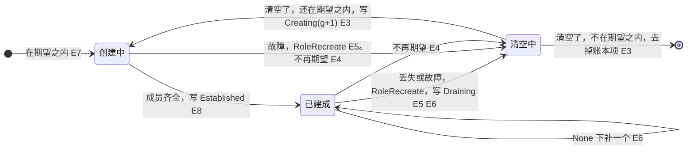
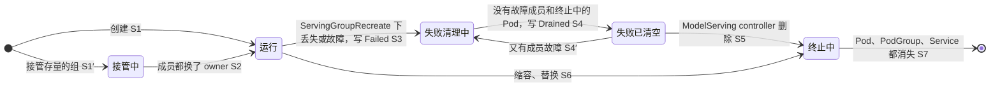
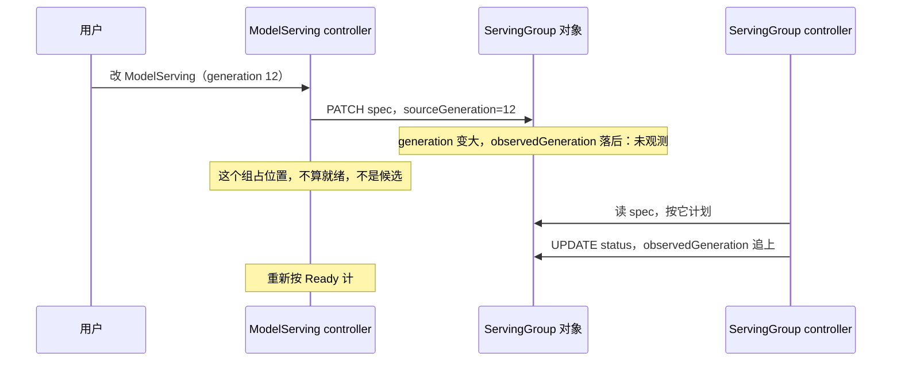
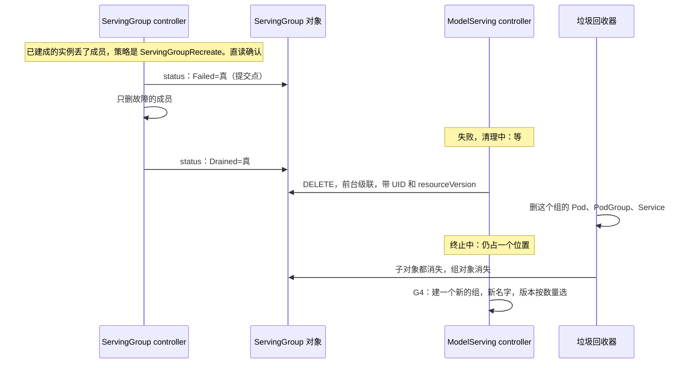
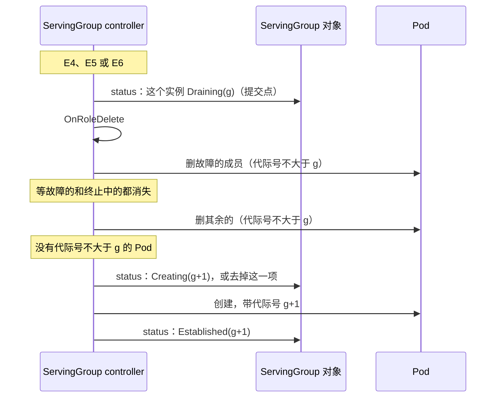
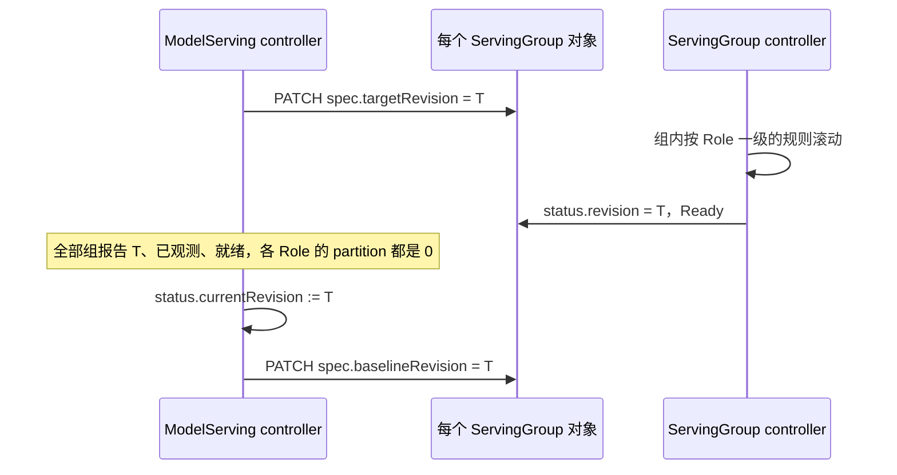

# 状态机

## 0. 文档信息

| 项 | 内容 |
| --- | --- |
| 用途 | 重画 [007 的 v4](../modelserving-state-machine-v3-v4/04-v4-servinggroup-cr.md) 第 4、5 节的状态机。读完这一份应当能回答三个问题：一轮 reconcile 做了什么；一个 ServingGroup、一个 Role 实例现在是什么状态、凭什么这样判定、下一步去哪；任何一个 controller 在任何一步换主或被接管，新进程会怎样 |
| 以谁为准 | 规则和理由以 [02](02-design.md) 为准，这里是它的逐条画法。两者有出入时是本文的错误 |
| 状态 | 设计提案，没有实现。每条边的证据来源在[第 12 节](#12-证据索引)：模型穷举过的，还是推演 |
| 记号 | E 开头是 Role 实例的转换，S 开头是 ServingGroup 的转换，G1–G6 是组一级一轮计划的六步（02 的 4.2），M、R 开头是两个 controller 一轮里的步骤，W 开头是写，L1–L7 是账本的规则（02 的 5.2），A1–A6 是两个 controller 之间的约定（02 第 3 节） |

## 1. 怎样读

| 想知道 | 看 |
| --- | --- |
| 一个状态是凭什么判定的 | 第 3–6 节每一层的判定表。条件都只用对象上的字段写；唯一的例外是重启故障的 grace 起点，它在内存里（第 3 节） |
| 一个状态能去哪、谁推动、要什么条件 | 第 4.3、5.3 节的转换表 |
| 一轮 reconcile 的完整过程 | 第 7、8 节，两个 controller 各一条线 |
| 两个 controller 怎样配合 | 第 9 节，四张时序图 |
| 在任何一步停下会怎样 | 第 10 节。10.2 把每一次写当作一个可能停下的点 |

三条贯穿全文的性质：

1. **状态不存储，只判定。**每一轮从对象重新得出。写在对象上的只有事实（账本的值、Failed、`deletionTimestamp`、版本），不是「我做到第几步」。
2. **每个状态的动作只取决于这个状态。**不取决于是怎样到达的、是哪个进程到达的。
3. **动作之前的提交点是一次带条件的写。**提交之后停下，下一个进程读到提交的事实，接着做；提交之前停下，下一个进程重新判断。

## 2. 状态在哪里

| 层 | 状态由什么得出 | 存在哪个对象上 | 谁写 |
| --- | --- | --- | --- |
| Pod 成员 | Pod 的 `deletionTimestamp`、`phase`、容器状态、原地更新的注解 | Pod | kubelet、环境；ServingGroup controller 只创建和删除 |
| Role 实例 | 账本的值 × 成员的观察 × 组的 `spec` | `ServingGroup.status.roleInstances[]` | ServingGroup controller |
| ServingGroup | `deletionTimestamp`；`status` 的 Failed、Drained、Adopted、Ready；`observedGeneration` | ServingGroup | 删除：ModelServing controller。`status`：ServingGroup controller |
| ModelServing | 名下各组的状态和版本；`spec` | 不存储。只有基线在 `status.currentRevision` | ModelServing controller |

内存里没有状态。内存里的三样东西（在途的写、故障起点、队列的退避）只会让动作晚一点（02 的 6.1）。

## 3. 第一层：Pod 成员

ServingGroup controller 对名下每个期望的位置判定一个成员状态，自上而下取第一个成立的。与 v2 相同，没有 finalizer。

| 成员状态 | 条件 | 对所在实例的含义 |
| --- | --- | --- |
| 外来 | 这个位置的名字上有一个 Pod，它的 controller owner 既不是这个组，也不满足下一行。正在终止的存量 Pod 属于这一种 | 不删它。自己的这个成员按缺失算，但不创建：报告并等待（L7） |
| 待接管 | 标签是这个组的，名字是这个位置的名字，controller owner 是所属的 ModelServing 或者没有 controller owner，不在终止中。只有一种情形另加两条：组不带 `adopt-members` 注解（它是按数量建的普通的组）并且 Pod 没有 controller owner。这时要求 Pod 带代际号标签，并且在 `ServingGroupRollingUpdate` 下它的 revision 标签等于组的 `spec.revision`。带注解的组是为这些 Pod 建的；owner 是 ModelServing 的 Pod 只会来自升级接管和回退。这两种都不加，所以原地更新到一半的组里标签还是旧版本的 Pod 照样接管，放弃回退时也接得回来（升级接管，以及 02 的 5.5 的无主成员 Pod；[06](06-live-upgrade.md) 的 5.1） | 是成员。不为这个名字创建，也不删除它；换 owner |
| 终止中 | `deletionTimestamp` 非空 | 已建成的实例：丢失。创建中的实例：等它消失 |
| 终态 | `phase` 是 `Failed` 或 `Succeeded` | 故障，不等 grace |
| 原地更新中 | 原地更新的进度注解没有完成 | 不是故障。走原地更新的接口点 |
| 重启故障（到期） | 有计划外的容器重启、不 Ready，恢复生效，并且满了 grace | 故障 |
| 重启故障（未到期） | 同上，没满 grace；或者恢复不生效 | 未就绪。满 grace 的时刻定时入队；恢复不生效时只报告 |
| 就绪 | `Running` 并且 Ready | — |
| 未就绪 | 其余 | 等待 |
| 缺失 | 该有这个成员而没有 Pod | 已建成的实例：丢失。创建中的实例：创建 |

第三行起只对 controller owner 是这个组的 Pod 判定。「恢复不生效」的重启故障不是故障，不触发恢复。

「恢复生效」指 `recoveryPolicy` 不是 `None`，并且 grace 不是 `-1`。故障起点在内存里（D9）：丢了，重新计满一个 grace。

## 4. 第二层：Role 实例

### 4.1 状态

一个 Role 实例是「组里某种 Role 的第 i 个」。它不是对象，状态记在组的账本里。

| 状态 | 判定 | 属性 |
| --- | --- | --- |
| 不存在 | 没有账本项，没有任何 Pod | — |
| 创建中 Creating(g) | 账本项是 Creating；或者没有账本项而有 Pod、或者在期望之内（零值） | — |
| 已建成 Established(g) | 账本项是 Established | 就绪：成员齐全并且全部就绪。否则未就绪 |
| 清空中 Draining(g) | 账本项是 Draining | — |

g 是代际号。没有账本项时 g 取现有 Pod 的最大代际号，没有 Pod 时取 0。

「在期望之内」：序号小于组 `spec` 里这种 Role 的 `replicas`，Role 一级的计划允许它存在（协调扩容的依赖门控还没放行的新增实例不算），并且没有被 Role 一级的计划选中删除（Role 缩容、按重建执行的滚动替换、回收 Role 一级的 surge）。Role 一级的计划沿用 v2，它把清空中当作 v2 的「终止中」，创建中当作「未就绪」。

### 4.2 图

`ServingGroupRecreate` 下的丢失和故障不走实例的边：它让整个组失败（[5.3](#53-转换) 的 S3），之后实例冻结。

### 4.3 转换

每一轮对每个实例自上而下取第一个成立的触发。每一格恰好一个反应。

| # | 触发 | 适用的状态 | 反应 | 写 | 之后 |
| --- | --- | --- | --- | --- | --- |
| E0 | 组在终止中 | 全部 | 不做事。垃圾回收器在删 | — | 不变 |
| E1 | 组已失败 | 全部 | 只删这个实例里故障的成员 | DELETE Pod | 不变 |
| E2 | 账本是 Draining(g)，还有代际号不大于 g 的 Pod | 清空中 | 本进程还没为它成功调过 `OnRoleDelete` 的先调：调之前直读这个组的 `status`，账本仍是 Draining(g) 才调。钩子不成功：这一轮不删，组报 `DrainBlocked`，下一轮重试。然后两步删除：先删故障的成员；没有故障的成员、也没有正在终止的 Pod 之后，删其余的 | 钩子；DELETE Pod | 清空中 |
| E3 | 账本是 Draining(g)，没有代际号不大于 g 的 Pod | 清空中 | 本进程还没为它成功调过 `OnRoleDelete` 的先调（同 E2；接管到一个已经清空的 Draining 时会走到这里）。然后，还在期望之内：写 Creating(g′)，g′ = max(g, 现有 Pod 的最大代际号) + 1。不在：去掉账本项 | 钩子；status | 创建中，或不存在 |
| E4 | 不在期望之内，并且有账本项或有 Pod | 创建中、已建成 | 写 Draining(g) | status | 清空中 |
| E5 | 有故障的成员；证据直读确认过 | 创建中、已建成 | `None`：删这一个终态的成员。`RoleRecreate`：写 Draining(g)。`ServingGroupRecreate`：写组的 Failed | DELETE Pod，或 status | 不变；清空中；组失败 |
| E6 | 已建成，有成员缺失或在终止；证据直读确认过 | 已建成 | `None`：缺失的创建，在终止的等它消失。`RoleRecreate`：写 Draining(g)。`ServingGroupRecreate`：写组的 Failed | 创建 Pod，或 status | 已建成；清空中；组失败 |
| E7 | 创建中，成员不齐：有缺失的，或者有在终止的 | 创建中 | 缺失的创建，带代际号 g。位置上有终止中的 Pod：等它消失。位置被外来 Pod 占着：报告，等 | 创建 Pod | 创建中 |
| E8 | 创建中，成员齐全，没有在终止的 | 创建中 | 全部成员都在缓存里看到了：写 Established(g)。还有没看到的：等缓存，不写 | status | 已建成，或创建中 |
| E9 | 已建成，成员齐全 | 已建成 | 不做事 | — | 已建成 |

几点说明。

- **E5、E6 的直读（L4）。**把缺失当证据：按名字读，要读到 NotFound。把终止中、终态当证据：要读回同一个 UID 并且仍然如此。读到的和缓存不一样，这一轮不动，等缓存追上。
- **E4 到 E6 先写再删（L1）。**status 写被拒绝（resourceVersion 冲突），本轮后面的删除和创建都不发。
- **E8 看的是缓存，不是创建请求的返回（L3）。**
- **`None` 下的重启故障**不到 E5：恢复不生效时它不是故障（第 3 节），只报告。
- **E5 和 E6 同时成立**（一个终态的成员加一个缺失的成员）时取 E5，缺失的成员下一轮处理。007 的账本模型是同一轮两样都做；轮次不同，终局相同。
- **接管中的组**（Adopted 不为真）先换 owner（R2），换完之前不创建、不删除成员。它的账本从零值开始，全部实例是创建中：这时缺的成员在换完 owner 之后按 E7 补，不按范围恢复。
- **原地更新中的成员**不触发 E5、E6；超过进度期限并且恢复生效时按故障算（007 的 05）。
- **策略取动手那一刻的 `spec`。**账本的值不记策略：Draining 写上之后策略改了，清空照样做完；清空之后建不建，看当时的期望。

### 4.4 每个状态一张卡片

**不存在**

| 项 | 内容 |
| --- | --- |
| 判定 | 没有账本项，没有 Pod |
| 进入 | E3：清空了并且不在期望之内 |
| 离开 | `spec` 把它纳入期望：它就是创建中（零值），E7 开始创建 |
| 不允许 | — |
| 接管时 | 新进程看到的和原进程相同 |

**创建中 Creating(g)**

| 项 | 内容 |
| --- | --- |
| 判定 | 账本项是 Creating，或者没有账本项而在期望之内或有 Pod |
| 进入 | 新的期望；E3 清空之后重建 |
| 离开 | E8 → 已建成；E4、E5 → 清空中；E5（`ServingGroupRecreate`）→ 组失败 |
| 这个状态下缺成员的含义 | **没建完。只补。** |
| 不允许 | 因为缺失而删除任何 Pod |
| 接管时 | 新进程看到 Creating 和若干成员：缺的补（名字确定，重复创建撞名字），齐了写 Established。原进程写了 Established 而新进程的缓存还没看到时，新进程按 Creating 处理：这段时间里的丢失只补，比原进程保守 |

**已建成 Established(g)**

| 项 | 内容 |
| --- | --- |
| 判定 | 账本项是 Established |
| 进入 | E8 |
| 离开 | E4、E5、E6 → 清空中；E5、E6（`ServingGroupRecreate`）→ 组失败 |
| 这个状态下缺成员的含义 | **丢失。按策略的范围恢复。**与 controller 当时在不在、换没换主无关 |
| 不允许 | 不经直读就把缺失当丢失 |
| 接管时 | 新进程读到 Established。成员在不在，直读确认。结果与原进程相同 |

**清空中 Draining(g)**

| 项 | 内容 |
| --- | --- |
| 判定 | 账本项是 Draining |
| 进入 | E4、E5、E6。**进入是一次 status 写，它是提交点** |
| 离开 | E3 |
| 这个状态下的动作 | 删代际号不大于 g 的 Pod，两步；不创建 |
| 不允许 | 删代际号大于 g 的 Pod（L5）；在这个实例里创建 |
| 接管时 | 新进程读到 Draining(g)，接着删同一批。不问原因、不问是谁写的。`OnRoleDelete` 可能被再调一次。原进程已经写了 Creating(g+1) 并建了新 Pod，而另一个进程读到的还是 Draining(g)：它只能删代际号不大于 g 的，碰不到新的 |

## 5. 第三层：ServingGroup

### 5.1 状态

生命周期五个状态。ModelServing controller 自上而下判定。

| 状态 | 判定 | 计入 |
| --- | --- | --- |
| 终止中 | `deletionTimestamp` 非空 | `active` |
| 失败，已清空 | Failed 为真，Drained 为真 | `active` |
| 失败，清理中 | Failed 为真，Drained 不为真 | `active` |
| 接管中 | 带 `adopt-members` 注解，Adopted 不为真（升级接管，以及收养无主的成员 Pod） | `active`、`live`。不是缩容和替换的候选 |
| 运行 | 其余 | `active`、`live` |

「运行」的组另有两组派生的属性，它们不是状态，只出现在边的条件里：

| 属性 | 取值 | 判定 |
| --- | --- | --- |
| 可用性 | 未观测 | `observedGeneration` 小于 `generation`。占位置，不算就绪；不是替换候选，缩容时不排在「未就绪的先」里 |
| | 就绪 | 已观测，Ready 为真 |
| | 未就绪 | 已观测，Ready 不为真。包括还在创建的 |
| 版本类 | 目标、受保护、过期 | 02 的 4.1 |

给人看的阶段（`kubectl get servinggroup` 的一列）按同一张表，把「运行」细分成 Creating（还有期望的实例没建成）、Ready、NotReady。它不参与任何判断。

### 5.2 图

### 5.3 转换

| # | 从 | 到 | 谁推动 | 条件 | 写和前置条件 |
| --- | --- | --- | --- | --- | --- |
| S1 | — | 运行 | ModelServing controller | G4 | 创建 ServingGroup。名字先登记；没有在途的创建 |
| S1′ | — | 接管中 | ModelServing controller | 升级接管（06 的 T3）；收养无主的成员 Pod（02 的 5.5） | 创建 ServingGroup，名字是 Pod 标签上的组名，带 `adopt-members` 注解。撞名字是幂等的 |
| S2 | 接管中 | 运行 | ServingGroup controller | 直读：名下没有待接管的成员了 | status：Adopted 为真 |
| S3 | 运行 | 失败，清理中 | ServingGroup controller | E5 或 E6，策略是 `ServingGroupRecreate` | status：Failed 为真。带 resourceVersion。**提交点** |
| S4 | 失败，清理中 | 失败，已清空 | ServingGroup controller | 没有故障的成员，没有正在终止的 Pod | status：Drained 为真 |
| S4′ | 失败，已清空 | 失败，清理中 | ServingGroup controller | 又有成员故障 | status：Drained 为假 |
| S5 | 失败，已清空 | 终止中 | ModelServing controller | G1 | DELETE，前台级联，带 UID 和 resourceVersion。S4′ 已经写上的话，这次删除被拒绝；S4′ 该写而还没写出来的那一小段时间里挡不住（U6） |
| S6 | 运行 | 终止中 | ModelServing controller | G2 或 G3 | 同上 |
| S7 | 终止中 | — | 垃圾回收器 | 带 `blockOwnerDeletion` 的子对象都消失 | — |
| S8 | 任何 | 终止中，或直接消失 | 用户 | `kubectl delete servinggroup` | 02 的 5.5 |

失败不可逆：没有从失败回到运行的边。策略在 S3 之后改了，照样删。

### 5.4 每个状态一张卡片

**运行**

| 项 | 内容 |
| --- | --- |
| 判定 | 没有 `deletionTimestamp`，Failed 不为真，不在接管中 |
| ServingGroup controller 在里面做 | 第 8 节的全部步骤 |
| ModelServing controller 对它可以做 | G2 缩容、G3 替换、G5 下发 `spec` |
| 离开 | S3、S6、S8 |
| 接管时 | 两个 controller 的新进程都从对象重新判定。未观测的组等 ServingGroup controller 过一遍 |

**失败，清理中**

| 项 | 内容 |
| --- | --- |
| 判定 | Failed 为真，Drained 不为真 |
| ServingGroup controller 在里面做 | 只删故障的成员（E1）。不创建，不推进账本，不做 Role 一级的任何事 |
| ModelServing controller 对它可以做 | 什么都不做，等。它占着一个位置，替换的组不建（没有滚动在进行时） |
| 为什么等 | D15：故障的成员停下并且消失之前，其余成员继续运行 |
| 离开 | S4 |
| 接管时 | 新进程读到 Failed：ServingGroup controller 接着删故障的成员，ModelServing controller 接着等。谁写的、因为什么写的，都不需要知道 |

**失败，已清空**

| 项 | 内容 |
| --- | --- |
| 判定 | Failed 和 Drained 都为真 |
| ModelServing controller 对它可以做 | G1：删除 |
| 离开 | S5；S4′ |
| 接管时 | 新进程的 ModelServing controller 直接删。DELETE 带 resourceVersion，读到的 `status` 不是最新时被拒绝 |

**终止中**

| 项 | 内容 |
| --- | --- |
| 判定 | `deletionTimestamp` 非空 |
| ServingGroup controller 在里面做 | 不做事。尽力调一次 `OnRoleDelete`（02 第 7 节） |
| ModelServing controller 对它可以做 | 不做事。它占着一个位置直到消失 |
| 谁在推进 | 垃圾回收器。kthena 不在也照样推进 |
| 接管时 | 没有需要接着做的事 |

**接管中**：见 [06](06-live-upgrade.md) 第 5 节。

## 6. 第四层：ModelServing

ModelServing 一级没有要存储的状态。对外是 `status` 的计数和 condition，全部按本轮的观察算；只有基线 `status.currentRevision` 是下一轮的输入。

**计数。**口径与当前实现相同。

| 字段 | 定义 | 终止中的组 | 失败的组 | 未观测的组 | 多建的组 |
| --- | --- | --- | --- | --- | --- |
| `replicas` | 全部组对象（`active`） | 计入 | 计入 | 计入 | 计入 |
| `updatedReplicas` | 其中版本等于 T 的 | 计入 | 计入 | 计入 | 计入 |
| `currentReplicas` | 其中版本等于 B 的。B = T 时与 `updatedReplicas` 相同，稳态是 N | 计入 | 计入 | 计入 | 计入 |
| `availableReplicas` | `live` 里报告的就绪为真的（02 的 4.1） | 不计 | 不计 | 按上一次报告 | 就绪了就计入 |
| `currentRevision`、`updateRevision` | B、T | | | | |

接管注解是 `InProgress` 的期间不重算计数，保留上一次写的值，只更新 condition：接管中的组还没有写出 Ready，重算会让可用数掉到 0 再回来。回退开关在的时候（06 的 9.1）`status` 整个不更新。

`updatedReplicas` 不计 `RecreateRequired` 为真的组：它的 `spec.revision` 是 T，Pod 不是。空组的 Ready 是假，所以各 Role 的副本数都是 0 时 `availableReplicas` 是 0。

**condition。**现有三个 condition 的 type、reason 和互斥关系不变：`UpdateInProgress`、`Progressing`、`Available` 同一时刻至多一个为真。判定里的「就绪」取报告的就绪，与 `availableReplicas` 同一个口径：`spec` 下发造成的短暂未观测不会让 `Available` 掉下去。新的事实写在 message 里，或者写在新增的 `RolloutBlocked` 上。

| condition | 为真的条件，自上而下取第一个成立的 | message 里写什么 |
| --- | --- | --- |
| `UpdateInProgress` | 滚动中：有过期的组；或者 B ≠ T 并且有未就绪的目标组 | 已经是目标版本的组、还在进行的组。全部组都是空组时写明在等副本数调回来 |
| `Progressing` | 不在滚动中，但有别的事在做：名下还有存量对象或有组在接管中；有失败的组；`live` ≠ N 或者有终止中的组；有未就绪的组 | 是哪一种：接管中、整组恢复中、扩缩中、等待就绪 |
| `Available` | 以上都不是：恰好 N 个组，全部就绪，没有在进行的变更 | 灰度停点（B ≠ T，有受保护的组）时写明停在 partition 上，并列出受保护的组名 |

| condition | 为真的条件 | 说明 |
| --- | --- | --- |
| `RolloutBlocked`（新增） | 有事要做，这一轮的计划却是空的，并且同一个原因已经持续超过期限。reason 见下表 | 可以和 `UpdateInProgress` 或 `Progressing` 同时为真。`Available` 为真时它一定是假 |
| `CoordinatedRoleRolloutBlocked`（已有） | 任何一个组的 `status` 报告了它 | ServingGroup controller 按组写，ModelServing controller 汇总，message 带组名 |

「有事要做」：有过期的组，或者 `good` < N，或者有失败的组，或者 `live` > `cap`，或者 B ≠ T、P = 0 而基线还没有推进（G6 的条件不成立）。「计划是空的」：G1 到 G4 这一轮一个写也没有。收养无主的成员 Pod 挡着 G4 的那一段不算（02 的 5.5），它有自己的期限和出口。这时在等什么，就是 reason，自上而下取第一个成立的：

| reason | 在等什么 | 持续时间的起点 | 例子 |
| --- | --- | --- | --- |
| `BaselineUnknown` | G4 要按 B 建组，而 B 读不到 | 不设期限，立刻报 | 02 的 4.8 |
| `WaitingForDeletion` | 有终止中的组，或者有 Failed 而没有 Drained 的组 | 那个组的 `deletionTimestamp`，或者 Failed 的 `lastTransitionTime` | 失败的组清不空；被替换的旧组卡在终止中；N 调小之后一个组卡在终止中 |
| `GroupNotObserved` | 有未观测的组，或者有组的 `status` 一直写不出来 | 未观测：ModelServing controller 最后一次写这个组的 `spec` 的时间（对象的 `managedFields` 里有）。写不出来：第一次写失败的时间，在内存里，进程重启之后重新计 | ServingGroup controller 写不出这个组的 `status` |
| `TargetNotReady` | 有未就绪的目标组 | 这个组的 Ready 最后一次变化的时间，没有就绪过的取 `creationTimestamp` | 新版本起不来。没有过期的组时就是 SG-C16 的终态和 U5：滚动只差它就绪 |
| `BudgetExhausted` | 其余：就绪数在下限上，未就绪的是受保护的组或者过期的组自己 | 那个未就绪的组的 Ready 最后一次变化的时间 | 受保护的组未就绪（SG-P09） |

- **都带期限。**等一个组消失、等一个新组就绪、等 `status` 跟上，都是正常的过程：每一次缩容、每一次带 surge 的滚动收尾都会经过。同一个原因持续超过一个可配的期限才把 `RolloutBlocked` 写成真。起点除了「`status` 写不出来」那一种都取对象上的时间，不需要记忆；那一种的起点丢了只会让报告晚一个期限。期限的默认值留给实现和真实验证定。
- **取第一个成立的。**一个卡住的失败组或终止中的组会盖住排在后面的原因；它本身也是要处理的异常。
- **空组不算「未就绪的目标组」。**各 Role 的副本数都是 0 是用户有意的，不报 `TargetNotReady`。

给人看的阶段按固定的优先级取一个：接管中、恢复中、阻塞、扩缩中、滚动中、灰度停点、稳定。

## 7. ModelServing controller 的一轮

key 是一个 ModelServing。

| 步 | 做什么 | 读 | 写 | 这一步停下 |
| --- | --- | --- | --- | --- |
| M0 入队 | ModelServing 的新增、`generation` 变化、接管注解变化、删除；名下任何 ServingGroup 的新增、更新、删除；它的 ControllerRevision 的新增和删除；在途登记到期；周期 resync。另有两种 Pod 事件，都由 ServingGroup controller 的 Pod 事件处理转过来：接管期间存量 Pod 的事件；任何时候无主的成员 Pod 的事件（02 的 5.5） | — | — | — |
| M1 接管屏障 | 这个 ModelServing 的屏障没过（名下还有组没被尝试过一遍）：重新入队，返回 | 进程内的信号 | — | 无影响 |
| M2 取对象 | ModelServing；它在删除中则返回，垃圾回收器会删名下的组 | 缓存 | — | 无影响 |
| M3 升级闸门 | 接管注解不是 `Done`（没有、`InProgress`、`RollingBack`）：走 [06](06-live-upgrade.md) 的接管或回退，本轮不做 M6 之后的写 | 直读 | 06；接管注解 | 06 |
| M3′ 收养 | Pod 缓存的索引显示名下有无主的成员 Pod：直读确认，为它们建同名的组（S1′，02 的 5.5）；同名而版本不同、确认是刚按数量建的组，前台删除。名下有接管中的组、或者有还没建出组的无主成员 Pod 时，本轮不做 G4 | 缓存的索引；直读 | W3 创建组；W2 DELETE 同名的新组 | 重做：撞名字；删除按直读的结果再判 |
| M4 观察 | 名下的组，叠加在途登记。**有在途的创建：本轮不发组的写**，等缓存或期限 | 缓存、内存 | — | 无影响 |
| M5 版本 | 解析 T：先在已有的 ControllerRevision 里找语义相同的，没有就创建。取 B（02 的 4.8） | 缓存 | W1 创建 ControllerRevision | 重复创建撞名字 |
| M6 分类和记账 | 02 的 4.1 | — | — | 纯函数 |
| M7 计划 | G1 到 G6，在工作副本上迭代 | — | — | 纯函数 |
| M8 执行 | 按 G1、G2、G3、G4、G5 的次序发。每个写之前按最新的缓存重算一次，这个写不再在计划里就不发。一轮的创建可以有多个：全部先登记，再逐个发 | 缓存 | W2 DELETE 组；W3 创建组；W4 PATCH 组的 `spec`（G3 对空组和原地更新改 `spec.revision` 也是它） | 第 10.2 节 |
| M9 写 status | 每一轮都写，出错的轮次也写。G6 的基线在这一次写里。接管注解是 `InProgress` 时不重算计数 | — | W5 `ModelServing.status` | 第 10.2 节 |
| M10 清理 | 清理不再引用的 ControllerRevision（02 的 8.6）。协调模式的基线仍然写在 ControllerRevision 的注解上（02 的 8.7） | 缓存 | W6 DELETE ControllerRevision；W1 的注解 | 下一轮重做 |

等待都是返回：等组就绪、等组消失，由组的事件带来下一轮。等在途登记到期用定时入队。

## 8. ServingGroup controller 的一轮

key 是一个 ServingGroup。

| 步 | 做什么 | 读 | 写 | 这一步停下 |
| --- | --- | --- | --- | --- |
| R0 入队 | 这个组的新增、更新、删除；名下任何 Pod 的新增、更新、删除（包括 owner 被改）；PodGroup、Service 的更新和删除；`spec` 引用的 ControllerRevision 的新增；grace 到期、原地更新期限到期、在途的写到期；周期 resync | — | — | — |
| R1 取对象 | 这个组。它在终止中：尽力调 `OnRoleDelete`，返回 | 缓存 | — | 无影响 |
| R2 接管成员 | 名下有待接管的成员：换 owner（06） | 直读 | W7 PATCH Pod、PodGroup、Service 的 owner | 06 |
| R3 观察 | 名下的 Pod，叠加在途的创建和删除。读 `spec` 引用的 ControllerRevision；它不在：这一轮出错，分类之后跳到 R11，等它出现的事件 | 缓存、内存 | — | 无影响 |
| R4 分类 | 成员（第 3 节）、实例（4.1）、组（5.1） | — | — | 纯函数 |
| R5 组已失败 | 只做 E1；算 Drained；跳到 R11 | — | W10 DELETE Pod | 第 10.2 节 |
| R6 Role 一级的计划 | v2 的 Role 层规则：扩缩容、滚动（重建或原地）、协调。得出哪些实例不再期望、哪些成员要打补丁 | — | — | 纯函数 |
| R7 账本的转换 | 对每个实例走 4.3 的表，得出这一轮的全部转换。E5、E6 的证据在这里直读 | 直读 | — | 无影响 |
| R8 提交 | 有转换（E3、E4、E5、E6、E8，或 S3）：写 status。**被拒绝：返回，本轮后面不发任何删除和创建** | — | W8 `ServingGroup.status`，带 resourceVersion | 第 10.2 节 |
| R9 钩子和删除 | 清空中的实例：`OnRoleDelete`（本进程第一次；调之前直读账本），不成功就不删、报 `DrainBlocked`；成功之后两步删除。`None` 下终态的成员：删 | 直读 | W9 plugin 钩子；W10 DELETE Pod，带 UID | 第 10.2 节 |
| R10 同步和创建 | 对每个在期望之内的实例调 `OnRoleSync`。PodGroup、Service 不在的建，内容与期望不同的更新（`minMember` 随 Role 的副本数和协调的阶段变化）。E6（`None`）、E7 的成员：`OnPodCreate`，创建。原地更新的补丁。Role 一级的 surge 标记和转正 | — | W11 创建和更新 Pod、PodGroup、Service；W12 Pod 的注解和镜像 | 第 10.2 节 |
| R11 写 status | 出错的轮次也写：读到了成员的话，`observedGeneration` 照样推进，Ready 按看到的成员照实算，带 `ReconcileFailed`。这一轮第一次看到就绪的成员：`OnPodReady`。 `observedGeneration`、Ready、Drained、版本、引用到的版本、deletion cost、计数。这一轮没有 R8 时两次写合成一次 | — | W8 | 下一轮重写 |

`observedGeneration` 在 R8 或 R11 的写里推进，条件是「这一轮的决定是按这份 `spec` 做的」，不等动作做完。每次 status 写都把 Ready、版本按这一轮读到的 `spec` 重算，不带着上一份 `spec` 的结论。

## 9. 跨 controller 的协议

### 9.1 下发 `spec`

### 9.2 整组恢复

### 9.3 清空一个 Role 实例

### 9.4 `RoleRollingUpdate` 下推进基线

## 10. 接管

「接管」包括：进程重启；换主；升级到同一设计的新版本。从旧版本升级过来的接管在 [06](06-live-upgrade.md)。

### 10.1 屏障

新进程在发第一个写之前（02 的 6.3）：三种对象各一次一致性的 LIST 并等缓存逐对象追上；ServingGroup controller 对每个组尝试一遍；一个 ModelServing 名下的组都被尝试过之后，ModelServing controller 才对它发组的删除和创建。尝试出错的组照样写 `status`（已观测，Ready 照实）；`status` 写不出来的保持未观测。都不挡别的组，也不挡别的 ModelServing。

屏障之后，新进程面对的就是第 3–6 节的判定表，没有别的输入。下面的表说明每一个可能停下的点落在哪一格。

### 10.2 每一次写都是一个可能停下的点

三栏分别是：停在这次写之前；写被 apiserver 接受了，进程在看到结果之前停下；写之后、同一步的下一个写之前停下。

**ModelServing controller**

| 写 | 之前停下 | 接受了、没看到 | 新进程的动作与原进程 |
| --- | --- | --- | --- |
| W2 DELETE 失败的组（G1） | 组是「失败，已清空」：再删 | 组是「终止中」：等 | 相同 |
| W2 DELETE 缩容的组（G2） | `live` 仍大于 `cap`：按同一个次序再选。对象没变，选中的是同一个；变了，按新的选 | 终止中；`live` 少了一个 | 相同，或者按更新的事实 |
| W2 DELETE 替换的组（G3） | 预算重算；候选没变则选同一个 | 终止中 | 相同 |
| W3 创建组（G4） | `good` 仍小于 N：再建。**名字是新的** | 屏障的一致性 LIST 里有这个组：不再建 | 相同。没有屏障时会多建一个，事后缩回。原进程的请求在新进程的 LIST 之后才落地时也会多建一个（02 的 6.4） |
| W3 一批创建发到一半 | 已经建出的在 LIST 里；`good` 仍小于 N：建剩下的 | 同上 | 相同 |
| W4 PATCH 组的 `spec`（G5；G3 改 `spec.revision`） | 再发，内容相同 | 组是未观测：等 | 相同。`expectedPods` 在同一次写里 |
| 接管注解（06 的 T1、T7；`RollingBack`） | 按直读的结果再写 | 注解已经是新的值：按它走 | 相同 |
| W3 为无主的成员 Pod 建同名的组（M3′） | 直读：Pod 还在、组还不在，再建 | 撞名字，核对 owner 和 `adopt-members` | 相同 |
| W2 删同名而版本不同的新组（M3′） | 直读：它仍然是刚建的（不带 `adopt-members`、没有 Established 的实例、没有就绪的成员），再删；不是了就不删 | 组在终止中：等它消失再建 | 相同，或者按更新的事实不删 |
| 06 的 T2、T2′ 按 UID 删；T3 建组；回退的 2′ 到 6（06 的 9.1） | 06 的 5.3、9.1 | 06 的 5.3、9.1 | 相同 |
| W5 `ModelServing.status`，含基线 | 条件还成立：再写 | 已经推进 | 相同。G6 的条件只有在全部完成时才成立，重写是幂等的 |
| W1、W6 ControllerRevision | 重做 | 撞名字，或已删除 | 相同 |
| 一轮里 G2 删了两个中的一个 | 剩下的一个：`live` 仍大于 `cap`，再选 | — | 相同 |
| 一轮里 G3 删了、G4 还没建 | 位置空着：G4 的条件成立，建 | — | 相同 |

**ServingGroup controller**

| 写 | 之前停下 | 接受了、没看到 | 新进程的动作与原进程 |
| --- | --- | --- | --- |
| W8 写 Established（E8） | 创建中，成员齐全：再写 | 已建成 | 相同 |
| W8 写 Draining（E4–E6） | 证据还在：直读，再写。证据不在了（Pod 回来了）：不写 | 清空中：E2 | 相同，或者按更新的事实不删 |
| W8 写 Failed（S3） | 同上 | 失败，清理中 | 相同 |
| W8 写 Creating(g+1) 或去掉项（E3） | 清空中、已空：再写 | 创建中：E7 | 相同 |
| W8 写 Drained（S4） | 条件还成立：再写 | 失败，已清空 | 相同 |
| W8 把 Drained 写回假（S4′） | 条件还成立：再写。写之前组被删了：见 U6 | 失败，清理中 | 相同，或者组已经在终止中 |
| W8 写 Adopted（S2）；只推进 `observedGeneration`；把账本的 g 抬到现有 Pod 的最大代际号（L5）；写 `RecreateRequired`、`DrainBlocked` | 都是按当前对象重算的值：再写 | 已经是新的值 | 相同 |
| W7 换 Pod、PodGroup、Service 的 owner（R2） | 还有待接管的成员：接着换。每个 PATCH 带 UID 和 resourceVersion | 那个成员已经是自己的 | 相同（06 的 5.3） |
| W10 DELETE Pod，第一步里的一个 | 清空中：E2 接着删 | 那个 Pod 在终止：等 | 相同 |
| W10 第一步做完、第二步之前 | 清空中，没有故障成员和终止中的：删其余的 | — | 相同 |
| W10 第二步删到一半 | 清空中，还有代际号不大于 g 的：接着删 | — | 相同 |
| W10 `None` 下删终态的成员（E5）；失败的组里删故障的成员（E1） | 成员还是终态或故障：再删 | 那个 Pod 在终止 | 相同 |
| W11 创建 Pod，一个实例建到一半 | 创建中，缺的补 | 撞名字，核对是自己的 | 相同 |
| W11 创建、更新 PodGroup、Service | 不在就建；内容不同就更新 | 撞名字；已经是新的内容 | 相同 |
| W9 `OnRoleDelete` | 清空中：新进程直读账本之后再调一次，再删 | — | 钩子多调一次 |
| W9 `OnPodCreate`、`OnPodReady`、`OnRoleSync` | 重调 | — | 钩子多调一次 |
| W12 原地更新的补丁 | 进度在 Pod 注解上：按注解续做 | — | 相同（007 的 05） |
| W12 Role 一级的 surge 标记、转正、回收 | 标记在 Pod 上：按标记续做 | — | 相同。沿用 v2 的分析（v2 的 04 第 5 节和第 10 节），本文没有重做 |
| R8 被拒绝之后 | 没有发过删除：下一轮重新判定 | — | 相同 |

表里没有「取决于原进程记得什么」的格子。「按更新的事实」的格子是水平触发的正常结果：两次观察之间对象变了，动作跟着变。

这句话有两处限定。一是它只对表里列出的写成立：ModelServing controller 的各行有模型（[05](05-inference-verification.md) 第 3 节），ServingGroup controller 的账本各行有 007 的模型，钩子、owner、surge 标记、PodGroup 的各行是推演。二是 plugin 自己的进程内记忆不在表里：内置的 headless Service plugin 今天有一份会影响删除动作的记忆，要按 02 第 7 节改成对象上的事实。

### 10.3 屏障挡住的两种情形

| 情形 | 没有屏障 | 有屏障 |
| --- | --- | --- |
| 第一次 LIST 是旧的 | 缓存里缺最新建的组：再建一批。缓存里的组是旧的：按旧的 Ready 选删除对象 | 一致性的 LIST 不会旧 |
| 停机期间 Pod 坏了，组的 `status` 没人更新 | ModelServing controller 按过期的 Ready 算健康额度，多删健康的组 | ServingGroup controller 先把 `status` 写新 |

### 10.4 两个进程同时在写

失主的进程在发现失主之前还可能发出写。这时没有屏障可言，靠每个写自己的前置条件（02 的 6.2、6.4）。结果：不会把创建中的实例当成丢失去删；不会用旧的 Draining 删掉新一批的 Pod；可能多建组、一个额度删两个、钩子重复、`ModelServing.status` 被来回覆盖；旧的一边退出之后收敛到同一个终局。

### 10.5 `status` 被清空或改写

| 被改的 | 后果 |
| --- | --- |
| 账本被清空 | 全部实例回到创建中。齐全的重新写上已建成；这期间的丢失只补 |
| 账本的代际号丢失 | 取现有 Pod 的最大代际号（L5） |
| Failed 被清掉 | 组回到运行。实例的账本还在：丢失的证据还在的话，重新判定，重新写 Failed |
| Drained 被错误地写成真 | 挡不住：故障成员还没停，组就被删。`status` 端点要用 RBAC 保护 |
| `observedGeneration` 被改小 | 未观测，直到 ServingGroup controller 重写 |
| `ModelServing.status.currentRevision` 被清空 | 从各组的 `spec.baselineRevision` 读回（02 的 4.8） |

## 11. 分不清的情形

设计明确接受的几处：

| # | 情形 | 反应 |
| --- | --- | --- |
| U1 | 实例建成之前成员被删 | 只补。与「没建完」是同一个反应 |
| U2 | Established 的写被接受、别的进程还没看到，这时丢了成员 | 那个进程按创建中只补。只在两个进程并存时出现 |
| U3 | 策略从 `None` 改成范围策略的那一刻，已建成的实例里正好有一个成员在补 | 按新策略整范围恢复 |
| U4 | Failed 或 Draining 写上之后策略改成 `None` | 照样做完。提交之后不撤销 |
| U5 | 一直不就绪的目标版本的组 | 留在 N 个里面，滚动算完成不了（基线不推进），`RolloutBlocked` 报 `TargetNotReady`。它是不是故障由成员状态和恢复策略决定，不由滚动决定 |
| U6 | 晚一跳的 `status`：健康额度；缩容的次序；Drained（写成真之后又有成员出故障，还没写回假时组被删；新进程对一个失败的组的第一次尝试出错时，用的也是上一个进程写的 Drained） | 02 的 6.5 |
| U7 | 原进程已经退出，它发出的请求在新进程的一致性 LIST 之后才落地 | 多建一个组，或者一个额度删两个；事后收敛。02 的 6.4 |
| U8 | 无主的成员 Pod 的事件晚于「少了一个组」 | 先多建一个组，收养之后缩掉一个；同名而版本不同时，确认是刚建的才删掉重建。02 的 5.5 |

## 12. 证据索引

| 内容 | 证据 | 位置 |
| --- | --- | --- |
| G1–G4、G6：预算、cap、保护、缩容和替换的次序 | 模型穷举；43 段场景脚本；每条规则去掉之后有场景、停点或性质报出来。哪条规则靠哪一种证据，见 05 第 2、3 节的两张变异表 | [05](05-inference-verification.md) 第 2、3 节 |
| 「缩容没做完不替换」 | 五个 runner 停点的重放：规则在时与 runner 的期望相同，去掉之后都出不来。穷举模型的性质查不到它（它不是预算需要的） | 05 第 2 节 |
| G3 的空组改版本 | 三个场景脚本（NEW-6、NEW-9、NEW-10）。没有进穷举模型 | 05 第 2 节 |
| G5、原地更新、`RoleRollingUpdate` 下的组一级、序号命名 | 推演。不在任何模型里 | 05 第 6 节 |
| ModelServing controller 在任何一次写之后被接管，终局集合相同 | 模型穷举 | 05 第 3 节 |
| 在途屏障、接管屏障、升级闸门 | 模型：去掉在途屏障，滚动途中扩缩容时在途的新组被当成未就绪先缩掉；去掉接管屏障报多建；去掉闸门，接管完成之前动了组。闸门自己会不会判错不在模型里 | 05 第 3 节 |
| S3–S5：失败、清空、删除的次序（D15） | 模型：去掉等待之后报出来；007 的组级模型。Drained 晚一跳的窗口不在模型里 | 05 第 3、5 节 |
| E3–E8：账本；ServingGroup controller 在任何两次写之间停下 | 007 的组级模型，原样重跑，结果相同 | 05 第 5 节 |
| L4 直读、L5 代际号 | 小模型：去掉之后分别报「没有丢失而清空」「新一批被旧的清空删掉」 | 05 第 4 节 |
| E0、E1、E2、E3 的钩子次序和调用之前的直读；E7 的外来 Pod；待接管的成员 | 推演 | — |
| 第 6 节的计数和 condition | 推演；口径取自当前实现的走读 | — |
| 10.2 里钩子、owner、surge 标记、PodGroup、接管注解的各行 | 推演 | — |
| 无主的成员 Pod 的收养（02 的 5.5） | 推演 | — |
| A1、A2：未观测、`sourceGeneration` | 未观测的处理有一个场景脚本（EX-3）；其余推演 | 05 |
| 10.5 | 推演；007 的模型里有「`status` 被清空」一项 | 05 第 5 节 |
| Role 一级的规则 | 沿用 v2，由 005 的参考模型覆盖。与账本的衔接是推演 | — |
| 关于 Kubernetes 行为的前提（前台级联、垃圾回收、一致性 LIST） | 按文档和源码，没有在集群上验证 | 05 第 7 节 |
