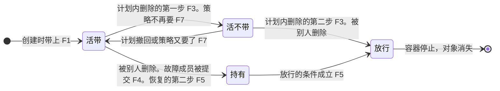

# v3：ServingGroup 仍是逻辑概念的确定状态机

## 0. 文档信息

| 项 | 内容 |
| --- | --- |
| 用途 | 在不改 CRD 字段、不改 Pod 名字和序号的前提下，把 v2 的状态机改成确定的。取舍的理由在 [02](02-dfa-criteria-and-tradeoffs.md)，这里只写结果 |
| 基线 | v2：[04](../modelserving-rollout-final/04-state-machine.md)、[06](../modelserving-rollout-final/06-state-table.md)、[07](../modelserving-rollout-final/07-core-state-machine.md)。没有提到的地方都与 v2 相同 |
| 范围 | 核心：生命周期、恢复、并发。滚动和扩缩容的规则（N、U、S、P，序号，surge，partition，A2 到 A8、A11）不变。原地更新见 [05](05-inplace-usage-isolation.md) |
| 状态 | 设计提案。没有改代码，没有在集群上验证。规则用模型穷举过，范围见[第 11 节](#11-模型证据) |
| 记号 | **活**：没有 `deletionTimestamp`。**持有**：有 `deletionTimestamp`，带保护 finalizer。**放行**：有 `deletionTimestamp`，不带。规则用 F 编号；本文自己的待决项用 Q；分不清的情形用 L。J 是 02 的判据；D、C、M、I、O、R 是 005 的编号 |

## 1. 原理

v2 里「单元缺一个成员」有两种反应，由内存里的记录和事后写的标记来区分。v3 改成一句话：

> **缺失只有一个含义：创建。丢失的证据是一个对象，就是被删的那个 Pod 自己。**

做法是给需要保护的 Pod 加一个 finalizer。这个 Pod 被任何人删除之后不会消失，它带着 `deletionTimestamp` 停在原地，直到 controller 处理完。于是：

- 一个成员的位置上要么有对象，要么没有。没有对象，就创建。
- 有对象、在终止、还带着保护 finalizer：这个范围丢了成员，整范围重建。
- 有对象、在终止、不带保护 finalizer：它是 controller 自己计划内删除的，或者是没有受保护的 Pod。等它走完，再创建。

删除者的那一次 DELETE 同时写下了证据。controller 在不在、换没换 leader、事件有没有送到，都不影响它。范围一级不存任何东西：范围是不是在恢复，每一轮从范围里的 Pod 推导。

一个例子。`RoleRecreate`，Role 实例 `r1` 有两个 Pod `p10`、`p11`。

| 步 | 发生了什么 | 之后的对象 | controller 在任何时刻重启后看到的 |
| --- | --- | --- | --- |
| 1 | 用户删除 `p11` | `p11` 持有，`p10` 活 | `r1` 在恢复中。不在 `r1` 里创建 |
| 2 | kubelet 停掉 `p11` 的容器 | `p11` 持有，只差放行 | 第二步的条件成立 |
| 3 | controller 删除 `p10`，不摘 finalizer | `p10`、`p11` 持有 | `r1` 里没有活着的 Pod |
| 4 | controller 放行 `p11`，它随即消失 | `p10` 持有，还在停止 | `r1` 仍在恢复中，不创建 |
| 5 | `p10` 停止，controller 放行它 | `r1` 没有 Pod | 缺失 |
| 6 | controller 创建 `p10`、`p11` | — | 创建中，缺的就补 |

对照「没创建完」：`p10` 建出来之后 controller 崩溃，`p11` 还没有建。新进程看到 `p10` 活、`p11` 缺失、范围里没有持有的 Pod，创建 `p11`。两种情形在对象上不同，反应各只有一个。

## 2. 保护 finalizer

### 2.1 名字和 `wantFinalizer`

两个名字，范围种类在名字里（名字是示意）：

| finalizer | 表示的范围 |
| --- | --- |
| `modelserving.volcano.sh/recover-role` | Pod 所在的 Role 实例 |
| `modelserving.volcano.sh/recover-servinggroup` | Pod 所在的 ServingGroup |

`wantFinalizer(spec, pod)` 是纯函数，返回一个名字或者「不要」：

| `recoveryPolicy` | 条件 | 返回 |
| --- | --- | --- |
| `None` | — | 不要 |
| `RoleRecreate` | Pod 所在的 Role 实例按最新的 `spec` 多于一个 Pod | `recover-role` |
| `RoleRecreate` | 只有一个 Pod | 不要 |
| `ServingGroupRecreate` | Pod 所在的 ServingGroup 按最新的 `spec` 多于一个 Pod | `recover-servinggroup` |
| `ServingGroupRecreate` | 只有一个 Pod | 不要 |

- 它不看 grace。grace 为 `-1` 时外部删除仍然要整范围重建（D13，04 第 14 节）。
- 范围只有一个 Pod 时不要：整范围重建和补这一个是同一件事。`RoleRecreate` 下没有 worker 的 Role 因此不带 finalizer。
- 开关关掉时（[9.2](#92-引入开关和部署)）一律返回「不要」。
- 一个 Pod 上同时出现两个名字（手工编辑造成）时，按较大的范围算，F7 把它改回 `wantFinalizer`。

### 2.2 一个 Pod 的一生

| 谁 | 什么时候加 | 什么时候摘 |
| --- | --- | --- |
| controller | 创建 Pod 的请求里带上（F1）。活着的 Pod 该带而没带、或者名字不对时 PATCH（F7、F4、F5） | 计划内删除之前（F3）。放行的条件成立时（F5）。策略不再要时（F7）。Pod 不再属于自己时（F8） |
| 别人 | 不应该加 | 手工摘掉等于放弃这次丢失的证据，这个 Pod 只会被补建（[第 8 节](#8-分不清的情形)） |

apiserver 不允许给正在删除的对象加 finalizer。所以持有的 Pod 的名字不会再变，范围种类在它被删的那一刻冻结；放行也不会再变回持有。

## 3. 状态

### 3.1 成员状态

自上而下判定。相对 v2 只有第一行拆成了两行。

| 成员状态 | 条件 | 所在的单元 | 引出的反应 |
| --- | --- | --- | --- |
| **持有** | `deletionTimestamp` 非空，带保护 finalizer | 不能就绪 | 在期望位置上时，它的范围在恢复中（F5）。范围由它自己的 finalizer 名字决定 |
| **放行** | `deletionTimestamp` 非空，不带保护 finalizer | 不能就绪 | 没有。等它消失。它不是证据 |
| 终态 | `phase` 是 `Failed` 或 `Succeeded` | 不能就绪 | 范围策略：提交（F4），不等 grace。`None`：删除这一个（F3） |
| 重启故障 | 与 v2 相同 | 不能就绪 | 恢复生效时满 grace 之后提交（F4）。不生效时只报告 |
| 就绪 | 与 v2 相同 | 可以就绪 | — |
| 未就绪 | 与 v2 相同 | 不能就绪 | 等待 |
| 缺失 | 该有这个成员而没有 Pod | 不能就绪 | 创建（F10），除非被封闭（F6） |
| 外来 | 与 v2 相同 | 不能就绪 | 只阻塞这个单元。带着保护 finalizer 的外来 Pod 另按 F8 摘掉 |

活着的 Pod 另有一个属性：带的保护 finalizer 是否等于 `wantFinalizer`。不等的由 F7 改正。

持有的 Pod 还要一个判断，叫**只差放行**：除了保护 finalizer 没有别的 finalizer，并且 `deletionGracePeriodSeconds` 为 0。它的含义是「如果没有保护 finalizer，这个对象已经不在了」（02 的 4.3）。

### 3.2 期望位置、范围和单元

**要缩掉的 Role 实例。**`ServingGroupRecreate` 下范围是整个组，比 Role 实例大，而 Role 层这时只做扩缩容。一个组里某种 Role 现存的实例（还有任何 Pod 的，包括 Pod 全部在终止的）多于 `roles[].replicas` 时，选出多出来的那几个，叫要缩掉的实例：没有活着的 Pod 的实例优先，其余按 A3 的次序（未就绪优先，deletion cost 低优先，序号高优先）。这一步只用 `spec` 和成员状态，不用恢复的状态：持有的 Pod 在这里只当作普通的终止中成员。它排在分类的最前面。

按现存的实例数、并且让没有活 Pod 的实例优先，是为了让一个实例从被选中到 Pod 全部消失一直算要缩掉的：它的活 Pod 都进入终止之后，下一轮仍然选中它，其中持有的 Pod 不会又变回证据。选出来的实例里还活着的那些，和 v2 的 A3 选中的相同。

**期望位置。**一个 Pod 不在要缩掉的实例里，就是在期望位置上。别的配置下范围不比单元大，每个 Pod 都在期望位置上。

**范围在恢复中**：范围里有期望位置上的持有 Pod。范围按这个 Pod 自己的 finalizer 名字算：`recover-role` 是它所在的 Role 实例，`recover-servinggroup` 是它所在的 ServingGroup。一个组里两种名字的持有 Pod 并存时，各算各的，取并集。

要缩掉的实例里的持有 Pod 不是证据：这个实例反正要删，它的 Pod 被别人先删了一个，不应当因此重建整个组。这与 v2 相同（04 的 6.5）。

「范围在恢复中」是 v3 里唯一和恢复有关的范围状态。它不存储。v2 的「承诺了没有开始」「已经开始」「残留」三种标记状态都没有了。

单元状态的四个值和判定次序与 v2 相同（07 的 3.2），只有「终止中」的第二个条件换了说法：

| 单元状态 | 条件 |
| --- | --- |
| 不存在 | 没有任何 Pod |
| 终止中 | 现存的成员全部在终止；或者单元在一个不小于它的、恢复中的范围里；或者本轮已经决定删除整个单元 |
| 就绪 | 与 v2 相同 |
| 未就绪 | 其余全部 |

计数（`active`、`live`、`ready`、`notReadyTarget`）和两个额度的定义不变。恢复中的范围比单元小时（`ServingGroupRollingUpdate` 配 `RoleRecreate`，组里一个实例在恢复），单元是未就绪，照常计入 `live`。

与 v2 的一点时间差：v2 里外部删除要等标记写上、范围里少了 Pod 才算开始；v3 从删除发生的那一刻就算。对记账的影响在同一轮之内。

## 4. 规则

| # | 规则 |
| --- | --- |
| F1 | **创建时带上。**controller 创建 Pod 时，按 `wantFinalizer` 在创建请求里带上保护 finalizer。不多一次写 |
| F2 | **持有和放行。**终止中的成员分成两种（3.1）。只有期望位置上的持有 Pod 是丢失的证据 |
| F3 | **计划内的删除先摘再删。**缩容、回收 surge、滚动替换、`None` 下终态 Pod 的重建、范围只有一个 Pod 时故障成员的重建：先 PATCH 摘掉保护 finalizer，再 DELETE。Pod 本来就不带时只有 DELETE |
| F4 | **故障的成员带着 finalizer 删除，这就是提交。**到期的故障成员（终态的立即到期；重启故障按 v2 的计时）按下面的裁决表处理。提交之后它是持有的 Pod，和被别人删除的没有区别 |
| F5 | **恢复。**范围在恢复中时分两步，然后放行，见下 |
| F6 | **封闭。**缺失的成员在两种情况下不创建：它在恢复中的范围里；它所在的范围（按当前策略）里有本轮要按 F4 提交的故障成员。创建发出之前复核 |
| F7 | **finalizer 跟着 `spec` 走。**活着的、属于自己的、在期望位置上的 Pod，带的保护 finalizer 不等于 `wantFinalizer`，并且本轮没有对它的删除，也不在恢复中的范围里：PATCH 改成 `wantFinalizer`（加上、摘掉或者换名字）。每轮每个 ModelServing 限量；F4、F5 里的改名不受这个限量 |
| F8 | **不属于自己的一律摘掉。**带着保护 finalizer 的 Pod，如果它的 owner（按 UID）不是一个存在的、没在删除的 ModelServing，或者身份标签不是 controller 生成的形式：摘掉 finalizer，不论它活着还是在终止。ModelServing 在删除时，controller 不创建、不恢复，只摘 |
| F9 | **已经开始的恢复按原范围做完。**范围取自持有的 Pod 自己的 finalizer 名字，不看最新的 `recoveryPolicy`。策略改成 `None` 之后，已有的持有 Pod 仍然让它的范围做完 |
| F10 | **缺失一律创建。**不带保护 finalizer 的 Pod 被删除、finalizer 被人摘掉、对象被绕过 API 抹掉：都只补这一个 |
| F11 | **计划内删除优先。**本轮被缩容、回收 surge、替换选中的单元，以及要缩掉的 Role 实例，其中活着的 Pod 都按 F3 删除，包括故障的成员；F4、F5 的删除不落在这些 Pod 上。被选中而动作推迟的单元（锁定）不算被选中，F4、F5 照常判断（与 v2 相同） |
| F12 | **内存。**只有三样：在途的写（逐对象叠加，带期限）、故障起点（D9）、事件去重。回调只入队。没有按资源的锁 |

**F4 的裁决表。**一个到期的故障成员 m，所在的单元没有被选中删除。W 是 `wantFinalizer(m)`；K 是盖住 m 的恢复中范围的种类。自上而下取第一个成立的。

| 条件 | 动作 |
| --- | --- |
| W 是 `recover-role` 而 K 为空；或者 W 是 `recover-servinggroup` 而 K 里没有它 | **提交。**当前策略要的范围还不在恢复中。m 带的名字等于 W：DELETE，不摘。不等（存量的、策略刚改过的、被人摘过的）：本轮只 PATCH 成 W，下一轮再删。范围里有外来的 Pod 时不提交，只报告（与 v2 相同） |
| K 不为空 | **F5 的第一步。**m 已经在一个恢复中的范围里：DELETE，不摘。例外：m 带的是 `recover-servinggroup` 而 K 里只有 `recover-role`，本轮先 PATCH 成 `recover-role`，下一轮再删 |
| 其余（W 是「不要」，K 为空） | `None`：终态的先摘再删，由 A10 补建；重启故障不处理。范围只有一个 Pod：删除，由 A10 补建 |

第一行的一个例子：策略刚从 `RoleRecreate` 改成 `ServingGroupRecreate`，实例 `r0` 按旧策略在恢复，这时 `r0` 里或者同组别的实例里又有成员故障。当前策略要的是整个组，组还不在恢复中，所以它按整个组提交。

**F5 的两步和放行。**

- **第一步。**范围里到期的故障成员按上表第二行删除。
- **第二步。**范围里没有「还在终止而不是只差放行」的 Pod 之后（持有的都已经只差放行，不带保护 finalizer 的终止中 Pod 都已经消失），DELETE 范围里其余活着的 Pod，不摘 finalizer。活着的 Pod 不带保护 finalizer 时直接删。活着的 Pod 带的是 `recover-servinggroup` 而本次恢复只有 `recover-role` 时，本轮先 PATCH 成 `recover-role`，下一轮再删；否则它一被删就成了整个组的证据。
- **放行期望位置上的持有 Pod。**三条都成立时摘掉它的 finalizer：它自己只差放行；它的范围里没有活着的 Pod；它的范围里期望位置上别的还在终止的 Pod，每一个都是持有的，并且名字代表的范围不小于它的范围（同一种名字，或者是 `recover-servinggroup`）。只差放行的对象摘掉之后随即消失。
- **放行要缩掉的实例里的持有 Pod。**这个实例里没有活着的 Pod 时摘掉。

放行的三个条件合起来保证：一个持有的 Pod 放行之后，它的范围里期望位置上剩下的每一个上一批的 Pod，自己都是盖住这个范围的证据。所以范围里只要还有上一批的 Pod，范围就还在恢复中，F6 的第一条足以让新旧两批成员不同时运行。这和 v2 的 M4（范围里还有带标记的 Pod 时不创建）是同一个结果。例外是要缩掉的实例里的 Pod：它们不挡放行，新一批创建时它们可能还在终止。

第三个条件里的名字只在策略切换过之后才会不同：整组在恢复中，其中一个持有的 Pod 带的是 `recover-role`。它盖不住整个组，所以带着 `recover-servinggroup` 的持有 Pod 要等它先放行并消失。

几处细节。

- **F3 的两次写之间停下。**Pod 是活着、不带 finalizer。下一轮还要删它就发 DELETE；不要删了就由 F7 加回去。加回去之前它不受保护。
- **F7 不在恢复中的范围里动手。**恢复中的范围里活着的 Pod 只由 F4、F5 处理。
- **外来的 Pod。**只影响提交（F4 表第一行）。已经在恢复中的范围不看外来的 Pod，照常做完；外来的 Pod 占着的那个名字建不出来，单元报告冲突。
- **结果不明的在途创建。**第二步推迟到创建的结果明确之后。这是内存的扣留，有期限。

## 5. 转换表

环境推动的边 W1 到 W4 与 v2 相同。controller 推动的边里，A2 到 A8、A11 与 v2 相同；A1、A9、A10 换成下面的写法，另加两条只动 finalizer 的边。

| # | 对应 v2 | 条件：这一轮观察到 | 动作 | 规则 |
| --- | --- | --- | --- | --- |
| A9 | A9 的「承诺」 | 到期的故障成员，F4 表的第一行 | 提交，或者本轮只改名 | F4 |
| A9′ | A9 的 `None` 一支 | 到期的故障成员，F4 表的第三行 | 先摘再删。之后由 A10 补建 | F3，D10 |
| A1 | A1 的「续做」 | 范围在恢复中；Pod 所在的单元本轮没有被选中删除 | 第一步和第二步 | F5，D15 |
| A1′ | 清除标记 | 持有的 Pod，放行的条件成立 | 摘掉它的 finalizer | F5 |
| A10 | A10 | 成员缺失，没有被封闭，所在的单元没有被选中删除 | 创建，带 `wantFinalizer`。版本的选法与 v2 相同 | F1、F6、F10 |
| A12 | 新增 | 活着的 Pod 的保护 finalizer 不等于 `wantFinalizer` | PATCH | F7 |
| A13 | 新增 | 带保护 finalizer 的 Pod 不属于自己 | 摘掉 | F8 |

恢复的三种触发在什么时候成立，与 v2 的表相同（07 的 3.3）：终态立即，不看 grace；重启故障按 grace，`-1` 不触发；外部删除立即。外部删除不再是 controller 的一条边：被删的 Pod 带着保护 finalizer、在期望位置上，范围就在恢复中。

**恢复和 A2 到 A8 的衔接。**

| 情形 | 结果 | 与 v2 |
| --- | --- | --- |
| 恢复中的范围不小于单元 | 单元是终止中，不是 A3、A6、A8 的候选。恢复清空它之后，空出来的位置要不要再建，由 A4、A7 按当时的计数决定。副本数在这期间调小了，它就不再被建出来 | 相同 |
| 恢复中的范围比单元小，单元被选中删除 | 单元里活着的 Pod 按 F3 删除。持有的 Pod 在放行的条件成立之后放行 | 相同（让路） |
| `ServingGroupRecreate` 下调小 `roles[].replicas`，要缩掉的实例里有持有的 Pod | 它不是证据，组不重建。实例里活着的 Pod 按 F3 删除，之后持有的 Pod 放行 | 丢失和缩容在同一轮、实例里还有活着的 Pod 时相同。两种情形不同，v2 会重建整个组而 v3 不重建：丢失比缩容早一轮以上；实例的 Pod 全部被别人删掉（第 8 节 L8） |
| `ServingGroupRecreate` 下组在恢复中，同时调小 `roles[].replicas` | 要缩掉的实例里活着的 Pod 按 F3 立即删除；组里其余的 Pod 照常恢复；清空之后按新的 `spec` 重建 | 终局相同，时点不同。v2 里 Role 层在恢复中的组里不运行，这些 Pod 由恢复的第二步删除；v3 里它们不等第二步，新一批创建时它们可能还在终止 |
| 单元被选中删除，其中有故障的成员 | 按 F3 删除，不提交，不触发范围恢复 | 相同（让路） |

## 6. 一轮的次序

一条线不变（07 第 2 节）：入队，观察，分类，记账，计划，执行，写 status。计划仍然是纯函数。变的是计划和执行里与恢复有关的几步。

**计划的次序。**

| 步 | 内容 |
| --- | --- |
| 1 | 分类成员；选出要缩掉的 Role 实例（3.2）；由期望位置上的持有 Pod 得出恢复中的范围；得出单元状态；记账 |
| 2 | 两层的 A2 到 A8，与 v2 相同。得出本轮要删除的单元 |
| 3 | 这些单元和要缩掉的实例里活着的 Pod：F3 |
| 4 | 其余活着的 Pod：A9、A9′，A1 的第一步和第二步 |
| 5 | 持有的 Pod：放行的条件成立的，放行 |
| 6 | A12、A13 |
| 7 | A10，过 F6 |
| 8 | A11，与 v2 相同 |

v2 把 A1 排在两层之前，这里排在之后。恢复中的范围不小于单元时，单元在两版里都是终止中、不是两层的候选，所以结果没有差别；排在之后是为了让 F11 可以直接引用「本轮被选中的单元」。

第 5 步的条件按本轮的观察判断，不按本轮计划执行之后的样子。所以同一轮里不会既删范围里的活 Pod、又放行这个范围的持有 Pod。

**执行的次序。**清除 surge 标记；finalizer 的 PATCH（A12、A13，F4、F5 的改名）；恢复的删除（A9、A9′、A1）；放行（A1′）；创建；缩容、回收 surge 和替换（每个 Pod 先摘再删）。

**每个写的前置条件。**

| 写 | 前置条件 | 被拒绝之后 |
| --- | --- | --- |
| 创建 Pod | 名字是确定的。`AlreadyExists` 时核对身份，与 v1 相同 | — |
| PATCH 加上或换名字 | UID 和 resourceVersion | 下一轮重新计划。apiserver 本来就拒绝给正在删除的对象加 finalizer |
| F3 的 PATCH 摘掉 | UID 和计划时的 resourceVersion | 同上 |
| F3 的 DELETE | UID 和 PATCH 返回的 resourceVersion | 同上。保证发出时 Pod 确实不带 finalizer |
| F4、F5 的 DELETE | UID 和计划时的 resourceVersion | 同上。保证发出时 Pod 带的 finalizer 就是计划时看到的 |
| 放行的 PATCH | UID | 对已经不带的 Pod 是空操作 |

Pod 的 `status` 经常变，带 resourceVersion 的写会遇到冲突。冲突只是让这个动作晚一轮；状态机是水平触发的，下一轮按当时的对象重新得出动作。

每个写只以被写的那个对象为条件。别的对象或 `spec` 在计划之后变了，挡不住（第 8 节 L6）。

## 7. 重启、换 leader、两个进程

**重启和换 leader。**新进程没有任何关于恢复的记忆，也不需要。第一轮的观察里：

| 看到的 | 反应 |
| --- | --- |
| 期望位置上的持有 Pod | 它的范围在恢复中，接着做。不问是谁、什么时候删的 |
| 放行的 Pod | 等它消失 |
| 活着、不带 finalizer、该带 | F7 加上 |
| 缺失 | 创建，过 F6 |

v2 里「开始担任 leader 时已经在终止的 Pod 一律不算外部删除」这条规则没有了。三个丢失窗口里，前两个（第一个标记写上之前；标记写到一半）不存在；第三个（清除残留时）也不存在，因为没有残留这个状态。

**两个进程同时在写。**这不是少见的故障。默认配置不开选主，Deployment 是滚动更新，每次升级新旧两个进程都会并存一段时间（走读，`cmd/kthena-controller-manager/main.go:86`，chart 的 Deployment 模板没有 `strategy`）。

| 两个进程是 | 结果 |
| --- | --- |
| 同一个版本的 v3 | 两边按相近的快照算出相同的动作。创建撞名字；PATCH 和 DELETE 带前置条件，重复发是幂等的或者被拒绝。预算上「一个额度删两个」的问题与 v2 相同，没有解决 |
| v3 和不认识 finalizer 的旧版本 | **旧版本的计划内删除不摘 finalizer，在 v3 眼里是丢失，会触发范围恢复。**这是分两个版本引入的原因（9.2） |

## 8. 分不清的情形

J3 要求把做不到的情形显式合并，并列出来。下面这些都是对象上分不清的，不取决于内存。

| # | 情形 | 结果 | 窗口 |
| --- | --- | --- | --- |
| L1 | Pod 被删时不带保护 finalizer：存量的 Pod 还没被接管；`None` 改成范围策略、或者范围从一个 Pod 变成多个之后 F7 还没轮到它；开关关着；finalizer 被人手工摘了 | 只补这一个 | F7 收敛之前，长短取决于限量（Q6）；人为 |
| L2 | F3 摘了 finalizer 之后计划撤回（副本数改回去），F7 加回之前这个 Pod 被删 | 只补这一个 | 同上 |
| L3 | 计划内删除做到一半，计划撤回 | 单元里留下新旧混合的成员。v2 相同 | — |
| L4 | 策略变了，或者范围从多个 Pod 变成一个，某个 Pod 的 finalizer 换名或摘掉之前它被删 | 按它被删时带的范围恢复 | F7 收敛之前 |
| L5 | 对象被绕过 API 抹掉（直接改 etcd） | 只补这一个 | — |
| L6 | 计划之后事实变了：恢复的删除、放行、创建已经计划好，发出之前 `spec` 变了，或者范围里别的成员刚被删 | 按计划时的观察落地。例如第二步的删除在另一个成员刚开始终止之后落地；要缩掉的实例里的放行在副本数调回去之后落地。v2 相同，没有一个写可以以另一个对象为条件 | 一次写 |
| L7 | 终态的成员带的名字不对，在改名和 DELETE 之间被别人删掉或被 PodGC 清掉 | 按它被删时带的范围；不带时只补这一个 | 一轮 |
| L8 | `ServingGroupRecreate` 下，一个实例的 Pod 丢了，组的第二步还没开始（或者开始了，但已经删掉的成员都不带保护 finalizer），这个实例被缩掉。包括实例的 Pod 全部被别人删掉、同时副本数调小的情形：被缩掉的就是这个实例 | 组不重建。副本数再调回来时，持有的 Pod 还没放行就重建整个组，已经放行就只建这个实例。v2 在丢失比缩容早一轮以上、或者实例的 Pod 全部被别人删掉时会重建整个组 | — |
| L9 | 范围里有外来的 Pod，这时受保护的成员被别人删除 | 范围照常恢复，其余健康的成员被删；外来的 Pod 占着的名字建不出来，范围要等冲突解除才完整。v2 分两种：外来的 Pod 先出现就不承诺、只补；恢复开始之后才出现就照常做完。v3 里这两种在对象上分不开，合并成后一种 | — |

L1、L2、L5、L7 的方向都是「少做」：退化成 02 的路线 A1。L4、L6、L8 里范围不是当前 `spec` 的范围。L9 比 v2 多删。没有一种情形会在范围里没有任何成员被删除时删掉一个健康的范围。

## 9. 代价和运维

### 9.1 代价

| 项 | 内容 |
| --- | --- |
| 写 | 受保护的 Pod 的每次计划内删除多 1 次 PATCH。一次范围恢复：v2 是每个 Pod 一次 PATCH 写标记，v3 是每个 Pod 一次 PATCH 放行，数量相同。创建不多。下面几种操作对每个受保护的 Pod 各多 1 次 PATCH：升级后接管存量 Pod；策略在 `None` 和两种范围策略之间切换；范围大小在一个 Pod 和多个之间变化；删除 ModelServing（F8 逐个摘）。这些写和别的 ModelServing 共用客户端的限流（默认每秒 5 个） |
| controller 不在 | 受保护的 Pod 被删之后停在终止中，直到 controller 回来。`kubectl delete pod` 默认会等；`kubectl drain` 默认无限等；namespace 删除会卡住。常见的几种形态：排空节点时把单副本的 controller 一起驱逐了，要等它在别的节点起来；单节点集群；controller 和工作负载在同一个 namespace，删 namespace 时它先退出；前台删除 ModelServing 时 ModelServing 自己也等 |
| controller 在场时的等待 | 被删的 Pod 要等两件事才放行，`kubectl delete pod` 和 `kubectl drain` 跟着等。一，范围里其余活着的 Pod 被删（第二步）。第二步被范围里另一个停不下来的 Pod 挡住时（节点失联、别人的 finalizer、终止期很长），它一直等。二，范围里不能替它作证的终止中 Pod 消失。这样的 Pod 有三种来源：存量没接管的成员被第二步删除；所在的单元正在被计划内删除；策略切换过之后带着较小范围名字的持有 Pod。这一种等待以对方的终止期为界，对方停不下来时也一直等。两个 Pod 的范围就会遇到第二种。要处理的是挡住的那个 Pod，对被删的 Pod 再做强制删除没有用。v2 里被删的 Pod 走完自己的终止期就消失 |
| 强制删除 | controller 在场时，`--grace-period=0 --force` 让受保护的 Pod 立刻成为只差放行的，范围接着恢复，用法和今天一样。controller 不在时对象仍然在，强制删除摆脱不了它 |
| 别人的 webhook | 摘 finalizer 是一次 Pod 更新。会改 Pod 的 mutating webhook 可能让它被拒绝（上游 Job 的 kubernetes/kubernetes#121828 是这种情况） |
| 可见的变化 | `kubectl get pod -o yaml` 里多一个 finalizer。恢复期间被删的 Pod 多停一段。长时间终止中的 Pod 可能触发已有的告警，标准的 Pod 指标里看不出是不是被保护 finalizer 留住的 |
| Volcano | 被留住的 Pod `phase` 可能是 `Succeeded`，Volcano 的 `ReadyTaskNum()` 把 `Succeeded` 计入（走读）。持有的 Pod 和新一批 Pod 不会同时存在（F6），影响限于恢复进行中的一段。没有上集群验证 |
| 范围只有一个 Pod 的配置 | 状态机和每个 Pod 的代价都不变：不带 finalizer，不多写。部署前提（9.2）和客户端限流是全局的，仍然相关 |

### 9.2 引入、开关和部署

**分两个版本。**

| 版本 | 行为 |
| --- | --- |
| 第一个 | 上一版的实现原样，恢复的行为不变。只多一件事：认识两个保护 finalizer 的名字，在自己的 Pod 和孤儿 Pod 上见到就摘。它不加 |
| 第二个 | v3 |

第一个版本的作用只是让第二个版本可以直接回退到它。它不是 v3 的一种运行方式，也没有行为变化。

**开关。**一个全局的开关，是紧急手段，不是一种部署方式。关着时 `wantFinalizer` 一律返回「不要」，F7 把所有保护 finalizer 摘掉，F8 照常工作。这期间范围策略下多 Pod 的范围是退化的：外部删除只补这一个（02 的路线 A1）；故障的成员没有提交点，只重建它自己。**这比 v1、v2 都弱。**它用在两种场合：finalizer 本身出了问题要止损；回退到不认识 finalizer 的版本之前。关着时怎样保住故障触发的整范围重建是待决项 Q8。

**回退。**回退到第一个版本可以直接做。回退到更早的版本之前，先关开关、等 finalizer 摘完；来不及的，回退之后运行清理命令（9.3）。

**部署。**升级窗口里旧进程的删除会被新进程当成丢失（第 7 节），所以不能让两个版本的进程并存。首选是打开选主，并在失主时退出进程。把 Deployment 改成 `Recreate` 也能做到，但校验 webhook 和 controller 在同一个进程里（走读，`cmd/kthena-controller-manager/main.go`），每次升级有一段 webhook 不可用：ModelServing 的写入被拒绝，开了驱逐 webhook 时驱逐也被拒绝。建议至少两个副本加反亲和，减少 controller 不在的时间。

### 9.3 清理和可见范围

- **informer 的范围。**今天 Pod informer 按标签 `modelserving.volcano.sh/group-name` 过滤，回调再按 owner 过滤（走读，`msc.go:123-137`、`226`）。F8 要处理的正是 owner 被摘掉、标签被改掉的 Pod。做法参照 Job 的孤儿队列：Pod 离开过滤范围时会收到一次删除回调，回调里对象带着保护 finalizer 就放进一个单独的队列；这个队列的 worker 按名字读一次，确认不属于自己之后摘掉。
- **controller 不在时发生的。**启动时扫描一次，或者只提供清理命令。前者是一次全量 LIST，是否值得待定（Q3）。不做的话，controller 不在时离开过滤范围的 Pod 以后被删会卡住。
- **不依赖 controller 的清理。**一个命令或者一次性 Job，摘掉指定 namespace 或全集群的保护 finalizer，两个名字都认。用在卸载、回退、namespace 删除卡住、CRD 被删之后 controller 起不来的时候。
- **卸载的次序。**用户指南里的清理步骤是先删 ModelServing，紧接着卸载 kthena（走读，`docs/kthena/docs/user-guide/multi-node-inference.md:577-585`）。删除 ModelServing 默认是后台级联，命令返回时 Pod 还在终止；这时卸载 controller，受保护的 Pod 会卡住。卸载要写成和回退同一套步骤：等 Pod 消失，或者运行清理命令。
- **报告。**`status` 的阻塞原因里加两种：恢复在等某个终止中的 Pod 停止（节点失联、别人的 finalizer）；有持有的 Pod 以及它已经持有了多久。持有超过阈值时在 Pod 上发事件。文档里给一条列出被持有的 Pod 的命令。
- **文档和注释。**要新增：保护 finalizer 的名字和含义；`kubectl delete pod`、drain、删除 namespace 对 controller 的依赖；卸载和回退的步骤；手工摘 finalizer 的后果。`recoveryPolicy` 两种范围策略的 API 注释要写明 Pod 带 finalizer、被删的 Pod 在范围处理完之前不会消失。按终稿的规则逐处核对过的清单在任务目录的 `subagents/final-regression-review.md` 第 3.7 节。

## 10. 相对 v2

### 10.1 去掉的

| 去掉的 | v2 里它是什么 |
| --- | --- |
| 恢复标记和个数 n | Pod 注解，决定恢复的那一刻写在范围里每个 Pod 上 |
| M1、M2、M5、M6 | 标记的承诺、删除、重建、残留。M3 续做留下，换成 F9；M4 封闭留下，换成 F6 |
| M7 两种范围互斥 | 换成并存，见 10.2 |
| 外部删除记录 | 内存 |
| 不算外部删除的删除 | 内存 |
| 「开始担任 leader 时已在终止的不算外部删除」 | 规则 |
| 上一轮 DELETE 确定失败的记录 | 内存，用于让路 |
| 让路 | 规则。换成 F11 和「要缩掉的实例里的持有 Pod 不是证据」 |
| 三个丢失窗口，待决项 O9 | 对受保护的 Pod 不再存在 |
| 残留标记对单元的锁定 | 04 的 5.2 |

04 列的四项内存信息剩下两项：在途的写和故障起点。两项都只影响时机。

### 10.2 变了的

| 项 | v2 | v3 | DFA 必需吗 |
| --- | --- | --- | --- |
| 外部删除的反应由什么决定 | 删除事件有没有送到本进程 | Pod 被删时带不带保护 finalizer | 是。这就是 N1、N2 |
| controller 不在时发生的删除 | 只补一个（O9） | 受保护的：整范围重建 | 是，同上 |
| 被删的 Pod 什么时候消失 | 走完自己的终止期 | 另外要等范围里其余活着的 Pod 被删、不能替它作证的终止中 Pod 消失（9.1） | 是，前提是不做证据转移（02 的 3.5）。证据在它身上 |
| D15 第二步的条件 | 范围里正在终止的 Pod 都消失 | 都只差放行，或者已经消失 | 是。持有的 Pod 不会消失。结果相同（02 的 4.3，推断） |
| 计划内删除 | 一次 DELETE | PATCH 加 DELETE | 是 |
| 故障成员带的名字不对 | — | 多一轮：先改名再删 | 是 |
| 策略变了之后，旧范围的恢复还没做完，又有新的丢失 | 新策略下的承诺等旧标记做完或清除（M7） | 两种范围并存，新的立即提交 | 不是。它是去掉标记之后最简单的做法：没有「全部带标记才能删」的要求，也就不需要互斥。终局相同，v3 少建一次又删掉的 Pod。一处时点上的差别：旧范围的恢复卡在一个停不下来的 Pod 上时，后提交的较大范围跟着封闭到它被处理为止；v2 这时较大的范围还没有承诺，别的位置照常补（按 04 的文字推断） |
| 范围比单元小、恢复卡在一个停不下来的 Pod 上时缩容 | 删不到范围里其余的 Pod | 单元可以被选中，活着的 Pod 先摘再删 | 不是。是 F11 的直接结果，与 v1 相同 |
| 丢失之后、第二步之前实例被缩掉（`ServingGroupRecreate`） | 丢失早一轮以上：重建整个组 | 不重建（L8） | 是。v2 靠的是「已经写了标记」这个事后的记录 |
| 范围里有外来的 Pod 时受保护的 Pod 被外部删除 | 外来的 Pod 先出现：不承诺，只补。恢复开始之后才出现：照常做完 | 范围照常恢复。外来 Pod 占着的名字建不出来（L9） | 是。两种情形在对象上分不开，只能合并；合并到「照常恢复」保住了整范围重建，代价是前一种情形下比 v2 多删健康的成员 |
| `ServingGroupRecreate` 下组在恢复中时调小 `roles[].replicas` | 多出来的实例由恢复的第二步删除 | 立即按计划内删除处理 | 不是。是「要缩掉的实例先选出来」的直接结果，终局相同 |
| 开关关着时 | — | 范围策略下多 Pod 的范围退化（9.2） | 紧急手段 |
| 卡住的种类 | Pod 卡在终止中 | 另加 9.1 的两种 | 是 |
| 不变量 | I3、I5、I11、I13、I14 按标记表述 | 见 10.4 | — |

封闭的范围不在表里：v2 是带标记的范围，v3 是恢复中的范围，两者在同一种情形下不创建。

### 10.3 碰到的决定

| 决定 | 结论 |
| --- | --- |
| D9、C5 故障计时不跨重启 | 不变。在判据里列为 J2 的豁免 |
| D10 `None` 下终态 Pod 单独重建 | 不变。实现上是先摘再删 |
| D11、C4 已经开始的恢复按原范围做完 | 不变。机制从标记换成 finalizer 的名字。「已经开始」的含义从「标记写上并且少了 Pod」变成「有期望位置上的持有 Pod」 |
| D13 终态等同于被删除 | 不变 |
| D14 不做退避 | 不变 |
| D15 两步删除 | 不变，条件改写 |
| D1 到 D3 | 不涉及 |
| C1 单一决策点，C2 水平触发，C3 状态放在对象上 | 不变，并且 C2 里「外加四项内存信息」收紧成两项只推迟的 |
| C9 机制从简 | finalizer 是新增的机制。理由是 J3：没有它，N1、N2 只能合并 |
| 契约 RC-01 到 RC-04（重启后的删除收敛） | v2 的结论是两种结果都合法：范围已经开始就做完，落在丢失窗口里就只补缺失的成员。v3 对受保护的 Pod 只有「做完」一种；「只补」只出现在第 8 节的情形里 |
| runner 契约 2.7 的其他用例 | controller 不在时删除 Pod 的用例，预期从「只补一个」变成「整范围重建」，更接近 API 注释。行为分析按用例的说明和审计脚本读出来要改的（没有运行）：RC-01 到 RC-04 的夹具靠「原故障 UID 消失」确认切点，v3 里它不会消失，要换成「带 `deletionTimestamp` 和保护 finalizer」；`scripts/audit-midrollout.py` 断言被钉住的 Pod 的 finalizer 集合只增不减，计划内删除会先摘掉保护 finalizer；`cases/lost-deletion`、`cases/deletion-replay` 的夹具抓删除帧的时机要改。真实删除和容器重启的用例（RUN-341 到 400）换 UID 的集合不变 |
| 契约里要新增的条款 | 范围策略下多 Pod 范围里的 Pod 带一个保护 finalizer；计划内的删除发出之前它已被摘掉；被外部删除的 Pod 在范围处理完之前不会消失；controller 不在时这样的 Pod 停在终止中 |

### 10.4 不变量

v2 的 I1、I2、I4、I6 到 I8、I10、I12 不变。其余换成：

| # | 内容 | 替换 |
| --- | --- | --- |
| V3-I3 | 恢复的删除（不摘 finalizer 的 DELETE）只落在：到期的故障成员；或者恢复中的范围里的 Pod，并且计划时范围里没有还在终止而不是只差放行的 Pod | I3、I11 |
| V3-I5 | 范围在恢复中期间，范围里不创建 Pod。期望位置上的持有 Pod 被放行时，它的范围里没有活着的 Pod；期望位置上别的还在终止的 Pod 都是盖住这个范围的持有 Pod。前提是 API 最终成功、Pod 最终停止、别人的 finalizer 最终被摘掉 | I5 |
| V3-I9 | 同一份快照、同一个 `now`，得到同样的计划。内存只让计划里的写晚发。新旧 leader 的差别只来自故障起点 | I9 |
| V3-I13 | 范围进入恢复的依据只有一种：范围里有一个在期望位置上、带着保护 finalizer 被删除的 Pod。缺员、扩容、创建到一半、结果不明的创建、摘掉 ownerReference，都不会让范围进入恢复 | I13 |
| V3-I14 | controller 的计划内删除发出时 Pod 不带保护 finalizer，不会让任何范围进入恢复 | I14 |
| V3-I15 | 每个带着保护 finalizer 的 Pod，要么属于一个存在的、没在删除的 ModelServing，要么会被 F8 摘掉 | 新增 |

### 10.5 逐条对照判据

| 判据 | v3 |
| --- | --- |
| J1 函数 | 计划的输入是 `spec`、快照和 `now`。`now` 只用在 grace 上 |
| J2 只能扣留 | 在途的写：有期限。故障起点：豁免，上界与换 leader 的次数有关（02 的 4.6）。没有会改变动作的内存 |
| J3 证据持久 | 受保护的 Pod 的丢失：证据由删除本身产生，controller 不在也留着。做不到的显式合并，列在第 8 节 |
| J4 提交原子，前缀封闭 | 提交点是一次 DELETE：删除者的，或者 controller 对故障成员的。每一步停下之后的对象和反应见第 4 节的细节和第 7 节 |
| J5 陈旧安全 | 每个写以被写的对象为条件。跨对象的陈旧是豁免，列为 L6 |
| J6 环境 | 同一个版本的另一个实例：靠前置条件。不认识 finalizer 的旧版本：靠分两个版本引入和不让两个版本并存（9.2） |
| J7 进展 | 假设不成立时停在「范围在恢复中，等待」，`status` 报告在等哪个 Pod（9.3） |
| J8 完备 | 成员状态表（3.1），F4 的裁决表，放行的两条规则 |

## 11. 模型证据

模型和完整输出在任务目录的 `model/` 下（`podmodel.py`、`designs.py`、`run_v3.py`、`v3-results.txt`）。形状是「组数 × 每组的 Role 实例数 × 每个实例的 Pod 数」，跑过的是 1×2×2、2×1×2、1×2×1，最多 4 个 Pod。每个场景都允许 controller 在任意两次写之间崩溃。

| 场景 | 内容 | v3 的结果 |
| --- | --- | --- |
| S1 | 策略固定，至多两次丢失（优雅删除、强制删除、终态、重启故障）。三种形状 | 无违反 |
| S3 | 一次丢失，加一次任意时刻的策略变更 | 无违反。说明：L4、L1 |
| S4 | Role 副本数调小再调大，带或不带一次丢失 | 无违反。说明：L6、L2 |
| S5 | 升级：存量 Pod 不带 finalizer | 故障：无违反，先改名再删。删除：L1 |
| S6 | finalizer 被人摘掉 | 说明：L1 |
| S7 | 范围大小在 1 和多之间变化；收窄与不收窄对比 | 无违反。说明：L4、L6、L1 |
| S9 | Pod 带着别人的 finalizer；节点失联 | 无违反 |
| 崩溃等价 | 两次丢失；一次丢失加一次策略变更；一次丢失加副本数改两次；两次删除加一次策略变更 | 四种都相同 |

去掉一条规则之后的结果（S8）：

| 去掉的 | 违反 |
| --- | --- |
| F3 的次序（先删后摘） | P4：没有丢失而整范围删除（232 个状态） |
| F5 的放行条件（一看到就放行） | P2：丢失之后有幸存的成员（12 个终局） |
| F6 | P3：往恢复中的范围里创建（213 个状态），并且出现建了又删的循环 |
| F4 的「先改名再删」 | P2（4 个终局） |
| D15（一步删完） | 只有 P8，就是 D15 本身 |

**这些性质说明什么。**

- P2：受保护的成员丢失之后，当时活在它的范围里的 Pod 在终局里都已经换过。范围按被删的 Pod 带的 finalizer 算；不带的记为说明（L1），带错的也记为说明（L4）。「无违反」要和说明的个数一起读。
- P3、P4、P8 里「范围在恢复中」的定义取自模型内核里一份只用 Pod 字段写的参考定义，不取自被检查的设计。P8 在计划时检查：计划之后别的成员又被删的情形是 L6。
- 「内存改变计划」对 v3 恒为 0：模型里 v3 没有内存。这一项只用来量 v2 的简化版。在途的写和故障起点不在模型里。
- 崩溃等价比较的是终局的集合。终局里每个 Pod 记着它在自己的恢复范围里经历过哪些丢失而没有被换掉。它说明崩溃不会带来不崩溃时到不了的结果，不等于逐条轨迹相同。

**模型和规则的对应。**模型里没有序号空洞、版本、surge、预算、外来的 Pod 和时间。模型里「`spec` 不再要的位置」对应这里「要缩掉的实例」：模型按序号定，实际按现存的实例数和 A3 的次序选；模型对三种策略都这样处理，范围不比单元大时结果与正文的规则相同。L8 在模型里不单独计数：模型的记账把不再要的位置上的丢失定义成不欠任何人。模型里故障都是到期的。模型里计划内删除在恢复中的范围里照常进行。

## 12. 没有验证的内容和待决项

没有验证的：

- 没有实现，没有在集群上运行。「只差放行」和各种删除方式下 `deletionGracePeriodSeconds` 的取值是按源码推出的。
- 第 5 节恢复和 A2 到 A8 的衔接是推演，模型里没有滚动。要缩掉的实例按现存的实例数和 A3 的次序选，模型里是按序号；「一个实例从被选中到 Pod 全部消失一直算要缩掉的」因此没有模型证据。
- 外来的 Pod 不在模型里，L9 是推演。
- 第 7 节两个进程的结论是推演，模型里只有一个 controller，并且总是按最新的快照计划。
- Volcano 对被留住的 `Succeeded` Pod 的计数对 PodGroup 的实际影响。
- runner 契约 2.7 的用例没有逐条对照。
- 升级时接管的写量对客户端限流的影响没有测量。

待决的：

| # | 问题 | 本文的做法 |
| --- | --- | --- |
| Q1 | 用 Pod finalizer（本文），还是 ModelServing 注解里的账本（02 的 3.4） | finalizer。v4 确定要做并且不远时应当反过来 |
| Q2 | 恢复的范围按原范围做完（本文），还是取最新的 `spec` | 按原范围做完 |
| Q3 | 启动时要不要全量扫描一次带保护 finalizer 的 Pod | 待定 |
| Q4 | ModelServing 自己要不要带一个 finalizer，让 `kubectl delete modelserving` 等到 Pod 的 finalizer 都摘完 | 没有采用。它能关掉 9.3 的卸载次序问题，代价是 controller 不在时 ModelServing 也删不掉 |
| Q5 | O11：Pod 全部在终止的临时单元算哪一边 | 从终止中的 Pod 上读 surge 标记（02 的 4.9） |
| Q6 | 接管存量 Pod 的限量取多少。它同时决定 L1、L2、L4 的窗口有多长 | 待定 |
| Q7 | 整组恢复时 PodGroup 的删除和 plugin 的删除钩子在哪一步、各调几次 | 没有规定，与 v2 相同（04 第 15 节）。v1 在第二步一开始删 PodGroup |
| Q8 | 开关关着时怎样保住故障触发的整范围重建 | 没有保住。一种做法是故障的成员留到最后删：先删范围里其余的 Pod，范围里只剩它之后再删它，这样它自己一直是证据。没有采用，没有建模 |
| Q9 | 9.1「controller 在场时的等待」要不要消掉 | 没有消掉。02 的 3.5 的「证据转移」可以，代价见那里 |
