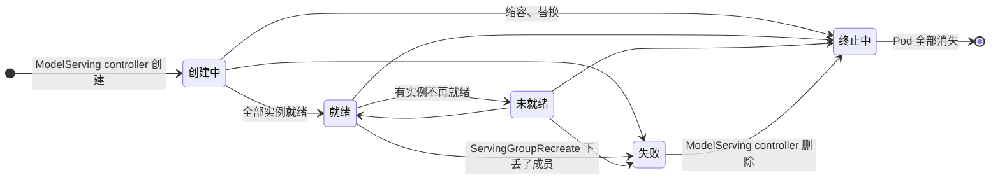

# v4：ServingGroup 作为 CR

## 0. 文档信息

| 项 | 内容 |
| --- | --- |
| 用途 | 评估「把 ServingGroup 从逻辑概念变成 CR、去掉组序号」能把状态机简化到什么程度，给出这种做法下的设计、三种粒度的比较，以及对外的变化和迁移要点 |
| 基线 | v2：[04](../modelserving-rollout-final/04-state-machine.md)、[07](../modelserving-rollout-final/07-core-state-machine.md)。对照物是 [v3](03-v3-state-machine.md) |
| 状态 | 设计提案，比 v3 粗。恢复和账本的规则用模型穷举过；组一级的滚动、按数量的 partition、两个 controller 之间的滞后都只是推演。迁移只列要点 |
| 记号 | 括号里的 G2、G3、G4、G7 是草稿里 v4 规则的编号，V 开头是提案分析对草稿的发现编号；两者都在任务目录的 `subagents/proposal-analysis-v4.md` 里，这里只为了能回查。本文的待决项用 K 编号 |

## 1. 先给结论

**对状态机能简化，对系统不能。**

- **恢复**明确变简单。v2 靠一个注解加七条规则，v3 靠每个 Pod 的 finalizer，v4 是一个对象上的一次写。v4 不需要 Pod finalizer。
- **组一级的滚动**有简化：没有 surge 标记、转正、回收和序号空洞，每次滚动少建 S 个组。代价是 partition 改成按数量，这是一处对外的语义变化。
- **Role 一级和原地更新**没有受益。它们原样搬进新的 controller。
- **整个系统变大了**：多一个 CRD、一个 controller、一套两个 controller 之间的约定和一次迁移。

和 v3 比：两者都得到确定的状态机。v3 不动 API，代价在运行时（计划内删除多一次 PATCH，controller 不在时受保护的 Pod 卡住）。v4 动 API，代价在一次性的迁移和长期多维护一个 CRD。v4 的保证比 v3 弱一处：实例建成之前的丢失只补一个（[7.3](#73-和-v3-的保证相比)）。

## 2. 对象和归属

### 2.1 对象

```yaml
apiVersion: workload.serving.volcano.sh/v1alpha1
kind: ServingGroup
metadata:
  name: llama-7k2qd                  # <ModelServing 名>-<后缀>，没有序号
  labels:
    modelserving.volcano.sh/name: llama
  ownerReferences:                   # ModelServing，controller=true，blockOwnerDeletion=true
spec:
  targetRevision: llama-6b7f9        # ControllerRevision 的名字
  baselineRevision: llama-5c4d8      # 只在 RoleRollingUpdate 下可能与 target 不同
  recoveryPolicy: RoleRecreate
  roles:                             # 每种 Role 的 replicas 和 Role 层的滚动参数
  - name: prefill
    replicas: 2
status:
  observedGeneration: 3
  revision: llama-6b7f9              # 这个组已应用的版本
  conditions:                        # Ready、Failed
  terminatingPods: 0
  roleInstances:                     # 账本，见第 5 节
  - role: prefill
    index: 0
    phase: Established
    generation: 4
```

字段是示意，不是 API 评审稿。链条是 ModelServing → ServingGroup → Pod、PodGroup、headless Service。ControllerRevision 仍然归 ModelServing。

Go 里已经有一个同名的模板类型 `ServingGroup`（走读，`pkg/apis/workload/v1alpha1/servinggroup_types.go:116`），它要改名。JSON 不变，Go 的引用方是破坏性变化。

### 2.2 名字

- 组名是 `<ModelServing 名>-<后缀>`。后缀由 controller 在客户端生成，不用 `metadata.generateName`：请求超时之后要能按名字查。后缀的字符集要排除纯数字，否则和存量的序号名字分不开。
- Pod 名的前缀跟着组名变：`<组名>-<role>-<实例序号>-<worker 序号>`。Role 实例的序号和 `WORKER_INDEX` 保留。
- 标签 `modelserving.volcano.sh/group-name` 的值是组名。eviction webhook、autoscaler、router 只把它当不透明的标识用（提案分析 3.3，走读），不受影响。

### 2.3 谁写什么

| 对象上的东西 | 唯一的写者 | 说明 |
| --- | --- | --- |
| ServingGroup 的创建和 DELETE | ModelServing controller | ServingGroup controller 不删自己，只写「失败」 |
| `spec` | ModelServing controller | 用不带 resourceVersion 的 PATCH，字段只有它写 |
| `status` | ServingGroup controller | 带 resourceVersion。ModelServing controller 连 condition 也不往里写 |
| labels | ModelServing controller，只在创建时 | 创建之后不变。会变的事实（版本、就绪）只放 `status` |
| Pod、PodGroup、Service | ServingGroup controller | — |
| `ModelServing.status` | ModelServing controller | 不变 |

用户直接改组的 `spec`，等于改 Deployment 名下的 ReplicaSet：ModelServing controller 每轮写回去。

## 3. 两个 controller

| | ModelServing controller | ServingGroup controller |
| --- | --- | --- |
| 队列的 key | ModelServing | ServingGroup |
| 看什么 | ModelServing 的 `spec`；它名下的 ServingGroup 对象 | 一个 ServingGroup 的 `spec`；它名下的 Pod |
| 做什么 | 组一级的扩缩容和 `ServingGroupRollingUpdate`；删除失败的组并按数量补；把 `spec` 下发到每个组；汇总 `status`；推进基线 | Role 一级的扩缩容、`RoleRollingUpdate`、协调、恢复、原地更新；写这个组的 `status` |
| 不做什么 | 不读写 Pod（deletion cost 除外，见 [6.4](#64-缩容和替换的次序)） | 不创建、不删除 ServingGroup |

两条规则保证它们之间的约定成立（G2）：

- **`observedGeneration`。**`status.observedGeneration` 小于 `metadata.generation` 的组，ModelServing controller 一律按「版本未知、未就绪」计。否则 `RoleRollingUpdate` 下新模板刚写进 `spec`，`status` 还是上一个模板的「全部就绪」，滚动会被提前判定完成（V3）。
- **基线分两段推进。**`RoleRollingUpdate` 下被 Role 的 partition 保护的实例要按基线版本创建，所以组的 `spec` 里有目标和基线两个版本。各组在 `status` 里报告，ModelServing controller 判断，再把新的基线写回每个 `spec`。

v2 里两层共用一份工作副本，靠规则衔接：「本轮新建的组从下一轮起才进 Role 层」「没在删除、恢复没有开始的组才走 Role 层」「让路」。v4 里它们变成对象的边界：组带 `deletionTimestamp` 或者已经失败，它里面的一切就停。

## 4. 组的状态机

组的一生像一个 Pod。



自上而下判定。

| 状态 | 条件 | 计入 |
| --- | --- | --- |
| 终止中 | `deletionTimestamp` 非空 | `active` |
| 失败 | `status` 里 Failed 为真 | `active` |
| 版本未知 | `observedGeneration` 落后 | `active`、`live` |
| 就绪 | Ready 为真 | `active`、`live`、`ready` |
| 未就绪、创建中 | 其余 | `active`、`live`；版本是目标版本时计入 `notReadyTarget` |

**失败是不可逆的（G3）。**要三条规则才成立：

1. 失败的含义是「请求删除」。ModelServing controller 看到它就删，不重新判断，策略中途改了也删。
2. 分类时失败排在 Pod 的观察前面。滞后的缓存不会让一个失败的组又被判成未就绪。
3. 组失败之后，ServingGroup controller 停掉一切创建，只删除故障的成员（两步删除的第一步）。

失败只在 `ServingGroupRecreate` 下可达。而 `ServingGroupRecreate` 配 `RoleRollingUpdate` 已经被 webhook 拒绝（走读，`webhook/validator.go:486`），所以失败不会和 Role 层的滚动交叉。这是一处不用花代价的隔离。

## 5. 账本：Role 实例一级

`RoleRecreate` 的范围是 Role 实例，它没有自己的对象。它的状态记在组的 `status.roleInstances` 里，每个实例一项（G4）。

| 值 | 含义 |
| --- | --- |
| 没有这一项，或 Creating | 创建中。**这是零值** |
| Established | 已建成：全部成员都在缓存里看到过 |
| Draining | 清空中：这个实例的 Pod 要全部删掉。清空之后建不建，由当时的 `spec` 决定 |

判定表。「丢失」指成员缺失、在终止、终态，或者重启故障到期。

| 账本的值 | 成员齐全 | 有成员缺失或在终止 | 有成员是终态或到期的重启故障 |
| --- | --- | --- | --- |
| Creating | 写 Established | 缺的创建；在终止的等它消失再创建 | `None`：删这一个。`RoleRecreate`：写 Draining。`ServingGroupRecreate`：写组的失败 |
| Established | 不动 | **丢失**。`None`：补这一个。`RoleRecreate`：写 Draining。`ServingGroupRecreate`：写组的失败 | 同左，`None` 下终态的删这一个 |
| Draining | 删除 | 删除剩下的。全空之后：还要这个实例就写 Creating，代际加一；不要就去掉这一项 | 同左 |

规则：

- **每一种由 ServingGroup controller 发起的实例删除，前面都有一次 status 写。**Role 缩容、按重建执行的 Role 滚动替换、实例恢复、协调模式回收多出来的实例，都先写 Draining。Draining 不区分原因（V11）。一次 status 写可以盖住这一轮要清空的全部实例。
- **零值是不会引起删除的状态。**`status` 被清空、被旧版本改写之后，后果都落在不删除的一侧：已建成被清掉，之后的丢失只补（V10）。这时要有一个 condition 说明账本是重建出来的。
- **Established 只在缓存里看到全部成员之后才写**，不是在创建请求都返回成功之后。
- **把缺失当作丢失之前，按名字直读一次。**Pod 的缓存和组的缓存是两条独立的 LIST，重启之后新旧没有保证；缓存比账本旧时，一个存在的 Pod 会被看成缺失（V8）。直读只发生在破坏性的那条边上。终止中的 Pod 是对象，不需要这一步。
- **代际。**账本的每一项带一个代际号，Pod 创建时带上同一个号。Draining 只删代际号不大于它的 Pod。这样重启之后读到一个旧的 Draining，碰不到新一批的 Pod（V9）。
- **只有一个 Pod 的实例不写账本。**丢了就是补这一个，与 v3 收窄的理由相同。
- **两步删除。**Draining 下先删故障的成员；实例里没有故障的成员、也没有正在终止的 Pod 之后，再删其余的。v4 的 Pod 没有 finalizer，D15 的条件原样适用。

## 6. 组一级的规则

N、U、S、P 的含义，`active ≤ N + S`，两个额度的算式，缩容门控，基线推进的条件（R17）不变。变的是下面几处。这一节是规则的轮廓，没有像 005 那样的参考模型。

### 6.1 没有了的边

| v2 | v4 |
| --- | --- |
| A2 转正，A6 回收 surge | 没有。多出来的组和别的组没有区别，数量超过上限时走缩容 |
| A4 补正式单元，A7 建 surge | 合成一条按数量的创建 |
| 被替换的单元消失之后在原序号上补回，surge 最后回收 | 没有补回。建一个新的，删一个旧的，做完时数量正好是 N |
| surge 标记，清标记失败时的锁定，待决项 O11 | 没有 |
| 序号空洞，不变量 I8 | 没有 |

v2 的例子里替换 3 个组一共建了 4 个，最后删掉那个 surge；v4 建 3 个。对要拉模型的负载，每次滚动少启动 S 个组。

### 6.2 创建

目标版本的组还不够，并且 `active` 小于 N + S 时创建。新组用哪个版本见 6.3。

创建不再幂等（G7）。v1 到 v3 里重复创建会撞上同名的 Pod；v4 里组名是随机的，没有这道挡板。会多建的情形：缓存滞后；重启之后第一次 LIST 是旧的；创建请求超时；两个进程同时在写。

| 手段 | 挡住什么 |
| --- | --- |
| 名字由 controller 生成；先登记在途的创建再发请求；结果不明时按名字直读 | 缓存滞后，请求超时 |
| 在途的创建带期限（v2 是 30 秒），到期直读 | 创建成功、被缓存看到之前就被人删了 |
| 数量超过上限时按固定次序缩回 | 重启和两个进程。事后修 |

所以不变量 I1 从「每一步成立」变成「最终成立」。多出来的组是最新的、未就绪的，缩回时先被删，不会误删健康的旧组；但它带着自己的 PodGroup 进调度队列，资源紧张时可能挤掉别的作业（推断）。

可选的加强：创建之前先把要用的名字写进 `ModelServing.status`，再按名字创建。创建重新幂等，两个进程也被这次条件写分出先后。代价是每批创建多一次 status 写。按 C9 可以不做。

### 6.3 按数量的 partition

今天 partition 按绝对序号：保护 `[0, P)`。没有序号之后改成按数量，有四处要定（V12）。

1. **保护的是基线版本，不是「不是目标的版本」。**最多保留 P 个版本等于 `status.currentRevision` 的组。既不是基线也不是目标的组总是可以替换。否则 N=4、P=3、3 个 v1 加 1 个 v2，用户把模板改回 v1 时，那个 v2 会被保护，回滚不生效。
2. **新建的组用哪个版本。**基线版本的组少于 P、并且基线不等于目标时用基线，否则用目标。
3. **保留哪几个。**保留最老的（创建时间，再按名字），对应今天的低序号。替换时新的先。
4. **缩容。**P 大于 0 时，基线版本的组排在后面删。今天缩容不看 partition，但次序的最后一项是序号高的先，被保护的低序号实际上最后才删；按创建时间排没有这个性质。

| 场景 | 按序号（v1 到 v3） | 按数量 |
| --- | --- | --- |
| N=4、P=2，2 旧 2 新；N 调到 6 | 2 旧 4 新 | 2 旧 4 新 |
| 同上，P 是 50% | P 变成 3。新序号都是新版本：2 旧 4 新 | P 变成 3。基线组少于 3，新建的里一个用基线：**3 旧 3 新** |
| N=4、P=1；一个新版本的组故障后重建 | 看它的序号 | 看当时基线组的个数，不看是哪一个组 |
| P 从 1 调到 2（1 旧 3 新） | 不回退。只有序号 1 自己重建时才用基线 | 不回退。之后不论哪个组重建、或者扩容，都补成基线，直到基线组有 2 个 |
| 想让某几个指定的组留在旧版本 | 可以，按序号 | 不可以。只能指定数量，保留的是最老的 |

第二行和最后三行是行为变化：不只是 P 写成百分比的时候，P 是绝对值而基线版本的组少于 P 时，扩容和重建出来的同样是旧版本。API 注释和用户文档里「按序号保护」的说法都要改。灰度的用户要能查到哪几个组是基线版本，ServingGroup 要有一列显示版本。另外，Role 一级的 partition 仍然按序号，同一个 API 里有两种 partition 语义。

社区的先例（调研报告 4.3、4.4）：OpenKruise CloneSet 的 partition 就是「保留在旧版本的 Pod 的数量」，扩容时旧版本不足 partition 的部分按旧版本创建，与上面第 2 条相同。LeaderWorkerSet 的 `groupIdentity: Hash`（[KEP-898](https://github.com/kubernetes-sigs/lws/tree/main/keps/898-group-identity)，v1.0.0）去掉了组序号，它的做法是直接拒绝 `partition`。

### 6.4 缩容和替换的次序

两种选择的次序不同，分开写。

- **缩容**（数量多于上限时删谁）：失败的先；未就绪的先；既不是基线也不是目标版本的先；deletion cost 低的先；P 大于 0 时基线版本的后；创建时间新的先；最后按名字。P 大于 0 时目标版本的组因此先于被保护的基线组被删，与今天「低序号最后删」的结果一致。
- **替换**（滚动时删谁）：候选是版本不等于目标、并且不在被保护的 P 个基线组之内的组。未就绪的先；创建时间新的先；最后按名字。

deletion cost 今天是组内各 Pod 注解之和（走读，`controller/binpack_scaledown.go:109-117`、`141-150`、`176-187`）。v4 里做选择的是 ModelServing controller，两条路选一条：ServingGroup controller 汇总进 `status`；或者 ModelServing controller 只读共享 informer 里的 Pod。待定。

## 7. 恢复

### 7.1 整组恢复变成替换

`ServingGroupRecreate` 下，丢失发生在已建成的实例里，或者有终态、到期的重启故障的成员：ServingGroup controller 把组的 Failed 写成真。这一次写就是提交点。

之后（G3）：

1. ServingGroup controller 只删除故障的成员，并在 `status` 里报告还有几个故障的成员、几个正在终止的 Pod。写「失败」的那一次 status 写里就带着这两个数。
2. ModelServing controller 看到失败的组，等这两个数都是 0，然后用前台级联删除它。
3. 组对象在 Pod 都消失之前一直在（前台级联），一直计入 `active`。
4. 组消失之后，ModelServing controller 按数量补一个新的，名字是新的。

第 2 步的等待保留了 D15：故障的成员停下并且消失之前，其余成员继续运行。只等「正在终止的 Pod 为 0」是不够的：重启故障到期触发时，写上失败的那一刻故障成员还没有被删，正在终止的本来就是 0。

**删除的机制有三种，选了前台级联。**

| | 后台级联（CR 的默认） | 前台级联（选） | 组带自己的 finalizer |
| --- | --- | --- | --- |
| 终止中的组还是不是对象 | 不是。对象立刻消失，Pod 还在终止 | 是，直到带 `blockOwnerDeletion` 的子对象消失 | 是，直到 controller 摘掉 |
| 「终止中的组计入 `active`」 | 不成立，新旧两组的 Pod 并存 | 成立 | 成立 |
| kthena 不在或已卸载 | 不受影响 | 不受影响，靠 kube-controller-manager | 组卡在终止中，namespace 和 CRD 删不掉 |
| 有人手工 `kubectl delete servinggroup` | 同上 | 绕过，回到第一列，新旧短暂并存 | 不受影响 |
| 要改的现状 | — | PodGroup 的 ownerReference 今天没有 `blockOwnerDeletion`（走读，`podgroupmanager/manager.go:340-350`），要补上 | 多一个 finalizer |

三种删除方式下垃圾回收的行为是按 Kubernetes 的文档写的，没有在集群上验证。

**可选的能力：失败的组消失之前先建替换的。**v2 里做不到，名字相同。v4 里名字不冲突，这第一次成了可以选的东西：恢复不被卡在终止中的 Pod 挡住，新组可以立刻开始拉模型。代价是瞬时容量超过 N + S，恢复会占掉滚动的 surge 名额。默认不做，与 v2 相同。LeaderWorkerSet 的 Hash 模式在同一个问题上选了「旧组的 Pod 对象都消失之后才放行新组」作为默认（调研报告 4.4.9）。这是 v4 相对 v3 唯一的可用性上的增益，留给维护者决定。

### 7.2 实例恢复

`RoleRecreate` 下按第 5 节的表：写 Draining，两步删除，清空之后写 Creating，创建，建齐后写 Established。固定 3 次 status 写，与实例里有几个 Pod 无关。

### 7.3 和 v3 的保证相比

| 情形 | v3 | v4 |
| --- | --- | --- |
| 实例建成之后丢了成员 | 整范围重建 | 整范围重建 |
| 实例还在创建时成员被删 | 整范围重建（被删的 Pod 带着 finalizer） | **只补这一个**（账本还是 Creating） |
| controller 不在时丢了成员 | 整范围重建；被删的 Pod 一直卡到 controller 回来 | 整范围重建（账本里是 Established，对象没有）；Pod 正常消失 |
| `status` 被清空，或 finalizer 被人摘掉 | 只补 | 只补 |
| 证据怕不怕缓存旧 | 不怕，证据是对象 | 把缺失当证据之前要直读一次 |

第二行是 v4 的一处显式合并：建成之前「没建完」和「建了又丢了」是同一个反应。

## 8. 序号

组一级的序号今天用在 11 类地方（提案分析 3.1）。真正需要整数的只有两处：partition（6.3 改成按数量）和 LWS。其余都是标识或者次序，换成名字和创建时间即可。

**LWS 兼容路径不能用随机名字。**plugin 用组序号拼出 Pod 的 hostname `<lws>-<序号>`、subdomain 下的 DNS 名和 `leaderworkerset.sigs.k8s.io/group-index` 标签（走读，`plugins/lws_labels_plugin.go:61-95`）。它要一个稳定、唯一、从 0 起的整数。今天两个活着的组不可能同序号，是名字的唯一性在保证；改成随机名字再加一个 index 字段，这个保证就没有了，两个组拿到同一个 index 就是两个 Pod 同一个 DNS 名。两条路：LWS 拥有的 ModelServing 的组保留 `<ms>-<序号>` 的名字；或者 v4 不覆盖 LWS 路径。待定。

Role 实例的序号保留，理由见下一节。

## 9. 粒度

| | (a) 只有 ServingGroup 是 CR | (b) Role 实例也去掉序号，不做 CR | (c) Role 实例也是 CR |
| --- | --- | --- | --- |
| 状态 | 组 6 个状态；账本每项 3 个值加代际号 | 组 6 个；账本 3 个值，不要代际号（ID 不重用） | 组和实例各 6 个，两层是同一台状态机；没有账本 |
| 重建一个实例的写 | 3 次 status | 3 次 status | 实例 status 1 次，删 1 个对象，建 1 个对象，再加两层的 status |
| 对象数 | 多 N 个 | 多 N 个 | 多 N + N·R 个。没有 worker 的实例里对象和 Pod 一样多 |
| 并发上要小心的 | 账本的条件写；代际；缺失的确认 | 账本的条件写；缺失的确认 | 每层只有对象上的条件写；状态汇总多一跳 |
| 对外的变化 | 组名；组一级的 partition | (a) 的全部，加上 Role ID、Role 一级的 partition、HPA 的 selector、Volcano 的 task 名、协调的候选算法 | (a) 或 (b) 的命名，再加一个 CRD |

**推荐 (a)。**

1. 用户说的是组的序号没有意义。Role 实例的序号今天有实在的外部用途：HPA 的 selector 靠「0 号实例」保证每组恰好一个 Pod（走读，`msc.go:2896-2912`）；Volcano 的 task 名（`podgroupmanager/manager.go:412-414`）；Role 一级的 partition 和协调的算法都按序号写成。(b) 要把这些一起改掉。
2. (c) 在范围只有一个 Pod 的形态下不划算。没有 worker 的实例只有一个 Pod，丢了就是补这一个，既不需要账本也不需要对象。
3. (a) 的账本代价是有界的：三个值加一个计数器。
4. (a) 不堵死 (c)：账本的每一项和将来的实例对象一一对应。先 (a) 后 (b) 则要改第二次命名，想要 (b) 应当现在就定。

「像 ReplicaSet 那样」还有一种读法没有列为候选：每个 revision 一个对象，名下是这个版本的全部组，像 Deployment 名下的 ReplicaSet。它管的是版本和数量，组仍然没有自己的对象，范围一级的事实还是没有地方放，01 的 N1 到 N4 一条都不解决。

什么会改变这个推荐：实例一级的代际和单个热对象的账本成了缺陷的主要来源，或者实例普遍很大并且主要用 `RoleRecreate`，改向 (c)；能证明 Role 序号的三个外部用途都可以换掉，并且「副本等价」也指 Role 实例，改向 (b)。

`RoleRollingUpdate` 推荐只用一个组（走读，`pkg/apis/workload/v1alpha1/model_serving_types.go:154-155` 的注释）。这时所有实例都在一个 ServingGroup 的账本里，它是唯一的热对象，一轮里多个实例的变化要合成一次写；并行度和今天一样，没有提高。

## 10. 并发和锁

两个队列，各自一个 key 同时只有一个 worker。回调只入队；回调要做的映射（Pod 到它的组，组到它的 ModelServing）是事件对象上的纯函数。两个 controller 的内存按各自的 key 分开，互相不读对方的，只通过对象交换信息。

**没有按资源的锁。**唯一共享的是「按 key 找到这份内存」的那张表，持有时间是一次查表，不跨任何 API 调用。

在途的写在 v4 里可以更简单：ServingGroup controller 的 key 是一个组，整个 key 的屏障只冻住这一个组，可以接受。v3 里不行，见 [02](02-dfa-criteria-and-tradeoffs.md) 的 4.7。

| 两个进程同时在写 | v3 | v4 |
| --- | --- | --- |
| 建 Pod | 名字确定，幂等 | 同左 |
| 建组 | 没有这个动作 | 不幂等，会多建，事后缩回 |
| 实例或范围的恢复 | 两边对同一批 Pod 发 DELETE，幂等 | 两边都要先过账本的条件写，只有一边成功；另一边重读之后接着删同一批。比 v3 干净 |
| 缩容、替换的删除 | 两边可能各选一个，一个额度删两个 | 同左 |

没有解决的：

- **预算是对多个对象求和，不能写成一个对象上的条件。**删一个组可以带 UID 和 resourceVersion，被删的这一个组在观察之后有任何变化都会让删除失败；别的组变了挡不住。
- **健康额度按晚一跳的 `status` 算。**Pod 变化，组的 `status` 才变，ModelServing controller 才看到。v2 的执行前复核管的是同一种滞后，v4 里更大。
- **并行度的上限不在锁上。**worker 默认 5 个，客户端默认每秒 5 个请求，同一个进程里的 controller 共用（走读，`cmd/kthena-controller-manager/main.go:88-92`）。v4 让不同的组并行，但每个生命周期步骤的写也变多了。批量操作的总耗时由限流决定，v4 不一定更快。没有测量。
- **部署前提。**默认配置下每次升级都有两个进程并存。v4 应当把「打开选主，或者 controller 的 Deployment 用 `Recreate`」写成前提，否则每次升级都可能多建组。

## 11. 简化了什么，增加了什么

| 没有了的 | 范围 |
| --- | --- |
| 跨多个 Pod 的恢复承诺：v2 的标记和 M1 到 M7，v3 的 Pod finalizer | 全部 |
| O9 的窗口 | Established 写成之后 |
| controller 不在时 Pod 卡在终止中（v3 的代价） | 全部 |
| surge 标记、转正、回收、序号空洞 | 组一级。Role 一级还在 |
| 每次滚动多建又多删的 S 个组 | 组一级 |
| 同序号上新旧两批 Pod 的隔离 | 组一级。Role 实例一级换成代际号 |
| 两层共用一份工作副本的衔接规则 | 变成对象的边界 |
| 「没有 Pod 的组」这个特例 | 组是对象，没有 Pod 也看得见 |
| 整个 ModelServing 串在一个 key 上 | 不同的组并行 |

| 新增的 | 代价 |
| --- | --- |
| 一个 CRD | API 面、RBAC、生成的 client、文档、chart 的安装和升级、模板类型改名 |
| 第二个 controller 和两者之间的约定 | `spec` 的下发、`observedGeneration`、状态的汇总、失败到删除的两步、基线的两段推进 |
| `status` 当输入 | 零值规则、代际、条件写、写放大 |
| 两种缓存之间的新旧 | 缺失的确认；重启之后的第一轮 |
| 创建不幂等 | 在途创建的登记、事后缩回、I1 变弱 |
| 按数量的 partition | 一处行为变化；和 Role 一级的按序号并存 |
| LWS 的例外 | 两种命名并存，或者 LWS 不走 v4 |
| 环境的输入变多 | 用户可以改组的 `spec`、删组、改组的 `status`，每一种都要有确定的反应 |
| 稳态下的写 | 每次就绪变化从 1 次 status 写变成 2 次；对象多 N 个 |

**`status` 当账本和 API 约定。**约定要求 `status` 能从观察重建，账本不能，这正是它的用处。先例：这个 CRD 自己的 `status.currentRevision` 已经是下一轮的输入；Job 的 `status.uncountedTerminatedPods`（KEP-2307）是为跨对象没有原子写而设的中间状态；RoleBasedGroup 的 `RoleInstance.status.lastReadyGeneration` 正是一个建成记录，它为了读到最新的 `status` 每轮直读 apiserver（调研报告 1.6）。KEP-2307 把「`status` 端点要用 RBAC 保护」列为风险，这里同样适用。

## 12. 对外的变化和迁移要点

只列条目，不是迁移设计。

| 项 | 内容 |
| --- | --- |
| 命名 | 组名和 Pod 名的前缀从序号变成随机后缀，并且每次滚动替换、每次整组恢复都换一个新名字。今天整组恢复之后名字不变。依赖 `<ms>-0-...` 这种稳定名字的脚本、告警、固定的 DNS 名都受影响 |
| 标签 | `modelserving.volcano.sh/group-name` 的值跟着变。平台自己的组件不解析它；用户的应用如果解析它，受影响 |
| 新对象 | 用户看得到 ServingGroup，可以对它 `kubectl get`、`describe`。要有显示版本和就绪的列；要给只读角色加权限；chart 的 RBAC 要加这个资源 |
| `status` | ModelServing 的 `status` 从各组的 `status` 汇总，晚一跳。condition 的消息里今天列的是序号，要改成名字或数量 |
| partition | 组一级改成按数量（6.3） |
| 缩容删哪一个 | 次序的最后一项从序号变成创建时间和名字；「既不是基线也不是目标版本的先」排在 deletion cost 前面，也是新的（6.4） |
| HPA、autoscaler | 粒度 (a) 下 HPA 的 selector 不变；多建出来还没缩回的组也会被它选中。autoscaler 仍然改 ModelServing 的副本数，`roles[].replicas` 的变化要多经过一个 controller 才到 Pod |
| 按 owner 认对象的地方 | 23 处调用按「owner 是 ModelServing」认 Pod、Service、PodGroup（提案分析 V14）。不改的后果：informer 丢掉新 Pod 的事件；eviction webhook 对新 Pod 的保护无声失效；Service 和 PodGroup 被当成外来的 |
| 混跑窗口 | webhook 在每个副本上都在跑（推断）。滚动升级 controller 时新旧副本并存，上面的 owner 检查要在同一个版本里一起改 |
| CRD 的安装 | CRD 在 chart 的 `crds/` 目录。Helm 对它只在安装时处理，升级时不处理（按 Helm 的文档，没有验证）。新 controller 先于新 CRD 起来时，informer 同步不了 |
| 名字长度 | webhook 按副本数的位数估计最长的名字（走读，`validator.go:162-179`）。随机后缀更长；这个检查在每次 UPDATE 都跑，存量的长名字对象会被挡住无关的更新，要改成只拦新引入的 |
| 存量对象 | 就地接管：给每个序号建一个确定性名字的组，再改每个 Pod 的 ownerReference，之后两种命名并存。或者滚动重建，等于一次全量更新 |
| 回退 | 旧版本不认识 ServingGroup。它看不到 owner 是 ServingGroup 的 Pod，会按序号再建一整套 |
| 契约、测试和文档 | runner 契约里按序号写的条款和用例；e2e 里 19 处按序号断言；用户指南里的命名规则 |

## 13. 模型证据

模型在任务目录的 `model/` 下（`sgmodel.py`、`run_v4.py`、`v4-results.txt`）。两个 controller 各自计划、各自执行，任意交错，任意两次写之间可以崩溃。

| 场景 | 内容 | 结果 |
| --- | --- | --- |
| T1 | 策略固定，至多两次丢失。性质按「建成之后的丢失」要求整范围重建 | 无违反 |
| T2 | 同上，性质按「任何丢失」要求 | P2：12 个终局（Role）、31 个（Group），全部在建成之前。就是 7.3 的那一行 |
| T3 到 T6 | 策略变更；Role 副本数变化；组副本数变化；组被人直接删除 | 无违反（见下面的范围） |
| T7 | `status` 被清空 | P2：4 个终局。退化成只补 |
| T8 | 一步删完（不保留 D15） | 只有 P8，就是 D15 本身 |
| 崩溃等价 | T1 的场景 | 相同 |

去掉一条规则之后：

| 去掉的 | 违反 |
| --- | --- |
| 账本（部分存在的实例一律当作丢了成员） | P4：没有丢失而整范围删除 |
| 「先写 Draining 再删」（计划内删除先删 Pod） | P4 |

这些性质的范围：

- P2 在 `spec` 变过之后不检查。所以 T3 到 T5 的「无违反」只说明收敛、不多建组、守住 D15。
- P4 只在整段历史里没有任何扰动时才报。T7 的「不多删」不是原模型证明的；独立评审补了一条更严的检查（写 Draining 或失败时，这个实例或这个组里确实发生过扰动），T1、T3、T4、T5、T7 都通过。
- P8 是 D15，在计划时检查，组一级和实例一级各一条。
- 崩溃等价的终局不区分「幸存」和「换过」。独立评审按严格的契约补跑过，相同。
- T6 按前台级联建模，没有覆盖有人用后台方式直接删组的路径。

模型没有覆盖的：缓存新旧不一（V8、V9），所以直读和代际这两条规则没有模型证据；创建不幂等（6.2）；按数量的 partition 和组一级的滚动（第 6 节）；`observedGeneration`；两个 controller 之间的滞后对预算的影响。模型里 ModelServing controller 直接看 Pod，设计里它看的是组的 `status`。

## 14. 没有验证的内容和待决项

没有验证的：第 13 节末尾列的全部；三种级联方式下垃圾回收的行为；Helm 对 `crds/` 的处理；多出来的 PodGroup 在 Volcano 里会不会抢占别的作业；写量和对象数对 apiserver 的影响。

待决的：

| # | 问题 | 本文的做法 |
| --- | --- | --- |
| K1 | 组怎样被删：前台级联，还是组自己的 finalizer。连带 D15 在 `ServingGroupRecreate` 下怎样保留 | 前台级联。ModelServing controller 等故障的成员和正在终止的 Pod 都为 0 再删，保留 D15 |
| K2 | 组一级的 partition 改成按数量：不能再指定哪几个组，扩容和重建的结果会变，并且和 Role 一级的按序号并存 | 改 |
| K3 | LWS 的路径 | 待定 |
| K4 | 多建一个组算不算可以接受的浪费；是否以打开选主为部署前提 | 接受，事后缩回；写成前提 |
| K5 | 粒度 | (a) |
| K6 | 失败的组消失之前能不能先建替换的 | 默认不能 |
| K7 | deletion cost 从哪里读 | 待定 |
| K8 | 做 v4，还是停在 v3 | 见 [README](README.md) |
